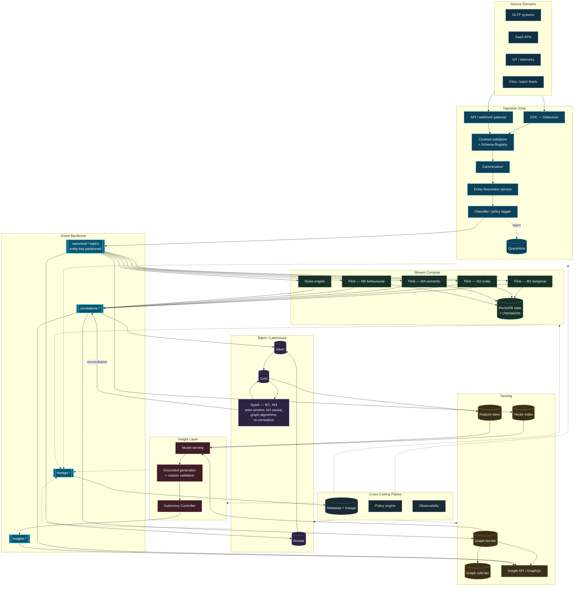

# Appendix B — Reference Implementation Blueprint

---


**Illustrative, not prescriptive.** This blueprint shows one plausible technology composition. Named products are examples of a *category*; substitutions with equivalent capability are expected. No product mentioned has been tested in this configuration, and no vendor has reviewed or endorsed this material.


## B.1 Component Selection by Layer

| Layer | Required capability | Open-source option | Managed option | Selection criterion |
| --- | --- | --- | --- | --- |
| **Event log** | Durable, partitioned, replayable, tiered retention | Apache Kafka, Apache Pulsar, Redpanda | Confluent Cloud, AWS MSK, Azure Event Hubs | Tiered storage support; partition count ceiling |
| **Stream compute** | Stateful, event-time, exactly-once, large state | Apache Flink | Confluent Flink, AWS Managed Flink, Databricks | Managed state size; savepoint operations |
| **CDC capture** | Log-based change capture | Debezium | Fivetran, Airbyte, Striim | Source coverage; schema-change handling |
| **Schema registry** | Versioned schemas, compatibility enforcement | Confluent Schema Registry, Apicurio | Vendor-managed | Compatibility policy granularity |
| **Entity resolution** | Deterministic + probabilistic + graph | Zingg, Splink | Senzing, Quantexa, Tamr | Streaming-capable inference; explainability |
| **Table format** | ACID, time travel, schema evolution | Apache Iceberg, Delta Lake, Apache Hudi | Databricks, Snowflake, BigQuery | Engine interoperability; partition evolution |
| **Batch compute** | Distributed, cost-elastic | Apache Spark, Trino | Databricks, EMR, Snowpark | Graph algorithm library availability |
| **Graph — hot tier** | Low-latency traversal, high write rate | Neo4j, Memgraph, JanusGraph | Neo4j Aura, Amazon Neptune, TigerGraph Cloud | Sustained write throughput under traversal load |
| **Graph — cold tier** | Bulk analytics over history | GraphFrames, NetworkX at scale | Neptune Analytics | Cost per algorithm run |
| **Vector index** | ANN over embeddings, metadata filtering | Qdrant, Weaviate, Milvus, pgvector | Pinecone, Vertex Matching Engine | Pre-filter support for policy enforcement |
| **Feature store** | Online/offline parity | Feast | Tecton, Databricks Feature Store | Point-in-time correctness |
| **Rules engine** | Deterministic, versioned, auditable | Drools, GoRules, Flink CEP | Vendor BRMS | Simulation and impact analysis tooling |
| **Policy engine** | Attribute-based, externalized | Open Policy Agent, Cedar | Styra DAS | Decision latency at correlation rate |
| **Metadata & lineage** | Column-level, extensible to inference | OpenMetadata, DataHub, Marquez | Collibra, Alation, Atlan, Purview | Custom entity types for correlations |
| **Model serving** | Low-latency inference, versioning | KServe, BentoML, Ray Serve | SageMaker, Vertex AI | Shadow deployment support |
| **LLM layer** | Grounded generation, structured output | Self-hosted open-weight models | Azure OpenAI, Bedrock, Vertex | Data residency; citation-forcing capability |
| **Observability** | Traces, metrics, logs across streaming | OpenTelemetry + Prometheus + Grafana | Datadog, New Relic | Streaming state and lag visibility |
| **Orchestration** | DAG scheduling, backfill | Apache Airflow, Dagster | Astronomer, Databricks Workflows | Retrospective re-correlation ergonomics |

**Table 88.** *Component selection by layer. **The three hardest selections are entity resolution, hot-tier graph, and inference-capable metadata**, because these are the layers where the framework's requirements exceed what mainstream products currently target.*

## B.2 Deployment Topology

**Figure 60.** *Reference deployment topology. Note that **M3 causal correlation runs only in the batch layer** — it requires wide windows and population-level statistics that streaming cannot supply — and that the reconciliation path from batch back to the correlation topic is explicit rather than implicit.*

## B.3 Indicative Sizing


**Order-of-magnitude only.** Derived from published component benchmarks, not from a deployed system. Treat as a starting point for capacity planning, not as a prediction.


| Profile | Events/day | Entities | Active scopes | Log partitions | Stream task slots | Stream state | Graph edges (hot) | Indicative monthly infra |
| --- | --- | --- | --- | --- | --- | --- | --- | --- |
| **Pilot** | 10 M | 500 K | 1–2 | 24 | 16 | 200 GB | 20 M | Low five figures (USD) |
| **Departmental** | 100 M | 5 M | 3–5 | 96 | 64 | 2 TB | 200 M | Mid five figures |
| **Enterprise** | 1 B | 50 M | 8–15 | 384 | 256 | 15 TB | 1.5 B | Low-to-mid six figures |
| **Large enterprise** | 10 B | 200 M | 15–25 | 1,536 | 1,024 | 100 TB | 8 B | High six figures |

**Table 89.** *Indicative sizing profiles. Cost is dominated by streaming state and graph write capacity, not by storage. Scope count grows far more slowly than event volume — deliberately, because scope count is the super-linear cost driver.*

## B.4 Build Sequence

| Sprint band | Deliverable | Dependency |
| --- | --- | --- |
| 1–3 | Event backbone, schema registry, first two sources with contracts | — |
| 4–6 | Canonicalizer, classification, quarantine | Contracts |
| 7–10 | Entity resolution service, deterministic + probabilistic tiers | Canonical events |
| 11–13 | Metadata and lineage plane, inline emission | Canonical events |
| 14–18 | Correlation engine M1 + M2, confidence scoring v1 | ER, metadata |
| 19–21 | Correlation store, Insight Object schema, shadow-mode harness | Correlation engine |
| 22–26 | Graph hot tier, edge lifecycle, expiry and decay | Correlation store |
| 27–30 | Disposition capture, calibration loop v1 | Shadow harness |
| 31–36 | Batch layer W1–W2, reconciliation protocol | Lakehouse, correlation store |
| 37–42 | M4 semantic, vector index, correlation-grounded RAG | Graph, embeddings |
| 43–48 | Rules engine, Autonomy Controller, L2 advisory operation | Calibration, policy engine |
| 49–56 | M3 causal (batch), M5 behavioural, alert clustering | Batch layer |
| 57+ | Multi-region HA, L3 actions, retrospective re-correlation | Sustained calibration |

**Table 90.** *Indicative build sequence in two-week sprints. **Entity resolution before correlation, and metadata before both**, are the two ordering constraints that most implementations will be tempted to violate and should not.*

## B.5 Minimum Viable Correlation Platform

For organizations wishing to test the premise cheaply before committing:

| Included | Excluded |
| --- | --- |
| Kafka + Flink, 3 sources | Multi-region, HA beyond single-AZ |
| Deterministic entity resolution only | Probabilistic and graph-based ER |
| M1 and M2 modalities only | M3, M4, M5 |
| Postgres correlation store | Dedicated graph database |
| Static confidence heuristics | Calibration loop |
| L1 shadow mode only | Any autonomous action |
| Manual disposition capture | Automated feedback |
| OpenLineage to Marquez | Full inference lineage |

**Table 91.** *Minimum viable correlation platform. This configuration tests the framework's central premise — that persisted cross-domain correlations produce findings unavailable to incumbent detection — at a small fraction of full cost. **If the premise fails here, it will not be rescued by additional modalities.***

---

**Next:** [Appendix C — Canonical Event and Correlation Schemas →](c-schemas.md)
