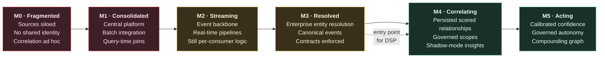

# Appendix D — Adoption Maturity Assessment

---


A self-assessment instrument for determining whether an organization is positioned to attempt a Data Swimming Pool implementation — and, more often, for determining that it is not yet. The instrument is deliberately unforgiving.


## D.1 Maturity Model

**Figure 61.** *Correlation maturity model. **M3 is the entry point.** Organizations at M0–M2 attempting to jump directly to M4 will build a correlation engine on unresolved identities, which produces confident relationships between entities that are not the same entity.*

## D.2 Assessment Instrument

Score each statement: **0** = not true, **1** = partially true, **2** = substantially true, **3** = fully true and evidenced.

### Dimension 1 — Data Foundation (max 24)

| # | Statement | Score |
| --- | --- | :-: |
| 1.1 | Critical source systems emit or expose changes in near real time (CDC or events), not only nightly extracts | ☐ |
| 1.2 | A canonical or agreed event/record schema exists across at least three domains | ☐ |
| 1.3 | Data contracts are enforced at ingestion, with rejection rather than silent acceptance | ☐ |
| 1.4 | Source schema changes are detected before they break downstream consumers | ☐ |
| 1.5 | Event time is recorded distinctly from processing time in critical sources | ☐ |
| 1.6 | Data quality is measured continuously, with published metrics per source | ☐ |
| 1.7 | Late and out-of-order data is handled explicitly, not discarded | ☐ |
| 1.8 | Raw source data is retained in an open format, replayable for reprocessing | ☐ |

### Dimension 2 — Identity and Entity Resolution (max 18) — **weighted ×2**

| # | Statement | Score |
| --- | --- | :-: |
| 2.1 | An enterprise identifier exists for your most important entity type | ☐ |
| 2.2 | Cross-system identity mapping is a managed service, not per-project logic | ☐ |
| 2.3 | Entity resolution accuracy has been measured against a labelled sample | ☐ |
| 2.4 | Probabilistic matches carry confidence scores that consumers can see | ☐ |
| 2.5 | Merge and split operations are audited and reversible | ☐ |
| 2.6 | Identity resolution is available at streaming latency, not only in batch | ☐ |

### Dimension 3 — Governance and Privacy (max 24)

| # | Statement | Score |
| --- | --- | :-: |
| 3.1 | A data governance body exists with authority to refuse requests, not only to advise | ☐ |
| 3.2 | Data is classified by sensitivity, and classification is machine-readable | ☐ |
| 3.3 | Purpose limitation is recorded per dataset and enforced technically | ☐ |
| 3.4 | Erasure requests are propagated to derived datasets, not only to source systems | ☐ |
| 3.5 | A DPIA process exists and is applied to new analytical uses | ☐ |
| 3.6 | Automated decision-making is inventoried and classified | ☐ |
| 3.7 | Policy is externalized and enforced at runtime, not embedded in application code | ☐ |
| 3.8 | The organization has previously declined a technically feasible data use on ethical grounds | ☐ |

### Dimension 4 — Platform and Engineering (max 21)

| # | Statement | Score |
| --- | --- | :-: |
| 4.1 | A durable, partitioned event log operates in production | ☐ |
| 4.2 | Stateful stream processing operates in production with checkpointing | ☐ |
| 4.3 | A lakehouse with an open table format is in production use | ☐ |
| 4.4 | Lineage is captured automatically at column level for critical pipelines | ☐ |
| 4.5 | Observability covers streaming lag, state size, and pipeline health | ☐ |
| 4.6 | Infrastructure is defined as code with reproducible environments | ☐ |
| 4.7 | The organization can run a graph database in production, or has a credible path to | ☐ |

### Dimension 5 — Analytics and AI Practice (max 18)

| # | Statement | Score |
| --- | --- | :-: |
| 5.1 | Models are versioned, with lineage from training data to prediction | ☐ |
| 5.2 | Model performance is monitored in production with drift detection | ☐ |
| 5.3 | Model outputs are calibrated, and calibration is assessed | ☐ |
| 5.4 | Ground-truth outcomes are captured systematically for at least one decision process | ☐ |
| 5.5 | An MLOps or equivalent deployment path exists, with shadow deployment capability | ☐ |
| 5.6 | Generative AI outputs, where used, are grounded and citation-checked | ☐ |

### Dimension 6 — Organizational Readiness (max 21) — **weighted ×1.5**

| # | Statement | Score |
| --- | --- | :-: |
| 6.1 | Executive sponsorship exists for a multi-year platform investment | ☐ |
| 6.2 | Funding is not contingent on twelve-month measurable return | ☐ |
| 6.3 | Domains accept accountability for the data they produce | ☐ |
| 6.4 | Cross-departmental failures can be surfaced without individual blame | ☐ |
| 6.5 | A platform team model exists, distinct from project delivery teams | ☐ |
| 6.6 | The organization can staff streaming, graph, ML, and governance expertise simultaneously | ☐ |
| 6.7 | There is documented demand for cross-domain questions that currently go unanswered | ☐ |

**Table 93.** *Assessment instrument across six dimensions. **Dimension 2 is weighted double and Dimension 6 by 1.5** because entity resolution bounds technical outcomes and organizational readiness bounds everything else. Both are more commonly the cause of failure than the correlation technology itself.*

## D.3 Scoring

| Dimension | Raw max | Weight | Weighted max |
| --- | :-: | :-: | :-: |
| 1 — Data Foundation | 24 | 1.0 | 24 |
| 2 — Identity and ER | 18 | 2.0 | 36 |
| 3 — Governance and Privacy | 24 | 1.0 | 24 |
| 4 — Platform and Engineering | 21 | 1.0 | 21 |
| 5 — Analytics and AI | 18 | 1.0 | 18 |
| 6 — Organizational Readiness | 21 | 1.5 | 31.5 |
| **Total** | **126** | — | **154.5** |

| Weighted score | Maturity | Recommendation |
| --- | --- | --- |
| **Below 60** | M0–M1 | Do not attempt. Invest in ingestion, contracts, and identity. Revisit in 18–24 months. |
| **60–89** | M2 | Not ready. Address the two lowest-scoring dimensions before any correlation work. |
| **90–114** | M3 | Ready for a **minimum viable correlation platform** ([Appendix B.5](b-reference-implementation.md)) in shadow mode, one scope. |
| **115–134** | M3+ | Ready for full Phase 1–2 adoption with three to five sources and one to two scopes. |
| **135+** | M4-capable | Ready for multi-scope adoption. Verify that no individual dimension scores below 70% of its weighted maximum. |

**Table 94.** *Score interpretation. **A minimum threshold applies regardless of total:** if Dimension 2 scores below 24 of 36, or Dimension 6 below 21 of 31.5, the organization is not ready irrespective of how strong the other dimensions are. High engineering capability does not compensate for unresolved identity or unwilling stakeholders.*

## D.4 Common Profiles

| Profile | Typical pattern | Diagnosis |
| --- | --- | --- |
| **The strong engineer** | D1, D4 high; D2, D3 low | Will build an impressive platform that correlates wrong entities under unclear authority. Fix identity and governance first. |
| **The governed laggard** | D3 high; D1, D4 low | Excellent controls over data that cannot move fast enough to correlate. Invest in streaming foundations. |
| **The AI-forward** | D5 high; D1, D2 low | Sophisticated models on unreliable joins. The models are not the constraint. |
| **The willing but under-resourced** | D6 high; D2, D4 low | Genuine demand, insufficient foundations. Highest-value profile to invest in; also the most likely to attempt the jump prematurely. |
| **The capable but unwilling** | D1–D5 high; D6 low | Technically ready, organizationally blocked. Correlation exposes cross-departmental failure; without blameless culture this fails politically. |

**Table 95.** *Common assessment profiles. **The capable-but-unwilling profile is the most frequent failure mode among large, well-resourced organizations**, and no amount of additional engineering resolves it.*

## D.5 Reassessment Cadence

Reassess at each adoption phase gate ([Chapter 40](../part-5/40-future-roadmap.md)) and at minimum annually. Track dimension trajectories rather than absolute scores: an organization improving Dimension 2 by six points a year is in a materially better position than one holding a higher static score.

---

**Next:** [Appendix E — Full Disclaimer and Licensing →](e-disclaimer.md)
