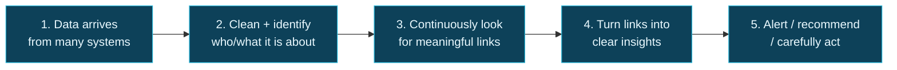

# Start Here — The Simple Version


**Read this page first.** It explains the whole whitepaper in plain language. No jargon required. You can finish it in about **8 minutes**.


---

## What is this about — in one breath?

Companies collect **huge amounts of data**.

But the data usually sits in separate piles (sales in one place, fraud in another, support in another, sensors somewhere else).

When something important happens in the real world, the clues are often **spread across those piles**. People have to dig through each pile by hand, connect the dots, write a slide, and then… forget the connection.

This whitepaper proposes a new kind of data system — a **Data Swimming Pool** — where those connections are found **automatically**, **kept**, and **used** to warn you, recommend actions, or (carefully) act.

---

## The swimming pool metaphor (this is the whole idea)

| Everyday image | What it means for data |
| --- | --- |
| A **lake** | Water (data) just sits there. Deep. Still. Easy to dump stuff into. Hard to keep clean. Nothing mixes on purpose. |
| A **swimming pool** | Water is **circulated**, **filtered**, **watched**, and **used**. Things interact. Someone notices if something is wrong. |


**One-liner.** A data lake stores. A Data Swimming Pool **connects**.


Today’s popular systems (warehouses, lakes, lakehouses, meshes) are excellent at **storing and querying** data. They are weak at **remembering relationships between events across departments** as a first-class job of the platform.

That gap is what this document is about.

---

## A story you already understand

Imagine a bank customer:

1. Their card is declined twice at unusual hours.
2. Their account balance drops below a threshold.
3. They call the call centre sounding stressed.
4. Their phone login location jumps cities overnight.

Each of those signals may look “fine enough” on its own.

Together, they might mean:

- **Account takeover** (fraud), or
- **Financial distress** (the customer needs help, not a hard block).

If four different teams each see only one signal, nobody sees the full picture in time.

A Data Swimming Pool is designed so the platform itself notices: *these things belong together*, scores how confident it is, shows its evidence, and routes a useful action — with rules about how much the machine is allowed to do alone.

---

## What the system actually does (five steps)

**Figure S-1.** *The idea in five steps. Everything else in the whitepaper is detail about how to do each step safely at enterprise scale.*

| Step | Plain English | Fancy name in later chapters |
| --- | --- | --- |
| 1 | Take in events as they happen (and older history too) | Ingestion + Streaming + Batch |
| 2 | Agree on “this is the same customer / machine / patient” | Entity resolution |
| 3 | Find patterns and links across domains | **Correlation Engine** (the core invention) |
| 4 | Explain the finding with evidence | Insight Object + Knowledge Graph |
| 5 | Decide how far the machine may go | Autonomy Ladder + Rules + Alerts |

---

## What is *new* here? (and what is not)


**Important honesty.** This is **not** a product you can buy tomorrow. It is an **original design idea** by the author, built from technologies that already exist (Kafka, Flink, Spark, graphs, AI, and so on). Think of it as an architectural blueprint for discussion and future building — not an industry standard.


**Not new:** storing data, streaming events, machine learning, dashboards, knowledge graphs as catalogs.

**Proposed as new (the heart of the paper):**

1. Treat **relationships between events** as lasting platform assets (not one-off spreadsheet joins).
2. Give each relationship a **confidence score**, an **expiry date**, and **governance rules**.
3. Make **correlation scope** (what you’re allowed to connect, why, and for how long) a managed object — like a product, not a side script.
4. Ground AI answers in those verified relationships, not free-floating guesses.
5. Use a clear **ladder of autonomy** so machines only act as far as the action can be reversed.

---

## Why should a normal person care?

Because modern organisations lose money, trust, and sometimes lives when **weak signals never meet**.

| Domain | Invisible problem | What connection could reveal |
| --- | --- | --- |
| Banking | Fraud vs customer hardship look similar | Safer actions that help the right person |
| Healthcare | Early deterioration is multi-factorial | Earlier clinical attention |
| Manufacturing | Many “in tolerance” conditions combine into defects | Predictive quality |
| Cybersecurity | Attacks hop across tools | Campaign detection instead of alert spam |
| Retail | Customer journey is fragmented | Real intent, not channel silos |

You do **not** need to understand Apache Flink to understand why that matters.

---

## How to read this site without drowning

Treat this GitBook like a **website with deep pages**, not a novel you must finish.

### If you have 10 minutes

1. This page (you’re on it)
2. [1. Executive Summary](../part-1/01-executive-summary.md) — skim the bold lines and the comparison table
3. Jump to **your industry** in Part IV (Banking, Healthcare, etc.)

### If you have 30 minutes

Add:

4. [8. Introducing Data Swimming Pool](../part-2/08-introducing-dsp.md)
5. [37. Comparison](../part-5/37-comparison.md) — what this is vs what already exists
6. [39. Challenges](../part-5/39-challenges-and-limitations.md) — why you might **not** build this

### If you want the technical meat

Follow [How to Read This Whitepaper](how-to-read.md) — Architect path.

---

## Tiny glossary (only the words you’ll keep seeing)

| Word | Meaning in this site |
| --- | --- |
| **Event** | Something that happened: a payment, a login, a sensor reading, a ticket update |
| **Correlation** | A meaningful link between events or entities the system has found and saved |
| **Insight** | A packaged finding: what happened, why we think so, how sure we are, what to do |
| **Knowledge graph** | A map of “things” and “how they connect” that stays up to date |
| **Autonomy** | How much the machine is allowed to do without a human |
| **Governance** | Rules for what data may be combined, for what purpose, and who is accountable |
| **Streaming** | Processing data as it arrives, continuously |
| **Batch** | Processing large amounts of history on a schedule |

A fuller glossary lives in [Appendix A](../appendix/a-glossary.md).

---

## Three promises this paper makes to you

1. **It will not pretend the idea is already proven in production.** It isn’t.
2. **It will say when *not* to build this.** Maturity, privacy, and cost matter.
3. **It will keep the metaphor honest.** Circulation without filtration is just a mess with better branding.

---

## Ready? Pick a door

| I want… | Go here |
| --- | --- |
| The big picture for leaders | [Executive Summary](../part-1/01-executive-summary.md) |
| The problem in vivid terms | [Current Challenges](../part-1/05-current-challenges.md) |
| The proposed system explained | [Introducing Data Swimming Pool](../part-2/08-introducing-dsp.md) |
| An industry story | [Banking](../part-4/29-banking.md) · [Healthcare](../part-4/30-healthcare.md) · [Cybersecurity](../part-4/34-cybersecurity.md) |
| Why this might fail | [Challenges and Limitations](../part-5/39-challenges-and-limitations.md) |
| The serious legal disclaimer | [Disclaimer](disclaimer.md) |


**Tip for website reading.** Use the **left menu** to jump. Use the **search box** (top) to find a word like “privacy” or “fraud”. You never have to read in order.

