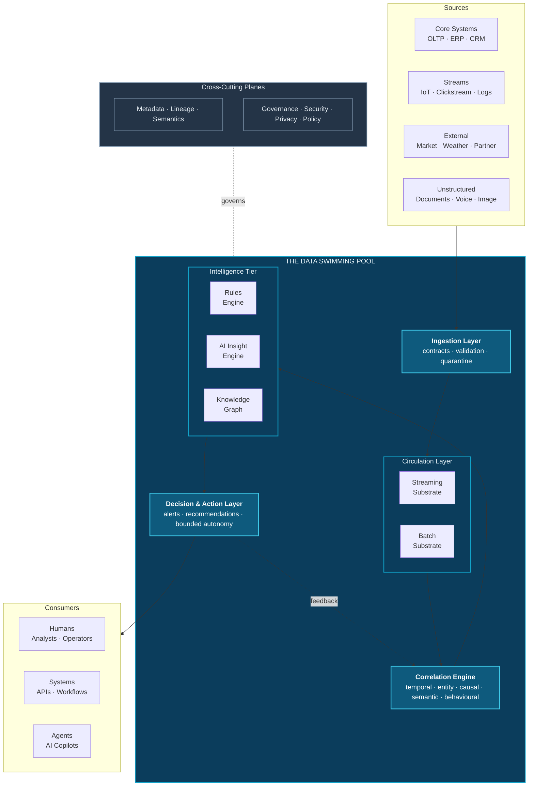

# 1. Executive Summary

---

## 1.1 The Central Problem

Enterprises have solved data storage. They have not solved data *connection*.

Over six decades, enterprise data architecture has advanced through a series of well-executed generational shifts: from transactional databases to dimensional warehouses, from warehouses to schema-on-read lakes, from lakes to transactional lakehouses, and — organizationally — from centralized platforms to federated meshes and virtualized fabrics. In parallel, event streaming has industrialized the movement of data in motion.

Each generation solved a genuine problem. Collectively, they have made it inexpensive to *accumulate* data at effectively unlimited scale, and increasingly practical to *query* it. But they share a common architectural assumption that is now the binding constraint:


**The binding constraint.** Contemporary architectures treat the *relationships between data* as a query-time concern belonging to applications, analysts, and models — not as a persistent, governed, first-class asset maintained by the platform itself.


The consequence is familiar to every data leader. An organization holds, somewhere in its estate, the transaction that signalled fraud, the sensor reading that predicted the failure, the support ticket that preceded the churn, and the network anomaly that preceded the breach. The data exists. What does not exist is any persistent, governed representation of the fact that these events *are related to one another*. That relationship is reconstructed — expensively, inconsistently, and usually too late — by a human being with four browser tabs open.

## 1.2 The Proposal

This whitepaper introduces **Data Swimming Pool**, an original conceptual framework for an enterprise data ecosystem in which correlation is architectural rather than incidental.


### Definition — Data Swimming Pool

A **Data Swimming Pool** is a governed enterprise data ecosystem in which heterogeneous batch and streaming sources are continuously ingested into a shared, instrumented medium where they interact, correlate, and enrich one another, producing a persistent and queryable graph of event relationships from which insights, alerts, predictions, recommendations, and bounded autonomous actions are generated in a lineage-traceable and policy-governed manner.


The name is chosen deliberately. A **lake** is a passive reservoir: things are placed in it and remain still. A **swimming pool** is an engineered, circulating, continuously maintained volume: it is filtered, chemically balanced, temperature-controlled, monitored, and — critically — its contents *move and interact*. The metaphor is not decorative. It encodes the central architectural claim: that the medium in which enterprise data sits should be active, instrumented, and self-maintaining rather than inert.

## 1.3 What Is Actually New


**Illustrative and original work.** Data Swimming Pool is an original conceptual framework proposed by the author. It builds upon existing enterprise data architectures and open-source technologies. It is **not** an established industry standard, a commercial product, or a deployed system. See the [Disclaimer](../front-matter/disclaimer.md).


Nearly every *component* described in this whitepaper exists today. Distributed logs, stateful stream processors, complex event processing engines, property graph databases, vector indices, open table formats, lineage catalogs, and policy engines are all mature. The contribution here is not a new technology. It is a **composition and a set of principles**, of which four elements are genuinely distinguishing:

1. **A first-class Correlation Engine.** A dedicated architectural tier — not an application, not a notebook, not a dashboard — whose sole responsibility is to continuously discover, score, persist, and expire relationships between events and entities across domain boundaries. Correlation becomes infrastructure. See [Chapter 14](../part-2/14-correlation-engine.md).

2. **The Insight Object as a governed data product.** Insights are not ephemeral query results. They are durable, versioned, lineage-carrying, permission-bearing artifacts with a lifecycle, a confidence score, an evidence set, and an audit trail. See [Chapter 16](../part-2/16-ai-insight-engine.md).

3. **A living knowledge graph fed by the correlation tier.** The enterprise semantic layer is not hand-curated and periodically refreshed; it is continuously updated by observed event relationships, making it a real-time representation of how the business actually behaves rather than how it was documented. See [Chapter 17](../part-2/17-knowledge-graph-layer.md).

4. **The Autonomy Ladder.** A six-level, explicitly governed model for delegating decisions to machines, in which every level specifies its reversibility requirement, its human control point, its evidentiary standard, and its escalation path. Autonomy is a graduated architectural property, not a binary switch. See [Chapter 20](../part-2/20-autonomous-decision-support.md).

## 1.4 Architecture at a Glance

**Figure ES-1.** *Data Swimming Pool — high-level architecture. Heterogeneous sources enter through a contract-enforcing ingestion layer into a unified circulation layer spanning streaming and batch substrates. The Correlation Engine — the architectural centre of gravity — continuously relates events across domains. The intelligence tier applies deterministic rules, machine learning, and graph reasoning. The decision layer emits governed outputs. Metadata and governance planes span every layer, and decision outcomes feed back into correlation as supervision signal.*

## 1.5 Comparison Summary

The following table condenses the detailed analysis of [Chapter 37](../part-5/37-comparison.md). Ratings reflect the *architectural intent and native capability* of each paradigm, not the best achievable outcome after extensive custom engineering.

| Capability | Data Warehouse | Data Lake | Lakehouse | Data Fabric | Data Mesh | **Data Swimming Pool** |
| --- | :---: | :---: | :---: | :---: | :---: | :---: |
| Batch Processing | ●●●●● | ●●●●○ | ●●●●● | ●●●○○ | ●●●●○ | ●●●●● |
| Streaming | ●○○○○ | ●●○○○ | ●●●○○ | ●●●○○ | ●●●○○ | ●●●●● |
| AI Integration | ●●○○○ | ●●●○○ | ●●●●○ | ●●●○○ | ●●●○○ | ●●●●● |
| **Event Correlation** | ●○○○○ | ●○○○○ | ●●○○○ | ●●○○○ | ●●○○○ | **●●●●●** |
| **Cross-Domain Intelligence** | ●●○○○ | ●●○○○ | ●●●○○ | ●●●●○ | ●●○○○ | **●●●●●** |
| **Autonomous Insights** | ●○○○○ | ●○○○○ | ●●○○○ | ●●○○○ | ●●○○○ | **●●●●●** |
| Knowledge Graph Support | ●○○○○ | ●●○○○ | ●●○○○ | ●●●●○ | ●●○○○ | ●●●●● |
| Governance | ●●●●● | ●●○○○ | ●●●●○ | ●●●●● | ●●●●○ | ●●●●● |
| Scalability | ●●●○○ | ●●●●● | ●●●●● | ●●●●○ | ●●●●● | ●●●●○ |
| Flexibility | ●●○○○ | ●●●●● | ●●●●○ | ●●●●○ | ●●●●● | ●●●●○ |
| Enterprise Readiness | ●●●●● | ●●●●○ | ●●●●○ | ●●●●○ | ●●●○○ | ●●○○○ |
| Decision Support | ●●●○○ | ●●○○○ | ●●●○○ | ●●●○○ | ●●●○○ | ●●●●● |

**Table 1.** *Capability comparison across enterprise data architecture paradigms. Scale: ●○○○○ minimal to ●●●●● native and comprehensive. Note the deliberately low Enterprise Readiness rating for Data Swimming Pool — it is a proposed framework without production deployment history, and this is its most significant present limitation.*

The pattern in Table 1 is the argument of this whitepaper in miniature. Existing architectures are strong where they were designed to be strong. None treats **event correlation**, **cross-domain intelligence**, or **autonomous insight generation** as a native architectural responsibility. Data Swimming Pool is designed specifically around those three columns — and pays for that focus with immaturity, operational complexity, and unproven scale.

## 1.6 Expected Value and Honest Costs


**Illustrative estimates.** The figures below are reasoned engineering estimates derived from published benchmarks and comparable architectural transitions. They are **not** measurements from a deployed Data Swimming Pool. Treat them as hypotheses to be tested, not as expected outcomes.


**Plausible benefits**, discussed rigorously in [Chapter 38](../part-5/38-benefits.md):

- **Compression of time-to-insight** for cross-domain questions, from days of manual investigation to seconds of graph traversal, because the join has already been computed and persisted.
- **Reduction in alert volume with improved precision**, because correlated multi-signal alerts replace independent single-signal alerts. Alert fatigue is fundamentally a correlation failure.
- **Detection of genuinely cross-domain phenomena** — fraud rings, cascading supply-chain failures, multi-stage intrusions — that are invisible to any single domain's analytics.
- **Reduced duplicated integration effort**, because correlation is built once in the platform rather than repeatedly in every downstream application.

**Real costs**, treated honestly in [Chapter 39](../part-5/39-challenges-and-limitations.md):

- **Combinatorial risk.** Naïve all-pairs correlation is O(n²) and will bankrupt an unbounded implementation. Aggressive scoping, partitioning, and pruning are mandatory, not optional.
- **Spurious correlation.** A system engineered to find relationships will find relationships that do not exist. Statistical discipline and confidence calibration are load-bearing.
- **Organizational readiness.** An enterprise that has not achieved reliable data quality, coherent entity resolution, and functioning governance will not succeed with this architecture. It amplifies existing maturity; it does not substitute for it.
- **Skills scarcity.** The framework requires fluency across stream processing, graph modelling, machine learning, and governance — a rare combination.

## 1.7 Recommended Posture

For most organizations, the appropriate response to this whitepaper is **not** a platform replacement programme. It is a **bounded, instrumented experiment**:

1. Select **two domains** whose interaction is known to matter and known to be poorly served today — for example, payments and customer service, or manufacturing quality and supplier logistics.
2. Implement the **Correlation Engine pattern only**, over existing streaming and storage infrastructure. Do not rebuild the estate.
3. Persist correlations into a graph store and measure, against a controlled baseline, whether decision quality and time-to-insight actually improve.
4. Operate strictly at **Autonomy Levels 0–2** (observe, recommend, assist) until correlation precision is empirically established.
5. Publish the results — including negative results — so the framework can be refined by evidence rather than assertion.

The full phased adoption model is presented in [Chapter 40](../part-5/40-future-roadmap.md), and a readiness instrument is provided in [Appendix D](../appendix/d-maturity-assessment.md).

---


## Key Takeaways

1. **Storage is solved; connection is not.** The binding constraint in enterprise data is no longer capacity or query performance but the absence of persistent, governed relationships between data across domain boundaries.
2. **Data Swimming Pool proposes correlation as infrastructure.** A dedicated Correlation Engine tier continuously discovers, scores, persists, and expires cross-domain event relationships, making them a reusable enterprise asset.
3. **Four elements distinguish the framework:** the Correlation Engine, the Insight Object as a governed data product, a continuously-updated knowledge graph, and the Autonomy Ladder for graduated machine decision-making.
4. **The framework composes existing technology.** Kafka, Flink, Spark, Iceberg, graph databases, vector stores, and policy engines are the substrate. The novelty is architectural, not technological.
5. **Its principal weakness is immaturity.** Data Swimming Pool has no production deployment history, carries genuine combinatorial and statistical risks, and demands organizational maturity that many enterprises lack.
6. **The recommended entry point is a two-domain experiment**, not a platform replacement — operated at low autonomy levels until correlation precision is demonstrated empirically.


---

**Next:** [2. Abstract →](02-abstract.md)
