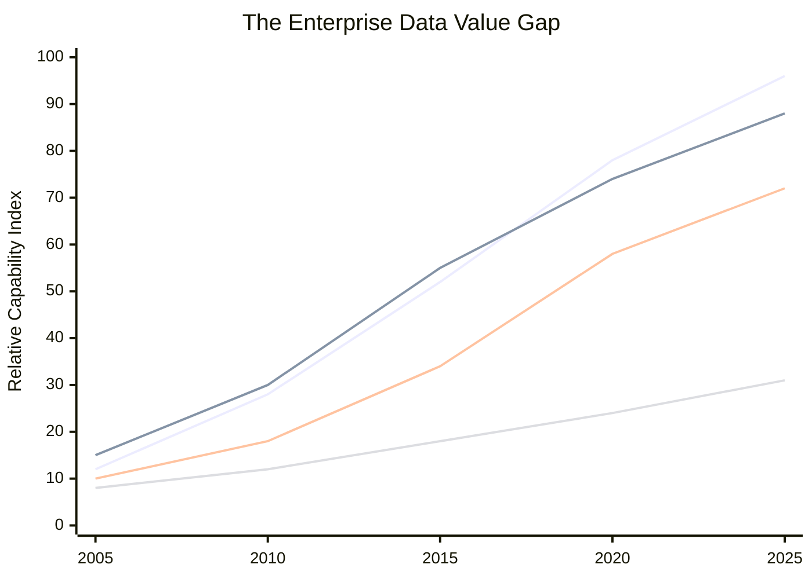
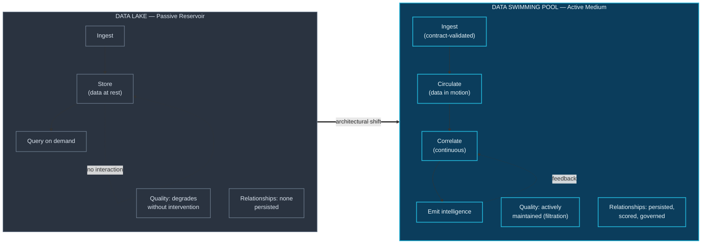

# 3. Introduction

---

## 3.1 A Question That Should Be Easy

Consider a question that a competent executive might reasonably ask on any given Tuesday:

> *"Three of our largest enterprise accounts reduced their spend last quarter. Was that related to the platform degradation we had in April, the pricing change in March, the account manager turnover in that segment, or something in their own industries?"*

This is not an exotic question. It is an ordinary question about a business. Every fact required to answer it exists somewhere inside the organization: billing records in the ERP, service-level telemetry in the observability stack, pricing decisions in a product management tool, HR records of personnel changes, support tickets in a service desk platform, and external market signals in a subscription data feed.

In a typical large enterprise, answering it takes between three days and three weeks. It requires an analyst to identify which systems hold the relevant facts, obtain access to each, reconcile inconsistent customer identifiers across them, align events onto a common timeline despite differing timestamp semantics and time zones, construct joins that no data model anticipated, and then exercise judgement about which co-occurrences are meaningful.

The analyst is not doing analysis. The analyst is doing **correlation**, by hand, because no system did it for them. And when they finish, the correlation they constructed evaporates. It exists in a slide deck. The next person to ask an adjacent question starts from zero.

This whitepaper is about that gap.

## 3.2 The Accumulation–Association Divergence

The last two decades of data infrastructure investment have delivered extraordinary returns on one axis and comparatively little on another.

**Figure 1.** *The enterprise data value gap. Capacity to store, compute over, and govern data has advanced steeply over two decades. The capability to persistently associate data across domain boundaries has advanced far more slowly, producing a widening divergence. Index values are illustrative and intended to convey relative trajectory rather than measured quantities.*

The divergence in Figure 1 is the practical experience of most data organizations. Storage became effectively unlimited. Compute became elastic. Cataloging and lineage tooling matured substantially. But the ability to answer *"what is this connected to, and why?"* improved only marginally — and almost entirely through human effort rather than platform capability.

There is a straightforward structural reason for this. Storage, compute, and governance are all properties of *data as inventory*. They scale with volume, and volume is what our architectures were designed to manage. Association is a property of *data as a population* — it scales with the number of meaningful *relationships*, which no architecture was designed to manage because relationships were assumed to be the consumer's problem.

## 3.3 Why the Consumer's Problem Became the Platform's Problem

For most of the history of enterprise data, delegating relationship discovery to the consumer was defensible. Analytical consumers were few, their questions were relatively stable, and the relationships they cared about were mostly *within* a domain: finance analysts joined finance tables, marketing analysts joined marketing tables. The dimensional model in a data warehouse encoded exactly the relationships that were known to matter, and encoded them well.

Three shifts have invalidated that assumption.

**First, the consequential questions became cross-domain.** Fraud is not a payments phenomenon; it is a payments, identity, device, behavioural, and network phenomenon simultaneously. Churn is not a CRM phenomenon; it is a product usage, service quality, billing, support, and competitive-market phenomenon. Equipment failure is not a maintenance phenomenon; it is a sensor, supplier, environment, operator, and scheduling phenomenon. The questions that matter most now span exactly the boundaries that our architectures reinforce.

**Second, the latency requirement collapsed.** A correlation discovered three weeks after a fraud ring completes its extraction has archival value only. A correlation between a sensor drift and a supplier batch change discovered after ten thousand defective units have shipped is a post-mortem, not an intervention. Many of the most valuable correlations have a short window of actionability, and human-mediated discovery cannot meet it.

**Third, the consumers are no longer only human.** AI agents, automated workflows, and retrieval-augmented systems now query enterprise data continuously, at machine rates, without the contextual judgement a human analyst brings. When a large language model is asked why revenue declined, it retrieves whatever the retrieval layer surfaces. If the retrieval layer contains only isolated documents and tables with no encoded relationships, the model will produce fluent, confident, and unfounded correlation — precisely the failure mode enterprises can least afford. **Grounding AI requires a substrate of governed relationships, not merely a substrate of governed facts.**


**A consequence worth stating explicitly.** The rise of AI agents as primary data consumers does not reduce the need for correlation infrastructure — it makes it urgent. An ungrounded model asked a cross-domain question will hallucinate a relationship. A grounded model asked the same question can cite one. The difference is architectural.


## 3.4 The Metaphor and Why It Matters

Architectural metaphors are not merely rhetorical. They encode assumptions, and those assumptions propagate into design decisions for years.

The **data lake** metaphor, introduced by James Dixon in 2010 [3], was an honest and useful description of a genuine innovation: a body of water into which tributaries flow, holding data in native form until needed. It correctly conveyed schema-on-read flexibility and the value of retaining raw fidelity.

But a lake is *passive*. It is a reservoir. Water enters, water sits, water is drawn out. Nothing in the metaphor suggests that the contents interact. And the industry duly built passive systems — which, when governance and quality discipline were absent, degraded into the "data swamp" that practitioners now speak of with weary familiarity. The metaphor predicted its own failure mode.

A **swimming pool** is a fundamentally different object. It is engineered infrastructure. Its water is continuously circulated through filtration. Its chemistry is monitored and actively balanced. Its temperature is regulated. Its clarity is a maintained property, not an accident. And its contents — swimmers — *move, interact, and affect one another*. The medium is active.

**Figure 2.** *Reservoir versus circulating medium. The data lake metaphor describes a passive store in which quality degrades absent intervention and no relationships are retained. The swimming pool metaphor describes engineered infrastructure with active circulation, continuous filtration, and — critically — interaction between contents. The metaphorical difference maps directly onto an architectural one.*

The metaphor is chosen because it makes the right things obvious. A pool requires **continuous maintenance** — which correctly implies that correlation quality, entity resolution, and metadata freshness are ongoing operational responsibilities, not project deliverables. A pool has **finite, engineered capacity** — which correctly implies that correlation scope must be bounded rather than universal. A pool is **transparent by design** — which correctly implies observability and lineage. And a pool's contents **interact** — which is the entire point.

## 3.5 Scope of This Whitepaper

**In scope.** The conceptual architecture, its layers and their responsibilities, the design principles governing it, the correlation modalities it supports, its integration with enterprise systems, its security, privacy and governance posture, its scalability and availability characteristics, ten illustrative cross-sector scenarios, a rigorous comparison against incumbent paradigms, an honest treatment of limitations, and a phased adoption roadmap.

**Out of scope.** Vendor selection guidance, detailed cost modelling for specific cloud providers, production-grade code, formal proofs of correctness or complexity bounds, empirical performance measurement, and any claim of commercial availability. These are identified as future work in [Chapter 40](../part-5/40-future-roadmap.md).

**Method.** This is a **design-science architectural proposition** [30], not an empirical study. Its argument proceeds by: establishing the gap through analysis of existing paradigms (Chapters 4–7); specifying an artifact intended to close it (Chapters 8–28); demonstrating applicability through constructed scenarios (Chapters 29–36A); and evaluating the artifact comparatively while stating its limitations (Chapters 37–39). The whitepaper makes no claim of empirical validation, and readers should apply the scepticism appropriate to an unvalidated design.

## 3.6 Intended Contribution

The author's aspiration for this document is modest and specific. It is not to persuade any organization to rebuild its data estate — a recommendation that would be irresponsible on the available evidence. It is to introduce a vocabulary and a structure for a conversation that the author believes the field needs to have:

**If we agree that the relationships between our data are as valuable as the data itself, what would it look like to build infrastructure that treats them that way?**

Data Swimming Pool is one answer. It is offered for critique.

---


## Key Takeaways

1. **Ordinary cross-domain business questions remain expensive to answer** despite two decades of data infrastructure investment, because the required correlation is performed manually and then discarded.
2. **Accumulation capability has diverged sharply from association capability.** Storage, compute, and governance scale with volume; association scales with relationships, which no architecture was designed to manage.
3. **Three shifts made relationship discovery a platform responsibility:** the consequential questions became cross-domain, the actionable window collapsed, and AI agents became primary consumers requiring grounded relationships to avoid hallucinated ones.
4. **The lake metaphor encoded passivity** and predicted the data swamp. The swimming pool metaphor encodes circulation, active maintenance, bounded capacity, transparency, and interaction — each mapping onto a specific architectural commitment.
5. **This is a design-science proposition, not an empirical study.** Its claims are architectural and its validation remains future work.


---

**Next:** [4. Background →](04-background.md)
