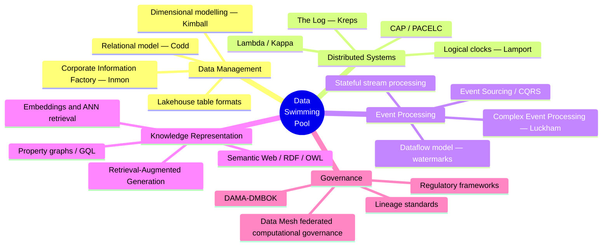

# 4. Background

---

This chapter establishes the intellectual foundations on which Data Swimming Pool is constructed. It is deliberately attributive: the framework proposed later in this whitepaper is a composition, and composition demands acknowledgment of what is being composed.

## 4.1 Foundations in Data Management

### 4.1.1 The Relational Model

Codd's 1970 formulation of the relational model [1] established that data could be represented as mathematical relations and manipulated through a closed algebra, independent of physical storage. Two of its properties are directly relevant here.

First, **physical–logical independence** — the separation of what data *means* from how it is *stored* — is the ancestor of every subsequent abstraction layer, including the semantic layer described in [Chapter 17](../part-2/17-knowledge-graph-layer.md).

Second, and more consequentially for this whitepaper, the relational model expresses relationships through **value equality at query time**. A foreign key is not a stored edge; it is a constraint that permits a join to be computed when requested. This is elegant and general, but it means that in the relational paradigm, *relationships are computed, not stored*. Fifty-five years later, this remains the default assumption of nearly all enterprise data architecture — and it is precisely the assumption Data Swimming Pool revisits.

### 4.1.2 Dimensional Modelling

Kimball's dimensional modelling [2] responded to a practical problem: normalized relational schemas, while correct, are slow and cognitively difficult for analytical work. The star schema — a central fact table surrounded by denormalized dimensions — pre-computes and materializes the relationships that analysts are expected to need.

This is important precedent. Dimensional modelling is, at its core, **the deliberate materialization of anticipated relationships to reduce query-time cost**. Data Swimming Pool extends the same logic to relationships that are *not* anticipated: instead of materializing joins a designer foresaw, the Correlation Engine materializes associations the system discovers.

### 4.1.3 Inmon's Corporate Information Factory

Inmon's contemporaneous framing [4] emphasized a normalized, subject-oriented, non-volatile, time-variant enterprise repository from which departmental marts are derived. Two of Inmon's four defining properties — **time-variance** and **non-volatility** — anticipate the append-only, temporally-indexed event model that underpins the circulation layer described in [Chapter 11](../part-2/11-streaming-layer.md).

## 4.2 Foundations in Distributed Systems

### 4.2.1 Time, Ordering and Causality

Lamport's 1978 paper on time, clocks and event ordering [5] is arguably the single most important theoretical antecedent of the correlation problem. Lamport established that in a distributed system there is no global "now"; that events can only be partially ordered by the *happened-before* relation; and that logical clocks can capture potential causality where physical clocks cannot.

Every correlation claim this whitepaper makes about temporal or causal relationships between events originating in different systems inherits this constraint directly. The Correlation Engine cannot know that event A caused event B. It can, at best, establish that A *could have* causally preceded B, and assign a confidence to that hypothesis. [Chapter 14](../part-2/14-correlation-engine.md) treats this limitation explicitly, and [Chapter 39](../part-5/39-challenges-and-limitations.md) revisits it as a fundamental rather than an engineering constraint.

Vector clocks [6] extend Lamport's construction to capture concurrency detection, and inform the causal correlation modality.

### 4.2.2 Consistency and Its Limits

Brewer's CAP conjecture [7], formalized by Gilbert and Lynch [8], and Abadi's PACELC refinement [9] establish the design envelope within which any distributed correlation system must operate. A correlation computed across geographically partitioned data is subject to the same trade-offs as any distributed read: it may be fast or it may be consistent, and under partition it must choose.

Data Swimming Pool adopts an explicit posture on this, stated in [Chapter 27](../part-3/27-high-availability.md): **correlations are eventually consistent by default and strongly consistent by exception**, with the exception invoked only for correlations that gate irreversible autonomous action.

### 4.2.3 The Log as a Unifying Abstraction

Kreps' articulation of the log as the fundamental abstraction for data integration [10] is the direct antecedent of the circulation layer. The insight — that an ordered, immutable, replayable sequence of records can serve simultaneously as a messaging system, a storage system, and a source of truth from which any number of derived views can be materialized — resolves the historical tension between "data at rest" and "data in motion."

Data Swimming Pool takes this further: if the log is the substrate, then correlations computed over it are themselves derivable, replayable, and auditable. A correlation is not a lucky discovery in a dashboard; it is a deterministic function of a replayable event history. This property is what makes correlation *governable*, and it is developed in [Chapter 18](../part-2/18-metadata-and-lineage.md).

### 4.2.4 Lambda and Kappa

Marz's Lambda architecture [11] proposed parallel batch and speed layers reconciled at query time, accepting the cost of dual implementation in exchange for combining batch accuracy with streaming freshness. Kreps' Kappa architecture [12] argued the batch layer was unnecessary if the log retained sufficient history and reprocessing were made cheap.

Data Swimming Pool declines to choose. [Chapter 12](../part-2/12-batch-layer.md) argues that the Lambda/Kappa debate conflates two separable questions — *how fresh must this be?* and *how complete must this be?* — and that the correct answer varies by correlation type rather than by architecture. The framework specifies a **unified canonical event model with an explicit reconciliation protocol**, allowing streaming and batch substrates to coexist without duplicating business logic.

## 4.3 Foundations in Event Processing

### 4.3.1 Complex Event Processing

Luckham's foundational work on complex event processing [13] is the closest existing antecedent to the Correlation Engine, and its intellectual debt is substantial. Luckham introduced the notions of the **event cloud**, **event hierarchies**, **event patterns**, and **event abstraction** — the derivation of higher-order events from constituent lower-order ones.

CEP established that patterns spanning multiple event types could be declared and detected continuously. The SASE [14] and Cayuga [15] systems demonstrated efficient pattern-matching over event streams, and the technique is now embedded in mainstream stream processors including Flink CEP and Esper.

Where Data Swimming Pool departs from classical CEP is in three specific respects, developed in [Chapter 14](../part-2/14-correlation-engine.md):

| Aspect | Classical CEP | Data Swimming Pool Correlation Engine |
| --- | --- | --- |
| **Pattern origin** | Declared in advance by a domain expert | Declared *and* discovered — statistical, semantic and learned modalities operate without prior declaration |
| **Result persistence** | Emits a derived event; the pattern instance is typically transient | Persists a first-class, versioned, confidence-scored correlation artifact into a graph |
| **Scope** | Typically bounded within a domain or application | Explicitly cross-domain by design, with entity resolution across source boundaries |
| **Governance** | Pattern definitions are application configuration | Correlations carry lineage, provenance, policy tags and expiry as platform-managed metadata |

**Table 2.** *Data Swimming Pool's Correlation Engine relative to classical complex event processing. The framework is best understood as CEP generalized from declared patterns to a governed, persistent, cross-domain correlation substrate.*

### 4.3.2 Event Sourcing and CQRS

Fowler's articulation of event sourcing [16] and Young's development of CQRS [17] establish that application state can be represented as an append-only sequence of state-changing events, from which any number of read models may be projected. Evans' domain-driven design [18] supplies the bounded-context discipline that keeps such event models coherent.

Data Swimming Pool treats correlations as **projections over the event history** — which means a correlation model can be revised and the entire correlation history recomputed, exactly as an event-sourced read model can be rebuilt. This is operationally significant: it means correlation logic is not a one-way door.

### 4.3.3 Stream Processing Semantics

The Dataflow model [19] resolved the theoretical basis for correct stream processing under out-of-order arrival, introducing the now-standard vocabulary of event time versus processing time, watermarks, windowing, and triggers. Its implementation lineage runs through Apache Beam, Apache Flink [20], and Spark Structured Streaming [21].

This work is foundational to the streaming substrate described in [Chapter 11](../part-2/11-streaming-layer.md). Correlation across sources with heterogeneous arrival characteristics is impossible without a principled treatment of event time and late data.

## 4.4 Foundations in Knowledge Representation

### 4.4.1 Semantic Web and Graph Data Models

The Semantic Web programme [22] and its associated standards — RDF, OWL, SPARQL — established formalisms for machine-interpretable representation of entities and relationships. The property graph model, popularized by Neo4j and standardized in query form through openCypher and ISO GQL [23], offers a pragmatic alternative optimized for traversal performance and developer accessibility.

The survey literature on knowledge graphs [24] documents the trajectory from academic ontology engineering to industrial deployment at Google, Amazon, Microsoft, LinkedIn, and eBay. Two lessons from that literature are directly incorporated into [Chapter 17](../part-2/17-knowledge-graph-layer.md): **hand-curated ontologies do not scale and do not stay current**, and **graphs derive their value from edges rather than from nodes**.

Data Swimming Pool's response is a knowledge graph whose edges are predominantly *machine-derived from observed event relationships* rather than hand-authored — a **living graph** whose topology tracks operational reality.

### 4.4.2 Embeddings and Vector Retrieval

Dense vector representations of text, entities, and behaviour, combined with approximate nearest-neighbour indices [25], make semantic similarity computationally tractable at scale. This underpins the **semantic correlation modality** described in [Chapter 14](../part-2/14-correlation-engine.md), which relates events whose meanings are proximate even when their surface representations share no tokens or keys.

### 4.4.3 Retrieval-Augmented Generation

Lewis et al. [26] demonstrated that grounding generative models in retrieved evidence improves factuality and permits attribution. The technique is now standard in enterprise AI.

Data Swimming Pool proposes an extension developed in [Chapter 16](../part-2/16-ai-insight-engine.md): retrieval over a **correlation substrate** rather than over a document corpus. Where conventional RAG retrieves passages that mention a topic, correlation-grounded retrieval returns the *evidence subgraph* — the set of related events, their relationship types, and their confidence scores. The generative model is thereby constrained to reason over relationships the platform has already established and can defend, rather than inventing them.

## 4.5 Foundations in Governance

DAMA-DMBOK [27] provides the canonical taxonomy of data management disciplines. Dehghani's data mesh [28] reframed governance as a federated computational concern rather than a centralized bureaucratic one. Regulatory frameworks — GDPR, HIPAA, BCBS 239, the EU AI Act — impose requirements on explainability, purpose limitation, lineage, and the right to contest automated decisions that bear directly on any system generating autonomous insights.

The governance posture of Data Swimming Pool, developed in [Chapter 25](../part-3/25-governance.md), inherits data mesh's federated computational model and extends it to a novel object: **correlations themselves must be governed**. A correlation between a customer's health-related purchase and their insurance premium may be statistically valid, technically discoverable, and legally impermissible. Policy must therefore be enforced at correlation time, not only at access time — a requirement developed in [Chapter 24](../part-3/24-privacy.md).

## 4.6 Synthesis

**Figure 3.** *Intellectual foundations of the Data Swimming Pool framework. The proposal is a synthesis across five established traditions; no element of the substrate is original to this whitepaper. Originality is claimed only for the composition and its governing principles.*

The honest summary is this: **Data Swimming Pool invents nothing at the component level.** Its wager is that these five traditions have matured sufficiently, and independently, that a composition organized around correlation as the central concern is now both technically feasible and economically justified — and that no one has yet made that composition explicit as an architectural pattern with a name, a set of principles, and a governance model.

---


## Key Takeaways

1. **The relational model computes relationships rather than storing them.** This fifty-five-year-old assumption remains the default in enterprise architecture and is what Data Swimming Pool revisits.
2. **Lamport's happened-before relation bounds what correlation can claim.** Cross-system causality can only ever be hypothesized with confidence, never asserted — a fundamental rather than an engineering limitation.
3. **The log as unifying abstraction makes correlation governable**, because a correlation over a replayable event history is a deterministic, auditable, recomputable function rather than an unreproducible discovery.
4. **Complex Event Processing is the closest antecedent.** Data Swimming Pool generalizes it from declared patterns to discovered, persisted, cross-domain, governed correlations.
5. **Knowledge graph literature teaches that hand-curated ontologies do not stay current**, motivating a living graph whose edges derive from observed event relationships.
6. **Correlations themselves require governance.** A statistically valid correlation may be legally impermissible, so policy must be enforced at correlation time rather than only at access time.


---

**Next:** [5. Current Challenges in Enterprise Data →](05-current-challenges.md)
