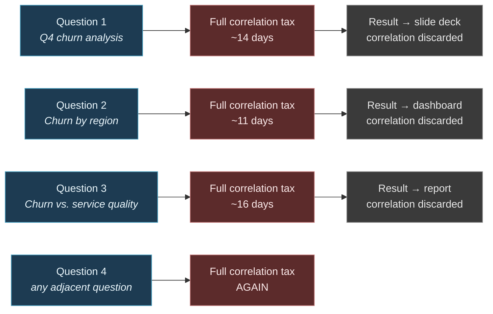

# 5. Current Challenges in Enterprise Data

---

This chapter catalogues the operational failures that motivate the proposed framework. The discipline applied throughout is to distinguish **symptoms** — which are widely reported and widely lamented — from **structural causes**, which are less frequently examined. Most enterprise data remediation programmes fail because they treat symptoms.

## 5.1 The Symptom–Cause Distinction

| # | Reported Symptom | Conventional Diagnosis | Structural Cause | Addressed by DSP? |
| --- | --- | --- | --- | :---: |
| 1 | "We have data silos" | Insufficient integration | Integration moves *copies*; it does not create *relationships* | ✔ Direct |
| 2 | "Time to insight is too slow" | Insufficient compute or tooling | Analysts manually reconstruct correlations that are then discarded | ✔ Direct |
| 3 | "Alert fatigue is overwhelming teams" | Thresholds need tuning | Alerts are single-signal because signals are never correlated | ✔ Direct |
| 4 | "We can't trust the numbers" | Data quality problem | No lineage from conclusion back to evidence | ✔ Direct |
| 5 | "The same metric differs by system" | Lack of a semantic layer | No canonical entity resolution across domains | ✔ Partial |
| 6 | "Our ML models degrade in production" | Model drift | Features lack cross-domain context; the world changed, not the model | ✔ Partial |
| 7 | "AI copilots hallucinate about our business" | Model limitation | Retrieval layer contains facts but no governed relationships | ✔ Direct |
| 8 | "We detect problems after the damage" | Need faster dashboards | Detection requires cross-domain correlation performed at human latency | ✔ Direct |
| 9 | "Governance slows everything down" | Too much process | Governance applied manually at access time rather than computationally at flow time | ✔ Partial |
| 10 | "Nobody can find anything" | Need a better catalog | Catalogs index assets, not the relationships between them | ✔ Partial |
| 11 | "Every project rebuilds the same joins" | Poor reuse culture | Correlation logic has no home in the platform, so it lives in applications | ✔ Direct |
| 12 | "Data platform costs keep rising" | Inefficient queries | Redundant recomputation of identical relationships by independent consumers | ✔ Partial |

**Table 3.** *Symptoms and structural causes of enterprise data underperformance. The recurring pattern is that conventional diagnoses target the presentation of the problem, while the structural cause in the majority of cases is the absence of persistent, governed relationships between data.*

## 5.2 Challenge One — Integration Without Association

The dominant enterprise response to fragmentation over the past fifteen years has been **integration**: build pipelines, land everything in a common substrate, and the fragmentation will resolve.

It did not resolve. Co-location is not connection.

Consider an enterprise that has successfully landed its CRM, ERP, service desk, web analytics, and IoT telemetry into a single lakehouse. It now possesses five schemas in one storage account. The customer identifier in CRM is a GUID; in ERP it is a numeric account code; in the service desk it is an email address; in web analytics it is a cookie ID; in telemetry it is a device serial. There is no table that states these refer to the same commercial entity, because no system was ever responsible for asserting that.


**The integration illusion.** Physical consolidation produces the *appearance* of integration while leaving the semantic work undone. An organization can complete a multi-year, multi-million-currency-unit consolidation programme and emerge with precisely the same inability to answer cross-domain questions — now with a single, very large bill.


The residual work — entity resolution, temporal alignment, semantic reconciliation — is the expensive part, and it is systematically underestimated because it is invisible in architecture diagrams. Every downstream consumer performs it independently, incompatibly, and without recording what they did.

## 5.3 Challenge Two — The Correlation Tax

The author proposes the term **correlation tax** for a cost that is real, substantial, and almost never measured.


### Definition — Correlation Tax

The **correlation tax** is the cumulative organizational cost of repeatedly reconstructing the same cross-domain relationships, incurred independently by each consumer of the data, with no mechanism for capturing, validating, or reusing the result.


The tax has four components:

**Discovery cost.** Determining which systems hold relevant facts, who owns them, and how to obtain access. In large organizations this routinely consumes more elapsed time than the analysis itself.

**Reconciliation cost.** Resolving identifiers, aligning timestamps across differing clock and time-zone semantics, harmonizing units and currencies, and reconciling conflicting definitions of shared concepts such as "active customer" or "shipment complete."

**Validation cost.** Determining whether an observed co-occurrence is meaningful. This is where the majority of analytical judgement is expended, and where it is most frequently expended incorrectly.

**Decay cost.** The reconstructed correlation is not persisted in any queryable form. It exists in a notebook, a slide, or an analyst's memory. When the analyst changes role, it is gone. The next enquiry pays the full tax again.

**Figure 4.** *The correlation tax cycle. Each cross-domain enquiry incurs the full cost of discovery, reconciliation, and validation. The resulting correlation is delivered as a presentation artifact rather than as a platform asset, so the next enquiry — however adjacent — begins from zero. Durations shown are illustrative.*

The economic significance of the correlation tax is that it is **recurring and invisible**. It appears in the labour budget of analytics teams rather than in the technology budget, and therefore never appears in the business case for platform investment.

## 5.4 Challenge Three — Alert Fatigue as a Correlation Failure

Alert fatigue is typically framed as a threshold-tuning problem. It is not. It is a **correlation failure expressed as a volume problem**.

A security operations centre monitoring endpoint, network, identity, and cloud telemetry generates alerts from each domain independently. Each domain-level detector is tuned to its own local notion of anomaly. None can distinguish between four unrelated benign anomalies and four stages of a single coordinated intrusion, because none has visibility into the others.

The consequences are well documented and severe:

- Analysts triage in isolation and close individually low-severity alerts that are collectively critical.
- Detection thresholds are progressively relaxed to reduce volume, systematically raising false-negative rates.
- Mean time to detection is dominated not by detector sensitivity but by the human effort required to assemble a narrative.

The same structure recurs outside security. Manufacturing plants generate independent alarms for vibration, temperature, and throughput deviation. Clinical monitoring generates independent alarms for heart rate, oxygen saturation, and blood pressure. Network operations centres generate independent alarms per element. In every case, **the meaningful signal is the conjunction, and the conjunction is precisely what no system computes.**


**Corollary.** Reducing alert volume by raising thresholds trades false positives for false negatives at an unfavourable rate. Reducing alert volume by *correlating signals* improves both simultaneously. These are not equivalent interventions, and organizations routinely choose the first because the second requires architecture they do not have.


## 5.5 Challenge Four — Ungrounded AI

Enterprises are deploying large language models against their data estates at speed. The dominant grounding pattern is retrieval-augmented generation over a vector index of documents and, increasingly, table summaries.

This pattern grounds **facts**. It does not ground **relationships**.

When a user asks a copilot *"why did our margin decline in the Northern region?"*, the retrieval layer surfaces passages and rows that mention margin and the Northern region. The model then does what generative models do: it constructs a plausible causal narrative connecting them. The narrative is fluent, confident, well-formatted, and — because no relationship in it was verified against anything — potentially fabricated.

This is not a model defect. It is a **retrieval substrate defect**. The model was asked to supply a relationship, and the substrate contained none, so the model generated one. The failure is architectural.


**A structural risk.** As AI copilots become the primary interface to enterprise data, the absence of a governed relationship substrate converts a latent architectural gap into an active source of confidently-stated misinformation at organizational scale. The volume of ungrounded correlation an enterprise produces will scale with its AI adoption.


## 5.6 Challenge Five — Latency Mismatch Between Insight and Action

Every correlation has a **window of actionability** — the interval during which knowing it permits changing the outcome.

| Domain | Illustrative correlation | Approximate window of actionability | Typical detection latency today |
| --- | --- | --- | --- |
| Card fraud | Device change + geo-velocity + merchant risk shift | Seconds to minutes | Minutes to hours |
| Clinical deterioration | Vitals trend + lab drift + medication timing | Minutes to hours | Hours |
| Equipment failure | Vibration harmonic + thermal drift + supplier batch | Hours to days | Days to weeks |
| Supply disruption | Port congestion + weather + inventory position | Days | Weeks |
| Customer churn | Usage decline + support sentiment + billing dispute | Weeks | Post-hoc |
| Intrusion campaign | Credential anomaly + lateral movement + exfiltration pattern | Minutes to hours | Weeks to months |

**Table 4.** *Windows of actionability versus typical detection latency. Where detection latency exceeds the window, the correlation retains forensic value but has lost preventive value. Figures are illustrative estimates drawn from published industry reporting rather than measurements.*

The pattern in Table 4 is uniform: **detection latency exceeds the window of actionability in every row**. The gap is not attributable to slow compute — modern infrastructure evaluates these conditions in milliseconds. It is attributable to the fact that no system is continuously evaluating them, because continuous cross-domain evaluation is nobody's architectural responsibility.

## 5.7 Challenge Six — Governance Applied at the Wrong Point

Enterprise governance is overwhelmingly enforced at the point of **access**: who may query which table, which columns are masked, which rows are visible.

Access-time governance is necessary and insufficient. It cannot express the class of constraint that matters most as correlation capability increases:

- *This dataset may be joined with that one for fraud prevention but not for marketing.*
- *This inference may be drawn for clinical care but not for underwriting.*
- *This correlation is statistically sound but constitutes prohibited profiling under applicable regulation.*
- *This relationship may be surfaced to a human reviewer but must never trigger automated action.*

These are constraints on **inference and purpose**, not on access. An architecture that discovers relationships automatically will discover impermissible ones automatically, and access controls will not prevent it — because no access rule was violated. Each constituent dataset was legitimately accessible; it is the *joining of them for a particular purpose* that is prohibited.


**A prerequisite, not an optional feature.** Any architecture that industrializes correlation must industrialize correlation governance in the same motion. Building the first without the second creates a compliance liability that scales with the system's effectiveness. This requirement drives the purpose-binding design in [Chapter 24](../part-3/24-privacy.md).


## 5.8 Challenge Seven — Organizational Incentives Against Correlation

A structural cause that is rarely stated: **no one is accountable for cross-domain relationships.**

Domain teams are accountable for their domain's data quality, availability, and cost. Platform teams are accountable for infrastructure reliability and spend. Governance teams are accountable for compliance. Analytics teams are accountable for delivering answers to specific questions.

Cross-domain correlation falls between all of these. It benefits everyone and is owned by no one. Under data mesh in particular, where domain ownership is a foundational principle, the *inter-domain* space can become explicitly ownerless — an unintended consequence of an otherwise sound organizational model.

Data Swimming Pool responds by making the correlation substrate **a platform-owned product with a named owner, an SLA, and a budget**, discussed in [Chapter 25](../part-3/25-governance.md).

---


## Key Takeaways

1. **The recurring structural cause behind twelve common symptoms** is the absence of persistent, governed relationships between data — not insufficient storage, compute, integration, or tooling.
2. **Integration produces co-location, not connection.** Landing all data in one substrate leaves entity resolution, temporal alignment, and semantic reconciliation undone, and every consumer redoes that work independently.
3. **The correlation tax is a real, recurring, and unmeasured cost** comprising discovery, reconciliation, validation, and decay components, borne in analytics labour budgets where platform business cases never see it.
4. **Alert fatigue is a correlation failure, not a threshold problem.** Raising thresholds trades false positives for false negatives; correlating signals improves both.
5. **RAG over documents grounds facts but not relationships**, so AI copilots asked cross-domain questions fabricate the connective tissue. The defect is in the retrieval substrate, not the model.
6. **Detection latency exceeds the window of actionability in essentially every domain**, because continuous cross-domain evaluation is nobody's architectural responsibility.
7. **Access-time governance cannot express purpose and inference constraints**, which are exactly the constraints that matter once correlation is automated.


---

**Next:** [6. Evolution of Enterprise Data Architecture →](06-evolution.md)
