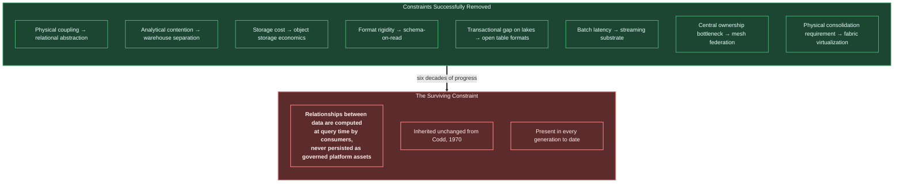

# 6. Evolution of Enterprise Data Architecture

---

This chapter traces six decades of enterprise data architecture. The purpose is not historical completeness but **diagnostic precision**: each generation is examined for the constraint it removed and the constraint it left in place. The argument developed in [Chapter 7](07-why-another-architecture.md) depends on establishing that one particular constraint has survived every generation intact.

## 6.1 Evolution Timeline

```mermaid
timeline
    title Six Decades of Enterprise Data Architecture
    section Foundations 1960s–1980s
        1960s : Hierarchical and network databases : IMS, CODASYL
        1970  : Codd's relational model : logical–physical independence
        1979  : First commercial RDBMS : SQL becomes lingua franca
        1980s  : OLTP standardization : ACID, two-phase commit
    section Analytical Era 1990s–2000s
        1991  : Inmon — Corporate Information Factory : normalized enterprise repository
        1992  : Kimball — dimensional modelling : star schemas, conformed dimensions
        1990s  : ETL industrialization : nightly batch, MPP appliances
        2000s  : Columnar storage and MPP : Vertica, Netezza, Teradata scale-out
    section Big Data Era 2004–2015
        2004  : MapReduce published : commodity distributed computation
        2006  : Hadoop and HDFS : storage economics transformed
        2010  : Dixon coins "data lake" : schema-on-read
        2011  : Apache Kafka open-sourced : the log as integration substrate
        2012  : Spark and in-memory processing : iterative and interactive workloads
        2014  : Kappa architecture proposed : streaming-first reprocessing
    section Convergence Era 2016–2022
        2016  : Cloud object storage dominance : separation of storage and compute
        2017  : Flink stateful streaming matures : event-time correctness at scale
        2019  : Delta Lake, Iceberg, Hudi : ACID on object storage
        2019  : Dehghani proposes data mesh : federated domain ownership
        2020  : Lakehouse formalized : warehouse semantics on lake economics
        2021  : Data fabric gains traction : metadata-driven virtualized integration
    section Intelligence Era 2022–present
        2022  : Foundation models enter enterprise : LLMs as data interface
        2023  : RAG becomes standard grounding pattern : vector databases mainstream
        2024  : AI agents as autonomous data consumers : tool use, multi-step reasoning
        2025  : Governance of AI inference : EU AI Act, model risk frameworks
        2026  : Proposed — correlation as architecture : Data Swimming Pool
```

**Figure 5.** *Six decades of enterprise data architecture. Each era removed a binding constraint of its predecessor. The final entry is the proposal of this whitepaper and is presented as a hypothesis about the next constraint to be addressed, not as an established development.*

## 6.2 Databases

**The constraint removed.** Before the relational model, applications were coupled to physical storage layout. Changing an access path meant rewriting programs. Codd's model [1] introduced logical–physical independence, and the subsequent standardization of SQL made data accessible to a population far larger than systems programmers.

**Architectural characteristics.** Row-oriented storage optimized for point access and small-range scans; ACID transactions under concurrency control; normalized schemas minimizing redundancy; relationships expressed declaratively as foreign key constraints and resolved at query time through joins.

**The constraint left in place.** Two, both consequential.

First, **analytical workloads degrade transactional systems**. A complex aggregation over millions of rows competes for the same locks and buffers as latency-sensitive transactions. This tension produced the entire warehouse industry.

Second — and this is the thread this whitepaper follows — **relationships are computed, never stored**. A foreign key is a constraint permitting a join, not a materialized edge. Relationships between entities in *different* databases are not expressible at all. Every subsequent generation inherited this assumption without re-examining it.

## 6.3 Data Warehouses

**The constraint removed.** Warehouses separated analytical workloads from transactional ones, introduced subject-oriented integration across source systems, and — through dimensional modelling [2] and columnar storage — made large aggregations tractable.

**Architectural characteristics.** Schema-on-write with rigorous upfront modelling; ETL pipelines performing extraction, conformance, and load, typically on nightly cycles; star and snowflake schemas with conformed dimensions; slowly changing dimension patterns for history; MPP execution across shared-nothing nodes.

**What warehouses achieved that is under-appreciated.** Warehouses remain, by a considerable margin, the strongest generation for **semantic consistency and trust**. A well-governed warehouse has a single, documented, agreed definition of every metric. Later generations traded this away for flexibility and have spent the subsequent decade attempting to recover it through semantic layers and metrics stores.

**The constraint left in place.** Schema-on-write requires knowing the questions in advance; unanticipated questions require a modelling change with a multi-week lead time. Batch cadence bounds freshness at hours to days. Semi-structured and unstructured data fit poorly. Cost scales unfavourably with volume when storage and compute are coupled.

Critically: warehouses materialize **anticipated** relationships beautifully and **unanticipated** relationships not at all. The dimensional model is a frozen assertion about which relationships matter.

## 6.4 Data Lakes

**The constraint removed.** Storage economics and format rigidity. Hadoop [29], and later cloud object storage, decoupled retention from cost and permitted ingestion of any format without prior modelling. Schema-on-read shifted interpretation to query time, so data could be captured before its use was known.

**Architectural characteristics.** Object storage as substrate; raw, refined, and curated zones; schema applied at read time; distributed processing via MapReduce and later Spark [21]; native support for logs, documents, images, audio, and telemetry.

**The constraint left in place.** The absence of enforced structure removed the discipline that made warehouses trustworthy. Without rigorous cataloging, quality enforcement, and ownership, lakes degraded into **data swamps** — repositories with high volume and low discoverable value. The lake also lacked transactional guarantees: concurrent writes, updates, and deletes were unsafe, making the lake unsuitable as a system of record and complicating regulatory obligations such as the right to erasure.

For the correlation thread: the lake made *more* data available for correlation while providing *fewer* mechanisms to perform it. Schema-on-read means every consumer independently interprets structure, so even agreement on what constitutes a customer record becomes a per-consumer decision.

## 6.5 Data Lakehouses

**The constraint removed.** The lakehouse [31] reconciled warehouse semantics with lake economics. Open table formats — Delta Lake, Apache Iceberg, Apache Hudi — introduced ACID transactions, schema evolution, time travel, and efficient upserts over object storage.

**Architectural characteristics.** Metadata layer over columnar files providing snapshot isolation and atomic commits; unified batch and streaming ingestion into the same tables; medallion (bronze/silver/gold) refinement zones; decoupled elastic compute; direct support for ML feature engineering.

**Assessment.** The lakehouse is, in the author's judgement, the strongest *technical* foundation currently available, and Data Swimming Pool assumes a lakehouse-class persistence substrate rather than proposing an alternative to it.

**The constraint left in place.** The lakehouse resolved the **storage** contradiction. It did not address the **relationship** problem. A lakehouse contains excellently-governed tables that still require query-time joins to relate, still lack cross-domain entity resolution, and still persist no discovered associations. It is a superior container for the same architectural gap.

## 6.6 Data Fabric

**The constraint removed.** Physical consolidation as a prerequisite for integrated access. Data fabric proposes a metadata-driven virtualization layer that presents a unified view across heterogeneous, distributed sources, using active metadata and knowledge graphs to automate discovery, integration, and policy enforcement.

**Architectural characteristics.** Active metadata catalog as the control plane; semantic knowledge graph over data assets; data virtualization and federated query; automated policy propagation; ML-assisted discovery, classification, and pipeline recommendation.

**Proximity to this proposal.** Data fabric is the closest incumbent to Data Swimming Pool, and shares two important commitments: metadata as an active control plane, and a knowledge graph as the semantic backbone.

**The constraint left in place — and the precise distinction.** Data fabric's knowledge graph describes **data assets**: this table, its columns, its owner, its lineage, its classification, its relationship to that other table. This is a graph *about the data estate*.

Data Swimming Pool's knowledge graph describes **business entities and the events connecting them**: this customer, this transaction, this device, this shipment, and the temporal, causal, and behavioural relationships observed between them. This is a graph *about the business as it actually behaves*.


**The distinction stated precisely.** Data fabric builds a graph of the *catalog*. Data Swimming Pool builds a graph of the *content*. A fabric can tell you that the transactions table relates to the customers table via a foreign key. It cannot tell you that *this specific transaction* is related to *that specific support call* and *that specific device change*, with a confidence of 0.87, on evidence of temporal proximity and shared resolved entity.


Additionally, data fabric is predominantly **query-time**: it federates when asked. Correlation in Data Swimming Pool is **continuous**: it runs whether or not anyone is asking.

## 6.7 Data Mesh

**The constraint removed.** Organizational rather than technical. Dehghani [28] observed that centralized data teams become bottlenecks scaling super-linearly with domain count, and that centralizing data ownership away from those with domain expertise degrades quality. Data mesh proposes four principles: domain-oriented decentralized ownership; data as a product; self-serve data infrastructure as a platform; and federated computational governance.

**Assessment.** Data mesh is a genuine and important contribution, and Data Swimming Pool adopts three of its four principles directly — data as a product (extended to insights and correlations), self-serve platform, and federated computational governance.

**The constraint left in place, and an unintended consequence.** Data mesh optimizes for **intra-domain** quality and velocity. It provides interoperability standards for cross-domain consumption, but the *inter-domain analytical space* has no owner by construction. If the payments domain and the customer-service domain each produce excellent data products, who is responsible for the relationship between a payment failure and a service call?

The answer under orthodox mesh is "the consuming domain," which means every consuming domain independently rebuilds cross-domain correlation — the correlation tax of [Chapter 5](05-current-challenges.md), now formalized as an organizational principle.


**Not a criticism of data mesh.** It is an observation that mesh solves a different problem. Mesh answers *"how do we scale ownership?"* Data Swimming Pool answers *"who owns the relationships between owned things?"* The two are complementary: the correlation substrate can plausibly be operated as a platform-provided capability within a mesh, and [Chapter 25](../part-3/25-governance.md) proposes exactly that.


## 6.8 Event Streaming

**The constraint removed.** Batch latency. Kafka [32] established the distributed commit log as durable, replayable, horizontally scalable integration substrate. Flink [20] and Spark Structured Streaming brought exactly-once stateful processing with event-time correctness. The Dataflow model [19] supplied the semantics for correctness under out-of-order arrival.

**Architectural characteristics.** Append-only partitioned logs with configurable retention; publish–subscribe decoupling of producers and consumers; stateful operators with checkpointed fault tolerance; event-time windowing with watermarks; exactly-once semantics via transactional writes and idempotent producers.

**The constraint left in place.** Streaming solved *movement*, not *meaning*. A Kafka cluster carrying two hundred topics is a highly efficient mechanism for delivering two hundred independent streams to independent consumers. Nothing in the streaming paradigm relates topic A to topic B. Stream-to-stream joins exist and work well, but they are:

- **declared per application**, not maintained as platform assets;
- **narrowly windowed**, because state cost grows with window width;
- **transient** — the join result is emitted downstream and the relationship is not persisted;
- **key-based**, requiring a shared join key, which cross-domain events rarely have.

Streaming is the essential *substrate* for correlation and is not itself correlation.

## 6.9 Comparative Synthesis

| Dimension | Database | Warehouse | Lake | Lakehouse | Fabric | Mesh | Streaming |
| --- | --- | --- | --- | --- | --- | --- | --- |
| **Era** | 1970s | 1990s | 2010s | 2019+ | 2021+ | 2019+ | 2011+ |
| **Primary constraint removed** | Physical coupling | Analytical contention | Storage cost | Lake/warehouse split | Physical consolidation | Central bottleneck | Batch latency |
| **Schema posture** | On write | On write | On read | On write, evolvable | Virtual | Per domain | Contract |
| **Latency** | ms (OLTP) | Hours–days | Hours | Minutes–hours | Query-time | Varies | ms–seconds |
| **Data variety** | Structured | Structured | Any | Any | Any | Any | Semi-structured |
| **Governance model** | Schema constraints | Centralized, strong | Weak | Table-level | Metadata-driven | Federated | Schema registry |
| **Relationship handling** | Query-time join | Pre-modelled join | None | Query-time join | Catalog graph | Per-domain contract | Windowed join |
| **Relationships persisted?** | ✘ | Partially (as schema) | ✘ | ✘ | Asset-level only | ✘ | ✘ |
| **Cross-domain intelligence** | ✘ | Limited | ✘ | Limited | Moderate | ✘ | ✘ |
| **Continuous evaluation** | ✘ | ✘ | ✘ | ✘ | ✘ | ✘ | ✔ (per stream) |
| **Native AI integration** | ✘ | Limited | Moderate | Strong | Moderate | Moderate | Limited |

**Table 5.** *Generational comparison of enterprise data architectures. The two rows that matter most for this whitepaper's argument are "Relationships persisted?" and "Cross-domain intelligence" — where no generation scores well, including the most recent.*

## 6.10 The Surviving Constraint

Reading Table 5 by column tells a story of steady, genuine progress. Reading it by **row** tells a different one.

**Figure 6.** *Capability accretion versus the surviving constraint. Eight distinct binding constraints have been removed across six decades. The assumption that relationships are computed by consumers at query time rather than maintained by the platform has passed through every generation without re-examination.*

This is the observation on which the remainder of the whitepaper rests. It is not a claim that previous generations were wrong — each was correct for its constraint. It is a claim that this particular assumption has never been the *target* of an architectural generation, and that conditions have now changed sufficiently to make it worth targeting.

---


## Key Takeaways

1. **Six decades produced eight genuine constraint removals**, from physical coupling through batch latency to centralized ownership. The progress is real and each generation remains valuable within its design intent.
2. **Warehouses remain the strongest generation for semantic trust**, a property later generations traded for flexibility and have spent a decade attempting to recover.
3. **The lakehouse resolved the storage contradiction, not the relationship problem.** It is a superior container for the same gap, and Data Swimming Pool assumes rather than replaces it.
4. **Data fabric builds a graph of the catalog; Data Swimming Pool builds a graph of the content.** Fabric relates assets; the proposed framework relates business entities and the events connecting them, continuously rather than at query time.
5. **Data mesh leaves the inter-domain space ownerless by construction**, formalizing the correlation tax as an organizational principle. The two frameworks are complementary rather than competing.
6. **Streaming solved movement, not meaning.** Stream joins are declared per application, narrowly windowed, transient, and key-dependent — an essential substrate for correlation but not correlation itself.
7. **One constraint survived every generation intact:** relationships are computed by consumers at query time and never persisted as governed platform assets. It has never been the explicit target of an architectural generation.


---

**Next:** [7. Why Another Architecture? →](07-why-another-architecture.md)
