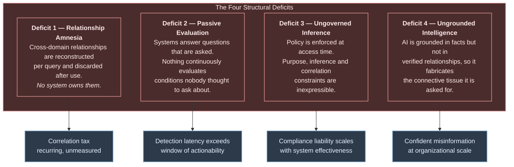

# 7. Why Another Architecture?

---

The enterprise data field does not suffer from a shortage of architectural paradigms. It arguably suffers from a surplus. Any proposal for a new one therefore carries a burden of proof, and this chapter attempts to discharge it explicitly.

## 7.1 The Burden of Proof

A new architectural paradigm is justified only if it satisfies all four of the following tests. Failing any one of them, the correct response is to extend an existing paradigm rather than propose a new one.

| # | Test | Question |
| --- | --- | --- |
| **T1** | **Gap** | Is there a class of problem that no existing paradigm treats as a first-class concern? |
| **T2** | **Insufficiency** | Would extending an existing paradigm be inadequate, rather than merely inconvenient? |
| **T3** | **Feasibility** | Do the technical preconditions for the proposal now exist? |
| **T4** | **Materiality** | Is the value at stake large enough to justify the cost and risk of adoption? |

**Table 6.** *Tests applied to justify a new architectural paradigm. Each is addressed in turn below. The author regards T2 as the most demanding and treats it at greatest length.*

## 7.2 Test One — Is There a Genuine Gap?

[Chapter 6](06-evolution.md) established that no generation persists relationships as governed platform assets. This section decomposes that observation into four distinct structural deficits, so that the proposed architecture can be evaluated against each specifically.

**Figure 7.** *The four structural deficits and their operational consequences. Each deficit is independently addressable in principle; the argument for a unified architecture is that they share a single root cause and that addressing them separately produces four partially-overlapping systems.*

### Deficit 1 — Relationship Amnesia

The system has no memory of what it learned. A correlation established by an analyst in March is unavailable to a model in June. This is the correlation tax formalized: the platform's inability to retain relational knowledge means the organization pays for the same discovery repeatedly.

### Deficit 2 — Passive Evaluation

Every incumbent paradigm is fundamentally **interrogative**: it responds to queries. Streaming is the partial exception, evaluating continuously *within* a declared stream topology. But no paradigm continuously evaluates the *cross-product* of domains looking for conditions that were never declared.

This matters because the highest-value correlations are frequently the ones nobody anticipated. A pre-declared rule catches known fraud patterns. It does not catch the pattern that emerged last week.

### Deficit 3 — Ungoverned Inference

Developed in [Chapter 5](05-current-challenges.md). Access controls govern *retrieval*. They cannot govern *derivation*. As inference becomes automated, the ungoverned surface grows in direct proportion to capability.

### Deficit 4 — Ungrounded Intelligence

Also developed in [Chapter 5](05-current-challenges.md). As AI becomes the dominant interface to enterprise data, the absence of a relationship substrate converts a latent gap into an active generator of plausible fabrication.

**T1 verdict: satisfied.** Four distinct deficits, sharing a root cause, unaddressed as first-class concerns by any incumbent paradigm.

## 7.3 Test Two — Could an Existing Paradigm Be Extended?

This is the strongest objection to the whitepaper and deserves the most careful treatment. The author examines each candidate extension on its merits and concedes where the objection has force.

### 7.3.1 "Extend the Lakehouse"

**The proposal.** Add correlation tables to a lakehouse. Persist discovered relationships as Iceberg or Delta tables. Query them with SQL.

**What works.** A great deal. Correlation results genuinely *should* be persisted in lakehouse-class storage, and [Chapter 10](../part-2/10-system-architecture.md) specifies exactly that. The lakehouse gives ACID guarantees, time travel, and schema evolution — all of which correlation artifacts need.

**Where it is insufficient.** Three specific places.

*Traversal performance.* The dominant access pattern over correlations is multi-hop traversal — *"what is connected to this, and what is connected to that, to depth four?"* Expressed in SQL this is a recursive common table expression, and recursive CTEs over columnar storage perform poorly relative to native graph traversal, typically by one to two orders of magnitude at depth three and beyond. This is a structural property of the storage layout, not a tuning problem.

*Continuous evaluation.* A lakehouse table is written by a job. Correlation requires a continuously-running stateful process observing streams, maintaining windows, and emitting relationships as they form. That process is not a lakehouse feature; it is a separate architectural component that happens to write to the lakehouse.

*Semantics.* A correlation is not a row. It has a confidence score requiring calibration, an evidence set requiring lineage, a temporal validity requiring expiry, a policy classification requiring enforcement, and a supersession relationship to prior versions of itself. These semantics can be encoded in table columns, but encoding semantics in columns and relying on every consumer to honour them is precisely the pattern that produced the problems in [Chapter 5](05-current-challenges.md).

**Concession.** For an organization with modest correlation ambitions — perhaps a few dozen well-understood relationship types within two or three domains — extending the lakehouse is very likely the correct and proportionate choice. The author states this plainly: **most organizations should not build a Data Swimming Pool.** They should extend what they have.

### 7.3.2 "Extend the Data Fabric"

**The proposal.** Data fabric already has an active metadata catalog and a knowledge graph. Extend the graph from assets to instances.

**Where it is insufficient.** This is a larger change than it appears. Fabric graphs are **metadata-scale**: thousands to hundreds of thousands of nodes describing tables, columns, pipelines, and owners. An instance-level correlation graph is **data-scale**: potentially billions of nodes and tens of billions of edges, with high write throughput and continuous expiry.

These are different systems with different storage engines, different consistency requirements, different cost profiles, and different operational disciplines. The metadata catalog is a control plane; the correlation graph is a data plane. Conflating them would degrade both — the catalog would inherit the correlation graph's write amplification, and the correlation graph would inherit the catalog's assumption of low churn.

**Concession.** Data fabric's *philosophy* — active metadata driving automated behaviour — is correct and is adopted wholesale by this framework. The disagreement is about the scale and placement of the graph, not about the value of graphs.

### 7.3.3 "Extend Complex Event Processing"

**The proposal.** CEP already detects cross-event patterns. Scale it up and persist the results.

**Where it is insufficient.** CEP is **declarative by construction**. Its power derives from the ability to state a pattern precisely and match it efficiently. That same property is its limitation: a CEP engine finds what you told it to find.

Extending CEP to *discover* undeclared relationships requires adding statistical inference, entity resolution across heterogeneous identifiers, semantic similarity via embeddings, and learned behavioural models. At the point where all four have been added, the result is no longer a CEP engine — it is a correlation engine that includes a CEP engine as one of five modalities. That is precisely the design of [Chapter 14](../part-2/14-correlation-engine.md), and the framework acknowledges CEP as its most direct antecedent.

**Concession.** If an organization's correlation needs are entirely expressible as declared patterns, CEP is sufficient and considerably simpler. Use it.

### 7.3.4 "Extend the Data Mesh"

**The proposal.** Make cross-domain correlations a data product owned by a domain.

**Where it is insufficient.** Which domain owns the relationship between payments and customer service? If payments owns it, payments must acquire and maintain expertise in customer-service semantics — violating the domain-expertise principle that motivates mesh. If a new "correlation domain" is created, it is a centralized team by another name — violating the decentralization principle.

The correlation substrate is more accurately characterized as **self-serve platform capability**, which is mesh's third principle. This is exactly what [Chapter 25](../part-3/25-governance.md) proposes, making the framework a mesh-compatible platform component rather than a mesh alternative.

**Concession.** Substantial. Data Swimming Pool can and arguably should be operated *within* a data mesh. The framework does not require abandoning mesh and is more likely to succeed alongside it.

### 7.3.5 "Just Use a Graph Database"

**The proposal.** Load everything into Neo4j and traverse.

**Where it is insufficient.** A graph database is storage and query. It does not ingest from heterogeneous sources, does not resolve entities, does not maintain streaming state, does not score confidence, does not calibrate against ground truth, does not expire stale edges, and does not enforce purpose-binding policy. It is one component of the architecture — an important one, specified in [Chapter 17](../part-2/17-knowledge-graph-layer.md) — and not a substitute for it.

Additionally, indiscriminate loading of enterprise data into a graph produces a graph with poor edge quality, which is worse than no graph: it invites confident traversal over unverified relationships.

### 7.3.6 Verdict on T2

| Candidate extension | Sufficient for | Insufficient because |
| --- | --- | --- |
| Extend the lakehouse | Modest, well-understood correlation within 2–3 domains | Traversal performance, no continuous evaluation, correlation semantics unenforced |
| Extend the data fabric | Asset-level relationship discovery | Metadata-scale control plane cannot absorb data-scale correlation plane |
| Extend CEP | Fully declarable pattern sets | No discovery of undeclared relationships; adding it produces a correlation engine |
| Extend the data mesh | Organizational scaling of ownership | Inter-domain space has no natural owner; correlation is platform capability |
| Use a graph database | Storage and traversal of correlations | Not ingestion, resolution, scoring, calibration, expiry or policy |

**Table 7.** *Assessment of extending existing paradigms. Each extension is sufficient within a bounded scope, and organizations within that scope should take it. The composite requirement — continuous, cross-domain, discovered, scored, persisted, governed correlation — is not met by any single extension.*

**T2 verdict: satisfied, with significant concessions.** The framework is justified only for organizations whose requirements exceed all five bounded scopes above. That is a minority of organizations, and the whitepaper states so.

## 7.4 Test Three — Are the Preconditions Now Met?

An architecture proposed before its enabling technologies exist is speculation. The relevant question is whether the preconditions for industrialized correlation are now satisfied. The author assesses that they are, and that most became true within the last five years.

| Precondition | Status | Enabling development |
| --- | --- | --- |
| Durable, replayable, high-throughput event substrate | ✔ Mature | Kafka, Pulsar, Kinesis at millions of events/second |
| Exactly-once stateful stream processing with event-time correctness | ✔ Mature | Flink, Spark Structured Streaming, Dataflow model |
| Transactional storage with time travel at object-storage cost | ✔ Mature | Iceberg, Delta Lake, Hudi |
| Graph storage at billions of edges with sub-second traversal | ✔ Adequate | Neo4j, TigerGraph, Neptune, JanusGraph |
| Semantic similarity at scale | ✔ Mature | Embedding models, HNSW/IVF indices, vector databases |
| Reasoning over retrieved structured evidence | ✔ Emerging | Foundation models, RAG, tool use, structured output |
| Machine-enforceable policy | ✔ Adequate | OPA/Rego, Cedar, purpose-based access control research |
| Standardized lineage capture | ✔ Emerging | OpenLineage, OpenTelemetry, Marquez |
| Elastic compute economics | ✔ Mature | Cloud autoscaling, spot capacity, serverless execution |

**Table 8.** *Technical preconditions for industrialized correlation. Seven of nine are mature; two are adequate-to-emerging. The composite has been feasible for approximately three to five years, which is a plausible explanation for why the pattern has not yet been named.*

**T3 verdict: satisfied.** No component requires invention. The composition requires engineering, not research.

## 7.5 Test Four — Is the Value Material?


**Illustrative reasoning.** The following is a structured argument about value, not a measurement or a forecast. No deployment exists from which to derive real figures.


Value materiality is assessed by considering where correlation is the *binding constraint* on an outcome the organization already values:

**Where value is likely material.** Fraud and financial crime detection, where the majority of sophisticated schemes are cross-domain by design and detection precision is directly monetized. Security operations, where alert correlation is the dominant cost driver and dwell time the dominant risk. Industrial reliability, where failure is multi-causal and unplanned downtime is expensive per hour. Clinical deterioration detection, where signals are individually weak and collectively strong. Customer retention in high-value B2B segments, where churn causes are cross-domain and account value justifies investigation cost.

**Where value is likely immaterial.** Single-domain reporting. Regulatory submissions with fixed, well-defined schemas. Organizations with fewer than roughly five substantive data domains. Organizations whose analytical questions are stable and well-served by existing dimensional models. Organizations that have not yet achieved reliable data quality — where the framework will amplify rather than remedy the deficiency.

**T4 verdict: conditionally satisfied.** Material for a specific class of organization characterized by high domain count, high cross-domain interaction, short windows of actionability, and existing data maturity. Not material for the majority.

## 7.6 What Would Falsify This Proposal

Intellectual honesty requires stating the conditions under which the author would consider the framework refuted. The following would each constitute meaningful evidence against it:

1. **A controlled comparison** in which a correlation-first architecture produces no improvement in decision quality or time-to-insight relative to a well-engineered lakehouse with the same data.
2. **Demonstration that correlation precision cannot be maintained** above a useful threshold at enterprise scale — that is, that spurious correlations dominate genuine ones irrecoverably as domain count grows.
3. **Demonstration that the operational cost** of maintaining a correlation substrate exceeds the correlation tax it eliminates, across a representative range of organizations.
4. **Emergence of a foundation-model capability** that performs reliable, attributable, governed cross-domain correlation directly over raw enterprise data without a dedicated substrate — rendering the architectural tier unnecessary.

The fourth is, in the author's view, the most plausible falsification route and is discussed further in [Chapter 40](../part-5/40-future-roadmap.md).

---


## Key Takeaways

1. **A new paradigm must pass four tests** — genuine gap, insufficiency of extension, technical feasibility, and material value. The author regards the second as the most demanding.
2. **Four structural deficits share one root cause:** relationship amnesia, passive evaluation, ungoverned inference, and ungrounded intelligence.
3. **Every candidate extension is sufficient within a bounded scope.** Organizations inside those bounds should extend rather than adopt. This is stated as a recommendation, not a caveat.
4. **Most organizations should not build a Data Swimming Pool.** The framework is justified for enterprises with high domain count, high cross-domain interaction, short actionability windows, and existing data maturity.
5. **The preconditions became true only recently.** Seven of nine enabling technologies are mature and two are emerging; the composite has been feasible for roughly three to five years.
6. **Data Swimming Pool is mesh-compatible and lakehouse-dependent.** It is best understood as a platform capability operating alongside these paradigms rather than replacing them.
7. **Four explicit falsification conditions are stated**, the most plausible being that foundation models eventually perform governed cross-domain correlation without a dedicated substrate.


---

**Next:** [8. Introducing Data Swimming Pool →](../part-2/08-introducing-dsp.md)
