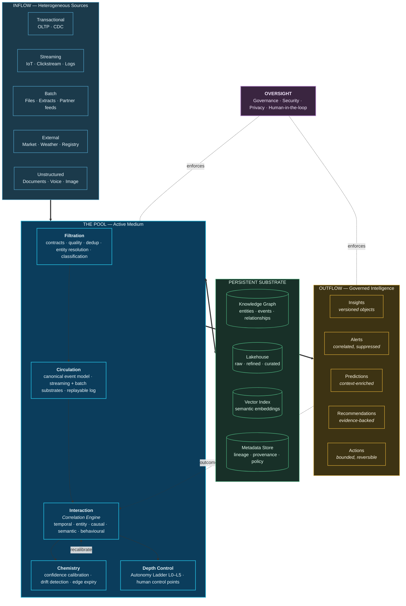

# 8. Introducing Data Swimming Pool

---

## 8.1 Definition


### Definition — Data Swimming Pool

A **Data Swimming Pool** is a governed enterprise data ecosystem in which heterogeneous batch and streaming sources are continuously ingested into a shared, instrumented medium where they interact, correlate, and enrich one another, producing a persistent and queryable graph of event relationships from which insights, alerts, predictions, recommendations, and bounded autonomous actions are generated in a lineage-traceable and policy-governed manner.


The definition is dense by intent. Each clause carries architectural weight:

| Clause | Architectural commitment |
| --- | --- |
| *governed* | Policy is enforced computationally at ingestion, correlation, inference, and action — not solely at access. |
| *heterogeneous batch and streaming* | One canonical event model spans both modalities; business logic is written once. |
| *continuously ingested* | The system operates whether or not anyone is querying it. |
| *shared, instrumented medium* | A common substrate with observability as a designed property, not an add-on. |
| *interact, correlate, enrich one another* | Cross-source association is a platform function, not an application function. |
| *persistent and queryable graph* | Relationships are durable, versioned, first-class artifacts — the defining commitment. |
| *insights, alerts, predictions, recommendations, autonomous actions* | Output is a spectrum of decision support, not a single artifact type. |
| *lineage-traceable* | Every output resolves to its evidence. Unattributable conclusions are rejected by construction. |
| *policy-governed* | Purpose, permissibility, and autonomy limits are enforced by machine. |


**Original conceptual framework.** Data Swimming Pool is proposed by the author. It builds on existing architectures and technologies and is **not** an industry standard, a product, or a deployed system.


## 8.2 The Metaphor Formalized

[Chapter 3](../part-1/03-introduction.md) introduced the metaphor. Here it is mapped onto architecture explicitly, because the mapping is the design.

| Swimming pool property | Architectural realization | Chapter |
| --- | --- | --- |
| **Water is continuously circulated** | Data flows through the circulation layer whether or not queried; correlation is continuous, not interrogative | [11](11-streaming-layer.md), [12](12-batch-layer.md) |
| **Filtration runs constantly** | Quality validation, deduplication, entity resolution and contract enforcement operate as always-on processes | [13](13-ingestion-layer.md) |
| **Chemistry is monitored and balanced** | Correlation confidence is continuously calibrated against ground truth; drift triggers recalibration | [14](14-correlation-engine.md) |
| **Contents interact and affect one another** | Cross-source correlation across five modalities; each new event may revise existing relationships | [14](14-correlation-engine.md), [19](19-event-relationships.md) |
| **Water is transparent by design** | Full lineage from every insight to its constituent evidence; no opaque conclusions | [18](18-metadata-and-lineage.md) |
| **Capacity is finite and engineered** | Correlation scope is explicitly bounded; unbounded correlation is architecturally prohibited | [14](14-correlation-engine.md), [26](../part-3/26-scalability.md) |
| **Lanes separate different activities** | Domain and tenant isolation with controlled cross-lane correlation under policy | [23](../part-3/23-security-architecture.md) |
| **Depth is marked and enforced** | The Autonomy Ladder — graduated decision authority with explicit limits | [20](20-autonomous-decision-support.md) |
| **A lifeguard is always present** | Human oversight is architecturally mandated, not culturally hoped for | [20](20-autonomous-decision-support.md) |
| **Access is controlled at entry** | Contract-enforcing ingestion; nothing enters unvalidated and unclassified | [13](13-ingestion-layer.md) |

**Table 9.** *The swimming pool metaphor mapped to architectural commitments. The metaphor is a design tool rather than a rhetorical device: each property corresponds to a specific, chapter-level design decision.*

Three properties deserve emphasis because they distinguish this framework from a data lake most sharply.

**Finite, engineered capacity.** A lake's implicit promise is unbounded retention. A pool's explicit property is designed capacity. This maps to a hard architectural rule: **correlation scope MUST be bounded**. The framework does not attempt to correlate everything with everything. It correlates within declared, budgeted, and reviewable scopes. [Chapter 14](14-correlation-engine.md) treats the combinatorial consequences of violating this rule.

**Continuous maintenance.** A pool left unmaintained for a month becomes unusable. So does a correlation substrate: entity resolutions decay, confidence calibrations drift, relationship types become stale, and semantic embeddings age. The framework treats maintenance as an operational requirement with an owner and a budget, not as a project phase.

**Marked depth.** Swimmers are told where the water becomes dangerous. The Autonomy Ladder performs the same function for machine decisions, and it is enforced by the architecture rather than by policy documents.

## 8.3 Conceptual Model

**Figure 8.** *The Data Swimming Pool conceptual model. Heterogeneous inflow passes through filtration into a circulating medium where the Correlation Engine drives interaction between sources. Chemistry — confidence calibration and edge expiry — maintains the medium's quality continuously. Depth control governs how much decision authority the system may exercise. Outflow is a spectrum of governed intelligence products whose outcomes feed back as supervision signal.*

## 8.4 The Three Defining Objects

The framework introduces three object types that have no direct equivalent in incumbent architectures. Their formal schemas appear in [Appendix C](../appendix/c-schemas.md).

### 8.4.1 The Canonical Event

Every fact entering the pool — a transaction, a sensor reading, a document upload, a CDC row change, a batch record — is normalized into a **canonical event** carrying a stable identity, event-time and ingestion-time, a resolved entity reference set, a source lineage pointer, a policy classification, and a payload.

The critical field is the **resolved entity reference set**. A raw transaction references a numeric account code. The canonical event references the resolved commercial entity *and* retains the original identifier. This single normalization is what makes cross-domain correlation tractable, and performing it once at ingestion rather than repeatedly at query time is the primary mechanism by which the framework eliminates the correlation tax.

### 8.4.2 The Correlation

A **correlation** is a first-class, persistent artifact asserting a typed relationship between two or more canonical events or entities. It carries:

- **Type** — one of the taxonomy in [Chapter 19](19-event-relationships.md)
- **Modality** — which of the five detection mechanisms produced it
- **Confidence** — a calibrated score with a stated interpretation
- **Evidence set** — the specific events and features supporting it
- **Temporal validity** — when it holds, and when it expires
- **Provenance** — the engine version, model version, and parameters that produced it
- **Policy classification** — purposes for which it may lawfully be used
- **Supersession** — a link to any prior correlation it revises

A correlation is not a query result. It is a governed asset with a lifecycle.

### 8.4.3 The Insight Object

An **Insight Object** is a durable, versioned assertion about the business, derived from correlations, carrying its full evidence chain, an explicit confidence statement, a stated recommended action, an autonomy level, a permission set, and a lifecycle status (proposed, validated, acted upon, superseded, retracted).


### Design Principle — Insights Are Products, Not Outputs

An insight MUST be a durable, addressable, versioned, permission-bearing artifact with full lineage to its evidence. A dashboard rendering, a notification, or a model output that cannot be resolved to the specific events supporting it is not an Insight Object and MUST NOT be treated as one.


This is a significant departure. In incumbent architectures the analytical output is ephemeral: a chart, an alert, a score. The framework's position is that if a conclusion is worth acting on, it is worth persisting, versioning, attributing, and auditing — and that the inability to do so is why organizations cannot reconstruct why a decision was made six months later.

## 8.5 Data Lake versus Data Swimming Pool

| Dimension | Data Lake | Data Swimming Pool |
| --- | --- | --- |
| **Metaphorical posture** | Passive reservoir | Engineered circulating medium |
| **Data state** | At rest | In circulation |
| **Entry control** | Land anything, interpret later | Contract-validated, classified, entity-resolved at entry |
| **Schema** | On read, per consumer | Canonical event model, enforced |
| **Interaction between sources** | None | Continuous correlation across five modalities |
| **Relationships** | Computed per query, discarded | Persisted, typed, scored, versioned, expiring |
| **Evaluation model** | Interrogative — answers questions asked | Continuous — evaluates conditions nobody asked about |
| **Quality trajectory** | Degrades without intervention (swamp risk) | Actively maintained by design (filtration, calibration) |
| **Semantic layer** | Absent or bolted on | Living knowledge graph fed by observed relationships |
| **AI grounding** | Documents and tables | Documents, tables, **and verified relationships** |
| **Output** | Datasets for downstream use | Insight Objects with evidence and lineage |
| **Governance point** | Access | Ingestion, correlation, inference, action, and access |
| **Capacity posture** | Unbounded retention | Bounded, budgeted correlation scope |
| **Autonomy** | None | Graduated, governed, reversible |
| **Failure mode** | Data swamp — high volume, low value | Correlation noise — spurious relationships at scale |
| **Operational burden** | Low to moderate | High |
| **Maturity** | Mature, widely deployed | Proposed, unvalidated |

**Table 10.** *Data Lake versus Data Swimming Pool. The final three rows are as important as the first thirteen: the framework carries a distinct failure mode, a substantially higher operational burden, and no deployment history.*

## 8.6 What the Framework Does Not Claim

To forestall predictable misreadings:

- **It does not claim to replace the lakehouse.** It assumes one as its persistence substrate.
- **It does not claim to replace data mesh.** It is proposed as a platform capability operable within a mesh.
- **It does not claim that correlation is always valuable.** [Chapter 7](../part-1/07-why-another-architecture.md) identifies the organizational profile for which it is material and states plainly that most organizations fall outside it.
- **It does not claim causality.** Correlations are hypotheses with confidence scores, bounded by the limits Lamport established in 1978.
- **It does not claim autonomy is desirable by default.** The Autonomy Ladder exists to constrain autonomy, and Levels 4 and 5 are recommended only under narrow conditions.
- **It does not claim production readiness.** This is its most significant limitation and is rated as such in every comparison in this document.

---


## Key Takeaways

1. **Data Swimming Pool is a governed ecosystem in which sources interact rather than merely coexist**, producing a persistent graph of scored, expiring, lineage-carrying relationships.
2. **The metaphor is a design tool.** Circulation, filtration, chemistry balance, finite capacity, marked depth, and lifeguarding each map to a specific architectural commitment developed in a later chapter.
3. **Three novel object types define the framework:** the canonical event with resolved entity references, the correlation as a governed asset, and the Insight Object as a versioned data product.
4. **Entity resolution performed once at ingestion**, rather than repeatedly at query time, is the primary mechanism by which the correlation tax is eliminated.
5. **Insights are products, not outputs.** Any conclusion worth acting on MUST be persistent, versioned, attributable, and auditable.
6. **Bounded capacity is architectural law.** Correlation scope MUST be declared and budgeted; the framework explicitly prohibits attempting to correlate everything with everything.
7. **The framework's distinct failure mode is correlation noise** — spurious relationships at scale — analogous to and as serious as the data lake's swamp risk.


---

**Next:** [9. Core Design Principles →](09-core-design-principles.md)
