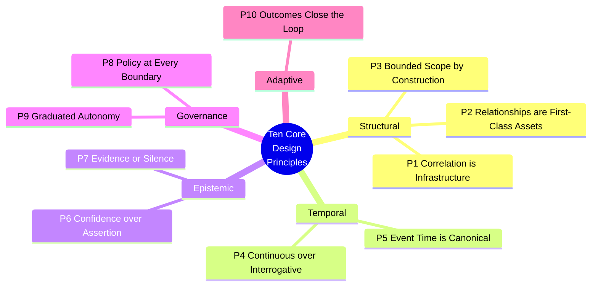

# 9. Core Design Principles

---

Ten principles govern the Data Swimming Pool framework. They are stated normatively using RFC 2119 conventions (**MUST**, **SHOULD**, **MAY**), applicable to the proposed framework only. Each principle is stated, justified, given an architectural implication, and paired with the failure mode that results from violating it.

**Figure 9.** *The ten core design principles, grouped into five thematic clusters. Structural principles define what the architecture is; temporal principles define when it acts; epistemic principles define what it may claim; governance principles define what it is permitted to do; the adaptive principle defines how it improves.*

---

## Principle 1 — Correlation Is Infrastructure


**P1.** Cross-domain correlation MUST be provided as platform infrastructure with a named owner, a service level objective, and a budget. It MUST NOT be delegated to consuming applications.


**Justification.** When correlation lives in applications, it is rebuilt per application, with inconsistent methodology, no shared provenance, and no reuse. This is the correlation tax of [Chapter 5](../part-1/05-current-challenges.md). Infrastructure status is what converts a recurring cost into a one-time investment.

**Architectural implication.** A dedicated Correlation Engine tier ([Chapter 14](14-correlation-engine.md)) exists between the circulation layer and the intelligence tier. Applications consume correlations; they do not compute them.

**Failure mode if violated.** The framework degenerates into a conventional streaming platform with a graph database attached, and every consumer resumes paying the correlation tax.

---

## Principle 2 — Relationships Are First-Class Assets


**P2.** A discovered relationship MUST be persisted as a typed, addressable, versioned artifact carrying confidence, evidence, provenance, temporal validity, and policy classification. Relationships MUST NOT exist only as transient query results.


**Justification.** A relationship that is not persisted cannot be reused, audited, contested, corrected, or improved. Persisting it converts institutional knowledge from tacit to explicit.

**Architectural implication.** The correlation store ([Chapter 17](17-knowledge-graph-layer.md)) is a system of record with the same operational standing as the lakehouse — backed up, versioned, access-controlled, and subject to retention policy.

**Failure mode if violated.** Relationship amnesia persists. The system computes correlations expensively and forgets them, which is worse than not computing them because the cost is incurred without the compounding benefit.

---

## Principle 3 — Bounded Scope by Construction


**P3.** Correlation scope MUST be explicitly declared, budgeted, and reviewable. The architecture MUST reject unbounded all-pairs correlation. Every correlation scope MUST specify its participating domains, its temporal window, its entity classes, and its computational budget.


**Justification.** Naïve correlation is O(n²) in event count. At one million events per hour, all-pairs evaluation is 10¹² comparisons per hour — economically impossible and, more importantly, statistically catastrophic. At conventional significance thresholds, a system performing 10¹² tests will surface billions of spurious "significant" relationships. **Unbounded correlation does not merely cost too much; it produces noise indistinguishable from signal.**

**Architectural implication.** Correlation scopes are declarative configuration artifacts, version-controlled, reviewed, and cost-attributed. The engine refuses to execute an undeclared scope. Partitioning strategies ([Chapter 26](../part-3/26-scalability.md)) enforce the bound physically.

**Failure mode if violated.** Simultaneous cost explosion and precision collapse — the two failure modes that would most rapidly discredit the framework.


**This is the most important principle in the framework.** An implementation that gets everything else right and this wrong will fail. An implementation that gets only this right will at least fail cheaply.


---

## Principle 4 — Continuous over Interrogative


**P4.** The system MUST evaluate declared correlation scopes continuously, independent of query activity. High-value conditions MUST be detected without a human having asked.


**Justification.** [Table 4](../part-1/05-current-challenges.md) established that detection latency exceeds the window of actionability across essentially every domain, because evaluation is triggered by human curiosity rather than by data arrival. Continuous evaluation is what closes that gap.

**Architectural implication.** Stateful stream processing is the primary execution model ([Chapter 11](11-streaming-layer.md)). Batch is a complement for wide-window and retrospective correlation ([Chapter 12](12-batch-layer.md)), not the default.

**Failure mode if violated.** The system becomes an expensive query accelerator. It answers faster but still only answers what it is asked, retaining the fundamental latency problem.

---

## Principle 5 — Event Time Is Canonical


**P5.** All correlation MUST be performed in event time, not processing time. Every canonical event MUST carry event time, ingestion time, and a source clock quality indicator. Late-arriving data MUST be handled explicitly, and correlations MUST be revisable upon late arrival.


**Justification.** Correlating in processing time correlates the behaviour of the *network and the pipeline*, not the behaviour of the *business*. A sensor reading delayed by a connectivity outage will appear temporally adjacent to unrelated events and temporally distant from its true companions. Processing-time correlation is systematically and invisibly wrong.

**Architectural implication.** Watermark-based windowing per the Dataflow model [19], with allowed-lateness configuration per correlation scope and a defined revision protocol for correlations invalidated by late arrival.

**Failure mode if violated.** Silent, systematic false correlation that is extremely difficult to detect because the system's outputs remain superficially plausible.

---

## Principle 6 — Confidence over Assertion


**P6.** Every correlation MUST carry a calibrated confidence score with a stated interpretation. The system MUST NOT assert unqualified relationships. Confidence MUST be validated against ground truth where available, and calibration drift MUST trigger recalibration.


**Justification.** Lamport's constraint [5] is fundamental: cross-system causality cannot be established, only hypothesized. A system that asserts relationships without qualification is asserting something it cannot know. Worse, uncalibrated confidence is arguably more dangerous than no confidence, because it invites trust it has not earned.

**Architectural implication.** A confidence scoring subsystem within the Correlation Engine ([Chapter 14](14-correlation-engine.md)) with defined semantics per modality, calibration against labelled outcomes, and reliability-diagram monitoring.

**Failure mode if violated.** Downstream consumers treat all correlations as equally valid, spurious relationships propagate into decisions, and the system's credibility collapses after the first well-publicized false positive.

---

## Principle 7 — Evidence or Silence


**P7.** Every insight, alert, prediction, recommendation, and action MUST resolve to the specific canonical events, correlations, models, and parameters that produced it. Any output whose evidence chain cannot be reconstructed MUST be suppressed rather than emitted.


**Justification.** Three converging requirements. Regulatory frameworks increasingly mandate explainability and the right to contest automated decisions. Operational trust depends on the ability to interrogate a surprising conclusion. And AI-generated outputs are worthless as decision inputs unless attributable.

The principle is deliberately strict: **silence is preferable to an unattributable conclusion.** An organization that cannot explain why it took an action is exposed regardless of whether the action was correct.

**Architectural implication.** Lineage capture is mandatory and inline ([Chapter 18](18-metadata-and-lineage.md)), not sampled or asynchronous. The emission path checks evidence completeness before release.

**Failure mode if violated.** Unauditable automated decisions — a regulatory, reputational, and operational liability that scales with system adoption.

---

## Principle 8 — Policy at Every Boundary


**P8.** Policy MUST be evaluated at five boundaries: ingestion, correlation, inference, action, and access. Correlation-time policy MUST be capable of prohibiting the formation of a relationship, not merely the viewing of it.


**Justification.** [Chapter 5](../part-1/05-current-challenges.md) established that access-time governance cannot express purpose and inference constraints. A correlation between protected health data and financial behaviour may be statistically valid, technically discoverable, and legally prohibited. Preventing its *viewing* is insufficient; the architecture must be able to prevent its *formation*.

**Architectural implication.** A policy decision point invoked at each boundary, with correlation scopes carrying explicit purpose declarations and a policy engine capable of denying scope execution. See [Chapter 24](../part-3/24-privacy.md) and [Chapter 25](../part-3/25-governance.md).

**Failure mode if violated.** The system's effectiveness becomes its compliance exposure. Every improvement in correlation capability enlarges the surface of impermissible inference.

---

## Principle 9 — Graduated Autonomy


**P9.** Machine decision authority MUST be expressed on the Autonomy Ladder (L0–L5). Each level MUST specify its reversibility requirement, its evidentiary standard, its human control point, and its escalation path. Autonomy level MUST be assigned per action class, MUST be independently auditable, and MUST be revocable at runtime without redeployment.


**Justification.** Autonomy is not a binary property of a system; it is a per-decision property. The same platform may appropriately auto-suppress a duplicate alert (fully reversible, low stakes) and must not auto-decline a mortgage application (materially irreversible, high stakes, regulated). Treating autonomy as a system-level setting forces an unacceptable choice between paralysis and recklessness.

**Architectural implication.** The Autonomy Ladder ([Chapter 20](20-autonomous-decision-support.md)) is enforced in the action layer, with runtime-adjustable levels, mandatory reversibility metadata, and a kill switch per action class.

**Failure mode if violated.** Either the system is too timid to deliver value, or it takes an irreversible action it should not have. The second failure ends programmes.

---

## Principle 10 — Outcomes Close the Loop


**P10.** Decision outcomes MUST be captured and fed back as supervision signal. The system MUST measure whether its correlations predicted reality and MUST adjust confidence models accordingly. Correlations that consistently fail to predict outcomes MUST be deprecated automatically.


**Justification.** Without outcome feedback, a correlation system cannot distinguish genuine relationships from persistent artifacts of its own methodology. Feedback is what makes the system's accuracy improve rather than drift.

**Architectural implication.** An outcome capture path from the action layer back to the Correlation Engine, an experiment framework for controlled comparison, and automated deprecation of chronically under-performing correlation types.

**Failure mode if violated.** Confidence scores become decoration. The system's precision degrades silently as the business changes, and nobody notices until a significant failure.

---

## 9.1 Principles Summary

| # | Principle | Cluster | Primary architectural realization | Failure mode if violated |
| --- | --- | --- | --- | --- |
| P1 | Correlation Is Infrastructure | Structural | Dedicated Correlation Engine tier | Correlation tax returns |
| P2 | Relationships Are First-Class Assets | Structural | Correlation store as system of record | Relationship amnesia persists |
| P3 | Bounded Scope by Construction | Structural | Declarative, budgeted correlation scopes | Cost explosion and precision collapse |
| P4 | Continuous over Interrogative | Temporal | Stateful stream processing as default | Expensive query accelerator |
| P5 | Event Time Is Canonical | Temporal | Watermark windowing, revision protocol | Silent systematic false correlation |
| P6 | Confidence over Assertion | Epistemic | Calibrated scoring with drift monitoring | Spurious correlations trusted equally |
| P7 | Evidence or Silence | Epistemic | Mandatory inline lineage; suppress if incomplete | Unauditable automated decisions |
| P8 | Policy at Every Boundary | Governance | Five-boundary policy decision points | Effectiveness becomes exposure |
| P9 | Graduated Autonomy | Governance | Autonomy Ladder with runtime revocation | Paralysis or irreversible error |
| P10 | Outcomes Close the Loop | Adaptive | Outcome capture and auto-deprecation | Silent precision decay |

**Table 11.** *The ten core design principles with their architectural realizations and violation consequences. P3 is regarded by the author as the most critical; P7 as the most frequently compromised under delivery pressure.*

## 9.2 Principle Conflicts and Resolution

Principles conflict in practice. The framework specifies resolution precedence:

**P3 (Bounded Scope) versus P4 (Continuous Evaluation).** Continuous evaluation of a broad scope is expensive. **Resolution: P3 prevails.** Narrow the scope rather than reduce evaluation frequency, because a narrow scope evaluated continuously beats a broad scope evaluated rarely on both cost and value.

**P6 (Confidence) versus P7 (Evidence or Silence).** A low-confidence correlation with complete evidence may still be worth surfacing. **Resolution: both must hold independently.** Evidence completeness is a gate; confidence is a graded attribute communicated to the consumer. Low confidence plus complete evidence is emitted with an explicit qualification. Any confidence plus incomplete evidence is suppressed.

**P8 (Policy) versus P4 (Continuous Evaluation).** Policy evaluation at correlation time adds latency to the hot path. **Resolution: P8 prevails absolutely.** Policy decisions are cached and pre-compiled to minimize cost, but a correlation MUST NOT form while its policy decision is pending.

**P9 (Graduated Autonomy) versus business demand for speed.** Stakeholders will request higher autonomy levels than evidence supports. **Resolution: autonomy level advances only on demonstrated precision** against a pre-registered threshold, measured over a defined period, with the measurement owned by a party independent of the requesting function.

---


## Key Takeaways

1. **Ten normative principles govern the framework**, clustered as structural, temporal, epistemic, governance, and adaptive.
2. **P3 — Bounded Scope by Construction — is the most critical.** Unbounded correlation fails on both cost and statistical validity simultaneously; an implementation that violates it will not recover.
3. **Event time is canonical because processing-time correlation is systematically and invisibly wrong**, correlating pipeline behaviour rather than business behaviour.
4. **Evidence or Silence is deliberately strict:** an unattributable conclusion MUST be suppressed rather than emitted, regardless of its apparent value.
5. **Policy must be enforceable at correlation time**, capable of preventing a relationship from forming — not merely preventing it from being viewed.
6. **Autonomy is a per-decision property**, expressed on a six-level ladder with explicit reversibility, evidentiary, and escalation requirements at each level.
7. **Principle conflicts have stated resolution precedence**, with bounded scope and policy enforcement taking absolute priority over evaluation breadth and latency.


---

**Next:** [10. System Architecture →](10-system-architecture.md)
