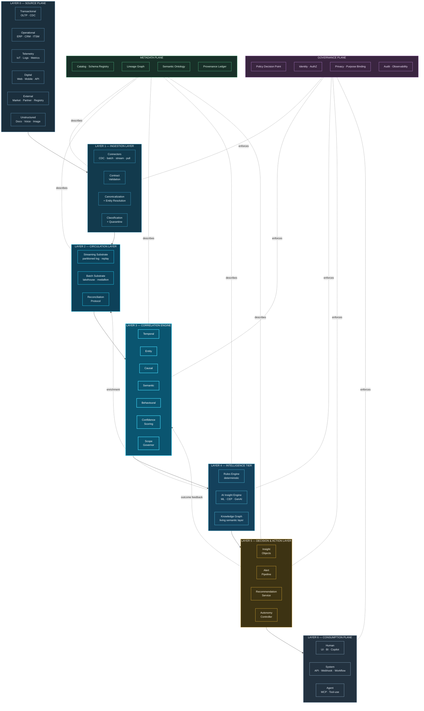
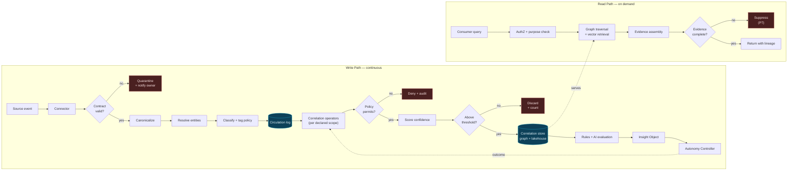
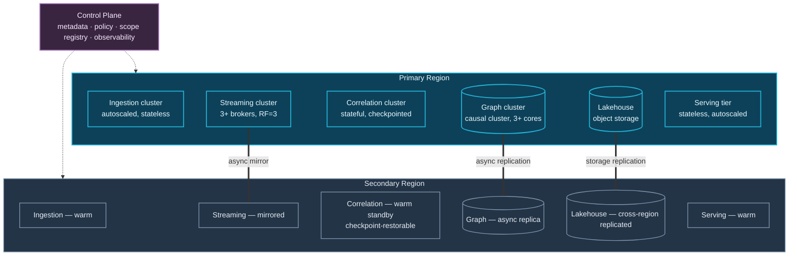

# 10. System Architecture

---

This chapter specifies the reference architecture. It defines seven layers and two cross-cutting planes, states each layer's responsibility and interface contract, identifies candidate technologies, and describes the principal data flows. Subsequent chapters ([11](11-streaming-layer.md)–[21](21-alert-generation.md)) elaborate individual layers.

## 10.1 Layered Reference Architecture

**Figure 10.** *Data Swimming Pool layered reference architecture. Seven horizontal layers carry data from source to consumption. Two vertical planes — metadata and governance — intersect every layer. Two feedback paths are architecturally significant: decision outcomes return to the Correlation Engine as supervision signal (P10), and intelligence-tier enrichments are written back into the circulation layer for reuse.*

## 10.2 Layer Responsibilities

| Layer | Responsibility | MUST NOT do | Candidate technologies |
| --- | --- | --- | --- |
| **L0 — Source** | Produce facts in native form; expose change feeds | Be modified to accommodate the pool | Existing enterprise systems |
| **L1 — Ingestion** | Connect, validate against contract, canonicalize, resolve entities, classify, quarantine | Apply business logic or transformation beyond canonicalization | Debezium, Kafka Connect, Airbyte, Fivetran, custom SDKs |
| **L2 — Circulation** | Durable, replayable, ordered transport; unified batch/stream persistence; reconciliation | Interpret domain semantics | Kafka, Pulsar, Kinesis; Iceberg, Delta Lake, Hudi |
| **L3 — Correlation** | Discover, score, persist, expire relationships within declared scopes | Exceed declared scope; assert causality; emit without confidence | Flink, Spark Structured Streaming, Esper, custom operators |
| **L4 — Intelligence** | Deterministic rules, ML inference, generative reasoning, graph maintenance | Bypass the correlation substrate to re-derive relationships | Drools, OPA; MLflow, feature stores; Neo4j, TigerGraph; vector DBs; LLM gateways |
| **L5 — Decision & Action** | Compose Insight Objects, correlate and suppress alerts, enforce Autonomy Ladder | Take action above its assigned autonomy level | Temporal, Camunda, custom controllers |
| **L6 — Consumption** | Deliver to humans, systems, and agents with permission enforcement | Cache correlations without honouring expiry | BI tools, APIs, MCP servers, notification services |
| **P-Meta — Metadata** | Catalog, lineage, semantics, provenance | Store instance-level correlations (that is L3/L4) | OpenLineage, DataHub, Collibra, OpenMetadata |
| **P-Gov — Governance** | Policy decisions at five boundaries, identity, purpose binding, audit | Be advisory rather than enforcing | OPA/Rego, Cedar, IAM, SIEM |

**Table 12.** *Layer responsibilities, prohibitions, and candidate technologies. The "MUST NOT do" column is as architecturally load-bearing as the responsibility column; most architectural erosion occurs when a layer quietly absorbs an adjacent layer's concerns.*

## 10.3 Component Interaction Topology

**Figure 11.** *Component interaction topology, separating the continuous write path from the on-demand read path. Three rejection points are architecturally mandatory: contract failure quarantines to the source owner, policy denial produces an audit record without forming the correlation (P8), and incomplete evidence suppresses the output rather than emitting it (P7).*

## 10.4 The Two Feedback Loops

The architecture contains two feedback paths that distinguish it from a conventional pipeline.

**Loop 1 — Outcome supervision (L5 → L3).** When an action is taken or an insight is acted upon, the resulting outcome is captured and returned to the Correlation Engine. Did the predicted failure occur? Was the flagged transaction genuinely fraudulent? Did the recommended intervention retain the customer? This is P10, and it is what converts a static correlation system into a learning one. Without it, confidence scores are assertions rather than measurements.

**Loop 2 — Enrichment writeback (L4 → L2).** Derived attributes — a computed risk score, a resolved entity cluster, a semantic classification — are written back into the circulation layer as canonical events in their own right. This means derived intelligence becomes available for further correlation, enabling multi-order reasoning: a correlation over correlations.


**Loop 2 requires care.** Writing derived events back into the circulation layer creates the possibility of feedback amplification, where a derived event triggers a correlation that produces another derived event, recursively. The architecture MUST enforce a **derivation depth limit** and MUST tag derived events with their derivation order so that correlation scopes can exclude them where appropriate. Failure to do so produces runaway event generation — a failure mode observed in poorly-designed event-driven systems generally.


## 10.5 Deployment Topology

The reference architecture is deployment-agnostic but assumes a specific set of operational properties.

**Figure 12.** *Reference deployment topology. Stateless tiers (ingestion, serving) scale horizontally and fail over trivially. Stateful tiers (correlation, graph) require checkpoint-based recovery and asynchronous replication. A single logical control plane holds the scope registry, policy definitions, and metadata, and is the component whose availability most constrains the system.*

**Operational assumptions:**

- **Stateless where possible.** Ingestion and serving tiers hold no durable state and are trivially replaceable.
- **Checkpointed where stateful.** The correlation tier holds substantial window state; it MUST checkpoint to durable storage at an interval bounded by the acceptable reprocessing window.
- **Replay as the recovery primitive.** Because the circulation layer retains an ordered log, recovery from correlation-tier failure is a replay operation rather than a restore operation. This is a significant operational advantage and is a direct benefit of the log-as-substrate decision.
- **The control plane is the critical dependency.** Correlation cannot proceed without the scope registry and the policy decision point. [Chapter 27](../part-3/27-high-availability.md) treats its availability requirements specifically.

## 10.6 Interface Contracts

Layers communicate through explicit contracts rather than shared state. The three most significant:

**L1 → L2: the Canonical Event contract.** Every event entering circulation conforms to the canonical event schema ([Appendix C](../appendix/c-schemas.md)), carrying identity, event time, ingestion time, clock quality, resolved entity references, original identifiers, source lineage pointer, policy classification, derivation order, and payload. Schema evolution is governed by the schema registry with backward compatibility enforced.

**L3 → L4: the Correlation contract.** Every correlation exposes type, modality, participant set, confidence, evidence set, temporal validity, provenance, policy classification, and supersession link. Consumers MUST honour temporal validity and MUST NOT cache correlations past their expiry.

**L5 → L6: the Insight Object contract.** Every insight exposes assertion, evidence chain, confidence, recommended action, autonomy level, permission set, lifecycle status, and version. Consumers MUST present confidence and MUST make the evidence chain accessible to the recipient.


### Design Principle — Contracts Are Enforced, Not Documented

Interface contracts MUST be machine-validated at runtime, not described in documentation. A message failing its contract MUST be rejected at the boundary with an audit record and notification to the producing owner, never silently coerced or accepted.


## 10.7 What This Architecture Deliberately Omits

**No unified query engine.** The framework does not propose a single query language spanning graph, lakehouse, and vector stores. Federated query across heterogeneous engines has a long history of disappointing performance. Consumers use the appropriate engine per access pattern, mediated by the serving tier.

**No custom storage engine.** All persistence is delegated to mature systems. The framework contributes the *model*, not the storage.

**No mandated orchestration technology.** Workflow, scheduling, and orchestration are treated as implementation choices.

**No prescribed cloud or vendor.** Every layer names multiple viable candidates.

---


## Key Takeaways

1. **Seven layers and two cross-cutting planes** constitute the reference architecture, with the Correlation Engine at L3 as the architectural centre of gravity.
2. **Each layer's prohibitions matter as much as its responsibilities.** Architectural erosion occurs when a layer quietly absorbs adjacent concerns — most commonly when applications re-derive correlations the platform already holds.
3. **Three rejection points are mandatory:** contract failure quarantines, policy denial prevents correlation formation, and incomplete evidence suppresses output.
4. **Two feedback loops distinguish the architecture from a pipeline:** outcome supervision returning to correlation, and enrichment writeback into circulation enabling multi-order reasoning.
5. **Enrichment writeback requires a derivation depth limit** to prevent runaway feedback amplification.
6. **Replay is the recovery primitive.** Because circulation retains an ordered log, correlation-tier recovery is replay rather than restore — a direct dividend of the log-as-substrate decision.
7. **The control plane is the critical availability dependency**, since correlation cannot proceed without the scope registry and policy decision point.
8. **The architecture deliberately omits a unified query engine and a custom storage engine.** It contributes a model, not infrastructure.


---

**Next:** [11. Streaming Layer →](11-streaming-layer.md)
