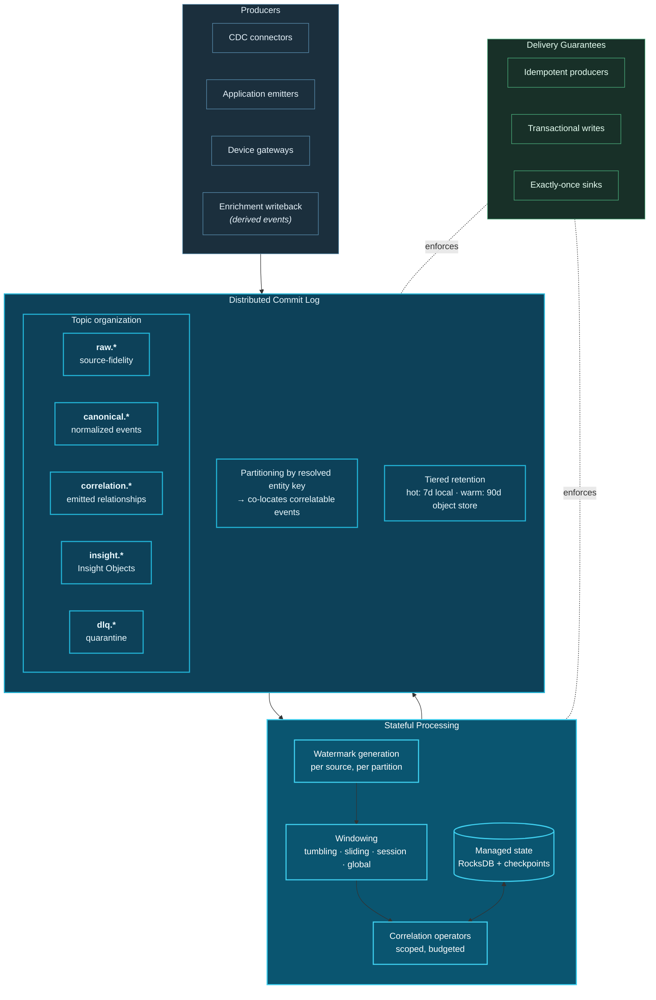
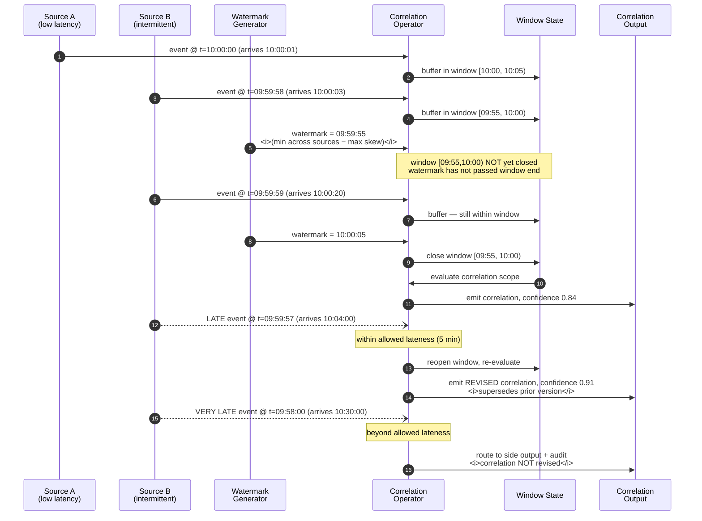

# 11. Streaming Layer

---

The streaming layer is the primary execution substrate for continuous correlation (Principle 4). This chapter specifies its structure, its semantics, and the properties it must guarantee for correlation to be correct.

## 11.1 Architecture

**Figure 13.** *Streaming layer architecture. Five topic families separate concerns: source-fidelity raw events, normalized canonical events, emitted correlations, Insight Objects, and quarantine. Partitioning by resolved entity key is the single most consequential design decision, because it determines whether correlatable events arrive at the same operator instance.*

## 11.2 Why Streaming Is the Default Execution Model

Principle 4 mandates continuous over interrogative evaluation. Streaming is how that is realized, for three reasons specific to correlation.

**Correlation is inherently incremental.** When a new event arrives, the question is not "recompute all relationships" but "what does this event change?" A stateful stream processor maintaining windowed state answers this in bounded work proportional to the window, not to history. Recomputing correlations in batch means recomputing relationships that have not changed — an unfavourable ratio that worsens as history grows.

**The window of actionability demands it.** [Table 4](../part-1/05-current-challenges.md) established that most high-value correlations have short actionability windows. Batch cadence forecloses them structurally.

**Correlation state is naturally streaming state.** The state a correlation operator maintains — recent events per entity, open temporal windows, running behavioural baselines — maps directly onto the managed keyed state that stream processors provide, with checkpointing and recovery included.

## 11.3 The Distributed Commit Log

### 11.3.1 Topic Organization

The framework prescribes five topic families:

| Family | Contents | Retention posture | Partition key |
| --- | --- | --- | --- |
| `raw.<source>.<entity>` | Source-fidelity events, unmodified | Short (compliance-driven) | Source natural key |
| `canonical.<domain>.<type>` | Canonical events post-resolution | Medium to long | **Resolved entity key** |
| `correlation.<scope>` | Emitted correlations | Long | Correlation participant key |
| `insight.<domain>` | Insight Objects | Long | Subject entity key |
| `dlq.<stage>` | Contract failures, poison messages | Short, alerted | Original key |

Retaining `raw.*` separately from `canonical.*` is deliberate. It preserves the ability to re-canonicalize when entity resolution logic improves — which it will — without re-ingesting from source systems. This is a direct application of event sourcing: canonicalization is a projection, and projections are rebuildable.

### 11.3.2 Partitioning Is the Critical Decision


**The decision that determines feasibility.** Correlation between two events is cheap when they reside in the same partition and expensive when they do not. Cross-partition correlation requires either a shuffle or a distributed state lookup, both of which are orders of magnitude more costly.


The framework's prescription: **partition `canonical.*` topics by resolved entity key, not by source natural key.** This is why entity resolution occurs at ingestion (L1) rather than in the correlation tier. Resolving early means that all events concerning a given commercial entity — regardless of originating system — land in the same partition and are therefore locally correlatable.

For correlation scopes that do not share an entity key — for example, correlating a regional weather event with a fleet of shipments — the framework uses **broadcast state**: the low-cardinality side is broadcast to all operator instances and joined locally. This works only when one side is small, which is the practical constraint bounding such scopes.

### 11.3.3 Tiered Retention

Correlation requires more history than conventional streaming. A behavioural baseline may span ninety days; a causal chain may span weeks. The framework assumes **tiered storage**, where recent segments reside on local disk for low-latency access and older segments are offloaded to object storage, remaining replayable at higher latency. This capability — available in modern Kafka, Pulsar, and managed equivalents — is what makes long-window correlation economically viable.

## 11.4 Event Time, Watermarks, and Late Data

Principle 5 mandates event-time correlation. The mechanics follow the Dataflow model [19].

**Figure 14.** *Event-time processing with watermarks, allowed lateness, and correlation revision. The watermark is derived as the minimum event time across all participating sources less the maximum tolerated skew — meaning a single lagging source holds back correlation for the entire scope. This coupling is the principal operational hazard of the streaming layer.*

### 11.4.1 The Slowest-Source Problem

Figure 14 illustrates a consequence that deserves explicit statement: because the watermark for a multi-source correlation scope is bounded by the slowest source, **one lagging source stalls correlation for every source in the scope**. A batch feed arriving hourly, included in the same scope as second-latency telemetry, reduces the entire scope to hourly effective latency.

The framework's mitigations:

- **Stratify scopes by latency class.** Do not place hourly and sub-second sources in the same correlation scope unless the correlation genuinely requires both at the same freshness.
- **Use per-source idle timeouts.** A source that has produced nothing for a defined interval is marked idle and excluded from watermark computation, preventing a dormant source from stalling everything.
- **Emit speculative correlations with revision.** Where the use case tolerates it, emit an early correlation on partial evidence with a flag indicating provisionality, then supersede it when the window closes.

### 11.4.2 Correlation Revision Protocol

Late data means a correlation emitted at window close may be wrong. The framework specifies:

1. Correlations carry a **version** and a **supersession pointer**.
2. Late arrival within allowed lateness triggers **re-evaluation**, producing a new version that supersedes the prior.
3. Consumers that acted on the superseded version are **notified through the outcome feedback path**.
4. Arrival beyond allowed lateness is routed to a **side output** and recorded, but does not revise the correlation. Persistent very-late arrival is an operational signal that allowed lateness is mis-configured.


**Downstream consequence.** Correlation revision means downstream systems must tolerate retraction. An alert fired on a correlation later revised to low confidence must be withdrawable. Systems that cannot retract — an email sent, an irreversible transaction — MUST be restricted to autonomy levels requiring window closure before action. This is a hard coupling between [Chapter 11](11-streaming-layer.md) and [Chapter 20](20-autonomous-decision-support.md).


## 11.5 Delivery Semantics and Their Correlation Implications

| Guarantee | Mechanism | Correlation implication | Framework position |
| --- | --- | --- | --- |
| **At-most-once** | Fire and forget | Missing events produce false negatives silently | Prohibited |
| **At-least-once** | Retry without dedup | Duplicate events inflate correlation confidence — a *systematic bias toward false positives* | Permitted only with idempotent correlation operators |
| **Exactly-once** | Idempotent producers + transactional commits + checkpointed state | Correct counts and confidence | **Required for scored correlation** |

**Table 13.** *Delivery semantics and their correlation implications. At-least-once delivery is uniquely dangerous for correlation because duplicates do not merely inflate counts — they inflate the evidence base for a relationship, systematically biasing confidence upward and producing more false positives precisely where the system is most trusted.*

The framework's position is unambiguous: **any correlation modality that produces a confidence score derived from event counts, frequencies, or co-occurrence rates MUST operate under exactly-once semantics.** The alternative is a system whose confidence scores are inflated by an unknown, variable, infrastructure-dependent factor.

Where exactly-once is unavailable — some external sources cannot support it — the framework requires either explicit deduplication at ingestion using a stable business key, or the correlation operator itself to be idempotent (for example, using set semantics rather than counting semantics).

## 11.6 State Management

Correlation state is the dominant operational cost of the streaming layer.

| State category | Typical size driver | Retention | Backing store |
| --- | --- | --- | --- |
| Window buffers | Events/sec × window width × scopes | Window width + allowed lateness | RocksDB, checkpointed |
| Entity context | Active entities × attributes | TTL-bounded (e.g. 90d) | RocksDB with TTL compaction |
| Behavioural baselines | Entities × features × history | Rolling, compacted | RocksDB or external feature store |
| Broadcast reference | Reference set cardinality | Until refresh | In-memory, replicated |
| Deduplication keys | Events/sec × dedup window | Short (minutes to hours) | Bloom filter or RocksDB |

**Table 14.** *Correlation state categories. Window buffers dominate and scale multiplicatively with event rate, window width, and scope count — which is the mechanical reason Principle 3 (Bounded Scope) is the framework's most critical constraint.*

**State size governance.** Each correlation scope declares a state budget. The scope governor ([Chapter 14](14-correlation-engine.md)) monitors actual consumption and takes graduated action: warn, then shed the lowest-value portion of the window, then suspend the scope and alert. A scope that cannot operate within budget is a scope that was declared too broadly.

**Checkpointing.** State is checkpointed to durable storage at a configurable interval. The interval trades recovery time against steady-state overhead: shorter intervals reduce reprocessing after failure but increase continuous I/O. The framework recommends aligning the checkpoint interval with the shortest window in the scope set, so that recovery never requires replaying more than one window.

## 11.7 Technology Selection

| Requirement | Kafka | Pulsar | Flink | Spark Structured Streaming | Managed cloud |
| --- | --- | --- | --- | --- | --- |
| Durable partitioned log | ✔ Native | ✔ Native | — | — | ✔ Kinesis, Event Hubs, Pub/Sub |
| Tiered storage | ✔ | ✔ Native | — | — | ✔ Varies |
| True per-event streaming | — | — | ✔ | ◐ Micro-batch | Varies |
| Rich event-time windowing | — | — | ✔ Strongest | ✔ Good | Varies |
| Large keyed state | — | — | ✔ RocksDB | ◐ Limited | Varies |
| Native CEP pattern API | — | — | ✔ Flink CEP | ✘ | ✘ |
| Exactly-once end-to-end | ✔ Transactions | ✔ | ✔ | ✔ | Varies |
| Batch/stream unification | — | — | ✔ | ✔ Strongest | Varies |
| Operational simplicity | ◐ | ◐ | ✘ Complex | ✔ | ✔ Strongest |

**Table 15.** *Streaming layer technology selection matrix. Legend: ✔ strong, ◐ partial, ✘ weak, — not applicable. The framework's reference combination is Kafka with tiered storage as the log and Flink as the correlation processor, chosen for Flink's state management, event-time rigour, and native CEP support — accepting materially higher operational complexity in exchange.*


**On Spark Structured Streaming.** Spark is a reasonable alternative where an organization already operates Spark at scale and its correlation scopes tolerate micro-batch latency (typically hundreds of milliseconds to seconds). Its weaker large-state support is the binding constraint for wide-window correlation; its unified batch/stream API is a genuine advantage for the reconciliation protocol described in [Chapter 12](12-batch-layer.md).


## 11.8 Backpressure and Load Shedding

When correlation cannot keep pace with ingestion, the system must degrade predictably rather than fail.

The framework specifies a four-stage graduated response:

1. **Backpressure.** Slow consumption, allowing the log to buffer. Acceptable while retention permits; the log is designed for exactly this.
2. **Scope prioritization.** Suspend scopes below a declared priority threshold. Every scope carries a priority; scopes without one default to lowest.
3. **Confidence-threshold elevation.** Raise the minimum emission threshold, reducing output volume while preserving the highest-value correlations.
4. **Window narrowing.** Temporarily reduce window widths, trading correlation recall for state reduction.

Only after all four are exhausted does the system shed input — and when it does, it MUST record precisely what was shed, because correlation over silently incomplete data produces confident and wrong conclusions.

---


## Key Takeaways

1. **Streaming is the default execution model** because correlation is inherently incremental, actionability windows are short, and correlation state maps naturally onto managed keyed state.
2. **Partitioning by resolved entity key is the decision that determines feasibility**, and it is why entity resolution belongs at ingestion rather than in the correlation tier.
3. **Retaining raw events separately from canonical events** preserves the ability to re-canonicalize as entity resolution improves, without re-ingesting from source.
4. **The watermark is bounded by the slowest source**, so mixing latency classes within one correlation scope degrades the entire scope. Stratification, idle timeouts, and speculative emission are the mitigations.
5. **Correlations are revisable on late arrival**, which imposes a hard requirement that downstream consumers tolerate retraction — and restricts irreversible actions to post-window-close autonomy levels.
6. **At-least-once delivery systematically biases confidence upward**, because duplicates inflate the evidence base. Exactly-once is required for any count-derived confidence score.
7. **Window buffer state scales multiplicatively** with event rate, window width, and scope count — the mechanical basis for the bounded-scope principle.
8. **Load shedding is graduated across four stages** before input is dropped, and any dropped input MUST be recorded, because correlation over silently incomplete data is confidently wrong.


---

**Next:** [12. Batch Layer →](12-batch-layer.md)
