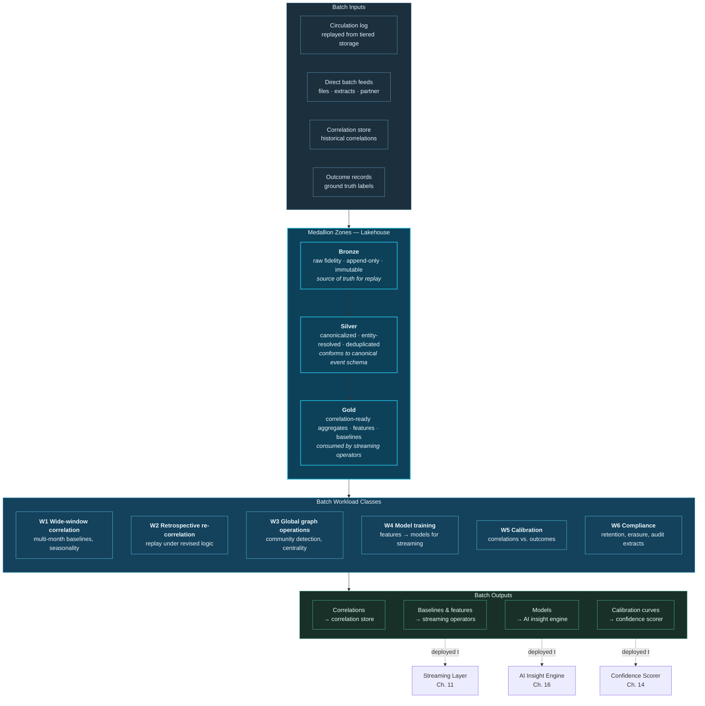
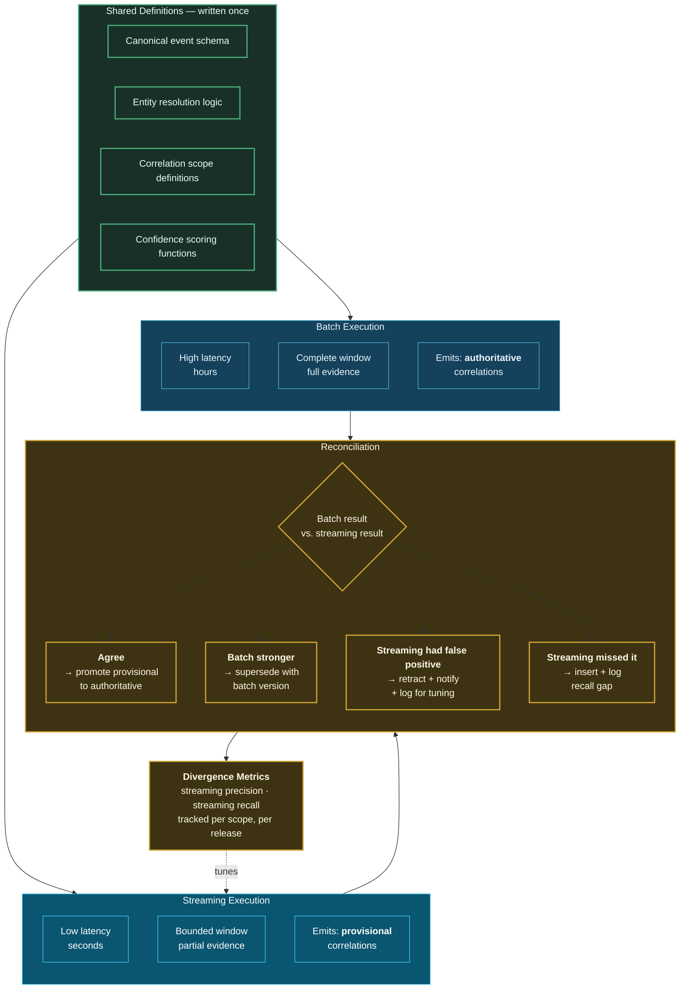

# 12. Batch Layer

---

## 12.1 Why a Batch Layer Still Exists

The Kappa position [12] holds that a batch layer is unnecessary when the log retains sufficient history and reprocessing is cheap. For many workloads this is correct, and the framework does not dispute it.

For correlation, however, four requirements are not well served by streaming alone:

**Wide-window correlation.** A behavioural baseline over twenty-four months, a seasonality model, or a cohort analysis spanning multiple years cannot be maintained as streaming state at acceptable cost. State size scales with window width, and a two-year window over millions of entities is economically prohibitive as keyed state.

**Retrospective re-correlation.** When correlation logic improves — a better entity resolution model, a revised confidence calibration, a new relationship type — the correct response is to recompute historical correlations. This is a bounded, parallelizable, throughput-optimized job: precisely a batch workload.

**Global operations.** Some correlation modalities require a global view. Community detection in a graph, clustering to establish behavioural cohorts, and training the models that streaming operators subsequently apply are all inherently non-incremental.

**Ground-truth reconciliation.** Confidence calibration (Principle 6) requires comparing historical correlations against subsequently-observed outcomes. Outcomes arrive weeks or months after the correlation, so calibration is necessarily retrospective.


**Reframing the Lambda/Kappa debate.** The framework's position is that the debate conflates two separable questions: *how fresh must this be?* and *how complete must this be?* Streaming optimizes freshness at bounded completeness. Batch optimizes completeness at bounded freshness. The correct answer varies **per correlation type**, not per architecture. The framework therefore provides both, unified by a shared canonical event model so that business logic is written once.


## 12.2 Architecture

**Figure 15.** *Batch layer architecture. Medallion zones provide progressive refinement, with Silver conforming to the same canonical event schema as the streaming layer — the mechanism by which business logic is shared. Six workload classes are served, and four output types feed directly back into streaming components.*

## 12.3 Workload Classes

| Class | Purpose | Typical cadence | Latency tolerance | Compute profile |
| --- | --- | --- | --- | --- |
| **W1** Wide-window correlation | Multi-month baselines, seasonal patterns, long-horizon cohorts | Daily to weekly | Hours | Large scan, moderate shuffle |
| **W2** Retrospective re-correlation | Recompute history under revised logic or new relationship types | On change | Hours to days | Very large scan, high parallelism |
| **W3** Global graph operations | Community detection, centrality, path enumeration, ring detection | Daily | Hours | Graph-parallel, iterative |
| **W4** Model training | Train models deployed to streaming operators and the insight engine | Weekly to monthly | Days | GPU-accelerated where applicable |
| **W5** Calibration | Compare historical correlations against realized outcomes | Weekly | Days | Moderate scan, statistical |
| **W6** Compliance | Retention enforcement, right-to-erasure propagation, audit extract | Daily, plus on demand | Hours (regulatory SLA) | Targeted scan and rewrite |

**Table 16.** *Batch workload classes. W2 is architecturally the most significant, because the ability to recompute the entire correlation history under revised logic is what makes correlation methodology improvable rather than frozen — a direct consequence of the event-sourcing posture.*

### 12.3.1 W2 — Retrospective Re-Correlation in Detail

W2 deserves elaboration because it is the workload that makes the framework's methodology improvable.

When entity resolution improves — say, a new matching model correctly unifies two customer records previously treated as distinct — every correlation involving either record is potentially affected. Some correlations become valid that were previously missed; some become invalid. Without W2, the correlation store contains a permanent record of decisions made under obsolete logic, and confidence in the store degrades over time.

W2 executes as follows:

1. **Declare the change.** A new engine version, model version, or scope definition is registered with an effective date.
2. **Determine affected scope.** Query the provenance ledger for correlations produced by the superseded version.
3. **Replay.** Read Bronze/Silver history for the affected entities and time range; execute correlation logic at the new version.
4. **Diff and supersede.** Emit new correlation versions; mark prior versions superseded with an explicit reason.
5. **Propagate.** Notify consumers whose Insight Objects depended on superseded correlations.
6. **Record.** Write the re-correlation run into the provenance ledger so the change is itself auditable.


**W2 is expensive and must be governed.** A full retrospective re-correlation over years of history across many scopes can dominate the platform's compute budget. The framework requires W2 runs to be scoped — by time range, entity class, and correlation type — and to carry a cost estimate approved before execution. Unbounded re-correlation is as dangerous as unbounded correlation.


## 12.4 The Reconciliation Protocol

The framework's answer to Lambda's dual-implementation problem is a **shared canonical event model plus an explicit reconciliation protocol**.

**Figure 16.** *The reconciliation protocol. Definitions are authored once and executed by both substrates. Streaming emits provisional correlations for immediate action; batch emits authoritative correlations on complete evidence. Reconciliation resolves the four possible outcomes and produces divergence metrics that quantify streaming precision and recall per scope — turning the Lambda dual-path problem into a continuous quality measurement.*

The protocol's most useful property is that **divergence becomes a measured quantity rather than a latent risk**. In classical Lambda architectures, batch and speed layer disagreement was a known hazard managed by convention. Here, disagreement is captured per scope, per release, as an explicit precision and recall measurement of the streaming path against the batch path. That measurement is directly actionable: a scope whose streaming precision falls below its declared threshold is either retuned or restricted to a lower autonomy level.

**Precedence rule.** Where batch and streaming disagree, **batch prevails** for the persisted correlation, because it operated on complete evidence. Streaming's provisional correlation is not deleted — it is superseded, and the supersession record is retained for divergence measurement.

## 12.5 Storage Layout and Optimization

The batch layer assumes an open table format (Iceberg, Delta Lake, or Hudi) and relies on several of its properties:

| Property | Correlation use |
| --- | --- |
| **ACID transactions** | Concurrent correlation writes from multiple scopes without corruption |
| **Time travel / snapshots** | Reproduce the exact input state for any historical correlation — essential for audit and for W2 |
| **Schema evolution** | Add correlation attributes without rewriting history |
| **Partition evolution** | Repartition as correlation access patterns change, without full rewrite |
| **Efficient upsert / merge** | Supersede correlation versions in place |
| **Row-level delete** | Right-to-erasure propagation (W6) |
| **Hidden partitioning** | Prevent consumer queries from accidentally full-scanning |
| **Metadata pruning** | Skip files by min/max statistics — critical for time-range correlation queries |

**Table 17.** *Open table format properties and their correlation applications. Time travel is the most architecturally significant: it is what allows an auditor to ask "what did the system know at the moment it made this decision?" and receive a verifiable answer.*

**Layout recommendations:**

- **Partition Silver by event date and domain**, cluster within partitions by resolved entity key. This serves both time-range scans (W1) and entity-focused replay (W2).
- **Partition correlations by validity start date**, cluster by correlation type. Most correlation queries are time-bounded and type-filtered.
- **Compact aggressively.** Streaming writes into the lakehouse produce many small files; correlation scans over unopacted data perform poorly. Compaction is an operational requirement with an owner.
- **Z-order or cluster on the highest-selectivity correlation predicates**, determined empirically from query telemetry rather than assumed.

## 12.6 Batch and Streaming Cost Comparison


**Illustrative.** The following is a structural cost comparison intended to convey relative shape, not absolute figures. Real costs depend on data volume, cloud pricing, and implementation quality.


| Correlation characteristic | Streaming cost driver | Batch cost driver | Generally cheaper |
| --- | --- | --- | --- |
| Narrow window (< 1 hour), high value | Small state, continuous compute | Full scan per run | **Streaming** |
| Wide window (> 30 days) | State size prohibitive | Bounded scan, parallelizable | **Batch** |
| Low event rate, wide window | Idle compute waiting | Efficient scan | **Batch** |
| High event rate, narrow window | Efficient incremental | Repeated large scans | **Streaming** |
| One-off retrospective question | Not applicable | Single job | **Batch** |
| Continuous monitoring requirement | Designed for it | Cannot meet latency | **Streaming** (only option) |
| Global graph algorithm | Not expressible incrementally | Natural fit | **Batch** (only option) |

**Table 18.** *Cost and suitability by correlation characteristic. The framework's guidance is to place each correlation scope on the substrate its characteristics indicate, rather than adopting a substrate-first posture — which is the practical content of declining to choose between Lambda and Kappa.*

---


## Key Takeaways

1. **A batch layer remains necessary for four requirements** streaming cannot economically serve: wide-window baselines, retrospective re-correlation, global graph operations, and ground-truth calibration.
2. **The Lambda/Kappa debate conflates freshness with completeness.** The correct substrate varies per correlation type, so the framework provides both, unified by a shared canonical event model.
3. **Retrospective re-correlation (W2) is what makes correlation methodology improvable** rather than frozen, allowing the entire correlation history to be recomputed under revised logic — but it must be scoped and cost-approved, because unbounded re-correlation is as dangerous as unbounded correlation.
4. **The reconciliation protocol converts Lambda's latent divergence risk into a measured quantity**, producing per-scope streaming precision and recall metrics that directly gate autonomy level.
5. **Batch prevails over streaming on disagreement**, because it operated on complete evidence; the superseded streaming correlation is retained for divergence measurement rather than deleted.
6. **Time travel in the open table format is what makes audit possible** — it allows verifiable reconstruction of what the system knew at the moment of any historical decision.
7. **Compaction is an operational requirement with an owner**, not an optimization, because correlation scans over unopacted streaming writes perform poorly enough to undermine the batch layer's purpose.


---

**Next:** [13. Data Ingestion Layer →](13-ingestion-layer.md)
