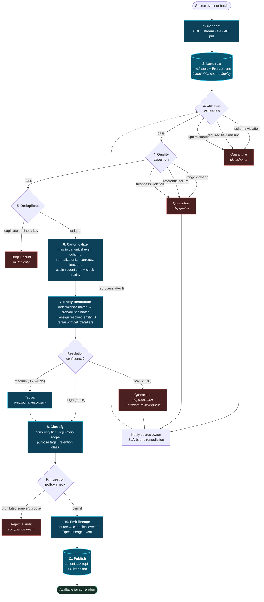
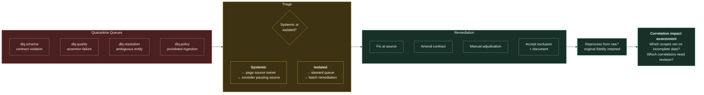

# 13. Data Ingestion Layer

---

The ingestion layer is where the framework's most consequential work happens. In a data lake, ingestion is a transport concern: land the bytes, interpret later. In a Data Swimming Pool, ingestion performs **canonicalization, entity resolution, and classification** — and doing so once at entry, rather than repeatedly at query time, is the primary mechanism by which the correlation tax is eliminated.

This is the filtration system of the metaphor, and it is the difference between a maintained pool and a swamp.

## 13.1 Ingestion Workflow

**Figure 17.** *Data ingestion workflow. Eleven stages, four quarantine paths, and one drop path. The critical design property is that **nothing reaches the correlation layer unvalidated, unresolved, or unclassified** — the architectural expression of the filtration metaphor and the reason a Data Swimming Pool cannot degrade into a swamp through neglect alone.*

## 13.2 Ingestion Patterns by Source Type

| Source type | Pattern | Mechanism | Latency | Correlation considerations |
| --- | --- | --- | --- | --- |
| Transactional database | Change data capture | Log-based CDC (Debezium, native) | Sub-second | Transaction boundaries must be preserved; correlating partial transactions produces false conclusions |
| Application events | Direct emit | SDK to log, schema-registry validated | Milliseconds | Requires application change; highest quality when achieved |
| IoT / telemetry | Gateway aggregation | MQTT/OPC-UA → edge gateway → log | Sub-second to seconds | Device clock skew is severe; clock quality indicator is essential |
| Clickstream | Collector | Beacon → collector → log | Seconds | Identity is cookie-scoped; resolution to person is probabilistic at best |
| SaaS applications | API polling / webhook | Connector with incremental cursor | Minutes | Rate limits bound freshness; webhook delivery is at-least-once |
| Files / extracts | Batch landing | Object storage event → parser | Minutes to hours | Event time must be extracted from content, not inferred from file arrival |
| Partner / B2B feeds | Scheduled transfer | SFTP/API, contract-validated | Hours to daily | Highest contract-violation rate; strict quarantine essential |
| Mainframe | Scheduled extract or CDC | Specialized connector | Hours | Frequently EBCDIC, fixed-width, undocumented; canonicalization is substantial work |
| Documents / unstructured | Pipeline with extraction | OCR/ASR → structuring → embedding | Minutes | Produces both canonical events and vector embeddings |
| Reference / master data | Slowly changing snapshot | Full or delta load, versioned | Daily | Becomes broadcast state for correlation; version must be pinned per correlation |
| **Derived (writeback)** | Internal emit | Intelligence tier → log | Seconds | MUST carry derivation order; MUST respect depth limit |

**Table 19.** *Ingestion patterns by source type. Two rows warrant particular attention: IoT sources require an explicit clock quality indicator because device clock skew routinely exceeds correlation window widths, and derived events require derivation-order tagging to prevent the feedback amplification described in [Chapter 10](10-system-architecture.md).*

## 13.3 Data Contracts

A **data contract** is a machine-enforceable agreement between a source owner and the platform. The framework treats contracts as mandatory, not advisory.

Each contract declares:

| Element | Purpose |
| --- | --- |
| **Schema** | Field names, types, nullability, nested structure, with a compatibility policy |
| **Semantics** | The business meaning of each field, in prose, versioned |
| **Event time source** | Which field carries event time, in which format, in which timezone |
| **Clock quality** | Whether the source clock is NTP-synchronized, best-effort, or unreliable |
| **Identity** | Which fields constitute the business key and which are candidate entity identifiers |
| **Quality assertions** | Range constraints, referential expectations, cardinality bounds, allowed null rates |
| **Freshness SLA** | Maximum acceptable lag from event occurrence to availability |
| **Volume expectation** | Expected rate and acceptable variance, for anomaly detection |
| **Classification** | Sensitivity tier, regulatory scope, permitted purposes, retention class |
| **Ownership** | Named accountable owner and escalation path |
| **Deprecation policy** | Notice period for breaking changes |


### Design Principle — Contracts Are Enforced at the Boundary

A source without a registered, versioned contract MUST NOT be ingested. A message violating its contract MUST be quarantined with notification to the named owner, never silently coerced, defaulted, or dropped. Contract violations MUST be visible as an operational metric with an SLA for remediation.


The rationale is specific to correlation. In a conventional lake, a malformed record degrades one dataset. In a correlation architecture, a malformed record propagates: it may be incorrectly entity-resolved, forming false relationships with events belonging to a different entity, which then feed insights and potentially actions. **Correlation amplifies data quality defects rather than absorbing them.** Contract enforcement is therefore load-bearing rather than hygienic.

## 13.4 Entity Resolution

Entity resolution is the single most valuable and most difficult function in the ingestion layer.

### 13.4.1 The Problem

The same real-world entity appears across systems with different identifiers and inconsistent attributes:

| System | Identifier | Name | Other attributes |
| --- | --- | --- | --- |
| CRM | `cust-8823a-4f` | Northgate Industrial Ltd | Registered address, SIC code |
| ERP | `AC-441902` | NORTHGATE IND. LTD | Billing address, tax ID |
| Service desk | `ops@northgate-ind.com` | Northgate | Contact name only |
| Web analytics | `cookie:7f3a...` | — | IP geolocation, device fingerprint |
| IoT platform | `site-NG-04` | Northgate Plant 4 | GPS coordinates |

Without resolution, correlating a service ticket with a payment failure and a device fault is impossible: no join key exists.

### 13.4.2 Resolution Strategy

The framework specifies a three-tier cascade, executed in order:

**Tier 1 — Deterministic matching.** Exact match on authoritative identifiers: tax registration number, legal entity identifier, verified email, national identifier where lawful. High precision, limited recall. Every match is recorded with the rule that produced it.

**Tier 2 — Probabilistic matching.** Fellegi–Sunter-style probabilistic linkage or a learned pairwise classifier over normalized attributes (name similarity, address similarity, temporal co-occurrence, structural graph features). Produces a match probability. Blocked by candidate-generation keys to avoid all-pairs comparison — the same combinatorial discipline Principle 3 imposes on correlation.

**Tier 3 — Graph-based resolution.** Transitive closure over high-confidence pairwise matches, with community detection to identify entity clusters. Critically, this tier must include **cluster-splitting logic**: transitive closure over probabilistic matches produces over-merged clusters ("everything connects to everything") unless actively constrained by cluster cohesion thresholds.

### 13.4.3 Handling Resolution Uncertainty


**The over-merge hazard.** An entity resolution system tuned for recall will merge distinct entities. A merged entity inherits the union of all its constituents' events, producing correlations between events belonging to genuinely different parties. In a fraud context this creates false accusations; in a clinical context it creates records mixing two patients. **Over-merging is more dangerous than under-merging**, and the framework therefore prescribes precision-favouring thresholds with human stewardship for the ambiguous band.


The framework's handling:

- **High confidence (≥ 0.95):** resolve and proceed.
- **Medium confidence (0.70–0.95):** resolve but tag as **provisional**. Correlations formed on provisional resolutions carry reduced confidence and are excluded from autonomy levels 3 and above.
- **Low confidence (< 0.70):** quarantine to a **data steward review queue**. Human adjudication is required. This queue's depth is an operational metric, and a growing queue indicates deteriorating source quality or model drift.
- **All resolutions are reversible.** A resolution decision is an event with lineage. If it is later found incorrect, W2 retrospective re-correlation ([Chapter 12](12-batch-layer.md)) recomputes affected correlations.

## 13.5 Classification and Policy Tagging

Every canonical event is tagged at ingestion with:

| Tag class | Values (illustrative) | Consumed by |
| --- | --- | --- |
| **Sensitivity tier** | Public, Internal, Confidential, Restricted | Access control, masking |
| **Regulatory scope** | GDPR, HIPAA, PCI DSS, SOX, none | Residency, retention, audit |
| **Special category** | Health, biometric, financial, political, none | Correlation-time prohibition |
| **Permitted purposes** | fraud-prevention, service-delivery, marketing, research | Purpose binding ([Chapter 24](../part-3/24-privacy.md)) |
| **Retention class** | 30d, 1y, 7y, indefinite, legal-hold | Automated retention enforcement |
| **Residency constraint** | EU-only, in-country, unrestricted | Deployment routing |
| **Derivation order** | 0 (source), 1, 2, … | Feedback depth limiting |

**Table 20.** *Classification tags applied at ingestion. Permitted purposes and special category are the two tags that make correlation-time policy enforcement (Principle 8) possible: the correlation engine can refuse to relate a special-category event to a commercially-purposed scope because the tag travels with the event.*

Classification is performed by a combination of contract declaration (the source owner declares what the field contains), automated detection (pattern and model-based identification of sensitive content), and inheritance (derived events inherit the most restrictive classification of their inputs).


**Inheritance of the most restrictive classification** is a rule with significant practical consequence: a derived risk score computed partly from health data inherits health-data restrictions. This is correct — the derived value can leak the sensitive input — but it means derived attributes rapidly accumulate restrictions unless deliberate, documented, and reviewed de-identification is applied. Managing this is an ongoing governance activity, not a one-time design decision.


## 13.6 Quarantine and Remediation

Quarantine is a first-class operational concept, not an error log.

**Figure 18.** *Quarantine and remediation flow. The final stage is what distinguishes this from conventional dead-letter handling: after reprocessing, the system must assess which correlation scopes executed on incomplete data during the outage and revise affected correlations. Silent data gaps produce confidently wrong correlations, so gap accounting is mandatory.*

**The gap accounting requirement.** If a source was quarantining for four hours, every correlation scope including that source produced results on incomplete evidence during that window. The framework requires that:

1. Scopes affected by a source outage are **marked degraded** for the affected window.
2. Correlations produced during a degraded window carry a **degradation flag**.
3. After remediation, affected windows are **re-correlated** via W2.
4. Consumers that acted on degraded correlations are **notified**.

This is operationally demanding and is one of the framework's genuine cost drivers. It is also non-negotiable: a correlation system that does not know when it was operating blind will assert conclusions it cannot support.

## 13.7 Ingestion Observability

| Metric | Purpose | Alert condition |
| --- | --- | --- |
| Contract violation rate per source | Source health | Sustained rise above baseline |
| Quarantine queue depth per queue | Remediation backlog | Depth or age above threshold |
| Entity resolution confidence distribution | Resolution model health | Shift in distribution shape |
| Steward review queue depth and age | Human bottleneck | Age exceeds SLA |
| Ingestion lag per source (event time to availability) | Freshness SLA | Lag exceeds contract SLA |
| Volume deviation from expectation | Silent source failure | Volume outside expected band |
| Clock skew distribution per source | Correlation validity risk | Skew approaching window width |
| Classification coverage | Governance completeness | Any unclassified field reaching Silver |

**Table 21.** *Ingestion observability metrics. Volume deviation detection is the most operationally valuable, because a source that silently stops producing is the failure mode most likely to cause confidently wrong correlations — the system does not know it is missing evidence unless it is watching for absence.*

---


## Key Takeaways

1. **Ingestion performs canonicalization, entity resolution, and classification** — doing once at entry what conventional architectures redo at every query, which is the primary mechanism for eliminating the correlation tax.
2. **Nothing reaches the correlation layer unvalidated, unresolved, or unclassified.** This is the architectural expression of filtration and the reason the framework cannot degrade into a swamp through neglect alone.
3. **Correlation amplifies data quality defects rather than absorbing them**, because a misresolved record forms false relationships that propagate into insights and actions. Contract enforcement is therefore load-bearing.
4. **Over-merging in entity resolution is more dangerous than under-merging**, so thresholds favour precision and the ambiguous band routes to human stewardship rather than being resolved automatically.
5. **Resolution decisions are reversible events with lineage**, allowing retrospective re-correlation when resolution logic improves.
6. **Classification tags travel with the event**, which is what makes correlation-time policy prohibition possible. Derived events inherit the most restrictive classification of their inputs.
7. **Gap accounting is mandatory.** Correlations produced while a source was quarantining must be flagged, re-correlated after remediation, and their consumers notified — because a system that does not know when it was blind will assert unsupportable conclusions.
8. **Detecting absence matters more than detecting anomaly.** A silently stopped source is the failure mode most likely to produce confidently wrong correlations.


---

**Next:** [14. Correlation Engine →](14-correlation-engine.md)
