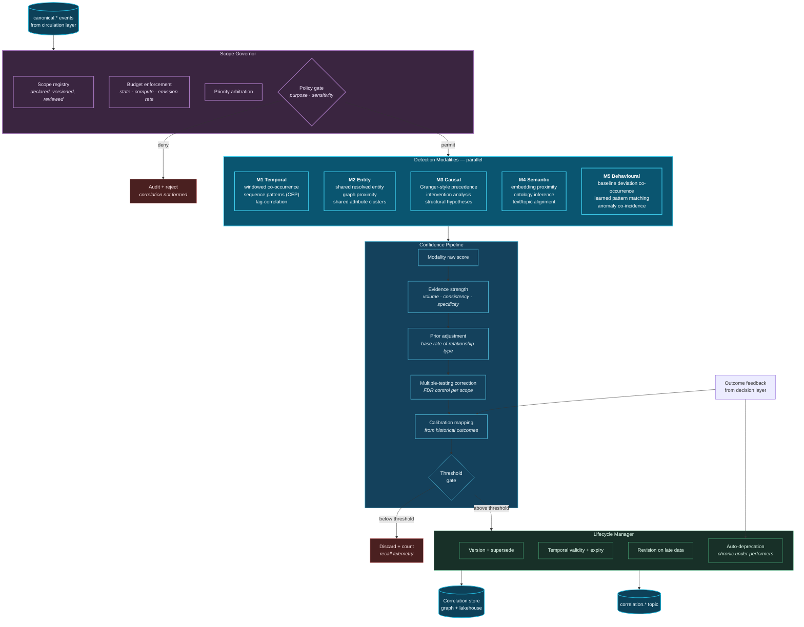
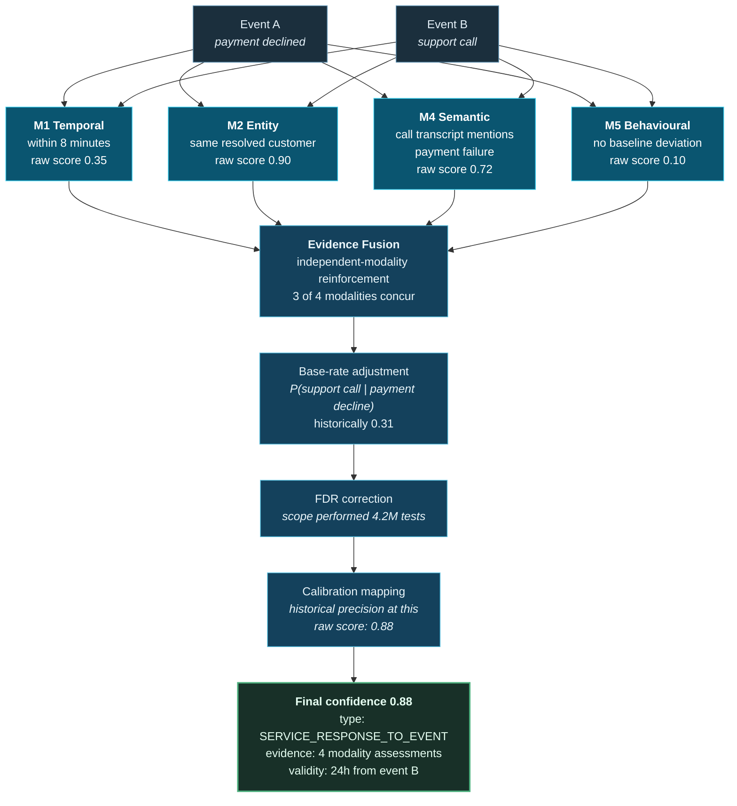
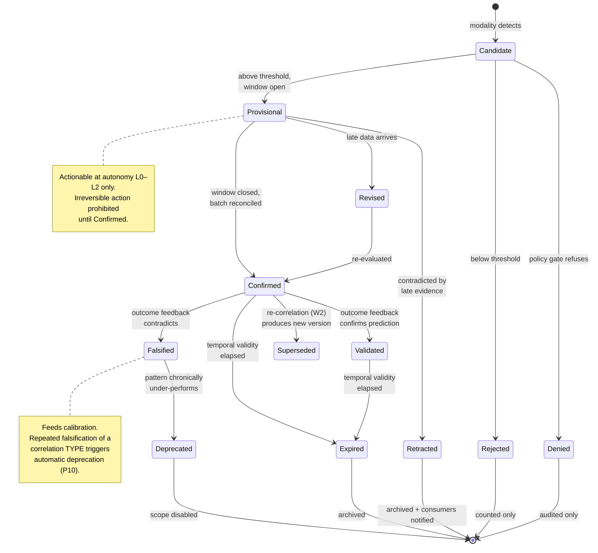

# 14. Correlation Engine

---

The Correlation Engine is the framework's principal contribution. Everything preceding it prepares data for correlation; everything following it consumes correlations. This chapter specifies its internal architecture, its five detection modalities, its confidence semantics, its scope governance, and — with equal seriousness — its failure modes.

## 14.1 Purpose and Position


### Definition — Correlation Engine

The **Correlation Engine** is a dedicated architectural tier whose sole responsibility is to continuously discover, score, persist, revise, and expire typed relationships between canonical events and resolved entities, within explicitly declared and budgeted scopes, subject to policy enforcement, and with full evidentiary lineage.


Its position is deliberate. It sits **above** the circulation layer, so it observes all canonical events regardless of source. It sits **below** the intelligence tier, so rules, models, and generative systems consume its output rather than re-deriving relationships independently. This positioning is the architectural realization of Principle 1: correlation is infrastructure.


### Design Principle — Consumers Consume, They Do Not Re-Derive

No component above the Correlation Engine MAY independently compute cross-domain relationships. If a required relationship type does not exist, the correct response is to declare a new correlation scope, not to implement the join in the consuming application. Violating this reintroduces the correlation tax inside the architecture designed to eliminate it.


## 14.2 Internal Architecture

**Figure 19.** *Correlation Engine internal architecture. Four subsystems: the Scope Governor enforces bounded scope and policy before any detection occurs; five detection modalities operate in parallel; a six-stage confidence pipeline including explicit multiple-testing correction and outcome-based calibration; and a lifecycle manager handling versioning, expiry, revision, and automatic deprecation. Note that the policy gate precedes detection — a prohibited correlation is never formed, not merely never shown.*

## 14.3 The Five Detection Modalities

### M1 — Temporal Correlation

**Mechanism.** Detects relationships based on co-occurrence, sequence, or lag in event time.

Three sub-mechanisms:

- **Windowed co-occurrence.** Events of declared types occurring within a window for the same or related entities. The simplest and cheapest modality.
- **Sequence pattern matching.** Ordered patterns with optional negation and timing constraints, implemented via CEP automata (NFA-based, following SASE [14] and Flink CEP). Example: *authentication from new device* → *within 10 minutes* → *payee added* → *within 5 minutes* → *high-value transfer*, with *no step-up authentication* in between.
- **Lag correlation.** Statistical association between two time series at a discovered lag, useful for relationships where the delay is unknown a priori — for example, supplier batch change to defect rate.

**Strengths.** Cheap, interpretable, directly actionable. Sequence patterns are highly precise when the pattern is genuinely characteristic.

**Weaknesses.** Co-occurrence is the weakest form of evidence. In a high-volume environment, unrelated events co-occur constantly. Without base-rate correction, temporal co-occurrence generates overwhelming false positive volume.

### M2 — Entity Correlation

**Mechanism.** Relates events sharing a resolved entity, or entities within a bounded graph distance.

- **Shared entity.** The strongest and cheapest correlation: two events concern the same resolved commercial entity. Available essentially for free as a consequence of ingestion-time resolution and entity-key partitioning.
- **Graph proximity.** Events concerning entities within *k* hops in the knowledge graph — same household, same corporate group, same device, same beneficial owner.
- **Shared attribute clusters.** Events whose entities share a distinguishing attribute — same device fingerprint, same shipping address, same IBAN — which is the foundational mechanism for detecting coordinated behaviour such as fraud rings.

**Strengths.** High precision when resolution is sound. Computationally efficient. Highly explainable.

**Weaknesses.** Entirely dependent on entity resolution quality. An over-merged entity produces false correlations at scale — the hazard identified in [Chapter 13](13-ingestion-layer.md). Graph proximity requires careful *k* bounding, since at *k*=4 or beyond in a dense graph, nearly everything is proximate to everything.

### M3 — Causal Correlation

**Mechanism.** Attempts to establish directional influence rather than mere association.

- **Precedence testing.** Granger-style tests establishing that one series improves prediction of another beyond the second's own history.
- **Natural experiment exploitation.** Where an intervention occurred — a policy change, a deployment, a supplier switch — comparing pre- and post-periods, or treated and untreated cohorts.
- **Structural hypothesis testing.** Evaluating a declared causal graph against observational data, using do-calculus-informed methods.


**The honest limitation.** This modality produces **causal hypotheses with confidence, never causal facts.** Lamport's constraint [5] means cross-system precedence cannot be established with certainty, and observational data cannot distinguish causation from confounding without assumptions that the platform cannot verify. Correlations from M3 MUST be labelled as hypotheses, MUST carry their assumptions explicitly, and MUST NOT gate irreversible autonomous action at autonomy levels 4 or 5.

The framework includes M3 because causal hypotheses are genuinely valuable for directing human investigation. It constrains M3 because presenting a causal hypothesis as a causal fact is the most consequential error the system could make.


**Strengths.** Highest decision value when correct. Directs remediation rather than merely flagging.

**Weaknesses.** Most computationally expensive, most assumption-dependent, most easily misinterpreted by consumers. Requires the largest evidence base.

### M4 — Semantic Correlation

**Mechanism.** Relates events by meaning rather than by key or timing.

- **Embedding proximity.** Events, documents, and entity descriptions embedded into a shared vector space; relationships inferred from nearest-neighbour proximity via HNSW or IVF indices [25].
- **Ontology inference.** Relationships derived by reasoning over a declared ontology — if *A* is a subtype of *B* and *B* relates to *C*, then *A* relates to *C*.
- **Cross-lingual and cross-modal alignment.** Relating a support call transcript to a technician's written note to a product defect classification, despite no shared vocabulary.

**Strengths.** Discovers relationships invisible to key-based or timing-based methods. Essential for unstructured content. Effective across languages and modalities.

**Weaknesses.** Embedding proximity is not relationship — semantic similarity frequently reflects topical overlap rather than a genuine connection between the specific instances. Embeddings drift as models are updated, making historical comparisons unreliable unless embedding version is pinned. Explainability is weak: "these vectors are close" is a poor justification to present to an auditor.

### M5 — Behavioural Correlation

**Mechanism.** Relates events by their deviation from established baselines.

- **Co-incident anomaly.** Two entities or systems simultaneously departing from their respective baselines. Individually unremarkable deviations; jointly significant.
- **Learned pattern matching.** Sequence or graph models trained on historically-confirmed relationships, applied to detect similar structures.
- **Cohort divergence.** An entity behaving unlike its peer cohort, where the cohort itself is behaviourally defined rather than declared.

**Strengths.** Detects novel patterns not previously declared — the modality most capable of finding what nobody thought to look for. Robust to adversarial adaptation, since baselines shift with genuine behaviour.

**Weaknesses.** Requires substantial baseline history before becoming useful (typically weeks to months per entity). Highly sensitive to baseline drift and to seasonality. Poor explainability. Vulnerable to poisoning if an adversary can influence the baseline period.

### 14.3.1 Modality Comparison

| Modality | Compute cost | Explainability | Precision potential | Recall potential | Prerequisite | Min. evidence |
| --- | --- | --- | --- | --- | --- | --- |
| **M1 Temporal** | Low | High | Low–Medium | High | Reliable event time | 2 events |
| **M2 Entity** | Low | Very high | High | Medium | Sound entity resolution | 2 events |
| **M3 Causal** | Very high | Medium | Medium | Low | Long history + assumptions | Hundreds of observations |
| **M4 Semantic** | Medium | Low | Medium | High | Embedding infrastructure | 2 events |
| **M5 Behavioural** | High | Low | Medium–High | Medium | Weeks of baseline | Baseline + deviation |

**Table 22.** *Correlation modalities compared. The framework's guidance is that **M2 (entity) should carry the majority of production correlation volume**, because it combines low cost, high precision, and strong explainability. M1 provides breadth, M4 reaches unstructured content, M5 finds novelty, and M3 should be used sparingly and always as hypothesis.*

### 14.3.2 Multi-Modal Reinforcement

The framework's most important scoring property: **correlations confirmed by multiple independent modalities are substantially more trustworthy than any single-modality correlation.**

**Figure 20.** *Confidence scoring pipeline, illustrated for a single correlation. Four modalities assess the same event pair independently. Evidence fusion rewards concurrence across independent modalities. Base-rate adjustment prevents the system from treating a common co-occurrence as remarkable. False discovery rate correction accounts for the millions of tests the scope performed. Final calibration maps the raw score to observed historical precision, so that a stated confidence of 0.88 means the correlation type has historically been correct 88% of the time at this score.*

The calibration step in Figure 20 is what gives the confidence score meaning. Without it, a score of 0.88 is an arbitrary number produced by an internal formula. With it, the score is an **empirical claim about historical precision** that can be verified and challenged.

## 14.4 Scope Governance

Principle 3 requires bounded scope. The Scope Governor enforces it.

### 14.4.1 Scope Declaration

A correlation scope is a versioned, reviewed configuration artifact declaring:

| Element | Example | Purpose |
| --- | --- | --- |
| **Identity and version** | `fraud.card-not-present.v3` | Provenance and supersession |
| **Participating event types** | `payment.authorization`, `identity.device_change`, `session.login` | Bounds the cross-product |
| **Entity class** | `customer` | Bounds the partition space |
| **Modalities enabled** | M1, M2, M5 | Bounds compute per event |
| **Temporal window** | 30 minutes, allowed lateness 5 minutes | Bounds state |
| **Graph proximity bound** | k ≤ 2 | Prevents proximity explosion |
| **Emission threshold** | confidence ≥ 0.75 | Bounds output volume |
| **Declared purpose** | `fraud-prevention` | Policy gate input |
| **State budget** | 40 GB | Hard operational limit |
| **Compute budget** | expressed in platform units | Cost attribution |
| **Emission rate cap** | 500 correlations/minute | Prevents downstream flooding |
| **Priority** | P1 | Load-shedding arbitration |
| **Owner** | named accountable individual | Governance |
| **Expected precision** | ≥ 0.80, measured monthly | Autonomy gating |
| **Review cadence** | quarterly | Prevents scope rot |

**Table 23.** *Correlation scope declaration elements. The Scope Governor refuses to execute a scope missing any mandatory element. Expected precision is the field that gates autonomy: a scope that cannot demonstrate its declared precision cannot be promoted to a higher autonomy level.*

### 14.4.2 The Combinatorial Discipline


**The arithmetic that makes bounded scope non-negotiable.**

Consider an enterprise producing 1,000 events per second — a modest figure — across 20 event types, with a 30-minute correlation window.

Events in window: 1,000 × 1,800 = **1.8 million**.

Naïve all-pairs comparisons: 1.8M² / 2 ≈ **1.6 × 10¹²** per window, recomputed continuously.

At a conventional significance threshold of α = 0.05, purely by chance the system would surface approximately **8 × 10¹⁰ "significant" relationships per window.** Every one of them would be spurious. Signal would be undetectable within the noise, and the compute cost would be several orders of magnitude beyond economic viability.

Now apply bounded scope. Restrict to 3 declared event types (not 20), partition by resolved entity so comparisons occur only within an entity's events (typically tens, not millions), enable 3 modalities rather than 5, and apply FDR correction across the actual test count.

Comparisons per window fall from 10¹² to approximately **10⁵–10⁶** — a reduction of six to seven orders of magnitude — and the expected false discovery count falls to a manageable figure that FDR correction can control explicitly.

**Bounded scope is not an optimization. It is the difference between a functioning system and noise.**


### 14.4.3 Runtime Enforcement

The Scope Governor monitors and acts:

- **State budget exceeded:** warn at 80%, shed oldest window content at 95%, suspend scope at 100% with alert.
- **Emission rate cap exceeded:** raise the effective confidence threshold dynamically until the rate conforms, and record that recall was sacrificed.
- **Precision below declared expectation:** automatically demote the scope's autonomy level and notify the owner. This is the framework's most important automated safeguard.
- **Review overdue:** mark the scope stale; stale scopes are excluded from autonomy levels 3 and above.

## 14.5 Correlation Lifecycle

**Figure 21.** *Correlation lifecycle state machine. Two constraints are architecturally enforced: provisional correlations may drive only reversible actions (autonomy levels 0–2), and correlation types that are chronically falsified by outcome feedback are automatically deprecated rather than persisting indefinitely as accumulated noise.*

## 14.6 Failure Modes and Mitigations

| Failure mode | Mechanism | Consequence | Mitigation |
| --- | --- | --- | --- |
| **Combinatorial explosion** | Scope declared too broadly | Cost and noise simultaneously | Scope Governor hard limits; declaration review |
| **Spurious correlation** | Multiple testing without correction | False relationships trusted | FDR control per scope; base-rate adjustment; multi-modal reinforcement requirement |
| **Confidence miscalibration** | No outcome feedback, or drift | Stated confidence is meaningless | Mandatory calibration against outcomes; reliability diagram monitoring; auto-demotion on drift |
| **Over-merged entities** | Entity resolution tuned for recall | Correlations across genuinely distinct parties | Precision-favouring thresholds; steward review; cluster cohesion limits |
| **Processing-time contamination** | Event time absent or unreliable | Systematic false temporal correlation | Mandatory clock quality indicator; scope-level minimum clock quality |
| **Silent evidence gaps** | Source outage unnoticed | Confident conclusions on partial data | Volume-absence detection; degradation flags; mandatory re-correlation |
| **Feedback amplification** | Derived events re-correlated recursively | Runaway event generation | Derivation-order tagging; depth limit; scope-level derived-event exclusion |
| **Embedding drift** | Model updated without versioning | Historical correlations incomparable | Pin embedding version per correlation; re-embed under W2 on change |
| **Adversarial baseline poisoning** | Attacker shapes M5 baseline | Malicious behaviour appears normal | Baseline change-rate limits; robust statistics; multi-modal cross-check |
| **Scope rot** | Scope outlives its business relevance | Cost without value; stale conclusions | Mandatory review cadence; staleness excludes from high autonomy |

**Table 24.** *Correlation Engine failure modes. Confidence miscalibration is the most insidious, because the system continues to operate and produce plausible output while its stated confidence has silently ceased to mean anything. It is detectable only by deliberate measurement against outcomes.*

## 14.7 Relationship to Complex Event Processing

The framework's relationship to CEP [13] warrants precise statement, since CEP is its closest antecedent.

**What the framework takes from CEP:** the event pattern abstraction, NFA-based sequence matching, event hierarchies and abstraction, and the notion of derived higher-order events. The M1 sequence sub-mechanism is essentially a CEP engine, and the framework recommends using a mature one rather than reimplementing.

**What the framework adds:**

| Dimension | Classical CEP | Correlation Engine |
| --- | --- | --- |
| Pattern origin | Declared by expert | Declared (M1) **and** discovered (M3, M4, M5) |
| Result | Derived event, typically transient | Persistent, versioned, scored artifact |
| Confidence | Binary match / no match | Calibrated probability with evidence set |
| Scope | Application or domain | Cross-domain with entity resolution |
| Governance | Application configuration | Platform-managed lineage, policy, expiry |
| Improvement | Manual pattern refinement | Outcome-driven calibration and auto-deprecation |
| Multiple testing | Not addressed | Explicit FDR control |

**Table 25.** *Correlation Engine relative to classical CEP. The framework is fairly characterized as CEP generalized along four axes: from declared to discovered, from transient to persistent, from binary to calibrated, and from application-scoped to platform-governed.*

---


## Key Takeaways

1. **The Correlation Engine is dedicated infrastructure**, positioned so that all canonical events flow through it and no consumer above it re-derives relationships independently.
2. **Five modalities operate in parallel:** temporal, entity, causal, semantic, and behavioural. Entity correlation should carry the majority of production volume because it uniquely combines low cost, high precision, and strong explainability.
3. **Causal correlation produces hypotheses, never facts.** It is included because hypotheses direct investigation valuably, and constrained because presenting one as fact is the most consequential error available to the system.
4. **Multi-modal reinforcement is the strongest confidence signal.** Independent modalities concurring on the same relationship is substantially more trustworthy than any single modality's assessment.
5. **Calibration against historical outcomes is what gives a confidence score meaning** — converting an arbitrary internal number into a verifiable empirical claim about precision.
6. **The combinatorial arithmetic makes bounded scope non-negotiable.** Unbounded correlation at modest event rates implies 10¹² comparisons and 10¹⁰ spurious "significant" findings per window. Bounded scope reduces this by six to seven orders of magnitude.
7. **Provisional correlations may drive only reversible actions.** Irreversible action requires a confirmed correlation on a closed, reconciled window.
8. **Chronically falsified correlation types are automatically deprecated**, preventing the accumulation of persistent methodological noise.
9. **Confidence miscalibration is the most insidious failure mode**, because the system continues producing plausible output after its confidence scores have ceased to mean anything. Only deliberate measurement detects it.
10. **The engine is CEP generalized along four axes:** declared to discovered, transient to persistent, binary to calibrated, and application-scoped to platform-governed.


---

**Next:** [15. Rules Engine →](15-rules-engine.md)
