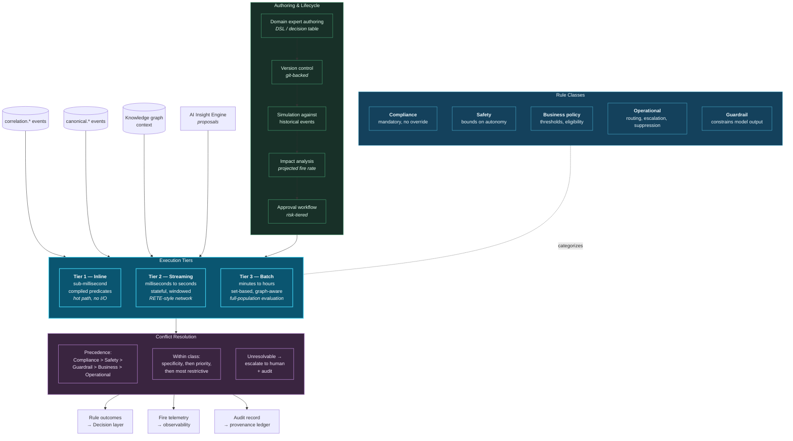

# 15. Rules Engine

---

## 15.1 Why Deterministic Rules Remain Essential

In an architecture featuring machine learning and generative reasoning, a deterministic rules engine may appear anachronistic. It is not. It serves four requirements that probabilistic components cannot.

**Regulatory mandate.** Many obligations are prescriptive rather than predictive. A transaction above a threshold must be reported. A patient with a specific drug combination must trigger a pharmacist review. A trade above a notional limit must be pre-approved. These are not judgement calls, and a model that satisfies them 99.7% of the time is non-compliant.

**Explainability by construction.** A rule is its own explanation. When an auditor asks why an action was taken, "condition X held and rule R mandates action A" is a complete and defensible answer. No post-hoc attribution technique is required.

**Guardrails on probabilistic components.** Rules bound what models may do. A model may recommend an action; a rule determines whether that action is permissible. This inversion — deterministic constraint over probabilistic recommendation — is the framework's primary safety mechanism.

**Deterministic latency.** Rule evaluation has bounded, predictable cost. Model inference does not, particularly for generative models. Where a decision must be made within a hard latency budget, a rule can guarantee it.


### Design Principle — Rules Constrain Models, Not the Reverse

Where a deterministic rule and a probabilistic model disagree on whether an action is *permitted*, the rule MUST prevail. Models propose; rules dispose. A model MAY expand the set of actions considered; it MUST NOT expand the set of actions permitted.


## 15.2 Rules Engine Architecture



**Figure 22.** *Rules engine architecture. Three execution tiers serve different latency requirements over the same rule corpus. Five rule classes carry explicit precedence, with compliance and safety rules unconditionally overriding business and operational rules. The authoring pipeline mandates simulation and impact analysis before approval — a rule is never deployed without a projection of how often it will fire.*

## 15.3 Rule Classes and Execution Tiers

| Class | Purpose | Override | Typical tier | Example (illustrative) |
| --- | --- | --- | --- | --- |
| **Compliance** | Statutory and regulatory obligation | Never | 1 or 3 | Report any single transaction above the statutory threshold |
| **Safety** | Bound on autonomous action | Never | 1 | No autonomous action may debit a customer account |
| **Guardrail** | Constrain model-proposed action | Only by compliance/safety | 1 | Model recommendations affecting credit require human approval |
| **Business policy** | Thresholds, eligibility, entitlement | By documented exception | 2 | Waive fees where lifetime value exceeds threshold and dispute is first occurrence |
| **Operational** | Routing, escalation, suppression, enrichment | Freely | 2 | Route correlations above severity 3 in EMEA to the Frankfurt team |

**Table 26.** *Rule classes, override permissions, and typical execution tiers. The override column is the architecturally significant one: compliance and safety rules are unconditional, which means they cannot be disabled by configuration change without an explicit, audited, dual-authorized process.*

### 15.3.1 Tier Selection

**Tier 1 (Inline).** Compiled predicate evaluation on the correlation emission path, with no external I/O permitted. Used for compliance and safety rules that must be evaluated before any correlation reaches a consumer. The no-I/O restriction is what guarantees sub-millisecond latency; a Tier 1 rule requiring a database lookup is mis-tiered.

**Tier 2 (Streaming).** Stateful evaluation within the stream processing runtime, typically using a RETE-derived network for efficient incremental matching against many rules. Supports temporal conditions ("three occurrences within an hour"), aggregation, and graph lookups. This is where the majority of business rules execute.

**Tier 3 (Batch).** Set-based evaluation over the full population, used for rules requiring global context ("customers in the top decile of this cohort") or expensive graph traversal ("any entity within three hops of a sanctioned party"). Runs on the batch layer schedule.

## 15.4 Interaction with Correlations

The rules engine consumes correlations rather than raw events, which changes rule expressiveness fundamentally.

**Conventional rule (single-signal):**

```
IF transaction.amount > 10000
   AND transaction.country != customer.home_country
THEN flag_for_review
```

This rule can only reference facts available in the triggering event. Its precision is inherently limited, and its false-positive rate is a function of how many legitimate customers travel.

**Correlation-aware rule (multi-signal):**

```
IF correlation.type = 'COORDINATED_ACCOUNT_TAKEOVER'
   AND correlation.confidence >= 0.85
   AND correlation.participants CONTAINS event.type = 'identity.device_change'
   AND correlation.participants CONTAINS event.type = 'payee.added'
   AND correlation.participants CONTAINS event.type = 'payment.high_value'
   AND NOT correlation.participants CONTAINS event.type = 'auth.step_up_completed'
   AND correlation.modality_count >= 2
THEN escalate_priority_1, hold_transaction, notify_customer
```

The second rule references a *relationship* with a *calibrated confidence*, established across *multiple event types* from *multiple domains*, confirmed by *multiple modalities*. It could not be expressed at all in an architecture without a correlation substrate — the rule author would have to implement the correlation logic inside the rule, which is precisely the anti-pattern Principle 1 prohibits.


**The practical dividend.** Correlation-aware rules are shorter, more precise, and more maintainable than single-signal rules, because the difficult work — relating events across domains and scoring the relationship — has been factored out into the platform. Rule authors express business intent rather than integration logic.


## 15.5 Conflict Resolution

With hundreds of rules evaluating concurrently, conflicts are inevitable. The framework specifies deterministic resolution:

1. **Class precedence.** Compliance > Safety > Guardrail > Business policy > Operational. A compliance rule mandating a hold defeats a business rule permitting release, unconditionally.
2. **Specificity within class.** The rule with more specific conditions prevails over a more general one, following the standard subsumption principle.
3. **Explicit priority within equal specificity.** Rules carry an integer priority.
4. **Most restrictive on tie.** Where priority is equal, the outcome that permits least prevails. Failing safe is the default.
5. **Escalation on genuine deadlock.** If steps 1–4 do not resolve, the decision escalates to a human with the full conflict recorded. Deadlocks are a defect signal and are reported to rule owners.


**Rule corpus growth is a real governance problem.** Rule bases grow monotonically because adding a rule is easy and removing one requires proving it is unnecessary. Left unmanaged, corpora accumulate contradictory, redundant, and dead rules. The framework mandates: fire-rate telemetry per rule, automatic flagging of rules that have not fired within a defined period, mandatory expiry dates on business and operational rules, and periodic corpus review with a named owner. A rule that has not fired in twelve months is presumed dead and must be re-justified or removed.


## 15.6 Rule Authoring and Deployment Discipline

The authoring pipeline in Figure 22 mandates four gates before deployment:

**Simulation.** The candidate rule is evaluated against a historical event and correlation window (typically 30–90 days), using the time-travel capability of the batch layer. This produces the actual set of instances the rule would have fired on.

**Impact analysis.** From the simulation, projected fire rate, affected entity count, and — where determinable — the historical outcome of the instances it would have caught or missed. A rule projected to fire 40,000 times per day when the receiving team handles 200 cases per day is rejected at this gate rather than discovered in production.

**Risk-tiered approval.** Compliance and safety rules require approval from the accountable risk function. Business rules require domain owner approval. Operational rules may be self-approved by the platform team. Approval is recorded in the provenance ledger.

**Staged rollout.** Rules deploy in shadow mode first — evaluating and logging but not acting — for a defined observation period, then progress to active. Shadow-mode divergence from expectation is the final gate.

## 15.7 Observability

| Metric | Purpose | Alert condition |
| --- | --- | --- |
| Fire rate per rule | Detect runaway or dead rules | Deviation from simulated projection |
| Rules never fired | Identify dead corpus | No fire within defined period |
| Conflict frequency per rule pair | Identify contradictory rules | Any recurring conflict |
| Escalation rate from deadlock | Corpus health | Any sustained deadlock |
| Evaluation latency per tier | SLO compliance | Tier 1 above sub-millisecond budget |
| Override rate on business rules | Policy fitness | High override rate implies wrong threshold |
| Shadow-mode divergence | Deployment safety | Divergence above tolerance blocks promotion |

**Table 27.** *Rules engine observability. Override rate is the most informative business signal: a rule overridden by humans in a large proportion of cases encodes a policy that does not match operational reality and should be revised rather than enforced more strictly.*

---


## Key Takeaways

1. **Deterministic rules remain essential** for prescriptive regulatory obligations, explainability by construction, guardrails on probabilistic components, and bounded latency.
2. **Rules constrain models, not the reverse.** Models propose actions; rules determine permissibility. This inversion is the framework's primary safety mechanism.
3. **Three execution tiers serve one corpus:** inline compiled predicates with no I/O for compliance and safety, stateful streaming evaluation for business rules, and batch set-based evaluation for globally-scoped rules.
4. **Compliance and safety rules are unconditionally non-overridable** and cannot be disabled without an audited, dual-authorized process.
5. **Correlation-aware rules are shorter, more precise, and more maintainable** than single-signal rules, because integration logic has been factored into the platform. Rule authors express intent rather than joins.
6. **Conflict resolution is deterministic** through class precedence, specificity, priority, most-restrictive default, and human escalation on genuine deadlock — with deadlocks treated as defect signals.
7. **Rule corpus growth requires active governance:** fire-rate telemetry, dead-rule flagging, mandatory expiry dates, and periodic review under a named owner.
8. **Simulation and impact analysis precede deployment.** A rule's projected fire rate is measured against the receiving team's actual capacity before it reaches production.
9. **High human override rates indicate a wrong rule, not wrong humans**, and should trigger policy revision rather than stricter enforcement.


---

**Next:** [16. AI Insight Engine →](16-ai-insight-engine.md)
