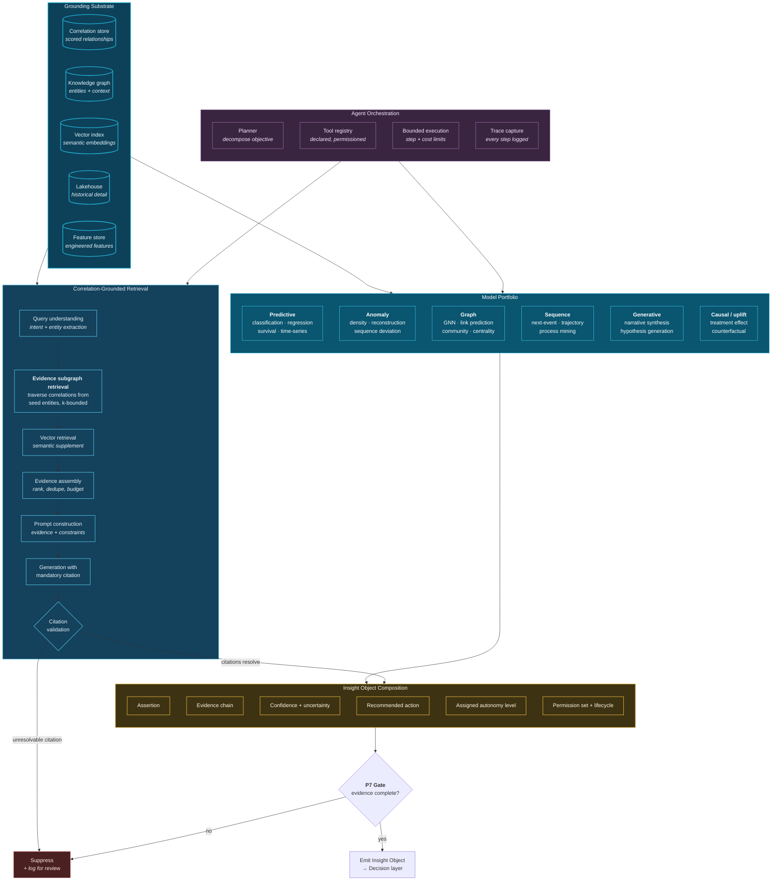
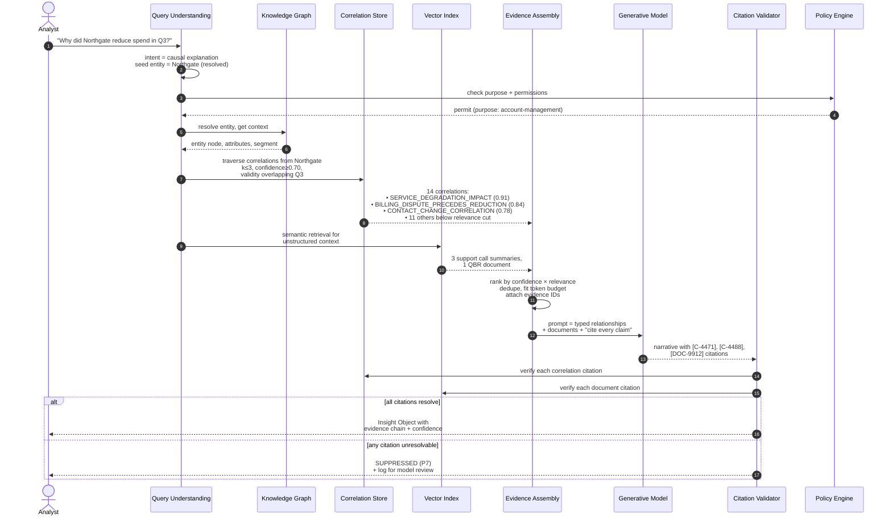

# 16. AI Insight Engine

---

The AI Insight Engine converts correlations into decision-ready intelligence. Its defining architectural property is that it is **grounded in the correlation substrate** rather than operating over raw data — which is what permits its outputs to be attributable rather than merely plausible.

## 16.1 Architecture

**Figure 23.** *AI Insight Engine architecture. Six model families operate over a five-component grounding substrate. The retrieval path is distinguished by retrieving an evidence subgraph of scored correlations rather than only semantically similar passages. Two hard gates enforce Principle 7: unresolvable citations and incomplete evidence chains cause suppression rather than emission.*

## 16.2 The Model Portfolio

| Family | Purpose in the framework | Input from correlation substrate | Output |
| --- | --- | --- | --- |
| **Predictive** | Forecast outcomes for entities and processes | Correlation features as model inputs — "customer has N active high-confidence risk correlations" | Probability, expected value, time-to-event |
| **Anomaly** | Detect deviation; feeds M5 behavioural correlation | Baselines maintained per entity and cohort | Anomaly score with contributing features |
| **Graph** | Reason over the correlation topology itself | The correlation graph as the graph | Link predictions, communities, influence rankings |
| **Sequence** | Model process trajectories and next-event likelihood | Ordered correlation chains | Predicted next event, deviation from normal path |
| **Generative** | Synthesize narrative explanation; propose hypotheses | Evidence subgraph as grounding context | Cited natural-language explanation |
| **Causal / uplift** | Estimate intervention effect | M3 causal correlations as candidate structures | Treatment effect estimate with assumptions stated |

**Table 28.** *AI model portfolio. The distinguishing property throughout is that correlations are model *inputs*, not merely model *outputs* — a customer's risk classification can be informed by the graph structure of their correlated events, not only by their own attributes. This is where the correlation substrate delivers measurable modelling value.*

### 16.2.1 Correlations as Features

The most underappreciated benefit of a correlation substrate is its effect on feature engineering. Conventional features describe an entity in isolation: transaction count, average balance, tenure. Correlation-derived features describe an entity's **position in a relationship structure**:

- Count of high-confidence correlations by type in a trailing window
- Number of distinct entities within two hops sharing a risk correlation
- Degree centrality within the correlation graph for a given relationship type
- Rate of change in correlation density (a rising correlation density often precedes an incident)
- Whether the entity participates in a detected community with adverse characteristics

These features are frequently more predictive than attribute-based features precisely because they encode context that isolated attributes cannot. They are also unavailable to any architecture that does not persist correlations — which is a concrete, measurable argument for the framework independent of its other claims.


**A testable prediction.** If the framework's central claim is correct, then adding correlation-derived features to an existing production model should improve its performance measurably, without any other change. This is the cheapest available experiment to validate the framework's premise, and it is recommended as the first step in [Chapter 40](../part-5/40-future-roadmap.md).


## 16.3 Correlation-Grounded Retrieval

This is the framework's proposed extension to retrieval-augmented generation [26].

### 16.3.1 The Difference

**Conventional RAG.** User question → embed → retrieve *k* semantically similar passages → construct prompt → generate. The model receives text that *mentions* relevant topics. If the answer requires connecting two facts from different passages, the model must infer the connection — and inference without verification is where fabrication occurs.

**Correlation-grounded retrieval.** User question → extract intent and seed entities → **traverse the correlation graph from those entities to bounded depth, filtered by relationship type, confidence threshold, and temporal validity** → supplement with vector retrieval for unstructured context → assemble evidence with explicit relationship statements → construct prompt containing *typed, scored relationships* → generate with mandatory citation → validate every citation resolves to a real correlation or event.

The model no longer infers relationships. It receives them, with types and confidences, and its task reduces to explanation and synthesis — a task at which generative models are reliable — rather than relationship discovery, at which they are not.

**Figure 24.** *Correlation-grounded retrieval sequence. The critical difference from conventional RAG appears at steps 8–9: the system retrieves *typed, scored relationships* rather than only similar text. The final validation step enforces Principle 7 — any citation the validator cannot resolve causes the entire response to be suppressed, converting hallucination from a probabilistic risk into a detected failure.*

### 16.3.2 Why Citation Validation Matters

Requiring citations is common practice. **Validating them is not**, and it is the difference between a mitigation and a control.

A generative model asked to cite will produce citation-shaped tokens whether or not the referenced object exists. Validating that every cited identifier resolves to a real correlation or event in the store converts fabrication from an undetected output into a **detected, suppressible, and measurable failure**.

The measurement matters as much as the suppression: citation validation failure rate is a direct, continuous quality metric for the generative component. A rising rate indicates model degradation, prompt drift, or an evidence-assembly defect, and it is observable without human review of outputs.


**What this does not solve.** Citation validation confirms that cited objects exist and that the claim references them. It does not confirm that the *interpretation* of those objects is correct. A model can cite a real correlation and mischaracterize what it means. Mitigating this requires human review at lower autonomy levels and structured output constraints — and it is a residual risk the framework acknowledges rather than eliminates.


## 16.4 AI Agents

The framework treats agents as bounded executors, not autonomous investigators.

**Permitted agent pattern.** An agent receives an objective, decomposes it into steps, and executes those steps using **declared, permissioned tools** — retrieve correlations for an entity, traverse the graph, run a specified model, query a specific dataset. Every step is logged. Execution is bounded by step count, wall-clock time, and cost budget. Tool access is governed by the same policy engine as human access, evaluated against the *requesting user's* permissions and the *declared purpose*.

**Required constraints:**

| Constraint | Requirement | Rationale |
| --- | --- | --- |
| **Tool declaration** | Agents may invoke only registered tools with declared schemas | Prevents unbounded capability |
| **Permission inheritance** | Agent acts with the requesting principal's permissions, never elevated | Prevents privilege escalation via agent |
| **Purpose binding** | Agent inherits the declared purpose; tools check it | Prevents purpose laundering |
| **Step budget** | Hard limit on reasoning steps | Prevents runaway loops |
| **Cost budget** | Hard limit on compute and token spend | Prevents cost incidents |
| **Full trace** | Every step, tool call, and intermediate result logged | Enables audit and debugging |
| **Write prohibition by default** | Agents read; writes require explicit autonomy level | Prevents unreviewed state change |
| **No self-modification** | Agents may not alter their own tools, prompts, or budgets | Prevents constraint circumvention |

**Table 29.** *Required constraints on AI agents. Permission inheritance and purpose binding are the two most frequently violated in practice, and both create serious exposure: an agent operating with elevated permissions or an undeclared purpose is a governance bypass, regardless of how well-intentioned its objective.*


**Purpose laundering.** A specific risk worth naming: a user permitted to access data for fraud prevention asks an agent a question whose real purpose is marketing. If the agent inherits the fraud-prevention purpose declared at session start, it may lawfully retrieve data and produce an output that is then used for a prohibited purpose. Purpose must be declared per request and validated against the output's intended use — not inherited indefinitely from a session. The framework treats this as an unresolved problem requiring further research.


## 16.5 The Insight Object

The engine's output is the Insight Object introduced in [Chapter 8](08-introducing-dsp.md). Its full schema appears in [Appendix C](../appendix/c-schemas.md); its essential fields:

| Field | Content | Consumed by |
| --- | --- | --- |
| `assertion` | The claim, in structured and natural-language form | Humans, downstream systems |
| `evidence_chain` | Ordered references to correlations, events, models, parameters | Audit, explanation UI, P7 gate |
| `confidence` | Calibrated confidence with an uncertainty interval | Decision thresholds |
| `uncertainty_sources` | Named sources of residual uncertainty | Human judgement |
| `recommended_action` | Structured action proposal, or explicitly none | Autonomy Controller |
| `autonomy_level` | Assigned level (L0–L5) for this insight class | Autonomy Controller |
| `permission_set` | Who may see this insight | Serving tier |
| `purpose_tags` | Purposes for which this insight may be used | Policy engine |
| `lifecycle_status` | proposed / validated / acted / superseded / retracted | Consumers |
| `version` and `supersedes` | Version chain | Audit, consumers |
| `provenance` | Engine version, model versions, prompt version, timestamp | Reproducibility |
| `outcome` | Populated by feedback: what actually happened | Calibration (P10) |

**Table 30.** *Insight Object essential fields. The `outcome` field is what makes the object a learning artifact rather than a record: populated retrospectively, it converts every insight into a labelled training example for confidence calibration.*

## 16.6 Model Governance

The framework requires the following of every model in the portfolio:

**Registration.** Model, version, training data reference, hyperparameters, and evaluation metrics recorded in a registry, with the registry entry referenced in every Insight Object the model contributes to.

**Evaluation before deployment.** Performance measured on a held-out set representative of production distribution, including subgroup performance to detect disparate impact.

**Shadow deployment.** New model versions run in parallel with the incumbent, with divergence measured, before taking traffic.

**Drift monitoring.** Input distribution drift, prediction distribution drift, and — where outcomes are available — realized performance drift, each monitored with alert thresholds.

**Automatic demotion.** A model whose realized performance falls below its declared threshold is automatically demoted to a lower autonomy level, exactly as a correlation scope is. This is the same safeguard applied consistently.

**Explainability requirement scaled to autonomy.** At autonomy levels 0–2, feature attribution is sufficient. At levels 3 and above, the framework requires either an inherently interpretable model or an attribution method whose fidelity has been validated — because at those levels the explanation may be the only human-reviewable artifact.


**On generative models at high autonomy levels.** The framework's position is that generative models SHOULD NOT be assigned autonomy levels above L2 for actions with material consequence. Their outputs are not reproducible in the strict sense, their failure modes are not well characterized, and their explanations are post-hoc narratives rather than causal accounts of their own computation. They are extremely valuable at L0–L2 — summarizing, explaining, drafting, proposing — and the framework recommends confining them there until the field's understanding matures.


---


## Key Takeaways

1. **The engine is grounded in the correlation substrate**, which is what allows its outputs to be attributable rather than merely plausible.
2. **Correlations are model inputs, not only outputs.** Correlation-derived features — graph position, correlation density, community membership — encode context that attribute-based features cannot.
3. **Adding correlation-derived features to an existing model is the cheapest available test of the framework's premise**, and should be the first experiment any organization runs.
4. **Correlation-grounded retrieval returns typed, scored relationships**, reducing the generative model's task from relationship discovery — at which it is unreliable — to explanation and synthesis, at which it is reliable.
5. **Citation validation converts hallucination from an undetected probabilistic risk into a detected, suppressible, measurable failure**, and its failure rate is a continuous quality metric requiring no human review.
6. **Citation validation does not verify interpretation.** A model can cite a real correlation and mischaracterize it; this residual risk is acknowledged, not eliminated.
7. **Agents are bounded executors** with declared tools, inherited (never elevated) permissions, step and cost budgets, full traces, and no self-modification.
8. **Purpose laundering is an unresolved problem.** Purpose must be declared per request rather than inherited from a session, and the framework identifies this as requiring further research.
9. **Generative models should not be assigned autonomy above L2** for materially consequential actions, given non-reproducibility, poorly characterized failure modes, and post-hoc explanations.
10. **Models are automatically demoted on performance drift**, applying the same safeguard used for correlation scopes.


---

**Next:** [17. Knowledge Graph Layer →](17-knowledge-graph-layer.md)
