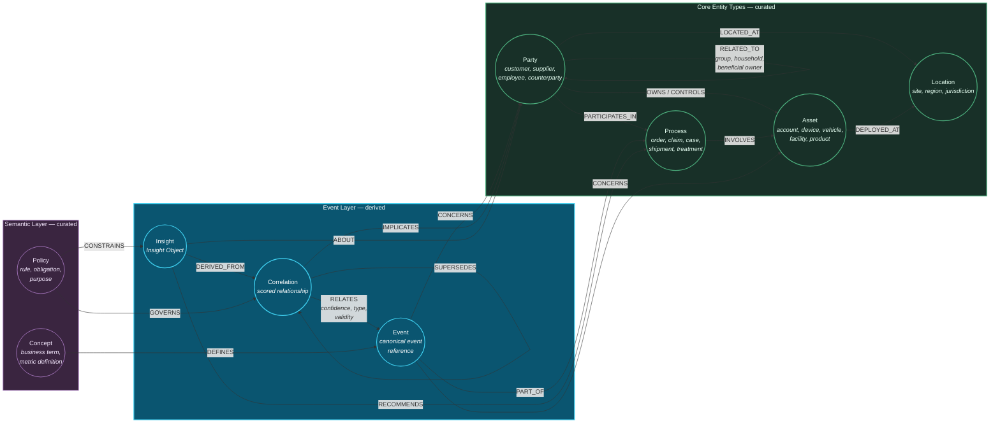

# 17. Knowledge Graph Layer

---

## 17.1 The Living Graph

The framework's knowledge graph differs from conventional enterprise knowledge graphs in one decisive respect: **its edges are predominantly machine-derived from observed event relationships rather than hand-authored from documented intent.**


### Definition — Living Knowledge Graph

A **living knowledge graph** is a graph whose topology is continuously revised by the Correlation Engine from observed event relationships, such that the graph represents how the enterprise **actually behaves** rather than how it was **documented to behave**. Its edges carry confidence, temporal validity, and provenance, and they expire.


The distinction is practical. Conventional enterprise knowledge graphs are curated: a modelling team declares entity types, relationship types, and instances, typically sourced from master data systems. This produces a graph that is authoritative about *structure* and stale about *behaviour*. It knows that customers place orders; it does not know that this customer's orders have been correlated with quality complaints for six weeks.

The living graph inverts the ratio. A curated ontology provides the type system and the invariant structural relationships. The Correlation Engine supplies the overwhelming majority of edges — dynamic, scored, expiring assertions about observed relationships.


### Design Principle — Curate the Schema, Derive the Instances

The graph's **type system** (entity classes, relationship types, constraints) MUST be curated, versioned, and governed by humans. The graph's **instance-level edges** SHOULD be predominantly derived from observed correlations. Hand-curating instance edges at enterprise scale does not remain current and MUST NOT be the primary mechanism.


## 17.2 Graph Schema

**Figure 25.** *Enterprise knowledge graph schema fragment. Four curated core entity types provide the structural skeleton. The derived event layer — events, correlations, and insights — supplies the dynamic, high-volume majority of the graph. A curated semantic layer binds business concepts and policies to the derived content, which is what enables policy to govern correlation formation rather than only correlation access.*

Note that **Correlation is itself a node type**, not merely an edge. This is a deliberate modelling decision: a correlation has properties (confidence, modality, evidence set, validity, provenance), participates in relationships (supersedes, is governed by), and has a lifecycle. Representing it as a reified node rather than as an edge property makes these first-class and queryable, at the cost of increased graph size and traversal depth.

## 17.3 What the Graph Enables

### 17.3.1 Multi-Hop Reasoning

The graph's principal contribution is efficient traversal to depth. Questions that are expensive or impossible in relational form become natural:

- *Which customers are within two hops of any entity subject to a sanctions correlation?*
- *What is the shortest correlation path between this equipment failure and any supplier change?*
- *Which entities form a community whose members share device correlations but no declared relationship?* — the canonical fraud-ring query.
- *Which insights depend, transitively, on a correlation that has just been retracted?* — the impact-analysis query, essential for the revision protocol.

The last of these is worth emphasizing. When a correlation is retracted, the framework must notify every consumer whose insight depended on it. Computing that transitive dependency set is a graph traversal. In a relational store it is a recursive join over the lineage tables; in a graph it is a single traversal. This is not a marginal performance difference at depth.

### 17.3.2 Graph-Native Analytics

| Algorithm | Correlation application |
| --- | --- |
| **Community detection** (Louvain, Leiden, label propagation) | Fraud rings, coordinated inauthentic behaviour, supplier clusters sharing hidden dependency |
| **Centrality** (degree, betweenness, PageRank) | Critical-path assets, systemically important counterparties, influential accounts |
| **Link prediction** | Anticipate relationships not yet observed — a candidate generator for the Correlation Engine |
| **Shortest / all paths** | Causal chain reconstruction; contagion path analysis |
| **Similarity** (node2vec, GraphSAGE embeddings) | Cohort construction for M5 behavioural baselines |
| **Temporal graph analysis** | How correlation topology evolves — rising density often precedes incidents |

**Table 31.** *Graph-native analytics and their correlation applications. Link prediction is architecturally notable because it runs in the opposite direction to the rest of the system: the graph proposes relationships that the Correlation Engine then attempts to verify against evidence, creating a hypothesis-generation loop.*

## 17.4 Edge Lifecycle and Expiry

The graph's most operationally demanding property is that **edges expire**.

A conventional knowledge graph accumulates edges monotonically. A living graph derived from correlations must not, for two reasons: correlations have temporal validity, and stale edges actively mislead. An edge asserting that two entities are behaviourally correlated, based on evidence from eighteen months ago, is worse than absent — it will be traversed and trusted.

The framework specifies:

| Mechanism | Behaviour |
| --- | --- |
| **Explicit validity** | Every derived edge carries `valid_from` and `valid_to`. Traversals filter by validity by default. |
| **Confidence decay** | Where appropriate to the relationship type, confidence decays with a declared half-life absent reinforcing evidence. |
| **Reinforcement** | New consistent evidence extends validity and may raise confidence, subject to the calibration pipeline. |
| **Contradiction** | Contradicting evidence reduces confidence and may retract the edge, triggering downstream notification. |
| **Archival, not deletion** | Expired edges move to a temporal archive partition, preserving auditability. Queries may explicitly request historical state. |
| **Retraction propagation** | Retraction triggers traversal of dependent insights and consumer notification. |

**Table 32.** *Edge lifecycle mechanisms. Archival rather than deletion is required for audit: an auditor must be able to reconstruct the graph state at the moment a historical decision was made, which is impossible if expired edges are removed.*


**Expiry is a significant operational cost.** Continuously evaluating validity, decaying confidence, and archiving expired edges across a graph of billions of edges is substantial ongoing work — comparable to compaction in a log-structured store. Implementations that treat expiry as a low-priority background task will find that traversals over stale edges silently degrade insight quality, and the degradation will be attributed to the models rather than to the graph.


## 17.5 Technology Selection

| Consideration | Property graph (Neo4j, TigerGraph, Memgraph) | RDF triple store (GraphDB, Virtuoso, Stardog) | Cloud managed (Neptune, Cosmos Gremlin) | Graph-on-lakehouse |
| --- | --- | --- | --- | --- |
| Traversal performance at depth | ✔ Strong | ◐ Moderate | ◐ Moderate | ✘ Weak |
| Write throughput | ◐ Moderate | ◐ Moderate | ◐ Moderate | ✔ Strong |
| Formal reasoning / inference | ◐ Limited | ✔ Strong (OWL) | ✘ | ✘ |
| Standardized query | ✔ Cypher / GQL | ✔ SPARQL | ◐ Gremlin | ✔ SQL |
| Scale to 10⁹⁺ edges | ◐ Requires care | ◐ Requires care | ✔ | ✔ |
| Temporal / bi-temporal support | ◐ Modelled manually | ◐ Modelled manually | ◐ Manual | ✔ Native snapshots |
| Operational maturity | ✔ | ✔ | ✔ Managed | ✔ |
| Cost at scale | ✘ High | ✘ High | ◐ Moderate | ✔ Low |

**Table 33.** *Graph technology selection considerations. Legend: ✔ strong, ◐ moderate, ✘ weak. No single option dominates, which motivates the hybrid topology below.*

### 17.5.1 Recommended Hybrid Topology

The framework recommends a **two-tier graph**:

**Hot tier — property graph.** Recent, high-confidence, currently-valid edges for entities under active consideration. Sized for sub-second traversal at depth three to four. Typically the trailing 30–90 days plus curated structural edges. This is where interactive queries, insight generation, and real-time decisioning execute.

**Cold tier — graph-on-lakehouse.** Complete historical edge set, including expired and archived edges, stored in the lakehouse in an adjacency-optimized layout. Serves batch graph analytics (W3), retrospective audit, and re-correlation. Queried with distributed graph processing rather than interactive traversal.

**Synchronization.** Edges promote to hot on creation and demote on expiry or age. The hot tier is treated as a **materialized cache** of the cold tier, rebuildable from it — which means hot-tier loss is a recovery inconvenience rather than data loss.


**Why the hot tier must be bounded.** A property graph containing every historical edge will not traverse at interactive latency, regardless of tuning. Bounding the hot tier is the graph-layer expression of Principle 3, and the same discipline applies: the bound must be declared, monitored, and enforced rather than hoped for.


## 17.6 Relationship to Data Fabric Graphs

[Chapter 6](../part-1/06-evolution.md) drew the distinction; it is restated here concretely because the two graphs are frequently conflated.

| Aspect | Data fabric catalog graph | Living knowledge graph |
| --- | --- | --- |
| **Nodes represent** | Tables, columns, pipelines, reports, owners | Parties, assets, processes, events, correlations, insights |
| **Edges represent** | Lineage, containment, ownership, classification | Observed relationships with confidence and validity |
| **Scale** | 10⁴–10⁶ nodes | 10⁸–10¹⁰ nodes and edges |
| **Write rate** | Low (schema change frequency) | Very high (event rate) |
| **Volatility** | Low | High — continuous creation and expiry |
| **Question answered** | "Where does this data come from?" | "What is this entity connected to, and why?" |
| **Consumers** | Stewards, engineers, compliance | Analysts, models, agents, decision systems |

**Table 34.** *Catalog graph versus living knowledge graph. Both are necessary and they are different systems. The framework retains a catalog graph in the metadata plane ([Chapter 18](18-metadata-and-lineage.md)) and a living graph in the intelligence tier. Attempting to serve both from one store degrades both.*

---


## Key Takeaways

1. **The living graph's edges are predominantly derived from observed correlations**, so it represents how the enterprise actually behaves rather than how it was documented to behave.
2. **Curate the schema, derive the instances.** Hand-curating instance-level edges at enterprise scale does not stay current and must not be the primary mechanism.
3. **Correlation is modelled as a node, not an edge property**, making its confidence, evidence, lifecycle, and supersession relationships first-class and queryable.
4. **Retraction impact analysis is a graph traversal**, which is why the graph is not merely a performance optimization — computing the transitive set of insights depending on a retracted correlation is impractical relationally at depth.
5. **Link prediction runs in reverse**, proposing relationships for the Correlation Engine to verify against evidence — a hypothesis-generation loop.
6. **Edges expire, and expiry is expensive.** Stale edges are worse than absent because they will be traversed and trusted. Implementations that deprioritize expiry will see insight quality degrade and misattribute it to models.
7. **Archival rather than deletion is required for audit**, so that graph state at the time of any historical decision is reconstructable.
8. **A two-tier hybrid is recommended:** a bounded property graph for interactive traversal and a complete graph-on-lakehouse for analytics and audit, with the hot tier treated as a rebuildable cache.
9. **The catalog graph and the living graph are different systems** at different scales with different volatility. Serving both from one store degrades both.


---

**Next:** [18. Metadata and Data Lineage →](18-metadata-and-lineage.md)
