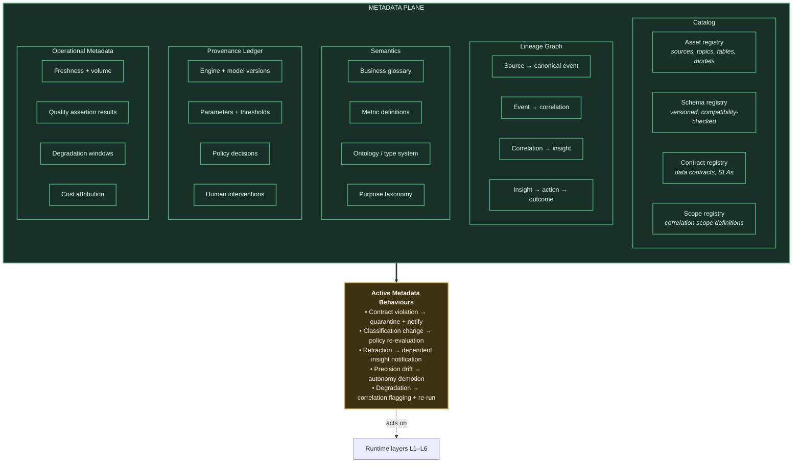
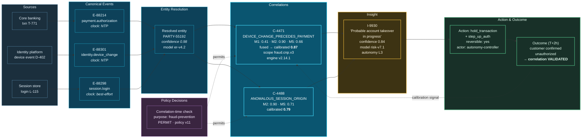

# 18. Metadata and Data Lineage

---

Principle 7 — Evidence or Silence — is only enforceable if lineage is complete. This chapter specifies the metadata plane that makes it so.

## 18.1 The Metadata Plane

**Figure 26.** *The metadata plane. Five metadata classes are maintained, but the architecturally significant component is the active metadata behaviour set: metadata in this framework is not descriptive documentation but an operational control plane that triggers quarantine, policy re-evaluation, consumer notification, autonomy demotion, and re-correlation.*

## 18.2 Metadata Classes

| Class | Contents | Primary consumer | Update trigger |
| --- | --- | --- | --- |
| **Catalog** | Asset registry, schemas, contracts, correlation scopes | Engineers, stewards, Scope Governor | Registration, schema evolution |
| **Lineage** | Directed graph from source to outcome | Audit, impact analysis, P7 gate | Every event, correlation, insight, action |
| **Semantics** | Glossary, metric definitions, ontology, purpose taxonomy | Humans, generative models, policy engine | Governance decision |
| **Provenance** | Engine and model versions, parameters, policy decisions, human interventions | Audit, reproducibility, W2 re-correlation | Every execution |
| **Operational** | Freshness, volume, quality results, degradation windows, cost | Operations, Scope Governor, cost management | Continuous |

**Table 35.** *Metadata classes maintained by the plane. Lineage is unique in being updated at the event rate rather than at configuration-change rate, which is why its capture mechanism must be engineered for throughput rather than treated as an audit afterthought.*

## 18.3 Lineage Depth Requirement

Conventional enterprise lineage terminates at the dataset: *this table was produced by that job from those tables*. This is insufficient for a correlation architecture, because the question an auditor asks is not "where did this table come from?" but **"why did the system conclude this, and act on it?"**

The framework therefore requires lineage at five levels:

| Level | Granularity | Example |
| --- | --- | --- |
| **L-A Asset** | Dataset to dataset | `silver.payments` derived from `bronze.core_banking_cdc` |
| **L-B Field** | Column to column with transformation | `canonical.amount_gbp` = `raw.amount` × FX rate (rate version pinned) |
| **L-C Record** | Individual canonical event to its source record | Event `E-88214` from CDC LSN `0x4F2A91`, source txn `T-771` |
| **L-D Correlation** | Correlation to its exact evidence set | Correlation `C-4471` from events {`E-88214`, `E-88301`}, modalities {M1: 0.35, M2: 0.90}, scope `fraud.cnp.v3`, engine `v2.14.1` |
| **L-E Decision** | Insight to action to realized outcome | Insight `I-9930` from {`C-4471`, `C-4488`} → action `hold_transaction` at L3 → outcome: confirmed fraud, £48,200 prevented |

**Table 36.** *Five levels of lineage depth. L-D and L-E are the levels conventional lineage tooling does not provide and that this framework mandates. Without L-D, a correlation cannot be defended; without L-E, confidence cannot be calibrated.*

## 18.4 End-to-End Lineage for a Derived Insight

**Figure 27.** *End-to-end lineage for a single derived insight, illustrative. Every arrow is a persisted lineage edge. The chain supports four distinct audit questions: what evidence supported the conclusion, what policy permitted the correlation to form, what authority permitted the action, and whether the conclusion proved correct. The final feedback edge is what makes the confidence figure of 0.87 an empirical claim rather than an assertion.*

The figure also illustrates a subtlety worth noting: event `E-88298` carries a clock quality of *best-effort* rather than *NTP*. A correlation relying primarily on temporal precedence involving that event would carry reduced confidence, and the lineage records this so an auditor can assess whether the temporal claim was warranted.

## 18.5 Capture Mechanism


### Design Principle — Lineage Is Emitted, Not Reconstructed

Lineage MUST be emitted inline by the component performing the operation, at the time of the operation. Lineage MUST NOT be reconstructed by parsing logs, inspecting query history, or inferring from schedules. Reconstructed lineage is incomplete by construction and cannot support Principle 7.


**Mechanism.** Each layer emits lineage events conforming to an open standard (the framework recommends OpenLineage, extended with correlation-specific facets) to a dedicated lineage topic. A consumer materializes these into the lineage graph.

**Throughput consideration.** L-C and L-D lineage is emitted at the event and correlation rate — potentially hundreds of thousands of events per second. This is the metadata plane's dominant cost, and the framework specifies three mitigations:

1. **Structural sharing.** Correlations within a scope share a reference to the scope definition and engine version rather than repeating them. Provenance is normalized.
2. **Batched emission.** Lineage events are batched and compressed on the wire, with the batch boundary aligned to the checkpoint boundary so that lineage and state are consistent after recovery.
3. **Tiered retention.** Full L-C lineage is retained for a regulatory window (commonly 90 days to 7 years by domain); beyond that, it is aggregated to L-B while L-D and L-E are retained in full because they are the audit-relevant levels.


**Lineage cannot be sampled.** Sampling is the obvious cost mitigation and it is prohibited by Principle 7. If lineage for a given insight was not captured, that insight cannot be defended, and the framework requires suppressing it. Sampled lineage means a random subset of the system's conclusions are inadmissible — which is operationally worse than a higher metadata cost, because the organization cannot know in advance which conclusions will need defending.


## 18.6 Active Metadata Behaviours

The plane is not a documentation repository. Five behaviours make it operational:

| Trigger | Behaviour | Affected layer |
| --- | --- | --- |
| Contract violation detected | Quarantine message, notify named owner, increment source health metric | L1 |
| Classification changed on a field | Re-evaluate all correlation scopes referencing it; suspend any now impermissible | L3, Governance |
| Correlation retracted | Traverse lineage graph for dependent insights; notify consumers; mark insights superseded | L4, L5, L6 |
| Scope precision falls below declared threshold | Automatically demote scope autonomy level; notify owner | L3, L5 |
| Source degradation window recorded | Flag correlations produced in window; schedule W2 re-correlation | L3, L5 |
| Model drift detected | Demote model autonomy level; trigger retraining evaluation | L4 |
| Scope review overdue | Mark stale; exclude from autonomy L3+ | L3 |

**Table 37.** *Active metadata behaviours. Classification-change propagation is the most consequential for compliance: when a field is reclassified as special-category data, every correlation scope using it must be re-evaluated for permissibility, and impermissible scopes suspended automatically rather than at the next manual review.*

## 18.7 Reproducibility

The framework's reproducibility requirement: **any historical insight MUST be reproducible from its provenance record.**

This requires pinning, in the provenance ledger, every variable input:

- Source data snapshot identifiers (lakehouse table version / snapshot ID)
- Canonical event schema version
- Entity resolution model version
- Correlation scope definition version
- Correlation engine version
- Confidence calibration curve version
- Embedding model version (where M4 participated)
- Predictive and generative model versions
- Prompt template version (where generative components participated)
- Policy bundle version
- Rule corpus version


**Why this is achievable here and not generally.** Reproducibility of analytical conclusions is notoriously difficult in conventional architectures because the inputs are mutable and unversioned. The framework achieves it through three properties inherited from its foundations: the circulation layer is an immutable replayable log, the lakehouse provides snapshot-versioned inputs, and the provenance ledger pins every code and model version. Reproducibility is a dividend of the event-sourcing posture rather than an additional feature.

The residual exception is generative model output, which is not reproducible in the strict sense even with a pinned model version and temperature zero, due to inference non-determinism. This is one reason [Chapter 16](16-ai-insight-engine.md) restricts generative components to lower autonomy levels.


---


## Key Takeaways

1. **Metadata is an operational control plane, not documentation.** It triggers quarantine, policy re-evaluation, consumer notification, autonomy demotion, and re-correlation.
2. **Five lineage levels are required**, and the two that conventional tooling does not provide — correlation-to-evidence (L-D) and insight-to-outcome (L-E) — are the two the framework mandates. Without L-D a correlation cannot be defended; without L-E confidence cannot be calibrated.
3. **Lineage must be emitted inline, never reconstructed.** Reconstructed lineage is incomplete by construction and cannot support Evidence or Silence.
4. **Lineage cannot be sampled.** Sampling means a random, unknowable subset of the system's conclusions are inadmissible — operationally worse than the metadata cost it avoids.
5. **Clock quality is recorded in lineage**, so an auditor can assess whether a temporal correlation claim was warranted given the reliability of the participating sources' clocks.
6. **Classification-change propagation is the most consequential active behaviour**, automatically suspending correlation scopes that become impermissible rather than waiting for manual review.
7. **Reproducibility is a dividend of the event-sourcing posture**, achieved through an immutable replayable log, snapshot-versioned lakehouse inputs, and a provenance ledger pinning every version.
8. **Generative output remains non-reproducible** even with pinned versions, which is a substantive reason to restrict generative components to lower autonomy levels.


---

**Next:** [19. Event Relationships →](19-event-relationships.md)
