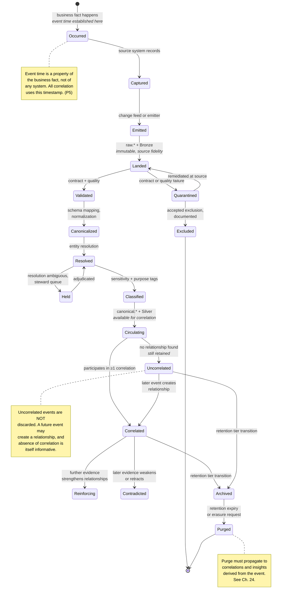

# 19. Event Relationships

---

This chapter specifies the taxonomy of relationships the framework recognizes and the lifecycle of the events that participate in them. A shared, explicit taxonomy matters because it is what allows a correlation to be interpreted consistently by a rule, a model, an analyst, and an auditor.

## 19.1 Event Lifecycle

**Figure 28.** *Canonical event lifecycle. Fourteen states from business occurrence to purge. Two properties are architecturally significant: event time is established at occurrence and never revised, and uncorrelated events are retained because a later arrival may create a relationship and because the absence of expected correlation is itself a signal.*

### 19.1.1 Why Uncorrelated Events Are Retained

A tempting optimization is to discard events that participate in no correlation. The framework prohibits it, for three reasons:

**Retrospective correlation.** An event uncorrelated today may correlate tomorrow when a related event arrives, or next quarter when a new scope is declared. Discarding it forecloses relationships that have not yet become discoverable.

**Absence as signal.** An event that *should* have correlated and did not is informative. A shipment dispatch with no corresponding delivery confirmation, a treatment order with no administration record, a trade with no settlement — the missing counterpart is frequently the finding. Detecting absence requires retaining the present half.

**Baseline integrity.** M5 behavioural baselines are computed over all events, not correlated ones. Discarding uncorrelated events biases every baseline toward correlated behaviour.

## 19.2 Relationship Taxonomy

```mermaid
flowchart TB
    ROOT["<b>Event Relationship</b>"]

    ROOT --> TEMP["<b>Temporal</b>"]
    ROOT --> STRUCT["<b>Structural</b>"]
    ROOT --> CAUS["<b>Causal</b>"]
    ROOT --> SEMANT["<b>Semantic</b>"]
    ROOT --> STAT["<b>Statistical</b>"]
    ROOT --> NEG["<b>Negative</b>"]

    TEMP --> T1["PRECEDES / FOLLOWS<br/><i>ordered in event time</i>"]
    TEMP --> T2["CONCURRENT_WITH<br/><i>overlapping, unordered</i>"]
    TEMP --> T3["PERIODIC_WITH<br/><i>recurring interval</i>"]
    TEMP --> T4["ACCELERATING / DECELERATING<br/><i>changing rate</i>"]

    STRUCT --> S1["SAME_ENTITY<br/><i>shared resolved entity</i>"]
    STRUCT --> S2["RELATED_ENTITY<br/><i>k-hop graph proximity</i>"]
    STRUCT --> S3["SHARED_ATTRIBUTE<br/><i>device, address, instrument</i>"]
    STRUCT --> S4["PART_OF_PROCESS<br/><i>same business process instance</i>"]
    STRUCT --> S5["HIERARCHICAL<br/><i>parent/child, group membership</i>"]

    CAUS --> CA1["PLAUSIBLY_CAUSES<br/><i>hypothesis, assumptions stated</i>"]
    CAUS --> CA2["MEDIATES<br/><i>intermediate in a chain</i>"]
    CAUS --> CA3["CONFOUNDED_BY<br/><i>common cause identified</i>"]
    CAUS --> CA4["AMPLIFIES / DAMPENS<br/><i>modifies magnitude</i>"]

    SEMANT --> SE1["DESCRIBES<br/><i>one event documents another</i>"]
    SEMANT --> SE2["SEMANTICALLY_SIMILAR<br/><i>embedding proximity</i>"]
    SEMANT --> SE3["CONTRADICTS<br/><i>logically inconsistent</i>"]
    SEMANT --> SE4["ELABORATES<br/><i>adds detail to another</i>"]

    STAT --> ST1["CO_ANOMALOUS<br/><i>simultaneous baseline deviation</i>"]
    STAT --> ST2["CORRELATED_SERIES<br/><i>association at discovered lag</i>"]
    STAT --> ST3["COHORT_DIVERGENT<br/><i>departs from peer group</i>"]
    STAT --> ST4["CLUSTER_MEMBER<br/><i>same detected community</i>"]

    NEG --> N1["EXPECTED_ABSENT<br/><i>counterpart did not occur</i>"]
    NEG --> N2["MUTUALLY_EXCLUSIVE_VIOLATED<br/><i>both occurred impossibly</i>"]
    NEG --> N3["SEQUENCE_BROKEN<br/><i>required step skipped</i>"]

    classDef root fill:#0a5570,stroke:#3fd0f0,stroke-width:3px,color:#ffffff
    classDef cat fill:#0d4159,stroke:#22b3d6,stroke-width:2px,color:#eaf9ff
    classDef leaf fill:#14415c,stroke:#4fb8d8,color:#eaf6fb
    classDef negc fill:#4a3020,stroke:#d09a60,stroke-width:2px,color:#fff4e6
    class ROOT root
    class TEMP,STRUCT,CAUS,SEMANT,STAT cat
    class NEG negc
    class T1,T2,T3,T4,S1,S2,S3,S4,S5,CA1,CA2,CA3,CA4,SE1,SE2,SE3,SE4,ST1,ST2,ST3,ST4 leaf
    class N1,N2,N3 negc
```

**Figure 29.** *Event relationship taxonomy. Six categories and twenty-four relationship types. The **Negative** category is highlighted because it is the category most commonly absent from correlation systems and frequently the most valuable: the relationship that should exist and does not is often the finding.*

## 19.3 Relationship Types in Detail

| Category | Type | Detection modality | Evidence required | Typical confidence ceiling |
| --- | --- | --- | --- | --- |
| Temporal | PRECEDES / FOLLOWS | M1 | 2 events, reliable clocks | 0.95 (bounded by clock quality) |
| Temporal | CONCURRENT_WITH | M1 | 2 events within window | 0.90 |
| Temporal | PERIODIC_WITH | M1 + M5 | ≥3 occurrences | 0.92 |
| Temporal | ACCELERATING / DECELERATING | M1 + M5 | Rate series | 0.85 |
| Structural | SAME_ENTITY | M2 | Resolved entity match | 0.99 (bounded by resolution confidence) |
| Structural | RELATED_ENTITY | M2 | Graph path, k bounded | 0.95 decreasing with k |
| Structural | SHARED_ATTRIBUTE | M2 | Matching distinguishing attribute | 0.97 |
| Structural | PART_OF_PROCESS | M2 | Shared process instance ID | 0.99 |
| Structural | HIERARCHICAL | M2 | Curated or derived hierarchy | 0.98 |
| Causal | PLAUSIBLY_CAUSES | M3 | Precedence + statistical test + assumptions | **0.75 (capped)** |
| Causal | MEDIATES | M3 | Chain with tested links | **0.70 (capped)** |
| Causal | CONFOUNDED_BY | M3 | Identified common cause | 0.80 |
| Causal | AMPLIFIES / DAMPENS | M3 + M5 | Interaction effect | **0.70 (capped)** |
| Semantic | DESCRIBES | M4 | Explicit reference or strong alignment | 0.90 |
| Semantic | SEMANTICALLY_SIMILAR | M4 | Embedding distance below threshold | **0.65 (capped)** |
| Semantic | CONTRADICTS | M4 + rules | Logical inconsistency detected | 0.92 |
| Semantic | ELABORATES | M4 | Containment or extension relation | 0.85 |
| Statistical | CO_ANOMALOUS | M5 | Simultaneous deviation, baselines established | 0.88 |
| Statistical | CORRELATED_SERIES | M1 + M5 | Series association, FDR-corrected | 0.85 |
| Statistical | COHORT_DIVERGENT | M5 | Cohort baseline + deviation | 0.85 |
| Statistical | CLUSTER_MEMBER | M2 + M5 | Community detection result | 0.90 |
| Negative | EXPECTED_ABSENT | M1 + rules | Expectation declared, window elapsed | 0.95 |
| Negative | MUTUALLY_EXCLUSIVE_VIOLATED | Rules | Both events present | 0.99 |
| Negative | SEQUENCE_BROKEN | M1 (CEP) | Pattern with negation matched | 0.96 |

**Table 38.** *Relationship types with detection modalities and confidence ceilings. Three ceilings are deliberately capped below what a scoring function might otherwise produce: causal types because causality cannot be established observationally, and semantic similarity because embedding proximity is weak evidence of an actual relationship between specific instances. Capping is a design decision to prevent overconfidence in structurally uncertain inferences.*

### 19.3.1 Negative Relationships

Negative relationships require explicit discussion because they invert the usual detection logic.

Detecting that something happened is straightforward: an event arrives. Detecting that something *did not happen* requires:

1. **A declared expectation.** The system must know that event type B is expected within interval T of event type A. This is configuration, not discovery — negative relationships are the one category the framework cannot discover without prior declaration.
2. **A timer.** A registered expectation with a deadline, evaluated on expiry rather than on arrival.
3. **Careful absence semantics.** Absence must be distinguished from three alternatives: the event occurred but is late, the event occurred but its source is degraded, and the event occurred but was quarantined. Only the first is a genuine EXPECTED_ABSENT; the others are data quality findings.


**The absence–degradation confound.** This is the framework's most dangerous ambiguity. If a source stops producing, every expectation dependent on it will fire as EXPECTED_ABSENT. In a clinical setting, this would report that thousands of medications were not administered. In a logistics setting, that every shipment failed to arrive.

The framework requires that negative relationship detection be **gated on source health**: an EXPECTED_ABSENT relationship MUST NOT be emitted when the source that would have produced the expected event is in a degraded or quarantining state. This is why the volume-absence detection in [Chapter 13](13-ingestion-layer.md) is described as the most operationally valuable ingestion metric.


### 19.3.2 Relationship Composition

Relationships compose into chains and structures, and the framework supports higher-order correlation over them:

| Structure | Form | Interpretation |
| --- | --- | --- |
| **Chain** | A PRECEDES B PRECEDES C | Candidate process trajectory or attack sequence |
| **Convergence** | A, B, C all PLAUSIBLY_CAUSE D | Multi-factor contribution to an outcome |
| **Divergence** | A PLAUSIBLY_CAUSES B, C, D | Common-cause cascade |
| **Cycle** | A → B → C → A | Feedback loop, or an artifact of over-inference (must be flagged) |
| **Community** | Dense mutual SHARED_ATTRIBUTE | Coordinated group — the fraud-ring signature |
| **Star** | Many events SAME_ENTITY as one hub | Entity under concentrated activity |

**Table 39.** *Relationship composition structures. Cycles warrant particular attention: a genuine feedback loop is a valuable finding, but cycles are also the characteristic artifact of over-inference in causal correlation. The framework requires cycles in causal relationship graphs to be flagged for review rather than accepted, since causal cycles in event time are frequently impossible and indicate a detection error.*

## 19.4 Relationship Confidence Semantics

Because the taxonomy is shared across rules, models, and human consumers, the *meaning* of a confidence score must be consistent. The framework specifies:

> A correlation of type *T* with confidence *c* asserts that, among historical correlations of type *T* assigned confidence in the neighbourhood of *c* and for which ground truth was subsequently established, approximately a proportion *c* were confirmed correct.

This is a **frequentist calibration claim**, and it has three important consequences:

**It is verifiable.** The claim can be tested by comparing predicted confidence against realized outcomes and plotting a reliability diagram. A well-calibrated system's diagram lies on the diagonal.

**It requires ground truth.** For correlation types where outcomes are never observed, confidence cannot be calibrated and must be labelled as **uncalibrated**. The framework requires uncalibrated confidence to be visually and structurally distinguished from calibrated confidence in every consumer interface, and prohibits uncalibrated correlations from gating autonomy levels 3 and above.

**It is type-specific.** A confidence of 0.85 on a SAME_ENTITY relationship and a confidence of 0.85 on a PLAUSIBLY_CAUSES relationship are calibrated against different populations and are not interchangeable in a decision rule. Rules that compare confidences across types must be authored with this in mind.

---


## Key Takeaways

1. **Event time is established at business occurrence and never revised**, and all correlation uses it. Fourteen lifecycle states track an event from occurrence to purge.
2. **Uncorrelated events are retained**, because they may correlate later, because their expected-but-missing counterparts are frequently the finding, and because discarding them biases behavioural baselines.
3. **Twenty-four relationship types span six categories.** A shared explicit taxonomy is what allows a correlation to be interpreted consistently by rules, models, analysts, and auditors.
4. **Negative relationships — the expected event that did not occur — are frequently the most valuable** and are the one category requiring prior declaration rather than discovery.
5. **The absence–degradation confound is the framework's most dangerous ambiguity.** Negative relationship detection MUST be gated on source health, or a source outage will report mass operational failure.
6. **Causal and semantic-similarity confidence is deliberately capped** below what scoring functions would produce, because causality cannot be established observationally and embedding proximity is weak evidence about specific instances.
7. **Cycles in causal relationship graphs must be flagged rather than accepted**, since they are the characteristic artifact of over-inference.
8. **Confidence is a verifiable frequentist calibration claim**, which means uncalibrated correlations must be visually distinguished and prohibited from gating higher autonomy levels, and confidences are not comparable across relationship types.


---

**Next:** [20. Autonomous Decision Support →](20-autonomous-decision-support.md)
