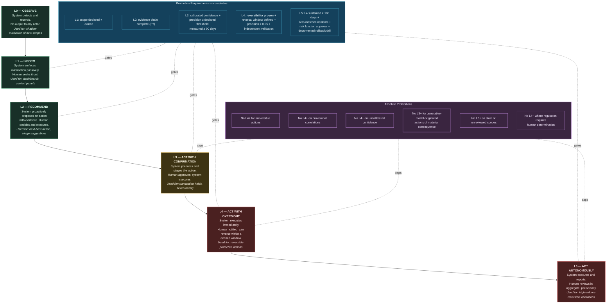
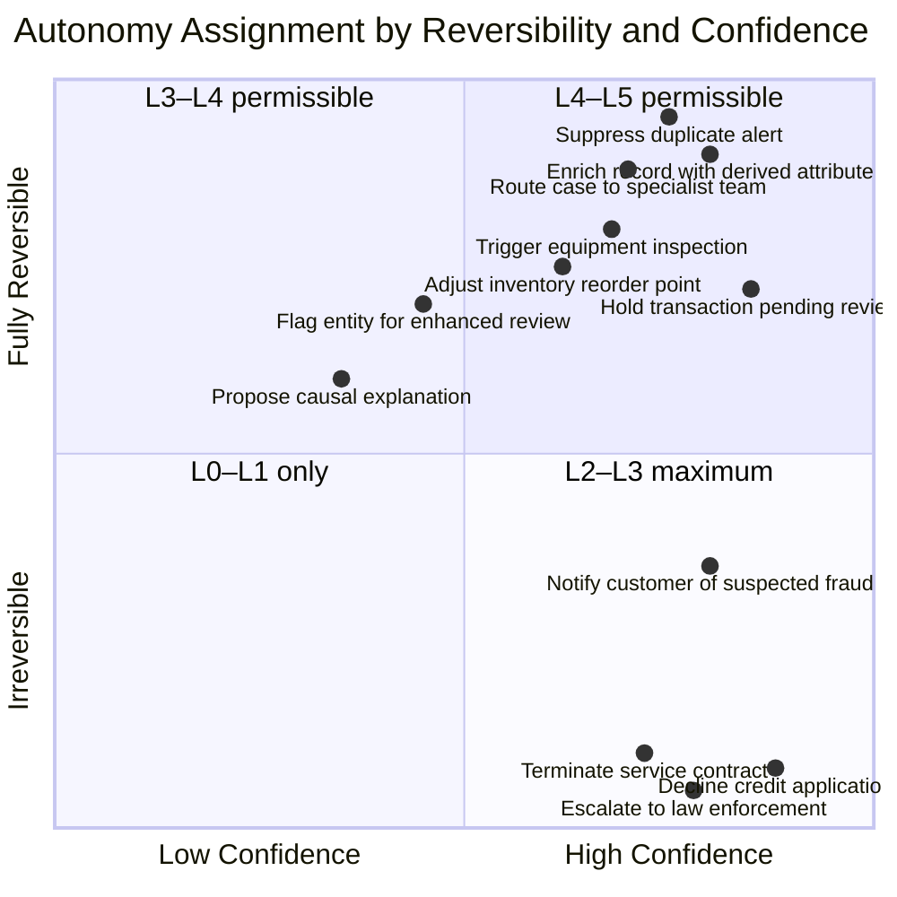
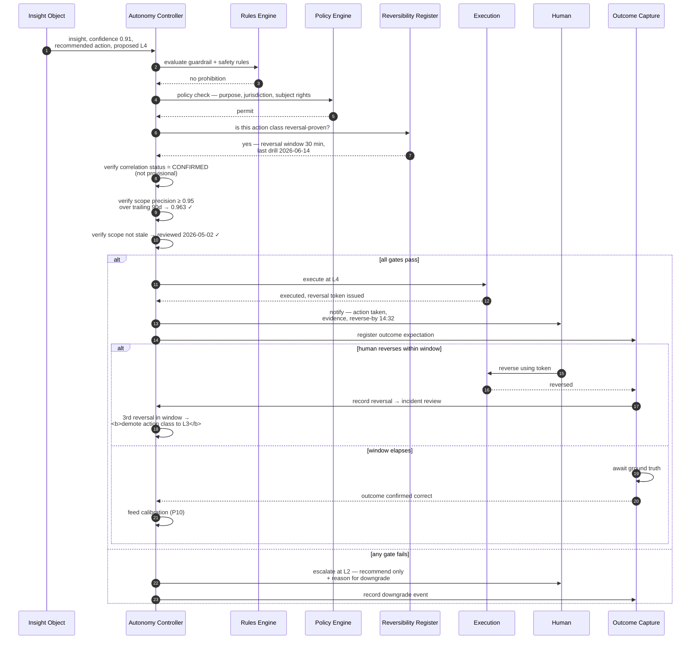

# 20. Autonomous Decision Support

---

## 20.1 Autonomy as a Graduated Property

The prevailing framing of enterprise AI autonomy is binary: a system is either human-in-the-loop or automated. This framing is unhelpful, because it forces a single decision across a heterogeneous population of actions with radically different consequence profiles.

The same platform may reasonably suppress a duplicate alert without asking anyone — fully reversible, trivial consequence, thousands of times per day — and must not autonomously decline a credit application — materially irreversible, regulated, consequential to a person's life. A system-level autonomy setting forces a choice between paralysis and recklessness.


### Definition — The Autonomy Ladder

The **Autonomy Ladder** is a six-level model in which machine decision authority is assigned **per action class**, with each level specifying its reversibility requirement, evidentiary standard, human control point, escalation path, and audit obligation. Autonomy level is runtime-adjustable, independently auditable, and automatically demoted on performance degradation.


## 20.2 The Six Levels

**Figure 30.** *The Autonomy Ladder. Six levels with cumulative promotion requirements and six absolute prohibitions. Promotion above L3 requires proven reversibility and sustained measured precision; promotion to L5 requires 180 days at L4 without material incident plus a documented rollback drill. Colour indicates increasing risk posture, not increasing desirability.*

## 20.3 Level Specifications

| Level | Human role | Reversibility requirement | Evidentiary standard | Escalation trigger | Audit obligation |
| --- | --- | --- | --- | --- | --- |
| **L0 Observe** | None | N/A — no action | None | N/A | Aggregate metrics only |
| **L1 Inform** | Seeks information | N/A — no action | Evidence chain available on request | N/A | Access log |
| **L2 Recommend** | Decides and executes | N/A — human acts | Evidence chain presented with recommendation | Human declines repeatedly → review scope | Recommendation + human decision recorded |
| **L3 Confirm** | Approves staged action | Action must be describable and its effects previewable | Calibrated confidence above declared threshold; complete evidence | Approval rate below 70% → automatic demotion | Full: staged action, evidence, approver, timestamp |
| **L4 Oversee** | Notified; may reverse | **Reversal must be technically demonstrated**, with a defined reversal window | Precision ≥ 0.95 sustained ≥ 90 days; independent validation | Any reversal → incident review; 3 reversals in window → demotion | Full: action, evidence, notification, reversal window, outcome |
| **L5 Autonomous** | Reviews in aggregate | Reversal demonstrated; rollback drill documented | L4 sustained ≥ 180 days, zero material incidents | Any material incident → immediate demotion to L2 | Full plus periodic aggregate review with named reviewer |

**Table 40.** *Autonomy Ladder level specifications. The L4 requirement that reversal be **technically demonstrated** rather than merely asserted is the most important control in the framework: an organization must show that it has actually reversed such an action successfully, in a test, before granting the level.*

## 20.4 Reversibility as the Governing Criterion

The framework's central claim about autonomy: **reversibility, not confidence, is the primary determinant of permissible autonomy level.**

A highly confident conclusion supporting an irreversible action warrants less autonomy than a moderately confident conclusion supporting a fully reversible one. This inverts the intuitive framing, and the inversion is deliberate.

**Figure 31.** *Autonomy assignment by reversibility and confidence. Actions in the upper region — reversible — may be granted high autonomy even at moderate confidence. Actions in the lower region — irreversible or materially consequential — are capped regardless of confidence. Positions are illustrative and organization-specific; the axes and the capping principle are the transferable content.*


**Reversibility is frequently overestimated.** An action is genuinely reversible only if reversing it restores the prior state *including all downstream effects*. Reversing a transaction hold restores the transaction, but does not un-notify the customer, un-trigger the partner system's risk flag, or un-record the event in a third party's file. Assessment of reversibility MUST consider the full effect graph, not only the primary action.

The framework's practical test: **an action is reversible if, after reversal, no external party retains a record of it having occurred, and no downstream process behaves differently than if it had not.** Very few actions genuinely pass this test, which is why L4 and L5 should be rare.


## 20.5 Decision Flow

**Figure 32.** *Autonomy Controller decision flow for a proposed L4 action. Seven gates are evaluated before execution: safety rules, policy, reversal provenance, correlation confirmation status, scope precision, scope freshness, and reversibility register currency. Failure of any gate downgrades to L2 rather than blocking outright — the system still delivers value as a recommendation.*

The downgrade-rather-than-block behaviour is deliberate. A system that fails closed entirely when a gate fails delivers nothing; a system that degrades to recommendation still delivers the insight while withholding the authority.

## 20.6 Human Factors

Automation research consistently identifies failure modes that architecture must anticipate.

**Automation bias.** Humans approve machine recommendations at high rates, particularly under time pressure, and particularly when the machine is usually correct. An L3 "approval" gate degenerates into a rubber stamp unless designed against.

*Framework requirement:* L3 interfaces MUST present the evidence chain, not merely the recommendation, and MUST require the approver to interact with at least one evidence element before approving. Approval rate is monitored: a rate above 95% is treated as a signal that the gate is not functioning as a control and triggers review of whether L4 is more honest than a nominal L3.

**Skill degradation.** Operators who do not exercise a judgement lose the ability to exercise it. When the automation fails, the humans who must take over have atrophied.

*Framework requirement:* Periodic manual-mode operation for a sample of cases, and inclusion of deliberate hard cases in the human review queue rather than routing only ambiguous ones.

**Responsibility diffusion.** When a system recommends and a human approves, neither feels accountable for the outcome.

*Framework requirement:* Every action records a named accountable human, even at L4 and L5, where accountability attaches to the person who authorized the autonomy level for that action class rather than to an approver of the individual action.

**Alarm-driven tunnel vision.** Operators presented with a confident machine conclusion tend to stop looking for alternatives.

*Framework requirement:* Where the Correlation Engine identified competing explanations, the interface MUST present the top alternative alongside the primary conclusion, with its confidence. A single confident answer is more dangerous than two competing ones.

## 20.7 Failure Handling and Kill Switches

| Control | Scope | Activation | Effect |
| --- | --- | --- | --- |
| **Action-class kill switch** | One action class | Owner or on-call | All actions in class drop to L2 |
| **Scope kill switch** | One correlation scope | Scope owner, Governor, or on-call | Scope stops emitting; dependent actions drop to L0 |
| **Global autonomy freeze** | All action classes | Incident commander | Everything drops to L2; system remains informative |
| **Automatic demotion** | Per action class or scope | Precision breach, reversal threshold, staleness | One level down, owner notified |
| **Circuit breaker** | Per action class | Action failure rate above threshold | Suspend execution, continue recommending |

**Table 41.** *Autonomy failure controls. The global autonomy freeze deliberately drops to L2 rather than L0: during an incident, the organization still benefits from the system's analysis even while withdrawing its authority to act. Removing the analysis as well would degrade incident response at precisely the wrong moment.*


### Design Principle — Degrade to Advisory, Not to Silence

When autonomy controls activate, the system MUST continue to inform and recommend. It MUST NOT go silent. Withdrawing decision authority and withdrawing decision support are different actions, and only the former is warranted by an autonomy failure.


---


## Key Takeaways

1. **Autonomy is a per-action-class property, not a system setting.** A binary framing forces an unacceptable choice between paralysis and recklessness across a heterogeneous action population.
2. **Six levels run from Observe to Autonomous**, with cumulative promotion requirements and six absolute prohibitions that cap autonomy regardless of measured performance.
3. **Reversibility, not confidence, is the primary determinant of permissible autonomy.** A highly confident conclusion supporting an irreversible action warrants less autonomy than a moderate conclusion supporting a reversible one.
4. **Reversibility is frequently overestimated.** The practical test is that after reversal no external party retains a record and no downstream process behaves differently — a test very few actions pass, which is why L4 and L5 should be rare.
5. **L4 requires reversal to be technically demonstrated**, not asserted: the organization must show it has successfully reversed such an action in a drill.
6. **Seven gates precede an L4 action**, and gate failure downgrades to recommendation rather than blocking, preserving value while withholding authority.
7. **Automation bias is designed against**, requiring evidence interaction before approval and treating approval rates above 95% as evidence the gate is not functioning.
8. **Where competing explanations exist, the interface must show the alternative.** A single confident answer is more dangerous than two competing ones.
9. **Autonomy controls degrade to advisory, never to silence.** Withdrawing decision authority and withdrawing decision support are different actions.


---

**Next:** [21. Alert Generation →](21-alert-generation.md)
