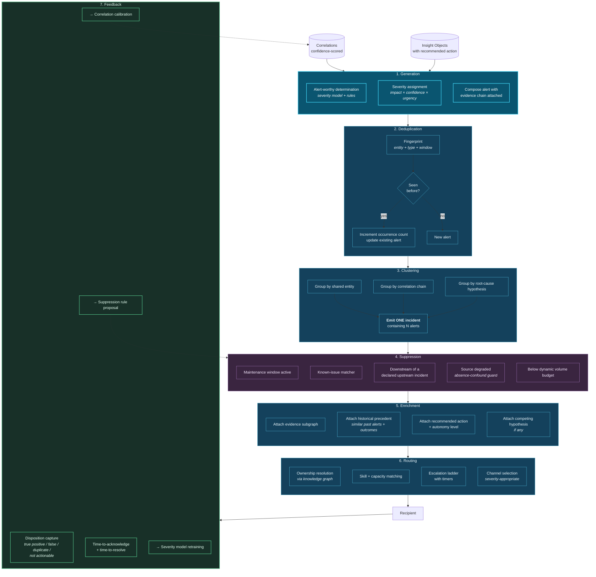

# 21. Alert Generation

---

## 21.1 Alert Fatigue Is a Correlation Failure

[Chapter 5](../part-1/05-current-challenges.md) argued that alert fatigue is not a threshold-tuning problem but a correlation failure expressed as a volume problem. This chapter specifies the alerting architecture that follows from that diagnosis.

The conventional model generates one alert per detector per triggering condition. Four independent detectors observing four facets of a single underlying event produce four alerts, each individually low-severity, none conveying the conjunction that makes them collectively critical. The analyst is asked to perform the correlation — which is the expensive, error-prone, human-latency operation the platform was supposed to eliminate.


### Design Principle — Alert on Correlations, Not on Events

An alert MUST be generated from a correlation or an Insight Object, never directly from a single raw event or single-signal threshold breach. Single-signal detection remains valuable as *input* to correlation; it MUST NOT be an output to a human.


The consequence is a substantial reduction in volume with an increase in precision — the two moving together rather than trading against each other, which is the specific improvement threshold tuning cannot deliver.

## 21.2 Alert Pipeline

**Figure 33.** *Alert generation and suppression pipeline. Seven stages transform correlations into routed, enriched incidents. Stage 3 (clustering) produces the largest volume reduction by emitting one incident containing many alerts rather than many independent alerts. Stage 7 (feedback) closes the loop, using disposition data to recalibrate correlation confidence, retrain severity, and propose new suppression rules.*

## 21.3 Severity Assignment

Severity is computed rather than declared, as a function of three factors:

**Impact** — the magnitude of consequence if the correlation is correct, derived from the entities involved (a critical asset, a high-value customer, a regulated process), the estimated financial or safety exposure, and blast radius via graph traversal.

**Confidence** — the calibrated correlation confidence. A high-impact correlation at 0.55 confidence is not a critical alert; it is an investigation request.

**Urgency** — the remaining window of actionability. A correlation whose actionable window closes in four minutes outranks a higher-impact correlation whose window is three weeks.


**Urgency is the factor conventional alerting omits.** Most severity models consider impact and sometimes confidence, but treat all alerts as equally time-sensitive. Incorporating remaining actionability window means the queue is ordered by *what will be lost by waiting* rather than by *what is largest*, which is a materially different and generally better ordering for operational response.


## 21.4 The Absence–Degradation Guard

Suppression stage S4 in Figure 33 implements the guard described in [Chapter 19](19-event-relationships.md), and it deserves restatement because it prevents the framework's most damaging plausible failure.

If a source stops producing, every EXPECTED_ABSENT correlation dependent on it fires. In a hospital, this would generate an alert for every medication scheduled but not recorded as administered — thousands of critical alerts, all false, during a systems outage, at precisely the moment clinical staff are least able to absorb them.

**Required behaviour:** the alert pipeline consults source health before emitting any alert derived from a negative relationship. Where the relevant source is degraded, quarantining, or silent beyond its expected volume band, the pipeline MUST emit a **single infrastructure alert** stating that absence detection is unavailable for that source, and MUST suppress the individual absence alerts.

This converts a catastrophic alert storm into one accurate operational notification.

## 21.5 Clustering into Incidents

Clustering is where the volume reduction is realized. Three mechanisms operate together:

| Mechanism | Basis | Example |
| --- | --- | --- |
| **Entity clustering** | Alerts concerning the same resolved entity within a window | Twelve alerts about one customer's account become one customer incident |
| **Chain clustering** | Alerts whose underlying correlations form a connected chain | Authentication anomaly → payee addition → transfer attempt become one takeover incident |
| **Root-cause clustering** | Alerts sharing a common upstream cause identified by graph traversal | Forty service alerts across regions trace to one dependency and become one incident |

**Table 42.** *Alert clustering mechanisms. Root-cause clustering delivers the largest reduction in incident-driven environments, and it is only possible because the correlation substrate persists the dependency relationships that permit the traversal.*

Root-cause clustering illustrates the framework's value directly: in a conventional architecture, determining that forty alerts share one cause is the analyst's job, performed after the alerts arrive. Here it is performed before, and the analyst receives one incident with forty pieces of supporting evidence attached.

## 21.6 Alert Quality Metrics

| Metric | Definition | Target posture | Interpretation |
| --- | --- | --- | --- |
| **Precision** | True positives / all alerts | Improve continuously | The primary quality measure |
| **Recall** | Detected / all genuine occurrences | Improve continuously | Requires ground truth; frequently unmeasurable, and its absence should be stated honestly rather than assumed adequate |
| **Alerts per analyst-hour** | Volume normalized to capacity | Match capacity | Above capacity, additional precision is wasted because alerts go untriaged |
| **Compression ratio** | Raw correlations / emitted incidents | Higher is better | Direct measure of clustering effectiveness |
| **Time to acknowledge** | Emission to first human action | Within SLA by severity | Rising times indicate volume exceeds capacity |
| **Time to resolve** | Emission to disposition | Domain-specific | Long tails indicate insufficient enrichment |
| **Disposition distribution** | Share by true/false/duplicate/not-actionable | Monitor for shift | "Not actionable" share is the most informative signal |
| **Actioned-within-window rate** | Resolved before actionability window closed | Maximize | The metric that connects alerting to actual outcomes |
| **Suppression accuracy** | Suppressed alerts later found significant | Near zero | Suppression errors are silent and require deliberate audit |

**Table 43.** *Alert quality metrics. Two deserve emphasis: the "not actionable" disposition share indicates that the system is correctly detecting things nobody can do anything about — a scope design problem, not a precision problem — and suppression accuracy requires deliberate periodic audit because suppression failures are invisible by construction.*


**Auditing suppression is non-optional and frequently neglected.** Every suppressed alert is a decision the system made silently. If suppression is wrong, nobody finds out, because the alert never appeared. The framework requires a periodic sampled review of suppressed alerts against subsequently-known outcomes, with the review owned by a party independent of the team that authored the suppression rules.


## 21.7 Routing and Ownership

Routing uses the knowledge graph rather than a static routing table.

An alert concerning an entity traverses the graph to determine: who owns this entity, who owns the affected process, who owns the implicated asset, and which team currently has capacity and the relevant skill. This means routing remains correct as organizational structure changes, because the graph is updated by the same mechanisms that maintain the rest of the system — rather than requiring a routing table to be maintained separately and, inevitably, to drift.

**Escalation ladders** are attached to severity, with timers. Unacknowledged alerts escalate on a defined schedule. Escalation events are themselves recorded as events, which means escalation patterns become correlatable — persistent escalation for a particular alert type is a signal about either the alert type or the receiving team's capacity.

---


## Key Takeaways

1. **Alerts are generated from correlations and Insight Objects, never from single events.** Single-signal detection remains valuable as correlation input but must not reach a human directly.
2. **Volume falls and precision rises together**, which is the specific improvement threshold tuning cannot deliver, because it can only trade false positives against false negatives.
3. **Severity incorporates remaining actionability window**, ordering the queue by what will be lost by waiting rather than by what is largest.
4. **The absence–degradation guard prevents the framework's most damaging plausible failure:** a source outage generating a mass false alert storm from negative relationships. One infrastructure alert replaces thousands of false ones.
5. **Root-cause clustering delivers the largest reduction** and is only possible because the correlation substrate persists the dependency relationships required for the traversal.
6. **The "not actionable" disposition share is the most informative quality signal**, indicating a scope design problem rather than a precision problem.
7. **Suppression must be deliberately audited** by an independent party, because suppression failures are silent by construction and will otherwise never be discovered.
8. **Routing traverses the knowledge graph rather than a static table**, remaining correct as organizational structure changes.


---

**Next:** [22. Enterprise Integration →](../part-3/22-enterprise-integration.md)
