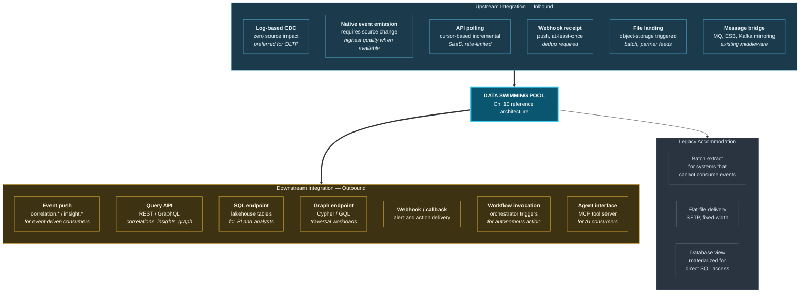

# 22. Enterprise Integration

---

## 22.1 Integration Posture

The framework's integration principle is that **the pool adapts to the enterprise, not the reverse**. Source systems are not modified to accommodate the architecture. Consuming systems are not required to adopt new interaction models. The pool absorbs heterogeneity at its boundaries.

This is a deliberate constraint. Architectures requiring source system change fail, because source system change requires the cooperation of teams whose priorities are elsewhere and whose systems are frequently outside the data organization's control.

**Figure 34.** *Enterprise integration architecture. Six inbound patterns and seven outbound patterns, plus explicit legacy accommodation. The inclusion of batch extract and flat-file delivery in an event-driven architecture is deliberate: systems that cannot consume events are the majority of the enterprise estate in most organizations, and excluding them excludes the value.*

## 22.2 Integration with Existing Data Platforms

The framework is designed to sit **alongside** existing investments rather than replacing them.

| Existing platform | Relationship to the pool | Integration mechanism |
| --- | --- | --- |
| **Data warehouse** | Remains authoritative for governed reporting and regulatory submission | Warehouse is a source (CDC or extract) and a consumer (correlation-derived tables) |
| **Data lake / lakehouse** | Becomes the pool's persistence substrate | Direct — the pool writes Bronze/Silver/Gold into the existing lakehouse |
| **Data fabric / catalog** | Remains the asset-level control plane | The pool registers its assets and emits lineage to the existing catalog |
| **Data mesh domains** | Remain the producers of domain data products | Domain products are sources; correlations are a platform-provided product consumed by domains |
| **Streaming platform** | Becomes the circulation layer | Direct — the pool uses existing Kafka/Pulsar rather than deploying a parallel one |
| **MDM system** | Remains authoritative for curated master data | MDM feeds the entity resolution tier as high-confidence deterministic matches |
| **Feature store** | Remains the ML feature interface | The pool writes correlation-derived features into the existing store |
| **SIEM / observability** | Remains the security and operations interface | The pool emits correlated incidents rather than raw alerts |
| **Workflow / BPM** | Remains the action execution layer | The pool invokes existing workflows rather than implementing action execution |

**Table 44.** *Relationship to existing platform investments. The recurring pattern is that the pool takes the correlation responsibility and delegates everything else to the incumbent — which is what makes incremental adoption feasible and what limits the framework's blast radius if it fails to deliver.*


**MDM as a resolution input is an underrated integration.** Organizations with a functioning master data management practice already possess the highest-quality entity resolution available to them. Feeding MDM golden records into the entity resolution tier as Tier 1 deterministic matches substantially reduces the framework's dependence on probabilistic matching — and correspondingly reduces the over-merge risk identified in [Chapter 13](../part-2/13-ingestion-layer.md). Where MDM exists, it should be the primary resolution source.


## 22.3 Consumption Interfaces

### 22.3.1 For Humans

**Analytical.** Correlations and insights are materialized into lakehouse tables consumable by any SQL-based BI tool. This matters more than it may appear: an organization's analyst population will not learn a new query language, and requiring them to would strand the framework's output.

**Investigative.** A graph exploration interface for traversing correlations from a seed entity, with confidence and evidence displayed inline. This is the interface where the framework's value is most directly visible to a human.

**Conversational.** A copilot grounded per [Chapter 16](../part-2/16-ai-insight-engine.md), answering natural-language questions with cited evidence.

**Operational.** Incident and alert interfaces per [Chapter 21](../part-2/21-alert-generation.md), with evidence, precedent, and recommended action attached.

### 22.3.2 For Systems

**Event-driven consumers** subscribe to `correlation.*` and `insight.*` topics with standard consumer-group semantics.

**Request-driven consumers** use a query API exposing four resource families: correlations by entity or type, insights by subject or status, graph traversal from a seed, and evidence retrieval by identifier. The API enforces permission and purpose on every call.

**Workflow consumers** are invoked by the Autonomy Controller, receiving the action request together with its evidence and reversal token.

### 22.3.3 For AI Agents

The framework recommends exposing capability to agents through a **tool server** conforming to an agent-tool protocol (the Model Context Protocol being the current de facto standard). Tools exposed:

| Tool | Function | Permission model |
| --- | --- | --- |
| `resolve_entity` | Map an identifier or description to a resolved entity | Caller's read permission |
| `get_correlations` | Retrieve scored correlations for an entity, filtered | Caller's permission + purpose |
| `traverse_graph` | Bounded traversal from a seed entity | Caller's permission, k capped |
| `get_evidence` | Retrieve the evidence chain for a correlation or insight | Caller's permission |
| `query_timeseries` | Retrieve event history for an entity | Caller's permission |
| `run_model` | Invoke a registered model with declared inputs | Explicit model-level grant |
| `propose_action` | Submit an action proposal to the Autonomy Controller | Never auto-executes; enters the ladder |

**Table 45.** *Agent tool surface. Note that `propose_action` submits to the Autonomy Controller rather than executing — an agent has no execution authority of its own, and its proposals are subject to the same seven gates as any other proposed action ([Chapter 20](../part-2/20-autonomous-decision-support.md)).*

## 22.4 Integration Anti-Patterns


**Four patterns the framework explicitly warns against.**

**The parallel estate.** Deploying a second Kafka cluster, a second lakehouse, and a second catalog because the existing ones are "not quite right." This doubles operational cost, splits governance, and guarantees divergence. Use what exists; improve it if necessary.

**The correlation bypass.** A consuming application discovering it can query the lakehouse directly and implementing its own joins, because that is faster than requesting a new correlation scope. This is Principle 1 violated from below, and it is the most likely way the architecture erodes in practice. Mitigation is organizational — the scope declaration process must be fast enough that bypassing it is not attractive.

**The universal API.** Attempting to expose all pool capability through one generic endpoint. This produces an interface that is difficult to permission, impossible to optimize, and prone to accidental full-graph traversal. Purpose-specific interfaces are preferable.

**Source system modification.** Requiring OLTP systems to emit canonical events directly. This is technically superior and organizationally unachievable at scale. Log-based CDC delivers most of the value with none of the negotiation.


## 22.5 Migration and Coexistence

The framework is adopted incrementally. A plausible sequence:

**Phase A — Shadow.** The pool ingests from two domains and produces correlations at autonomy L0. No consumer is affected. The purpose is to measure whether correlations of value are found, and at what precision.

**Phase B — Advisory.** Correlations surface at L1–L2 in existing interfaces — as a context panel in the existing case management tool, as additional columns in existing reports. No new interface is introduced. The purpose is to measure whether humans find the correlations useful.

**Phase C — Integrated.** Correlation-derived features feed existing production models. Alert clustering replaces raw alerting for one operational team. The purpose is to measure quantifiable improvement against a baseline.

**Phase D — Authoritative.** Selected action classes advance to L3, then — where reversibility is proven — L4. Scope expands to additional domains.

At every phase, the incumbent systems continue operating. There is no cutover, and abandonment at any phase leaves the enterprise no worse off than before. This property is deliberate: given that the framework is unvalidated, an adoption path that cannot be abandoned cheaply would be irresponsible to propose.

---


## Key Takeaways

1. **The pool adapts to the enterprise, not the reverse.** Architectures requiring source system change fail because they depend on cooperation from teams with different priorities.
2. **The framework sits alongside existing investments**, taking the correlation responsibility and delegating persistence, cataloging, workflow, and serving to incumbents.
3. **Where MDM exists it should be the primary entity resolution source**, substantially reducing dependence on probabilistic matching and the associated over-merge risk.
4. **Correlations must be consumable via SQL**, because an organization's analyst population will not adopt a new query language and requiring it strands the output.
5. **Agents receive a bounded tool surface** in which action proposals enter the Autonomy Ladder rather than executing, giving agents no independent execution authority.
6. **The correlation bypass is the most likely erosion path.** Applications will implement their own joins if scope declaration is slower than doing so — making process latency an architectural concern.
7. **Adoption is incremental and abandonable at every phase.** Given that the framework is unvalidated, an adoption path without cheap exit would be irresponsible to propose.


---

**Next:** [23. Security Architecture →](23-security-architecture.md)
