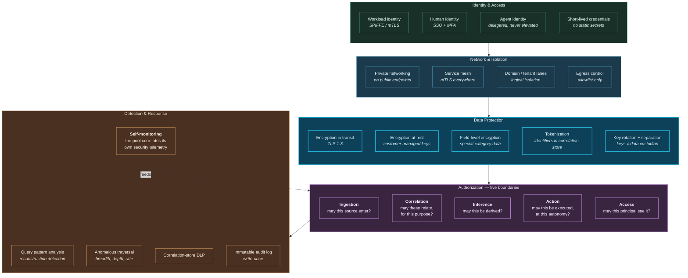

# 23. Security Architecture

---

## 23.1 The Distinctive Security Problem

A Data Swimming Pool presents a security problem that conventional data platforms do not: **it manufactures sensitive information that was not present in any of its inputs.**

Each constituent dataset may be individually unremarkable. A record of store visits, a record of pharmacy purchases, and a record of insurance enquiries are each routine. The *correlation* between them can reveal a health condition that appears in none of them. The correlation substrate is therefore a **higher-value target than the sum of its sources**, and an attacker who compromises it obtains inferences rather than merely records.

This has three architectural consequences:

1. The correlation store requires **stricter protection than its inputs**, not equivalent protection.
2. Access control must operate on **derived inferences**, not only on source data.
3. Exfiltration detection must consider **query patterns**, because a series of individually-permitted traversals can reconstruct a sensitive picture.

**Figure 35.** *Zero-trust security architecture. Five control domains. The authorization domain is distinguished by operating at five boundaries rather than one — with correlation-boundary and inference-boundary authorization being the controls that conventional data platforms lack and that this architecture requires.*

## 23.2 Controls by Layer

| Layer | Principal threats | Required controls |
| --- | --- | --- |
| **L0 Source** | Credential compromise, feed spoofing | Source authentication, mTLS, signed feeds where available, source health monitoring |
| **L1 Ingestion** | Poisoned input, injection via payload, resolution manipulation | Contract validation, payload sanitization, resolution confidence thresholds, quarantine, rate limiting per source |
| **L2 Circulation** | Unauthorized topic access, replay abuse, tampering | Topic-level ACLs, encryption in transit and at rest, immutable log semantics, consumer-group authorization |
| **L3 Correlation** | **Impermissible correlation formation**, scope abuse, state exfiltration | Correlation-boundary policy enforcement, scope approval workflow, state encryption, scope-level audit |
| **L4 Intelligence** | Model theft, prompt injection, training-data extraction, model poisoning | Model access control, input sanitization, output filtering, prompt-injection detection, training data governance |
| **L5 Decision & Action** | Unauthorized action, autonomy escalation, action replay | Action authorization, autonomy-level enforcement, idempotency tokens, dual control for high-consequence classes |
| **L6 Consumption** | Excessive access, reconstruction attack, credential sharing | Least privilege, purpose validation, query pattern analysis, rate limiting, session binding |
| **Metadata plane** | Lineage tampering, catalog poisoning | Write-once lineage, signed provenance records, separation from data-plane credentials |
| **Governance plane** | Policy bypass, policy tampering | Policy-as-code in version control, dual approval for policy change, fail-closed on policy engine unavailability |

**Table 46.** *Security controls mapped to architectural layers. Two rows contain controls with no conventional equivalent: correlation-boundary policy enforcement at L3, and reconstruction-attack detection at L6. Both exist specifically because the system derives information rather than merely storing it.*

## 23.3 The Reconstruction Attack


**A threat specific to correlation architectures.**

An analyst holds legitimate permission to query correlations for fraud prevention. Each individual query is permitted. But by issuing a carefully-chosen sequence of queries — traversing from an entity, examining its correlations, traversing to related entities, examining theirs — the analyst can reconstruct a picture of an individual's behaviour, associations, health, or finances that no single query would have revealed and that no policy intended to grant.

This is the differential-privacy problem transposed to graph traversal, and it is not solved by conventional access control, because no access rule was violated.


The framework specifies four mitigations, none complete:

**Traversal budgets.** A principal has a bounded budget of traversal operations per entity, per window. Exhausting the budget requires justification. This limits reconstruction breadth without preventing legitimate investigation.

**Query pattern analysis.** The pool applies its own correlation capability to its access logs. Reconstruction attacks have a characteristic signature: breadth-first traversal from a single seed, unusual depth, or systematic enumeration. Detecting this is exactly a behavioural correlation (M5) problem, and the framework's self-monitoring capability is well suited to it.

**Purpose re-validation on depth.** Traversal beyond a declared depth requires purpose re-affirmation, creating a friction point and an audit record at the boundary where investigation becomes surveillance.

**Aggregation thresholds.** Queries returning correlations over small populations are suppressed or noised, following established statistical disclosure control practice.


**None of these is sufficient.** A determined insider with legitimate access and patience can reconstruct. The framework's honest position is that reconstruction risk is **reduced but not eliminated**, that it is a genuine cost of building correlation infrastructure, and that organizations must weigh it explicitly. Detection and deterrence, rather than prevention, are the realistic posture.


## 23.4 Prompt Injection and the Generative Surface

The AI Insight Engine introduces an attack surface that data platforms have not previously had.

**The threat.** Content ingested into the pool — a support ticket, a document, a device-reported string — may contain instructions targeting a generative model that later processes it. If the model treats ingested content as instruction rather than data, an attacker who can write to any ingested source can influence the model's output, and potentially its tool use.

**Framework requirements:**

- **Separation of instruction and data in prompts.** Retrieved evidence is enclosed in a structurally distinct region with explicit instruction that its content is data, never instruction. This is a mitigation, not a guarantee.
- **Output filtering.** Generated output is screened for indications of instruction-following from ingested content — unexpected tool invocations, references to entities outside the retrieved evidence set, deviation from the expected output schema.
- **Tool authorization independent of model output.** The critical control: a model cannot invoke a tool it was not granted, regardless of what it generates. An injected instruction to "retrieve all customer records" fails at authorization, not at the model.
- **Citation validation as an injection detector.** A model influenced by injected content will frequently cite objects that do not exist or do not support the claim. Citation validation ([Chapter 16](../part-2/16-ai-insight-engine.md)) therefore serves double duty as an injection signal, and a rising citation-failure rate should be investigated as a potential security event rather than only as a quality issue.

## 23.5 Self-Monitoring

The framework has an unusual property: **it can be applied to its own security telemetry.**

Authentication events, authorization decisions, query logs, traversal patterns, policy denials, and scope executions are all events. Ingesting them as canonical events and declaring correlation scopes over them yields correlated security detection over the platform itself — the same capability [Chapter 34](../part-4/34-cybersecurity.md) describes for enterprise security generally.


**With a mandatory caveat.** Self-monitoring MUST NOT be the only monitoring. A compromised pool cannot be trusted to report its own compromise. Security telemetry MUST also flow to an independent system — a SIEM outside the pool's control plane — with independent alerting. The pool's self-monitoring is a detection *enhancement*, never a detection *dependency*.


## 23.6 Insider Risk

The framework increases insider risk materially, and this should be stated plainly rather than buried.

A conventional data platform grants an insider access to records. A correlation platform grants an insider access to **inferences about people and entities that those people did not disclose and the organization may not have intended to derive**. The value of insider access rises accordingly, and so does the harm from its abuse.

Required controls:

| Control | Purpose |
| --- | --- |
| **Dual control for high-sensitivity scopes** | Two authorized individuals required to declare or modify scopes touching special-category data |
| **Separation of duties** | Scope authors cannot approve their own scopes; policy authors cannot grant themselves exemptions |
| **Privileged access management** | Administrative access to the correlation store is time-bounded, justified, and recorded |
| **Immutable audit** | Access logs are write-once, stored outside the pool's administrative boundary |
| **Behavioural monitoring of privileged users** | Applied via the same M5 modality used elsewhere, with independent oversight |
| **Periodic access recertification** | Correlation access is recertified more frequently than source data access, reflecting its higher sensitivity |

**Table 47.** *Insider risk controls. Recertifying correlation access more frequently than source access reflects the framework's core security insight: derived information is more sensitive than the data it was derived from.*

---


## Key Takeaways

1. **The pool manufactures sensitive information not present in any input**, making the correlation store a higher-value target than its sources and requiring stricter protection than them.
2. **Authorization operates at five boundaries.** Correlation-boundary and inference-boundary authorization are controls conventional data platforms lack and this architecture requires.
3. **The reconstruction attack is specific to correlation architectures** and is not prevented by access control, because no access rule is violated. Traversal budgets, pattern analysis, purpose re-validation, and aggregation thresholds reduce but do not eliminate it.
4. **Detection and deterrence, rather than prevention, are the realistic posture** against a determined insider with legitimate access — and this is a genuine cost of the architecture that organizations must weigh explicitly.
5. **Tool authorization independent of model output is the critical prompt-injection control.** Filtering and prompt structure are mitigations; authorization is the guarantee.
6. **Citation validation doubles as an injection detector**, so a rising citation-failure rate warrants security investigation, not only quality investigation.
7. **The pool can monitor itself but must not monitor only itself.** A compromised pool cannot be trusted to report its own compromise; independent telemetry is mandatory.
8. **Insider risk increases materially**, because insiders gain access to inferences rather than records. Correlation access should be recertified more frequently than source data access.


---

**Next:** [24. Privacy →](24-privacy.md)
