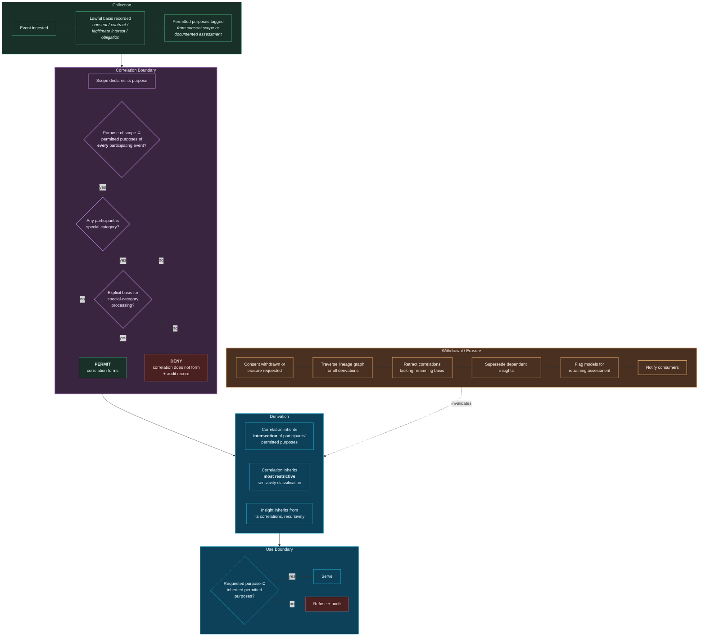

# 24. Privacy

---


**Not legal advice.** This chapter discusses privacy at an architectural level. Regulatory references are conceptual summaries, not legal interpretations. Organizations must obtain qualified counsel.


## 24.1 The Privacy Problem Correlation Creates

Data protection regimes are built around a model in which an organization *collects* personal data for a *stated purpose*, *retains* it for a *defined period*, and *processes* it within *declared bounds*. The data subject's rights — access, rectification, erasure, portability, objection — attach to that collected data.

A correlation architecture strains this model in five specific ways:

**Inference is not collection.** A correlation between store visits, purchase patterns, and appointment timings may reveal a pregnancy that was never disclosed. The organization did not collect that fact. It derived it. Whether derived special-category data attracts the same protections as collected special-category data is legally contested in most jurisdictions and, in the author's assessment, will be resolved against organizations that assumed it does not.

**Purpose limitation becomes purpose *combination*.** Data collected for fraud prevention and data collected for service delivery may each be lawfully held. Correlating them may constitute processing for a purpose neither collection contemplated.

**Erasure must propagate to derivations.** Deleting an event does not delete the correlations derived from it, nor the insights derived from those correlations, nor the model weights influenced by them. A naïve erasure implementation leaves the derived knowledge intact — which defeats the right.

**Automated decision-making rights engage earlier.** Where correlations drive decisions with legal or similarly significant effect, rights to explanation, human intervention, and contest engage. The framework's evidence chain is well suited to satisfying these, but only if the architecture is designed for it from the outset.

**Data minimization conflicts with correlation.** Correlation improves with more data. Minimization requires less. This tension is genuine and cannot be engineered away — it can only be managed through explicit scoping.

## 24.2 Purpose Binding

The framework's principal privacy mechanism is **purpose binding**: purpose travels with data and is evaluated at every boundary, including correlation formation.

**Figure 36.** *Privacy-by-design data flow with purpose binding. The decisive control is at the correlation boundary: a correlation whose declared purpose is not permitted by **every** participating event **does not form**. This is a stronger control than access restriction, because the impermissible inference is never derived and therefore cannot leak, be subpoenaed, or be discovered later.*

### 24.2.1 Purpose Intersection

The inheritance rule is deliberately conservative. A correlation between an event permitting `{fraud-prevention, service-delivery}` and an event permitting `{fraud-prevention, analytics}` inherits only `{fraud-prevention}`.

This is restrictive by design. The alternative — union, or the correlation's own declared purpose — would permit purpose expansion through correlation, which is precisely the harm the mechanism exists to prevent.


**A practical consequence.** Under intersection semantics, correlations across domains with divergent lawful bases will frequently have very narrow permitted purposes, and some will have an empty intersection and therefore not form at all. This will feel like the system refusing to do useful work. It is the system correctly declining to do impermissible work, and the appropriate response is to revisit consent and lawful basis at collection — not to relax the intersection rule.


## 24.3 Erasure Propagation

The right to erasure is where correlation architectures most obviously fail if not designed for it.

**The requirement.** When a data subject's data is erased, the derived knowledge must not survive.

**The mechanism:**

1. **Identify.** Resolve the subject to their entity identifier and all historical identifiers.
2. **Traverse.** Use the lineage graph to enumerate every canonical event, correlation, insight, action record, and feature derived from the subject's data.
3. **Assess remaining basis.** A correlation involving multiple subjects may retain a lawful basis with respect to others. Erasure removes the erased subject's contribution; it does not necessarily void the correlation entirely.
4. **Retract.** Correlations with no remaining basis are retracted; dependent insights are superseded; consumers are notified.
5. **Tombstone.** Erasure is recorded as a tombstone in the log so that replay does not resurrect the data. This is essential: an append-only log without tombstones cannot honour erasure, and W2 re-correlation would reintroduce the erased subject.
6. **Model assessment.** Models trained on the subject's data are flagged. Full retraining is frequently disproportionate; the framework requires a documented assessment of whether the model retains identifiable influence, with the assessment reviewable.
7. **Verify and evidence.** Erasure completeness is verified by re-traversing lineage, and the verification is retained as evidence of compliance.


**The unresolved problem: model memorization.** Erasing training data does not erase its influence on a trained model. Machine unlearning is an active research area without a production-ready general solution. The framework's honest position is that this is **unresolved**, that organizations should minimize training on erasable personal data where alternatives exist, prefer architectures where personal data is retrieved at inference rather than embedded in weights, and document their assessment rather than claim a completeness they cannot deliver.


## 24.4 Privacy-Enhancing Techniques

| Technique | Mechanism | Applicability in the framework | Limitation |
| --- | --- | --- | --- |
| **Pseudonymization** | Replace identifiers with tokens | Default for the correlation store; correlation operates on tokens | Reversible by the token holder; not anonymization |
| **Tokenization with separated vault** | Token–identity mapping held under separate control | Strong: correlation compute never sees direct identifiers | Vault is a high-value target |
| **Field-level encryption** | Encrypt special-category fields | Protects at rest and from operators | Encrypted fields cannot participate in correlation |
| **Differential privacy** | Calibrated noise on aggregate outputs | Suitable for published statistics and cohort analytics | Unsuitable for individual-level correlation, which requires exactness |
| **k-anonymity / l-diversity** | Suppress or generalize small groups | Suitable for correlation outputs over populations | Weak against auxiliary-information attacks |
| **Federated computation** | Compute without centralizing raw data | Suitable for cross-organization correlation | Substantially higher complexity; limited modality support |
| **Secure enclaves** | Hardware-isolated computation | Suitable for the most sensitive correlation scopes | Cost, attestation complexity, side-channel exposure |
| **Synthetic data** | Statistically similar artificial data | Suitable for development, testing, demonstration | Does not preserve genuine correlations; unsuitable for production |
| **Purpose binding** | Policy-enforced purpose propagation | **Primary mechanism** — enforced at correlation formation | Depends on correct purpose declaration at collection |

**Table 48.** *Privacy techniques and their applicability. Differential privacy is included with an explicit caveat: it is frequently proposed as a general solution and is largely inapplicable to the framework's core function, because individual-level correlation requires exact relationships. Noise added to protect individuals destroys the signal the system exists to find.*

## 24.5 Data Subject Rights

| Right | Framework capability | Residual difficulty |
| --- | --- | --- |
| **Access** | Lineage traversal returns all events, correlations, and insights concerning the subject | Correlations involving multiple subjects require redaction of other parties |
| **Rectification** | Corrected event enters the log; W2 re-correlation recomputes derived correlations | Downstream consumers who acted on prior correlations must be notified |
| **Erasure** | Propagation mechanism per §24.3 | Model memorization unresolved |
| **Restriction** | Subject's events excluded from correlation scopes via policy tag | Historical correlations must be marked restricted, not deleted |
| **Portability** | Canonical events exported in structured format | Correlations are arguably the controller's derived work, not the subject's data — legally unsettled |
| **Objection** | Purpose tags revoked; scopes re-evaluated | Legitimate-interest balancing must be documented per scope |
| **Explanation of automated decision** | Evidence chain provides the specific correlations and their confidence | Explaining *why the confidence was 0.87* to a lay person is genuinely difficult |
| **Human intervention** | Autonomy Ladder provides the control point | Requires the intervention to be meaningful rather than nominal |
| **Contest** | Full evidence chain supports substantive challenge | Contesting a probabilistic inference is harder than contesting a factual error |

**Table 49.** *Data subject rights and framework capability. The framework is unusually well positioned on access, explanation, and contest because of its lineage requirements — arguably better positioned than conventional architectures. It is poorly positioned on model memorization, and honest about it.*


**An underappreciated advantage.** Principle 7 (Evidence or Silence) was motivated by operational trust, but it produces a compliance dividend: a system that can always produce the evidence chain for a decision is far better placed to satisfy explanation and contest rights than a system that cannot. Organizations facing increasing automated-decision-making obligations may find this the framework's most immediately valuable property.


## 24.6 Privacy Governance for Correlation Scopes

Every correlation scope touching personal data requires, before approval:

1. **Purpose specification** — the specific purpose, not a category.
2. **Lawful basis** per participating event type.
3. **Necessity assessment** — why this correlation is necessary for the stated purpose, and why a less intrusive alternative is insufficient.
4. **Proportionality assessment** — the benefit weighed against the intrusion.
5. **Special-category determination** — whether the correlation could reveal special-category data even if no input is so classified. This is the assessment most frequently omitted and most consequential.
6. **Data protection impact assessment** where the risk threshold is met.
7. **Retention justification** for the correlation, distinct from the retention of its inputs.
8. **Subject transparency** — how the processing is disclosed.

Point 5 warrants emphasis. A scope correlating retail purchases with delivery timing contains no special-category inputs. It may nonetheless reveal health conditions, religious observance, or pregnancy. **The assessment must consider what the correlation could reveal, not merely what its inputs contain** — and this is a question that requires imagination rather than classification.

---


## Key Takeaways

1. **Inference is not collection, and this is the framework's central privacy problem.** Derived special-category data will, in the author's assessment, be resolved legally against organizations that assumed it escapes protection.
2. **Purpose binding is the primary mechanism**, enforced at correlation formation so that impermissible inferences are never derived — a stronger control than access restriction because the inference cannot subsequently leak or be discovered.
3. **Purpose inheritance uses intersection, not union**, deliberately preventing purpose expansion through correlation, and accepting that some useful-seeming correlations will not form.
4. **Erasure must propagate through the lineage graph** to correlations, insights, actions, and features, with tombstones in the log so that replay does not resurrect erased data.
5. **Model memorization is unresolved.** Organizations should minimize training on erasable personal data, prefer retrieval-at-inference architectures, and document their assessment rather than claim completeness they cannot deliver.
6. **Differential privacy is largely inapplicable** to individual-level correlation, because the noise that protects individuals destroys the signal the system exists to find.
7. **The framework is unusually strong on explanation and contest rights** because of its mandatory evidence chains — potentially its most immediately valuable compliance property.
8. **Scope assessment must consider what a correlation could reveal**, not what its inputs contain — a question requiring imagination rather than classification, and the assessment most frequently omitted.


---

**Next:** [25. Governance →](25-governance.md)
