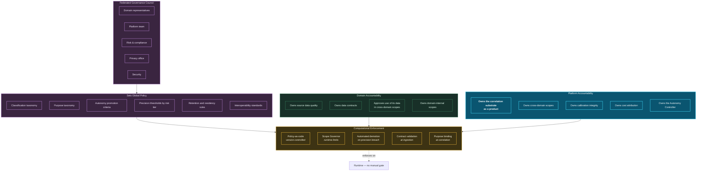

# 25. Governance

---

## 25.1 The Governance Object That Does Not Exist Elsewhere

Conventional data governance operates over datasets, pipelines, reports, and models. A Data Swimming Pool introduces a governance object with no established equivalent: **the correlation scope**.

A correlation scope is not a dataset — it produces data rather than containing it. It is not a pipeline — it discovers rather than transforms. It is not a model — it is declarative configuration, though it may invoke models. It is a **standing authorization to derive relationships between specified categories of data for a specified purpose**, and it requires its own governance discipline.


### Definition — Correlation Scope Governance

**Correlation scope governance** is the discipline of declaring, reviewing, approving, monitoring, and retiring standing authorizations to derive relationships across data domains, with accountability for the purpose, proportionality, precision, cost, and consequences of each authorization.


## 25.2 Federated Computational Governance

The framework adopts data mesh's federated computational governance principle [28] and extends it.

**Figure 37.** *Federated governance operating model. The council sets global policy; domains own their data and approve its use in cross-domain scopes; the platform owns the correlation substrate as a product with a named owner and budget. All policy is enforced computationally at runtime rather than through manual review gates — which is what makes the model scale.*

### 25.2.1 The Platform Owns the Correlation Substrate

[Chapter 6](../part-1/06-evolution.md) identified that data mesh leaves the inter-domain space ownerless. The framework's resolution is explicit:

**The correlation substrate is a platform-provided data product with a named owner, a published SLA, a budget, and a roadmap.** It is not a shared service that everyone uses and no one maintains. Its owner is accountable for correlation precision, calibration integrity, substrate availability, and cost — and is measured on them.

This does not centralize domain data ownership. Domains continue to own their data, their contracts, and their quality. What the platform owns is the *relating of domains*, which no domain can own without acquiring expertise in another domain's semantics.

## 25.3 The Scope Lifecycle

| Stage | Activity | Approvers | Exit criteria |
| --- | --- | --- | --- |
| **1. Proposal** | Business case, purpose, participating domains, expected value | Requesting owner | Complete declaration per [Table 23](../part-2/14-correlation-engine.md) |
| **2. Domain consent** | Each contributing domain reviews use of its data | Domain owners | All domains consent or the scope is narrowed |
| **3. Privacy assessment** | Purpose, necessity, proportionality, special-category determination | Privacy office | Assessment complete; DPIA where triggered |
| **4. Security assessment** | Sensitivity of derived inference; access model | Security | Controls specified |
| **5. Cost approval** | State, compute, and emission budget | Platform + finance | Budget allocated |
| **6. Shadow (L0)** | Execute without output; measure volume, precision proxy, cost | Platform | Actual cost within budget; volume as projected |
| **7. Advisory (L1–L2)** | Surface to humans; measure usefulness and precision | Scope owner | Precision above declared threshold over defined period |
| **8. Operational (L3+)** | Promote per Autonomy Ladder | Risk function | Autonomy Ladder criteria met |
| **9. Periodic review** | Quarterly: still valuable? still proportionate? still precise? | Scope owner + council | Renewed, narrowed, or retired |
| **10. Retirement** | Scope disabled; correlations expire; consumers notified | Scope owner | Consumers migrated |

**Table 50.** *Correlation scope lifecycle. Stage 6 — mandatory shadow execution — is the stage most likely to be skipped under delivery pressure and most valuable when observed: it is where cost overruns and volume misestimates are discovered before they reach production.*


**Scope proliferation is the governance failure to expect.** Scopes are easy to create and difficult to retire. Left unmanaged, an organization accumulates hundreds of overlapping, partially redundant, individually-justified scopes whose combined cost is unsustainable and whose combined false-positive volume is unmanageable.

The framework's countermeasures: a hard organizational cap on active scopes (reviewed rather than raised automatically), mandatory expiry dates requiring active renewal, automatic retirement of scopes whose outputs are not consumed, and overlap detection flagging scopes whose participating event types substantially intersect.


## 25.4 Governance of Correlations Themselves

Beyond scopes, individual correlation *types* require governance:

| Governance question | Mechanism |
| --- | --- |
| Is this relationship type permissible to derive? | Purpose binding at the correlation boundary ([Chapter 24](24-privacy.md)) |
| Is its confidence meaningful? | Mandatory calibration against outcomes; uncalibrated types visually distinguished |
| Who may see correlations of this type? | Type-level permission sets, more restrictive than source data permissions |
| How long does it remain valid? | Declared temporal validity per type; confidence decay where appropriate |
| What happens when it is wrong? | Retraction protocol with consumer notification |
| Who is accountable when it drives a bad decision? | Named accountable human per action class ([Chapter 20](../part-2/20-autonomous-decision-support.md)) |
| Should this type continue to exist? | Automatic deprecation on chronic falsification (P10) |

**Table 51.** *Governance questions applied to correlation types. The accountability question is the one organizations most often leave unanswered, and it must be answered before an action class is promoted above L2 — not after an incident.*

## 25.5 Metrics and Reporting

The framework proposes a governance dashboard organized around five questions:

**Is the substrate trustworthy?** Calibration error by scope, share of correlations uncalibrated, retraction rate, divergence between streaming and batch results.

**Is it proportionate?** Active scope count against cap, share of scopes touching special-category data, DPIA coverage, scope overlap index.

**Is it valuable?** Correlations consumed against correlations produced, insights acted upon, outcome-confirmed insights, actioned-within-window rate.

**Is it controlled?** Autonomy level distribution across action classes, automatic demotions in period, policy denials at each boundary, reversal rate at L4.

**Is it affordable?** Cost per scope, cost per emitted correlation, cost per acted-upon insight, share of budget consumed by the top five scopes.


**The most diagnostic single metric.** *Correlations consumed divided by correlations produced.* A system producing large volumes of correlations that nothing consumes is expending resources on relationships nobody needs — which indicates scope design disconnected from actual decision-making, and is the earliest reliable signal that the programme is drifting into technical activity without business value.


## 25.6 Regulatory Alignment

| Framework | Relevant obligation | Architectural response |
| --- | --- | --- |
| **GDPR** | Purpose limitation, minimization, erasure, automated decision rights | Purpose binding, scope necessity assessment, erasure propagation, evidence chains |
| **EU AI Act** | Risk classification, transparency, human oversight, logging | Autonomy Ladder as the oversight mechanism; provenance ledger as the logging mechanism; risk tiering per action class |
| **BCBS 239** | Risk data aggregation accuracy, completeness, timeliness, adaptability | Lineage completeness, degradation flagging, reconciliation protocol, W2 adaptability |
| **HIPAA** | Minimum necessary, access controls, audit | Purpose binding, field-level encryption, immutable audit |
| **PCI DSS** | Cardholder data isolation and protection | Tokenization before correlation; correlation operates on tokens |
| **SOX** | Controls over financial reporting | Reproducibility from provenance; rule approval workflow |
| **DORA** | Operational resilience, third-party risk | HA design ([Chapter 27](27-high-availability.md)); source dependency mapping via lineage |
| **Model risk (SR 11-7 and equivalents)** | Model validation, monitoring, governance | Model registry, shadow deployment, drift monitoring, automatic demotion |

**Table 52.** *Regulatory alignment at a conceptual level. The EU AI Act row is the most consequential for this framework: the Autonomy Ladder and provenance ledger were designed independently but map closely onto its human-oversight and logging requirements, which the author regards as convergent evidence that the design is pointed in a defensible direction.*

## 25.7 Governance Anti-Patterns


**Four failure modes observed in comparable programmes.**

**Governance as a review board.** If every scope requires a committee meeting, the correlation bypass ([Chapter 22](22-enterprise-integration.md)) becomes rational. Governance must be computational and fast; committees set policy, code enforces it.

**Precision thresholds set by the requesting function.** The team that wants a scope promoted should not measure whether it qualifies. Measurement must be independent.

**Scope approval without cost approval.** Scopes approved on business merit without a budget produce cost incidents. Cost is a governance concern, not merely an engineering one.

**Governance without retirement.** A governance process that only approves and never retires guarantees proliferation. Retirement must be as routine as approval, and automatic where outputs go unconsumed.


---


## Key Takeaways

1. **The correlation scope is a governance object with no established equivalent** — a standing authorization to derive relationships for a purpose, requiring its own discipline.
2. **The platform owns the correlation substrate as a product** with a named owner, SLA, and budget, resolving data mesh's ownerless inter-domain space without recentralizing domain data ownership.
3. **Mandatory shadow execution is the most valuable and most skipped lifecycle stage**, because it surfaces cost overruns and volume misestimates before production.
4. **Scope proliferation is the governance failure to expect**, countered by hard caps, mandatory expiry, automatic retirement of unconsumed scopes, and overlap detection.
5. **Accountability for a bad automated decision must be assigned before promotion above L2**, not determined after an incident.
6. **Correlations consumed divided by correlations produced is the most diagnostic single metric**, and the earliest reliable signal of drift into technical activity without business value.
7. **The EU AI Act's human-oversight and logging requirements map closely onto the Autonomy Ladder and provenance ledger**, which were designed independently — convergent evidence the design is defensible.
8. **Governance must be computational and fast**, because slow governance makes the correlation bypass rational and erodes the architecture from below.


---

**Next:** [26. Scalability →](26-scalability.md)
