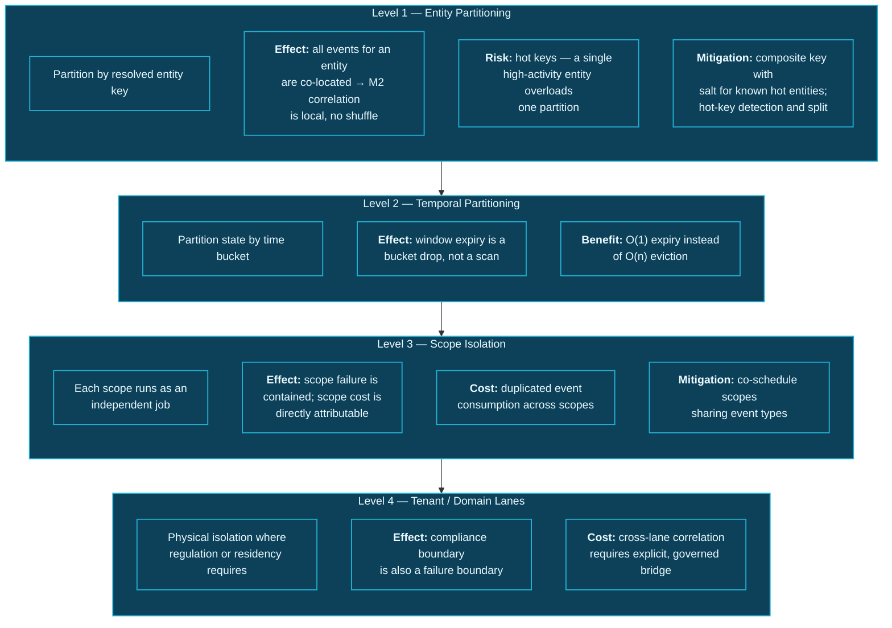

# 26. Scalability

---

## 26.1 The Dimension That Matters

Conventional data platforms scale along a familiar axis: data volume. A Data Swimming Pool has a second axis that dominates it.


**The scaling insight.** Data volume scales **linearly** with business activity. Correlation cost scales with the **product** of participating event types, entity cardinality, window width, and modality count. The second grows far faster than the first, and it is the binding constraint on every implementation.


An organization can double its event volume and add roughly double the storage and ingestion capacity. If it doubles the number of *domains participating in correlation*, the number of potential cross-domain relationships grows quadratically, and if scopes are declared naïvely the cost grows with it.

This is why Principle 3 exists, and why scalability in this framework is primarily a **governance** problem expressed as an engineering one.

## 26.2 Scaling Dimensions

| Dimension | Growth driver | Cost behaviour | Primary strategy |
| --- | --- | --- | --- |
| **Event volume** | Business activity | Linear | Horizontal partition scaling |
| **Event types** | New sources onboarded | Linear in ingestion, **quadratic in potential correlation** | Scope declaration discipline |
| **Entity cardinality** | Customer, device, asset growth | Linear in state | Key-space partitioning, state TTL |
| **Window width** | Correlation requirements | Linear in state per scope | Substrate selection (stream vs. batch) |
| **Modality count** | Scopes enabling more modalities | Multiplicative per scope | Enable only modalities that demonstrably contribute |
| **Scope count** | Organizational demand | Additive, but each carries fixed and variable cost | Hard cap with review |
| **Graph edges** | Correlation emission rate × validity | Grows until expiry balances creation | Aggressive expiry; hot/cold tiering |
| **Query concurrency** | Consumer population | Linear in serving tier | Stateless horizontal scaling, caching |
| **Traversal depth** | Query complexity | **Exponential in k** | Hard depth caps, budget enforcement |

**Table 53.** *Scaling dimensions and strategies. Two dimensions exhibit non-linear growth and require architectural rather than capacity responses: potential correlation grows quadratically in event types, and traversal cost grows exponentially in depth. Both are addressed by hard limits rather than by adding resources.*

## 26.3 Partitioning Strategy

Partitioning determines whether correlation is cheap or expensive, and the framework's strategy is layered.

**Figure 38.** *Four-level partitioning strategy. Entity partitioning makes the dominant correlation modality local. Temporal bucketing converts window expiry from an O(n) eviction scan into an O(1) bucket drop. Scope isolation makes cost attributable and failures contained. Domain lanes align the compliance boundary with the failure boundary.*

### 26.3.1 The Hot Key Problem

Entity partitioning has a characteristic failure: a small number of entities generate a disproportionate share of events. A corporate account with ten thousand subsidiaries, a shared device, a default null entity that resolution failures collapse into.

The framework's mitigations, in order of preference:

1. **Detect and split.** Monitor per-key event rates; automatically apply a salt to keys exceeding a threshold, accepting that correlation for those keys becomes a two-stage aggregation.
2. **Reject the null attractor.** Resolution failures MUST NOT collapse into a shared "unknown" entity, which becomes an artificial hub correlating everything with everything. Unresolved events receive distinct placeholder identities and are excluded from entity-modality correlation until adjudicated.
3. **Cap per-entity state.** A single entity's window state is bounded; exceeding it sheds oldest content and records that recall was reduced for that entity.


**The null attractor is a specific and severe failure mode.** If unresolved entities share one identifier, the graph acquires a hub node connected to a large fraction of all events. Any traversal touching it explodes, community detection places everything in one community, and entity-modality correlation produces spurious relationships at enormous volume. This is one of the fastest ways to render a correlation system useless, and it happens through an apparently reasonable engineering shortcut.


## 26.4 Elasticity

| Component | Elasticity characteristic | Scaling trigger | Constraint |
| --- | --- | --- | --- |
| Ingestion | Stateless — scales freely | Ingestion lag | Source rate limits |
| Circulation log | Partition count — scales with rebalance | Throughput, retention | Partition increase is disruptive; over-provision partitions initially |
| Correlation operators | Stateful — scales with state redistribution | Backpressure, state size | Rescaling requires checkpoint restore; not instantaneous |
| Graph hot tier | Read replicas scale reads; writes do not scale freely | Query latency, write lag | Write scaling requires sharding, which complicates traversal |
| Lakehouse | Compute scales freely; storage unbounded | Query concurrency | Small-file accumulation degrades scans |
| Serving tier | Stateless — scales freely | Request rate | Downstream capacity |
| Control plane | Should not need to scale | — | Its availability, not capacity, is the constraint |

**Table 54.** *Elasticity by component. The correlation tier is the framework's least elastic component: rescaling a stateful job requires redistributing large keyed state, which takes minutes rather than seconds. Capacity planning must therefore anticipate load rather than react to it.*


**Plan the correlation tier for peak, not average.** Because stateful rescaling is slow, the correlation tier should be provisioned for anticipated peak load with headroom, and elasticity should be treated as a cost-optimization mechanism for sustained load changes rather than as a response to spikes. This is the opposite of the posture appropriate for the stateless tiers.


## 26.5 Cost Control

Cost in this framework is dominated by three items: correlation state, correlation compute, and graph storage. All three are governed by scope declarations, which is why cost control is a governance function.

**Cost attribution.** Every scope carries its cost, computed from its state footprint, its compute consumption, and its emission volume. Cost is reported per scope, per owner, per domain — which makes the conversation about whether a scope is worth its cost possible.

**Cost per outcome.** The framework recommends tracking cost per *acted-upon insight* rather than cost per correlation. A scope producing a million correlations of which none is acted upon has infinite cost per outcome and should be retired regardless of how cheap its correlations are individually.

**Tiering.** Recent correlations live in the graph hot tier; older ones move to the lakehouse. Recent events live on local disk; older ones move to object storage. Both transitions are automated and both are substantial cost levers.

**Modality economics.** Enabling all five modalities on every scope is the most common and most expensive design error. M3 (causal) in particular is orders of magnitude more expensive than M2 (entity) and should be enabled only where causal hypotheses are genuinely required and will genuinely be used.

## 26.6 Scale Limits and Honest Boundaries


**Illustrative reasoning, not measurement.** The following boundaries are engineering estimates derived from the published characteristics of the underlying technologies. No deployment exists from which to measure them.


| Dimension | Comfortable | Demanding | Beyond practical bounds |
| --- | --- | --- | --- |
| Canonical events per second | < 100k | 100k – 1M | > 1M without substantial custom engineering |
| Active correlation scopes | < 50 | 50 – 200 | > 200 — governance failure precedes technical failure |
| Entity cardinality in hot state | < 10M | 10M – 100M | > 100M requires aggressive TTL |
| Graph hot-tier edges | < 1B | 1B – 10B | > 10B — interactive traversal degrades |
| Correlation window width (streaming) | < 24h | 24h – 7d | > 7d — move to batch |
| Traversal depth (interactive) | ≤ 3 | 4 | ≥ 5 — exponential blowup |
| Participating domains | < 10 | 10 – 25 | > 25 — scope combinatorics dominate |

**Table 55.** *Estimated practical scale boundaries. The most important row is active correlation scopes: the framework's governance capacity — the ability to review, calibrate, and retire scopes meaningfully — fails well before its technical capacity does. An organization that cannot govern fifty scopes will not be rescued by infrastructure that can execute two hundred.*

---


## Key Takeaways

1. **Correlation cost scales with the product of event types, entity cardinality, window width, and modality count** — far faster than data volume, making this the binding constraint on every implementation.
2. **Scalability is primarily a governance problem expressed as an engineering one**, which is why Principle 3 is the framework's most critical constraint.
3. **Four-level partitioning** — entity, temporal, scope, and domain lane — makes the dominant correlation modality local, converts window expiry to O(1), attributes cost, and aligns compliance with failure boundaries.
4. **The null attractor is a severe and easily-introduced failure mode.** Collapsing unresolved entities into one identifier creates a graph hub that renders traversal, community detection, and entity correlation useless.
5. **The correlation tier is the least elastic component** and should be provisioned for peak with headroom, treating elasticity as a cost lever for sustained changes rather than a spike response.
6. **Track cost per acted-upon insight, not cost per correlation.** A scope whose output is never used has infinite cost per outcome regardless of unit economics.
7. **Enabling all modalities on every scope is the most common expensive error**, with causal correlation orders of magnitude more costly than entity correlation.
8. **Governance capacity fails before technical capacity.** An organization unable to meaningfully govern fifty scopes will not be rescued by infrastructure capable of executing two hundred.


---

**Next:** [27. High Availability →](27-high-availability.md)
