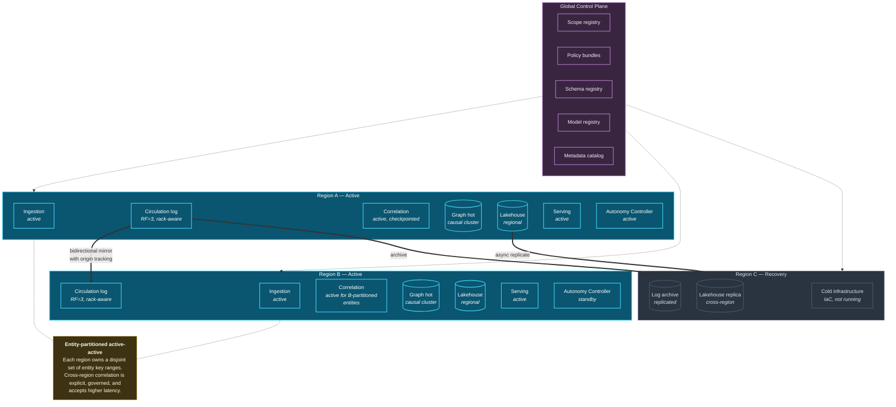

# 27. High Availability

---

## 27.1 What Availability Means Here

Availability in a correlation architecture is not a single property. The framework distinguishes four:

| Availability type | Question | Failure consequence |
| --- | --- | --- |
| **Ingestion availability** | Can events still enter? | Data loss if sources cannot buffer; correlation gaps |
| **Correlation availability** | Are relationships still being discovered? | Missed detections within the actionability window |
| **Serving availability** | Can consumers read correlations and insights? | Decisions made without available context |
| **Decision availability** | Can actions still be taken? | Protective actions not executed |

**Table 56.** *Four availability types. They fail independently and warrant independent objectives. A common design error is specifying a single platform SLA, which either over-engineers serving or under-engineers correlation.*


**A useful asymmetry.** Serving availability can degrade gracefully — a consumer that cannot reach the pool falls back to its own data, as it did before the pool existed. Correlation availability cannot degrade gracefully in the same way: correlations not formed during an outage are **not formed late, they are not formed at all**, unless the system deliberately replays. This makes replay capability the framework's most important availability property.


## 27.2 Multi-Region Topology

**Figure 39.** *Multi-region high-availability topology. Regions are active-active but **entity-partitioned**: each region owns a disjoint set of entity key ranges and performs correlation only for its own. This avoids the fundamental problem of concurrent correlation over the same entities in two regions, which would produce duplicate and potentially conflicting correlations with no principled resolution.*

### 27.2.1 Why Entity-Partitioned Active-Active

The naïve active-active design — both regions correlating all entities — fails. Two regions independently correlating the same entity's events will produce two correlations for the same relationship, with different confidence scores (because each saw a different subset under replication lag), and no principled way to reconcile them.

Entity partitioning avoids this: for any given entity, exactly one region is authoritative. Regions are both active, but over disjoint key ranges. On regional failure, the surviving region assumes the failed region's key ranges by replaying from the mirrored log — which is why bidirectional mirroring with origin tracking is required rather than one-way replication.


**Cross-region correlation is the exception, not the rule.** A correlation scope requiring entities owned by different regions must either accept cross-region latency and partition-tolerance implications, or be executed in the batch layer where completeness matters more than freshness. The framework recommends the latter as the default and treats cross-region streaming correlation as a scope-level decision requiring explicit justification.


## 27.3 Availability Tiers

| Tier | Components | Availability objective | RTO | RPO | Mechanism |
| --- | --- | --- | --- | --- | --- |
| **T1 Critical** | Circulation log, ingestion | 99.99% | < 1 min | 0 (no loss) | Multi-AZ replication, RF≥3, producer acks=all |
| **T2 High** | Correlation tier, Autonomy Controller | 99.9% | < 15 min | < 1 checkpoint interval | Checkpoint restore + log replay |
| **T3 Standard** | Graph hot tier, serving | 99.9% | < 30 min | < 5 min | Replicas; rebuildable from cold tier |
| **T4 Deferred** | Batch layer, graph cold tier | 99.5% | < 4 hours | < 1 hour | Cross-region storage replication |
| **T0 Control** | Scope registry, policy engine | **99.99%** | < 1 min | 0 | Multi-region, cached locally, fail-safe defaults |

**Table 57.** *Availability tiers with recovery objectives. The control plane is deliberately rated at the same level as the circulation log: correlation cannot proceed without scope definitions and policy decisions, so control plane unavailability halts the system's core function even when every data-plane component is healthy.*

### 27.3.1 Control Plane Availability

The control plane is the framework's most dangerous single point of dependency. The mitigations:

**Local caching with TTL.** Each correlation worker caches scope definitions and compiled policy bundles locally. On control plane unavailability, workers continue on cached configuration for a bounded period.

**Fail-safe defaults on expiry.** When the cache TTL expires and the control plane remains unavailable, workers do **not** continue on stale policy. They halt correlation for scopes whose policy cannot be confirmed. This is a deliberate choice of correctness over availability: continuing to form correlations under possibly-revoked policy is a compliance failure, and Principle 8 states that policy prevails absolutely.

**Read-only degradation.** The control plane may be available for reads while unavailable for writes. This is a fully acceptable degraded state — existing scopes continue, new scopes cannot be declared.

## 27.4 Failure Scenarios

| Scenario | Immediate effect | Recovery | Correlation integrity impact |
| --- | --- | --- | --- |
| **Single broker loss** | None (replication) | Automatic rebalance | None |
| **Correlation worker crash** | Partition's scopes stall | Checkpoint restore + replay from last offset | None — replay is complete |
| **Correlation tier total loss** | All correlation halts | Restore checkpoints, replay from log | None if log retention exceeds outage; **gaps if not** |
| **Graph hot tier loss** | Traversal queries fail; writes buffer | Rebuild from cold tier | None — hot tier is a cache |
| **Lakehouse unavailability** | Batch halts; streaming continues | Storage-layer recovery | Batch reconciliation delayed; provisional correlations not promoted |
| **Control plane unavailability** | Cached operation, then halt on TTL expiry | Control plane recovery | Gap during halt; requires replay |
| **Regional loss** | Region's entity ranges unserved | Surviving region assumes ranges via log replay | Gap during failover; replay closes it |
| **Source outage** | Scopes involving source degraded | Source recovery + W2 re-correlation | **Degradation flags mandatory**; negative-relationship alerts suppressed |
| **Model serving failure** | AI insights unavailable | Fallback to rules engine | Reduced insight richness; correlations unaffected |
| **Policy engine failure** | Correlation halts (fail-closed) | Policy engine recovery | Gap; correctness preserved |

**Table 58.** *Failure scenarios and their correlation integrity impact. The recurring theme is that **replay closes gaps** provided log retention exceeds the outage duration — which makes retention configuration an availability decision, not merely a cost decision.*


**The retention–availability coupling.** If the circulation log retains seven days and the correlation tier is unavailable for eight, the eighth day's correlations are permanently unrecoverable from the streaming path. They may be reconstructable from the lakehouse via W2 batch re-correlation, but only if events reached the lakehouse — which they did, since ingestion writes to both. This is a strong argument for the dual-write ingestion design: **the lakehouse is the correlation tier's disaster recovery mechanism.**


## 27.5 Consistency Posture

Per [Chapter 4](../part-1/04-background.md), the framework's stated position:

**Correlations are eventually consistent by default.** A correlation formed in one region becomes visible in another after replication. Consumers must tolerate this, and the framework requires that correlation reads expose the freshness of the data they reflect.

**Strong consistency by exception.** Correlations gating irreversible autonomous action (L4 and above) MUST be read with strong consistency, accepting the latency and partition-tolerance cost. In practice this means such reads are served from the authoritative region for that entity, and fail rather than serve stale data under partition.

**Read-your-writes for human workflows.** An analyst who confirms a correlation must see the confirmation reflected immediately. Session-scoped consistency is provided for interactive workflows.

## 27.6 Operational Practices

| Practice | Frequency | Purpose |
| --- | --- | --- |
| **Checkpoint restore drill** | Monthly | Verify correlation tier recovers within RTO |
| **Regional failover drill** | Quarterly | Verify key-range assumption works under load |
| **Replay drill** | Quarterly | Verify a defined-length outage can be closed by replay |
| **Control plane isolation test** | Quarterly | Verify workers halt correctly on cache expiry rather than proceeding on stale policy |
| **Reversal drill** | Before any L4 promotion, then quarterly | Verify autonomous actions can actually be reversed ([Chapter 20](../part-2/20-autonomous-decision-support.md)) |
| **Degradation simulation** | Quarterly | Verify source outage produces degradation flags and suppresses absence alerts, not an alert storm |
| **Chaos injection** | Continuous | Verify graceful degradation across component failures |

**Table 59.** *Operational availability practices. The degradation simulation is specific to this architecture and is the drill most likely to reveal a serious defect, because the absence–degradation confound ([Chapter 19](../part-2/19-event-relationships.md)) fails catastrophically and silently until it is tested.*

---


## Key Takeaways

1. **Four availability types fail independently** — ingestion, correlation, serving, and decision — and warrant independent objectives rather than a single platform SLA.
2. **Correlation availability cannot degrade gracefully.** Correlations not formed during an outage are not formed late, they are not formed at all — which makes replay capability the framework's most important availability property.
3. **Active-active must be entity-partitioned.** Two regions correlating the same entities produce duplicate, conflicting correlations with no principled reconciliation.
4. **The control plane is rated as critically as the circulation log**, because correlation cannot proceed without scope definitions and policy decisions.
5. **Workers halt rather than proceed on expired policy cache.** Correctness prevails over availability, consistent with Principle 8.
6. **Log retention is an availability decision, not only a cost decision**, because replay can only close gaps shorter than retention.
7. **The lakehouse is the correlation tier's disaster recovery mechanism**, which is the strongest justification for the dual-write ingestion design.
8. **Degradation simulation is the drill most likely to reveal a serious defect**, because the absence–degradation confound fails catastrophically and silently until deliberately tested.


---

**Next:** [28. Performance Considerations →](28-performance.md)
