# 28. Performance Considerations

---

## 28.1 Performance Is Path-Dependent

There is no single performance figure for a Data Swimming Pool. The system serves several distinct paths with objectives that differ by orders of magnitude, and specifying one number for all of them produces either unaffordable over-engineering or unusable under-engineering.


**Illustrative targets.** All figures in this chapter are **proposed service level objectives** derived from the published characteristics of the underlying technologies and the actionability requirements analysed in [Chapter 5](../part-1/05-current-challenges.md). They are **not measurements** of any deployed system.


## 28.2 Service Level Objectives by Path

| Path | Definition | Proposed p50 | Proposed p99 | Dominant cost | Failure consequence |
| --- | --- | --- | --- | --- | --- |
| **P1 Ingestion** | Source event → available in circulation | 200 ms | 2 s | Entity resolution lookup | Correlation freshness |
| **P2 Hot correlation** | Event availability → correlation emitted (narrow window) | 500 ms | 3 s | State access, modality evaluation | Missed short-window actions |
| **P3 Warm correlation** | Event availability → correlation emitted (wide window) | 30 s | 5 min | Window state size | Delayed detection |
| **P4 Insight composition** | Correlation → Insight Object emitted | 1 s | 10 s | Model inference | Delayed decision support |
| **P5 Generative explanation** | Insight → cited narrative | 3 s | 15 s | LLM inference + citation validation | Analyst wait time |
| **P6 Graph traversal (k≤2)** | Query → result | 50 ms | 300 ms | Graph index | Interactive UX |
| **P7 Graph traversal (k=3)** | Query → result | 300 ms | 2 s | Fan-out | Interactive UX |
| **P8 Evidence retrieval** | Insight ID → full evidence chain | 100 ms | 500 ms | Lineage graph traversal | Audit and trust |
| **P9 Autonomy decision** | Insight → action executed | 200 ms | 1 s | Seven gate evaluations | Protective action delay |
| **P10 Analytical query** | SQL over correlation tables | 2 s | 30 s | Scan volume | Analyst productivity |
| **P11 Batch re-correlation** | W2 job over 90 days, one scope | 45 min | 4 h | Scan and shuffle | Methodology iteration speed |

**Table 60.** *Proposed service level objectives by path. Note the three orders of magnitude between P2 (hot correlation) and P11 (batch re-correlation). Designing a single system to satisfy both is the framework's core engineering challenge, and it is resolved by substrate selection per correlation scope rather than by attempting uniform performance.*

## 28.3 The Latency Budget for Hot Correlation

P2 is the framework's most demanding path and the one that justifies the streaming architecture. Its budget decomposes:

```mermaid
flowchart LR
    A["<b>Event available</b><br/>t=0"] --> B["Deserialize + route<br/><b>~5 ms</b>"]
    B --> C["Scope matching<br/>which scopes want this?<br/><b>~2 ms</b>"]
    C --> D["Policy check<br/><i>cached decision</i><br/><b>~1 ms</b>"]
    D --> E["State access<br/>window buffer read<br/><b>~15 ms</b>"]
    E --> F["Modality evaluation<br/>M1 ~3ms · M2 ~2ms · M5 ~40ms<br/><b>~45 ms</b>"]
    F --> G["Confidence pipeline<br/>fusion, base rate,<br/>FDR, calibration<br/><b>~8 ms</b>"]
    G --> H["Threshold gate<br/><b>~1 ms</b>"]
    H --> I["Persist correlation<br/>graph write + log emit<br/><b>~120 ms</b>"]
    I --> J["<b>Correlation available</b><br/>t≈200 ms typical"]

    classDef fast fill:#183028,stroke:#4caf7d,color:#e6fff2
    classDef med fill:#3d3313,stroke:#d4a636,color:#fff8e6
    classDef slow fill:#4a3020,stroke:#d09a60,stroke-width:2px,color:#fff4e6
    class B,C,D,H fast
    class E,G med
    class F,I slow
```

**Figure 40.** *Illustrative latency budget for the hot correlation path. Two stages dominate: behavioural modality evaluation (M5, requiring baseline comparison) and correlation persistence (a graph write plus a log emit). These are the two stages where optimization effort returns most, and both admit well-understood mitigations.*

**Optimization levers, in order of return:**

1. **Asynchronous graph persistence.** Emit the correlation to the log synchronously and write to the graph asynchronously. The log emit is the durability guarantee; the graph write is a materialization. This removes roughly 100 ms from the critical path at the cost of brief read-after-write inconsistency in the graph.
2. **Selective M5 evaluation.** Behavioural modality is expensive. Evaluate it only when cheaper modalities have already produced a partial signal, rather than unconditionally. This is a cascade design and typically reduces mean cost substantially while preserving recall on the correlations that matter.
3. **Policy decision caching.** Policy decisions for a (scope, purpose, classification) tuple change rarely. Cache aggressively with invalidation on policy bundle change.
4. **State locality.** Ensure entity partitioning is correct so that state access is local. A remote state lookup costs one to two orders of magnitude more than a local one, and mis-partitioning is the most common cause of unexpected latency.

## 28.4 Throughput Characteristics

| Component | Throughput driver | Scaling behaviour | Practical bottleneck |
| --- | --- | --- | --- |
| Ingestion | Events/sec × validation cost | Linear with instances | Entity resolution lookups |
| Circulation log | Bytes/sec, partitions | Linear with partitions and brokers | Network, then disk |
| Correlation operator | Events/sec × scopes × modalities | Linear with parallelism, **bounded by state** | State access, then CPU |
| Graph writes | Correlations/sec | **Sub-linear** — write contention | Index maintenance |
| Graph reads | Queries/sec × traversal cost | Linear with replicas | Fan-out at depth |
| Vector index | Queries/sec | Linear with replicas | Recall/latency trade-off |
| Model inference | Requests/sec | Linear with replicas or GPUs | Batch size vs. latency trade-off |
| Lakehouse scan | Bytes scanned | Linear with compute | Small files, poor pruning |

**Table 61.** *Throughput characteristics. Graph writes are the framework's principal throughput bottleneck: property graph databases do not scale writes as freely as logs or object storage, and correlation emission rate can exceed graph write capacity. This is the primary architectural justification for asynchronous, batched graph persistence with the log as the authoritative durability layer.*

## 28.5 Anti-Patterns


**Six performance anti-patterns specific to this architecture.**

**Unbounded traversal.** A query without a depth cap will, in a dense graph, traverse a large fraction of it. Depth caps must be enforced by the API, not left to the caller.

**Synchronous graph write on the hot path.** The single most common cause of correlation latency exceeding budget. The log is the durability guarantee; the graph is a materialization.

**All modalities on every scope.** Multiplies per-event cost with, typically, marginal recall improvement. Cascade instead.

**Cross-partition correlation.** Requires shuffle or remote state access. If a scope requires it frequently, the partitioning key is wrong for that scope, and the scope should be re-partitioned rather than the shuffle accepted.

**Small-file accumulation.** Streaming writes into the lakehouse produce many small files. Analytical scans over them degrade by an order of magnitude or more. Compaction is not optional.

**Uncapped evidence assembly for generative paths.** Retrieving an unbounded evidence subgraph to construct a prompt produces both latency and token cost blowup, and beyond a modest evidence volume, generation quality degrades rather than improves. Evidence budgets must be enforced.


## 28.6 Benchmarking Approach

The framework has not been benchmarked. Were an implementation to be built, the author proposes the following methodology, offered so that any evaluation is comparable:

**Workload definition.** A synthetic enterprise generating events across a defined number of domains, with a declared entity cardinality, a controlled proportion of genuinely related event pairs (the ground truth), and injected noise.

**Primary metrics.**
- *Correlation precision and recall* against injected ground truth — the only metrics that matter for validating the framework's premise.
- *End-to-end latency distributions* per path in Table 60.
- *Cost per correlation* and *cost per true-positive correlation* — the second being the economically meaningful figure.
- *Calibration error* — measured as expected calibration error against the reliability diagram.

**Comparison baseline.** The same workload served by a lakehouse with query-time joins and by a streaming platform with declared stream-stream joins, measuring time-to-answer and answer quality for a fixed question set.

**Scaling curves.** Each metric measured while independently varying event rate, domain count, entity cardinality, scope count, and window width — to empirically establish the boundaries estimated in [Table 55](26-scalability.md).


**The benchmark that would matter most.** Not throughput. **Precision at a fixed recall, as domain count increases.** The framework's central claim is that bounded, governed, multi-modal correlation can maintain useful precision as cross-domain scope grows. The falsification condition in [Chapter 7](../part-1/07-why-another-architecture.md) is that it cannot. A benchmark plotting precision against domain count would resolve the question more decisively than any other measurement, and the author regards constructing it as the highest-value next step.


---


## Key Takeaways

1. **Performance is path-dependent**, spanning three orders of magnitude from hot correlation to batch re-correlation. Substrate selection per scope, not uniform engineering, resolves this.
2. **Behavioural modality evaluation and graph persistence dominate the hot path budget**, and both admit well-understood mitigations.
3. **Asynchronous graph persistence with the log as durability guarantee** is the highest-return optimization, removing roughly half the hot-path latency.
4. **Cascade modality evaluation** — running expensive modalities only after cheaper ones signal — substantially reduces mean cost while preserving recall where it matters.
5. **Graph writes are the principal throughput bottleneck**, because property graphs do not scale writes as freely as logs or object storage.
6. **Mis-partitioning is the most common cause of unexpected latency**, since remote state access costs one to two orders of magnitude more than local.
7. **Six anti-patterns are specific to this architecture**, of which synchronous graph writes and uncapped traversal are the most frequently encountered.
8. **The benchmark that would matter most is precision at fixed recall as domain count increases**, because it directly tests the framework's central claim and its stated falsification condition.


---

**Next:** [29. Banking Use Case →](../part-4/29-banking.md)
