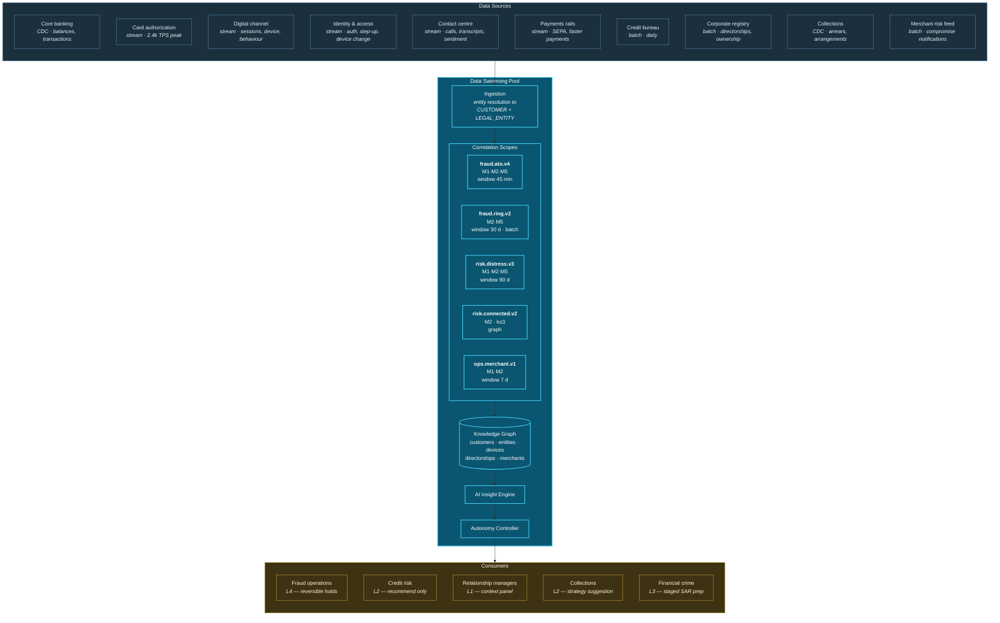
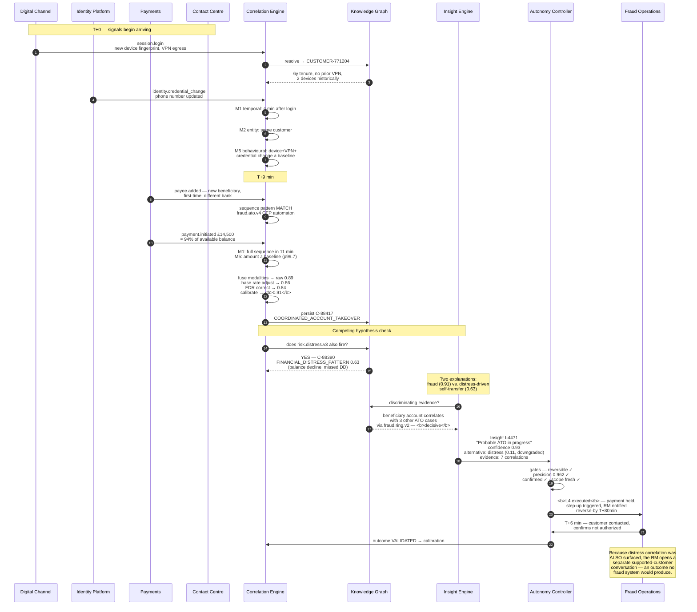

# 29. Banking Use Case

---


**Illustrative scenario.** This chapter describes a synthetic, constructed scenario. It does not describe any real institution, incident, customer, or dataset. All figures are reasoned estimates presented to make the scenario concrete and internally consistent; they are **not** measurements of a deployed Data Swimming Pool.


## 29.1 Scenario Context

**"Meridian Retail Bank"** is a constructed mid-sized European retail and commercial bank: 4.2 million retail customers, 180,000 SME accounts, 340 branches, and a digital channel handling 78% of interactions. It operates a modern lakehouse, a Kafka backbone, a rules-based fraud engine, and separate analytics functions for fraud, credit risk, collections, and customer experience.

**The problem it cannot solve.** Each function performs well in isolation. Fraud detection catches known patterns. Credit risk models are well calibrated at origination. Collections operates efficient contact strategies. But phenomena that manifest across all four are invisible: a customer whose behaviour indicates emerging financial distress, whose account is simultaneously being targeted for social-engineering fraud, whose SME entity shares a director with three other deteriorating accounts, and whose recent card activity is consistent with a merchant compromise.

Each function sees one facet. No function sees the picture. The customer's outcome is determined by whichever function acts first, on the least complete information.

## 29.2 Correlation Architecture

**Figure 41.** *Banking correlation architecture (illustrative). Ten sources feed five declared correlation scopes with differing modalities, windows, and substrates. Note that autonomy levels differ by consumer: fraud operations operate at L4 because transaction holds are genuinely reversible, while credit risk operates at L2 because credit decisions are not.*

## 29.3 Event Flow — Account Takeover with Distress Confound

The following sequence illustrates the framework's value most directly: a case where two plausible interpretations compete, and the correlation substrate distinguishes them.

**Figure 42.** *Banking event sequence (illustrative). The architecturally significant moment is the competing hypothesis check: the system surfaces both a fraud explanation and a financial distress explanation, uses the fraud-ring correlation as discriminating evidence, and — critically — retains the distress finding rather than discarding it. A conventional fraud system would have produced a hold; this produces a hold **and** a customer-support intervention.*

## 29.4 Correlation Scopes in Detail

| Scope | Participating event types | Modalities | Window | Substrate | Autonomy | Declared precision |
| --- | --- | --- | --- | --- | --- | --- |
| `fraud.ato.v4` | login, device_change, credential_change, payee_added, payment_initiated, auth_step_up | M1, M2, M5 | 45 min | Stream | L4 | ≥ 0.95 |
| `fraud.ring.v2` | payee_added, payment, device_fingerprint, address_change | M2, M5 | 30 d | Batch | L3 | ≥ 0.85 |
| `risk.distress.v3` | balance, direct_debit, salary_credit, card_spend_category, contact_sentiment, arrears | M1, M2, M5 | 90 d | Stream + batch | L2 | ≥ 0.80 |
| `risk.connected.v2` | directorship, ownership, guarantee, shared_address | M2 (k≤3) | Standing | Graph | L2 | ≥ 0.90 |
| `ops.merchant.v1` | card_authorization, merchant_compromise_notice, dispute | M1, M2 | 7 d | Stream | L3 | ≥ 0.88 |

**Table 62.** *Banking correlation scopes (illustrative). Autonomy assignment follows the reversibility principle strictly: `fraud.ato.v4` reaches L4 because a payment hold is reversible within a defined window, while `risk.distress.v3` is capped at L2 because acting on distress inference — reducing a limit, changing terms — is materially consequential and not reversible in the sense [Chapter 20](../part-2/20-autonomous-decision-support.md) requires.*

## 29.5 What This Enables That Existing Architectures Do Not

| Capability | Conventional architecture | With correlation substrate |
| --- | --- | --- |
| Detect ATO from a single strong signal | ✔ | ✔ |
| Detect ATO from multiple individually-weak signals | Rarely | ✔ Multi-modal reinforcement |
| Distinguish fraud from distress with similar surface behaviour | Manual investigation | ✔ Competing hypothesis with discriminating evidence |
| Link beneficiary to other cases in real time | Post-hoc analysis | ✔ Graph traversal at decision time |
| Detect connected-party credit contagion across an SME group | Quarterly review | ✔ Standing graph correlation |
| Correlate card compromise pattern to a merchant before notification | ✘ | ✔ M2 shared-attribute clustering |
| Retain the secondary finding while acting on the primary | ✘ — first system to act wins | ✔ Both surfaced, both actionable |

**Table 63.** *Banking capability comparison (illustrative). The final row is the least obvious and arguably the most valuable: conventional architectures resolve competing interpretations by whichever system fires first, discarding the alternative. A correlation substrate retains both.*

## 29.6 Illustrative Outcomes


**Estimates, not measurements.** The following are reasoned projections based on the structural improvements described. They have not been observed.


| Measure | Plausible direction | Reasoning |
| --- | --- | --- |
| ATO detection precision | Improvement | Multi-modal reinforcement replaces single-signal thresholds |
| False-positive holds | Substantial reduction | Competing hypothesis evaluation prevents distress being treated as fraud |
| Detection latency for multi-stage ATO | Minutes rather than post-hoc | Continuous sequence evaluation rather than periodic batch scoring |
| Fraud ring identification | Earlier and broader | Shared-attribute clustering across previously separate cases |
| Connected-party credit exposure discovery | Continuous rather than quarterly | Standing graph correlation over registry data |
| Customer-support interventions triggered | New capability | Distress findings retained rather than discarded when fraud fires |
| Analyst time per investigation | Reduction | Evidence chain pre-assembled rather than manually constructed |

**Table 64.** *Illustrative outcome directions. The last row is where the correlation tax reduction manifests operationally: the investigation an analyst previously performed to assemble evidence has been performed by the platform.*

## 29.7 What Makes This Hard

Honesty about the difficulties in this scenario specifically:

**Entity resolution across retail and SME.** A sole trader is simultaneously a retail customer and a legal entity. Directorship data from corporate registries is inconsistently structured and frequently stale. Over-merging a director with an unrelated namesake creates false connected-party exposure — a serious error with regulatory implications.

**Regulatory constraint on correlation.** Correlating transaction data with inferred financial distress for the purpose of credit decisioning may constitute automated decision-making with significant effect, engaging rights to explanation and human intervention. The scope's declared purpose materially determines its permissibility, and `risk.distress.v3` operating at L2 reflects this constraint rather than a technical limitation.

**Fraud-ring correlation is adversarial.** Adversaries adapt. A ring detected by shared device fingerprints will migrate to distinct devices. Behavioural baselines can be poisoned during a deliberate quiet period. The correlation scope requires continuous adversarial review, not quarterly business review.

**Precision at L4 is demanding.** A declared precision of 0.95 for autonomous transaction holds means one in twenty holds inconveniences a legitimate customer. Whether that is acceptable is a business judgement about the relative cost of fraud loss and customer friction — and it must be made explicitly by an accountable person, not implied by a threshold configuration.

---


## Key Takeaways

1. **Each banking function performs well in isolation and none sees the whole picture**, so a customer's outcome is determined by whichever function acts first on the least complete information.
2. **Competing hypothesis evaluation is the scenario's most distinctive capability:** the system surfaces both fraud and distress explanations, uses ring correlation as discriminating evidence, and retains the secondary finding rather than discarding it.
3. **Autonomy differs by consumer within one platform** — L4 for reversible transaction holds, L2 for credit inferences — demonstrating that autonomy is a per-action-class property.
4. **Real-time beneficiary linkage to other cases** converts post-hoc ring analysis into decision-time evidence.
5. **Entity resolution across retail and legal-entity domains is the principal technical difficulty**, with over-merging carrying regulatory consequence.
6. **Fraud correlation is adversarial and requires continuous review**, not the quarterly cadence appropriate to business scopes.
7. **A declared precision of 0.95 at L4 is an explicit business judgement** about the relative cost of fraud loss and customer friction, and must be owned by an accountable person.


---

**Next:** [30. Healthcare Use Case →](30-healthcare.md)
