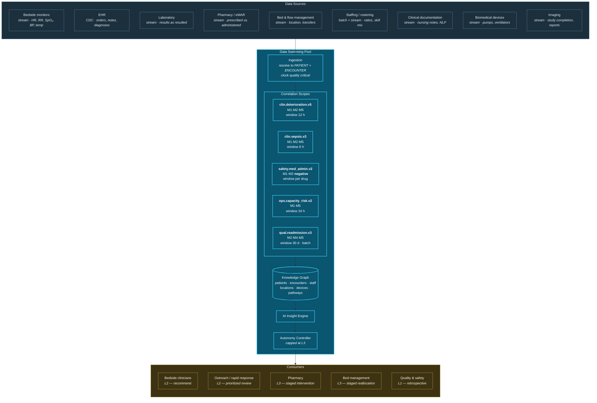
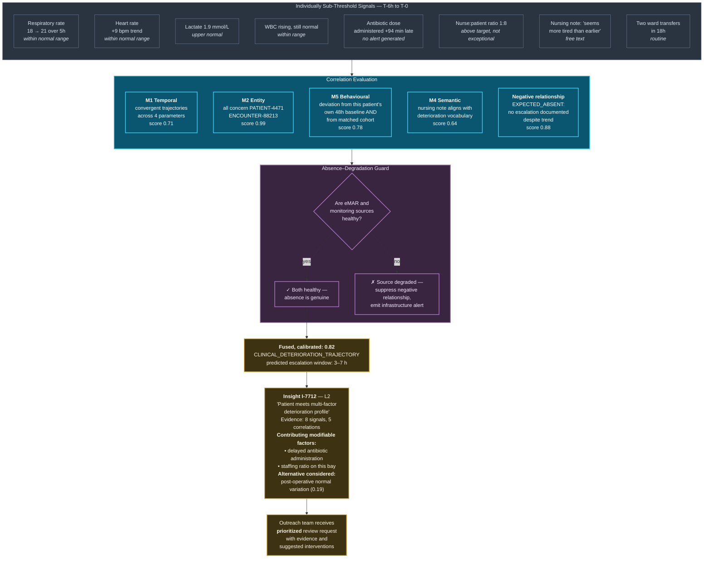

# 30. Healthcare Use Case

---


**Illustrative scenario.** Synthetic and constructed. No real institution, patient, incident, or dataset is described. This chapter is **not** clinical guidance and must not be used to inform patient care. All figures are reasoned estimates.


## 30.1 Scenario Context

**"Northfield Health System"** is a constructed integrated provider: three acute hospitals, 900 beds, an ambulatory network, a community care service, and a shared electronic health record. It monitors vital signs continuously in critical care and at four-hourly intervals on general wards, runs a standard early warning score, and operates separate systems for laboratory results, pharmacy, bed management, staffing, and equipment.

**The problem it cannot solve.** Clinical deterioration is multi-factorial and frequently visible in weak signals across systems hours before it becomes visible in any single one. A patient's respiratory rate drifts upward within normal range. Their most recent lab shows a modest rise in inflammatory markers. A prescribed antibiotic was administered ninety minutes late. Their assigned nurse is covering an unusually high patient load. Their room is at the end of a corridor with lower observation frequency.

No single signal triggers an alert. Each is within tolerance. The conjunction is a recognizable risk profile that experienced clinicians identify intuitively — and that no system computes.

Simultaneously, the early warning score generates a high volume of alerts that clinicians have learned to discount, because single-parameter thresholds fire frequently on patients who are not deteriorating.

## 30.2 Correlation Architecture

**Figure 43.** *Healthcare correlation architecture (illustrative). Autonomy is capped at L3 across the entire deployment — no clinical action is taken without human confirmation, irrespective of confidence. This is a deliberate scenario-level constraint reflecting that clinical actions are rarely reversible in the sense [Chapter 20](../part-2/20-autonomous-decision-support.md) requires.*

## 30.3 Deterioration Correlation Flow

**Figure 44.** *Healthcare deterioration correlation workflow (illustrative). Eight individually sub-threshold signals produce a correlation of 0.82. Two features are architecturally significant: the negative relationship (expected escalation absent) contributes substantially, and the absence–degradation guard prevents a monitoring outage from generating mass false deterioration alerts — the failure mode described in [Chapter 21](../part-2/21-alert-generation.md) that would be catastrophic in this setting.*

## 30.4 Why Modifiable Factors Matter

The Insight Object in Figure 44 distinguishes **contributing modifiable factors** from the deterioration signal itself. This is a design choice with substantial clinical consequence.

A conventional deterioration score tells a clinician *this patient is at risk*. That is useful but incomplete. The correlation substrate can also indicate *which contributing factors are within the organization's control*: the antibiotic was late, the staffing ratio on this bay is elevated, the patient was transferred twice.

These are actionable in a way the vital-sign trend is not. The trend is a consequence; the modifiable factors are levers. Surfacing them converts a prediction into an intervention plan — and it is only possible because the correlation spans clinical, pharmacy, and operational domains that conventional early warning systems do not connect.

## 30.5 Correlation Scopes

| Scope | Purpose | Modalities | Window | Autonomy | Special considerations |
| --- | --- | --- | --- | --- | --- |
| `clin.deterioration.v5` | Multi-factor deterioration risk | M1, M2, M5, M4 | 12 h | L2 | Cohort baselines must be demographically stratified |
| `clin.sepsis.v3` | Sepsis pathway trigger | M1, M2, M5 | 6 h | L2 | High recall priority; precision trade-off accepted |
| `safety.med_admin.v2` | Prescribed-not-administered detection | M1, M2, negative | Per-drug therapeutic window | L3 | **Absolutely requires source health gating** |
| `ops.capacity_risk.v2` | Staffing and flow risk to patient safety | M1, M5 | 24 h | L3 | Correlating staffing with outcomes is industrially sensitive |
| `qual.readmission.v3` | Readmission risk with modifiable factors | M2, M4, M5 | 30 d, batch | L1 | Must not influence admission or discharge decisions |

**Table 65.** *Healthcare correlation scopes (illustrative). `safety.med_admin.v2` is the scope most dependent on the absence–degradation guard: an eMAR outage without gating would report that every scheduled medication in the hospital was not administered.*


**The scenario's most dangerous failure mode.** In a 900-bed hospital, an eMAR integration failure lasting one hour would, without source-health gating, generate an EXPECTED_ABSENT correlation for every medication scheduled in that hour — plausibly several thousand critical safety alerts, all false, delivered to clinical staff who cannot distinguish them from genuine ones.

This is not a hypothetical risk. It is the predictable consequence of implementing negative relationship detection without the guard specified in [Chapter 19](../part-2/19-event-relationships.md), and it would justifiably end a clinical deployment.


## 30.6 Governance and Privacy Constraints

**Autonomy is capped at L3 system-wide.** No clinical action executes without human confirmation. This reflects that clinical interventions are rarely reversible in the required sense: an administered drug cannot be un-administered, a transfer cannot be un-transferred, and a family conversation cannot be un-had.

**Purpose binding is strict.** Correlations derived for direct care are tagged `direct-care` only. Their use for resource allocation, insurance, employment, or research requires separate lawful basis and, in most jurisdictions, separate consent or ethical approval. The purpose intersection rule ([Chapter 24](../part-3/24-privacy.md)) enforces this.

**Staffing correlation is industrially sensitive.** `ops.capacity_risk.v2` correlates staffing levels with patient outcomes. This is clinically valuable and organizationally contentious. The framework's position: the scope should exist, its outputs should be governed as safety information rather than performance management data, and it should be explicitly excluded from individual staff evaluation — with that exclusion enforced by purpose binding rather than by policy statement.

**Explainability is a clinical requirement, not merely a regulatory one.** A clinician will not act on a score they cannot interrogate. The evidence chain is what makes the insight clinically usable, and its absence would render the system ignorable regardless of accuracy.

## 30.7 What Makes This Hard

**Clock quality across biomedical devices.** Device clocks drift, are set manually, and are frequently wrong by minutes to hours. Temporal correlation over device data without accurate clock quality metadata produces systematically false trajectories. The clock quality indicator specified in [Chapter 13](../part-2/13-ingestion-layer.md) is not optional here.

**Cohort baselines must be stratified carefully.** A behavioural baseline for deterioration must account for age, comorbidity, procedure type, and admission reason. An unstratified baseline will flag post-operative patients as deteriorating and miss deterioration in chronically unwell patients. Constructing appropriate cohorts is clinical work, not data science work.

**Alert precision requirements are severe.** Clinical alerting already suffers acute fatigue. A new system adding volume — even accurate volume — will be disabled. The framework's value here depends entirely on *replacing* single-parameter alerts rather than supplementing them, and on demonstrating a reduction in total alert volume from day one.

**Ground truth is delayed and ambiguous.** Confirming whether a deterioration prediction was correct requires clinical adjudication, which is slow and inter-rater variable. Calibration (Principle 6) is therefore harder here than in domains with crisp outcomes, and confidence scores should be presented with appropriate humility about their calibration quality.

---


## Key Takeaways

1. **Clinical deterioration is visible in weak cross-domain signals hours before any single system detects it**, and the conjunction is what experienced clinicians recognize intuitively but no system computes.
2. **Surfacing contributing modifiable factors converts a prediction into an intervention plan**, and is only possible because correlation spans clinical, pharmacy, and operational domains.
3. **Negative relationships contribute substantially** — the escalation that should have been documented and was not is significant evidence.
4. **The absence–degradation guard is the scenario's most critical control.** An eMAR outage without it would generate thousands of false critical safety alerts and would justifiably end the deployment.
5. **Autonomy is capped at L3 system-wide** because clinical actions are rarely reversible in the required sense.
6. **Staffing–outcome correlation should exist but be purpose-bound to safety**, excluded from individual performance management by enforcement rather than by policy statement.
7. **Device clock quality is a first-order concern**, since biomedical device clocks drift substantially and temporal correlation over them is otherwise systematically wrong.
8. **The framework must reduce total alert volume from day one**, not supplement existing alerts, or clinical staff will disable it regardless of accuracy.


---

**Next:** [31. Manufacturing Use Case →](31-manufacturing.md)
