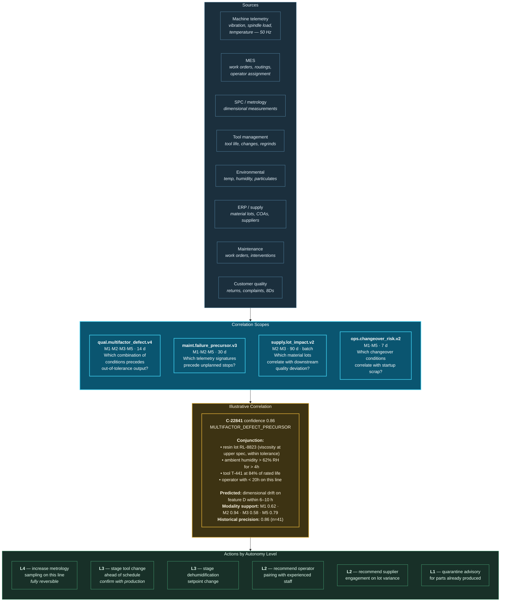

# 31. Manufacturing Use Case

---


**Illustrative scenario.** Synthetic and constructed. All figures are reasoned estimates, not measurements.


## 31.1 Scenario Context

**"Halden Precision Components"** is a constructed tier-one automotive supplier: four plants, 61 CNC and injection-moulding lines, 14,000 sensor points, and a supplier base of 230 material vendors. It runs a modern MES, a condition-monitoring platform, an SPC quality system, and an ERP.

**The problem it cannot solve.** Defects and failures are almost never single-cause. A batch of out-of-tolerance parts traces to a combination of a marginally different resin lot, an ambient humidity excursion, a tool approaching its wear limit, and an operator new to that line. Each factor alone is within tolerance. The condition-monitoring system watches the tool. The SPC system watches the output. The ERP records the lot. Nobody correlates them until a customer rejects a shipment three weeks later — by which point 40,000 parts have been produced.

## 31.2 Correlation Architecture and Flow

**Figure 45.** *Manufacturing predictive quality and maintenance workflow (illustrative). A single correlation identifies a four-factor conjunction, none of whose components violates a tolerance individually. Six actions follow at four different autonomy levels — with increased metrology sampling at L4 because it is genuinely reversible and costs only measurement time.*

## 31.3 Why Manufacturing Suits This Architecture

Manufacturing is, in the author's assessment, among the strongest candidate domains for the framework, for four reasons:

**Ground truth is crisp and fast.** A part is in tolerance or it is not. Metrology provides objective, timely outcome labels, which makes confidence calibration (Principle 6) genuinely tractable — unlike domains where outcomes are ambiguous or delayed by months.

**Causality is more accessible than usual.** Physical processes obey physical laws. A causal hypothesis linking humidity to resin viscosity to dimensional drift can be tested experimentally, and frequently is. M3 causal correlation is more defensible here than in social or commercial domains.

**Actions are often genuinely reversible.** Increasing sampling frequency, adjusting a setpoint within a permitted range, or scheduling an early tool change are all reversible in the strict sense of [Chapter 20](../part-2/20-autonomous-decision-support.md) — no external party retains a record and no downstream process behaves differently.

**The window of actionability is favourable.** Hours to days, rather than the seconds of fraud or the minutes of clinical deterioration. This tolerates batch-substrate correlation for many scopes and reduces engineering demand substantially.


**A recommendation.** Organizations seeking to validate the framework empirically should consider manufacturing as the pilot domain, precisely because crisp ground truth makes the central claim — that multi-modal correlation maintains useful precision across domains — directly measurable.


## 31.4 Supply Chain Correlation

`supply.lot_impact.v2` deserves specific attention because it crosses an organizational boundary.

The scope correlates incoming material lot characteristics — from certificates of analysis, supplier telemetry where shared, and inbound inspection — with downstream quality outcomes measured weeks later and frequently at a different plant. This is a wide-window, cross-facility, batch-substrate correlation, and it produces findings that are commercially significant: *this supplier's lots within this parameter band correlate with elevated defect rates in this process*.

**Two cautions:**

Findings of this kind have contractual and commercial consequence, and correlation is not causation. A supplier lot correlating with defects may reflect a genuine material issue, or a confound — perhaps that supplier's lots are preferentially routed to an older line. Before any commercial action, the M3 causal hypothesis requires confirmation through designed experiment, and the framework's role is to direct that experiment rather than to substitute for it.

Sharing correlation findings with suppliers requires care about what is disclosed. A finding may reveal the organization's own process capability, which is commercially sensitive in the opposite direction.

## 31.5 Illustrative Outcomes

| Measure | Plausible direction | Reasoning |
| --- | --- | --- |
| Multi-factor defect detection lead time | Hours rather than weeks | Continuous conjunction evaluation vs. customer return |
| Scrap volume from undetected drift | Reduction | Earlier detection bounds affected production |
| Unplanned downtime | Reduction | Precursor signatures detected across telemetry and maintenance history |
| Maintenance intervention precision | Improvement | Multi-modal support replaces single-parameter thresholds |
| Supplier quality issues attributed correctly | Improvement | Cross-facility lot correlation over long windows |
| Engineering investigation time per issue | Substantial reduction | Evidence pre-assembled; conjunctions identified |
| False alarm rate on condition monitoring | Reduction | Correlation replaces independent threshold alerts |

**Table 66.** *Illustrative outcome directions for manufacturing. All are directional estimates, not measurements.*

## 31.6 What Makes This Hard

**Sensor data volume.** Fourteen thousand points at 50 Hz is 700,000 events per second before any filtering — beyond the comfortable range in [Table 55](../part-3/26-scalability.md). Edge aggregation is mandatory: raw telemetry is summarized at the gateway into features (rolling statistics, spectral bands, threshold crossings) and only features enter the pool. This is a design requirement, not an optimization.

**Time synchronization on the plant floor.** Industrial controllers frequently lack reliable time synchronization. Correlating a vibration event with a metrology result requires both timestamps to be trustworthy to within the correlation window. Deploying PTP or equivalent is a prerequisite, and the clock quality indicator must reflect actual synchronization status.

**Operator attribution is sensitive.** Correlating operator assignment with defect rates is analytically valid and industrially fraught. The framework's position mirrors the healthcare staffing case: the correlation is legitimate as a *training and support* signal, must be purpose-bound to exclude individual performance management, and the exclusion must be enforced computationally.

**Confounded process changes.** Manufacturing processes change continuously — new tooling, revised parameters, different materials. A behavioural baseline established before a process change is invalid after it. Baselines must be versioned against process configuration, and process change must trigger baseline reset rather than being absorbed as drift.

---


## Key Takeaways

1. **Manufacturing defects are conjunctions of individually in-tolerance conditions**, which is precisely the pattern no single monitoring system detects.
2. **Manufacturing is the strongest candidate pilot domain** because ground truth is crisp and fast, causality is experimentally testable, many actions are genuinely reversible, and actionability windows are favourable.
3. **Increased metrology sampling is a rare genuine L4 action** — fully reversible, low cost, and directly risk-reducing.
4. **Cross-facility supplier lot correlation produces commercially consequential findings** that must be confirmed by designed experiment before action, with the framework directing the experiment rather than substituting for it.
5. **Edge aggregation is mandatory, not optional**, at plant sensor volumes; only derived features should enter the pool.
6. **Plant-floor time synchronization is a prerequisite**, and clock quality metadata must reflect actual synchronization status.
7. **Operator attribution must be purpose-bound to training and support**, with exclusion from performance management enforced computationally.
8. **Baselines must be versioned against process configuration**, since process change invalidates them and must trigger reset rather than being absorbed as drift.


---

**Next:** [32. Retail Use Case →](32-retail.md)
