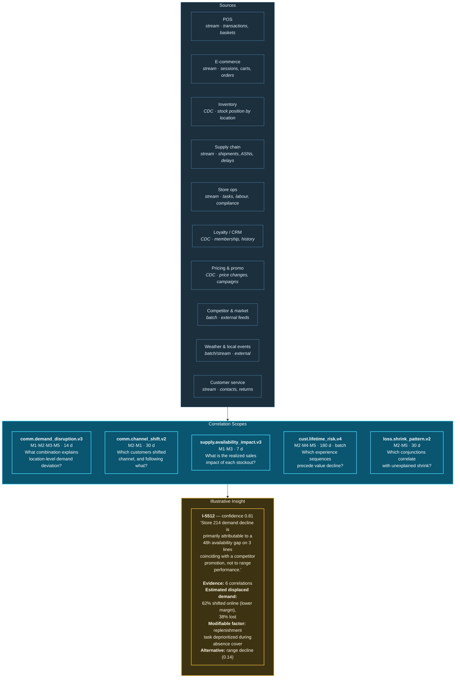

# 32. Retail Use Case

---


**Illustrative scenario.** Synthetic and constructed. All figures are reasoned estimates, not measurements.


## 32.1 Scenario Context

**"Calder & Rowe"** is a constructed omnichannel retailer: 410 stores, an e-commerce platform, a marketplace presence, three distribution centres, and 2,100 SKUs across seasonal and continuity ranges.

**The problem it cannot solve.** Commercial outcomes are determined by interactions the organization measures separately. A store's sales decline. Merchandising attributes it to range performance. Supply chain sees adequate stock in the DC. Store operations sees normal staffing. E-commerce sees a regional uplift. In fact: a delivery was late, causing a two-day gap on a key line, during a local competitor promotion, in a store where the replenishment task was deprioritized because a colleague was absent, and the customers affected shifted to online where margin is lower.

Each function's data supports its own explanation. None supports the actual one.

## 32.2 Correlation Architecture

**Figure 46.** *Retail unified commerce correlation workflow (illustrative). The insight attributes a demand decline to a specific conjunction and explicitly names the alternative explanation the organization would otherwise have adopted — range performance — with its lower confidence. This attribution correction is the scenario's central value.*

## 32.3 Channel Shift as a Correlation Problem

`comm.channel_shift.v2` illustrates a pattern that is invisible to conventional analytics.

A retailer's channel reporting shows store sales down and online sales up. The natural interpretation is structural channel migration — an industry-wide trend requiring strategic response.

The correlation substrate can distinguish this from **induced channel shift**: individual customers who purchased in store, encountered a specific failure (unavailability, queue, unhelpful interaction), and subsequently purchased the same category online. This is not a trend; it is a set of remediable service failures with a measurable margin cost.

The distinction requires entity-resolved correlation across POS, loyalty, e-commerce, and store operations data with a customer-level view — precisely the cross-domain, entity-anchored correlation the framework provides and that channel-level aggregate reporting structurally cannot.

## 32.4 Privacy Constraints in Retail

Retail is where the framework's privacy risks are most acute, because retail correlation readily produces **special-category inferences from entirely non-special-category inputs**.


**The canonical example.** Purchase patterns, delivery timing, and browsing behaviour can reveal pregnancy, health conditions, religious observance, financial distress, or relationship changes. None of the input data is special category. The inference is.

[Chapter 24](../part-3/24-privacy.md) requires scope assessment to consider **what a correlation could reveal**, not what its inputs contain. In retail this assessment is not a formality — it is the difference between a lawful personalization capability and a serious regulatory and reputational failure.


**Framework requirements applied here:**

- Scopes producing customer-level behavioural correlations MUST declare a specific purpose, not "personalization" as a category.
- Special-category determination MUST be performed by someone with the imagination to anticipate non-obvious inferences, reviewed by the privacy office.
- Correlations capable of revealing special-category information MUST be classified as such on formation, inheriting the restrictions rather than the permissions of their inputs.
- Marketing purposes MUST NOT inherit from service-delivery or fraud-prevention collection bases — the intersection rule prevents this, and attempts to override it should be treated as a governance escalation.

## 32.5 Illustrative Outcomes

| Measure | Plausible direction | Reasoning |
| --- | --- | --- |
| Demand deviation correctly attributed | Substantial improvement | Multi-factor correlation replaces single-function explanation |
| Stockout impact quantified | New capability | Displaced-demand correlation across channels |
| Induced channel shift identified separately from structural | New capability | Entity-resolved cross-channel correlation |
| Remediable service failures identified | New capability | Correlation of customer experience sequences to value change |
| Range decisions based on correct attribution | Improvement | Fewer lines delisted for availability failures |
| Shrink investigation targeting | Improvement | Conjunction patterns rather than variance thresholds |

**Table 67.** *Illustrative outcome directions for retail. Three rows are marked as new capability rather than improvement, because conventional channel-level reporting cannot produce them at all.*

## 32.6 What Makes This Hard

**Identity resolution across anonymous and known.** A substantial proportion of store transactions are anonymous. Linking anonymous POS activity to a known customer requires payment token matching, loyalty scanning, or probabilistic inference — the last of which carries both accuracy risk and privacy risk. The framework's precision-favouring thresholds ([Chapter 13](../part-2/13-ingestion-layer.md)) apply with particular force: an over-merged customer identity in retail produces both wrong analysis and a potential data protection breach when one customer's history is exposed to another.

**External data quality.** Competitor pricing, local events, and weather feeds vary substantially in reliability and timeliness. Correlations depending heavily on external feeds inherit their quality, and the contract discipline that applies to internal sources must apply equally to purchased data.

**Seasonality dominates behavioural baselines.** Retail behaviour is profoundly seasonal, and a naïve baseline will flag every seasonal transition as anomalous. Baselines must be seasonally adjusted, and the adjustment must be robust to the fact that each year's seasonality differs.

**Commercial pressure toward higher autonomy.** Retail organizations will want automated pricing, promotion, and personalization actions at high autonomy levels because the volume justifies it. Many such actions are less reversible than they appear — a promotional price communicated to a customer cannot be un-communicated, and a personalized recommendation revealing an inferred pregnancy cannot be un-shown. The reversibility test in [Chapter 20](../part-2/20-autonomous-decision-support.md) should be applied strictly against commercial pressure.

---


## Key Takeaways

1. **Each retail function's data supports its own explanation of a commercial outcome, and none supports the actual one**, which is typically a conjunction spanning supply, operations, competition, and customer behaviour.
2. **Distinguishing induced channel shift from structural migration is a new capability** requiring entity-resolved cross-channel correlation that aggregate reporting structurally cannot produce.
3. **Retail is where the framework's privacy risk is most acute**, because ordinary purchase and browsing data readily yields special-category inferences.
4. **Special-category determination requires imagination, not classification**, and in retail it is the difference between lawful personalization and serious regulatory failure.
5. **Over-merged customer identity produces both wrong analysis and a potential breach**, since one customer's history may be exposed to another.
6. **Purchased external data requires the same contract discipline as internal sources**, since correlations inherit its quality.
7. **Commercial pressure toward higher autonomy must be resisted where reversibility fails.** A communicated price or a shown recommendation cannot be un-communicated or un-shown.


---

**Next:** [33. Smart Cities Use Case →](33-smart-cities.md)
