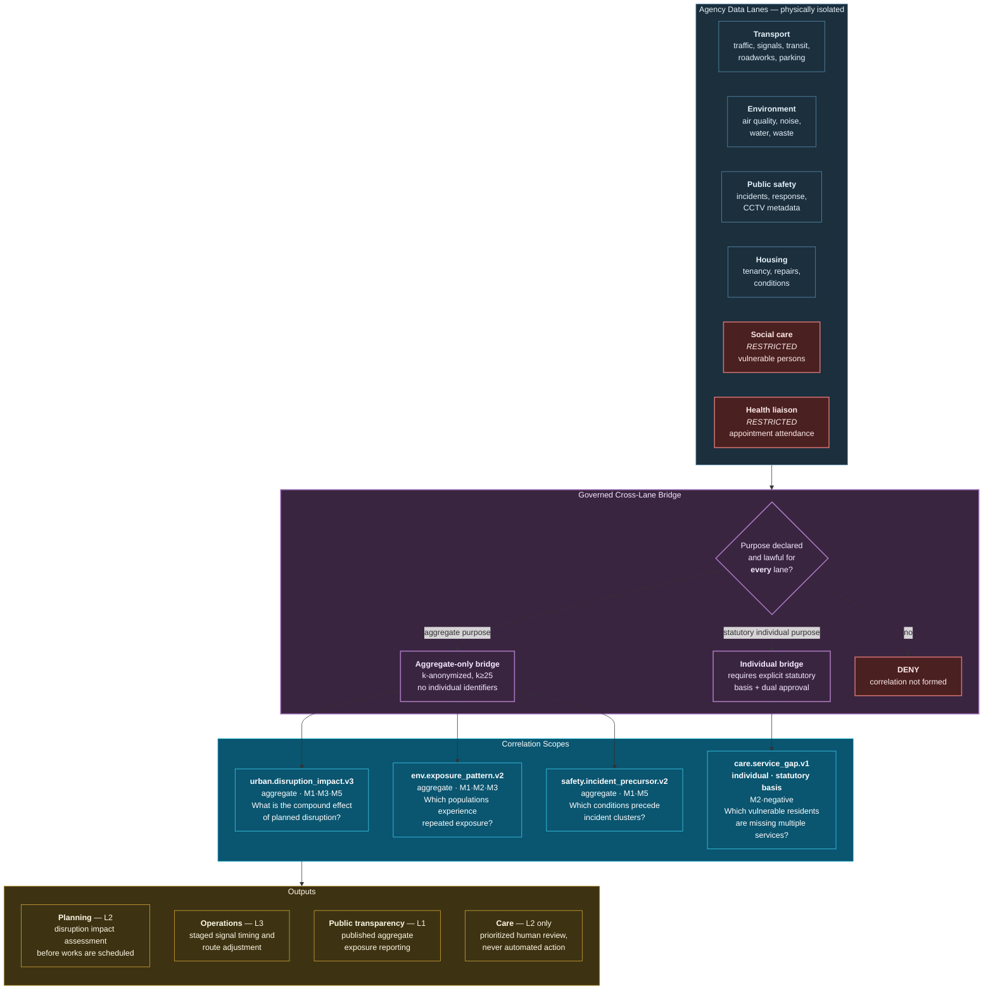

# 33. Smart Cities Use Case

---


**Illustrative scenario.** Synthetic and constructed. All figures are reasoned estimates, not measurements.


## 33.1 Scenario Context

**"Aldreth Metropolitan Authority"** is a constructed municipal authority serving 1.4 million residents, operating traffic management, public transport coordination, waste services, environmental monitoring, social care, housing, and emergency service liaison — across eleven separate agencies with independent data estates and independent legal bases for processing.

**The problem it cannot solve.** Urban systems are coupled and the agencies are not. A road closure for utility works reroutes traffic past a school, elevating particulate levels during pickup hours, while the diverted bus route extends journey times for residents in an area with high hospital appointment attendance, some of whom miss appointments, some of whom are known to social care.

Every agency acts correctly within its remit. The compound effect falls on residents and is visible to nobody.

## 33.2 Multi-Agency Correlation Architecture

**Figure 47.** *Smart city multi-agency correlation workflow (illustrative). Agency lanes are physically isolated per [Chapter 26](../part-3/26-scalability.md). Cross-lane correlation passes through a governed bridge offering two paths: an aggregate-only path with k-anonymity for planning purposes, and a heavily-restricted individual path requiring explicit statutory basis and dual approval. Most municipal correlation value is achievable via the aggregate path.*

## 33.3 Aggregate-First as a Design Principle

The most important design decision in this scenario is that **the default cross-agency bridge is aggregate-only**.

Individual-level correlation across municipal agencies is the architecture of a surveillance system. It is technically straightforward and, in most democratic jurisdictions, both legally constrained and politically illegitimate absent specific statutory authority.

The framework's position is that the majority of municipal value — understanding compound disruption effects, identifying repeatedly-exposed populations, anticipating incident conditions, planning services — is achievable with aggregated, k-anonymized correlation. Individual-level cross-agency correlation should be reserved for narrow statutory purposes, subject to dual approval, with a mandatory audit trail and periodic independent review.


**A caution the author regards as essential.** A municipality that builds a Data Swimming Pool without this constraint has built the technical substrate for population-level surveillance, whatever its intent. The bridge design is not a compliance formality; it is the control that determines whether the system is a public service capability or a civil liberties problem. It must be architecturally enforced, externally reviewable, and politically accountable.


## 33.4 The Compound Disruption Insight

`urban.disruption_impact.v3` illustrates the aggregate path's value.

A planned utility closure is submitted for scheduling. Before approval, the scope correlates the proposed closure against: historical traffic reassignment patterns for comparable closures, air quality response at monitoring stations on likely diversion routes, transit journey-time impacts on affected routes, the demographic and service-use profile of affected areas (aggregate), and concurrent planned works.

The output is an impact assessment naming the compound effects — *this closure, combined with the existing works two streets away, will likely elevate particulates near two schools during pickup hours and extend journey times on a route with high hospital-appointment usage* — with confidence and evidence.

The action is not automated. It is a planning input at L2: reschedule, phase differently, add mitigations, or proceed with awareness. This is the framework's value in its least controversial and arguably most useful form: **making a compound consequence visible to a human decision-maker before the decision, rather than after the complaint.**

## 33.5 Illustrative Outcomes

| Measure | Plausible direction | Reasoning |
| --- | --- | --- |
| Compound disruption effects identified pre-decision | New capability | Cross-agency aggregate correlation at planning time |
| Repeated environmental exposure patterns identified | New capability | Longitudinal spatial correlation across agencies |
| Incident precursor conditions anticipated | Improvement | Multi-source conjunction rather than single-agency threshold |
| Service gaps for vulnerable residents identified | New capability, tightly constrained | Negative relationships under statutory basis only |
| Resident complaints attributable to compound causes | Improvement | Evidence chain for cross-agency causes |
| Public transparency on exposure equity | New capability | Published aggregate correlation reporting |

**Table 68.** *Illustrative outcome directions for smart cities. The final row is distinctive: publishing correlation findings about exposure distribution is a transparency capability with civic value, and it is available at low privacy risk through the aggregate path.*

## 33.6 What Makes This Hard

**Legal basis fragmentation.** Each agency processes under a different lawful basis, frequently statutory and purpose-specific. The purpose intersection rule ([Chapter 24](../part-3/24-privacy.md)) will produce empty intersections for many desirable correlations. This is correct behaviour and will feel obstructive. The remedy is legislative or through data-sharing agreements, not architectural.

**Political and public legitimacy.** Municipal data correlation is politically sensitive in a way commercial correlation is not. The framework's transparency properties — evidence chains, published methodology, auditable scopes — are assets here, and the author would argue the system should be designed for public scrutiny from the outset rather than retrofitted for it after challenge.

**Data quality across agencies varies enormously.** A modern traffic management system and a legacy housing repairs system have incomparable data quality. Correlation inherits the weaker source's quality, and contract enforcement across agencies with no shared IT governance is an organizational problem more than a technical one.

**Spatial and temporal alignment.** Municipal data uses inconsistent spatial units — wards, output areas, postcodes, sensor catchments, bus route segments — none of which align. Spatial harmonization is substantial work and introduces its own error, which must be represented in correlation confidence rather than ignored.

**Vulnerable persons data demands exceptional care.** `care.service_gap.v1` correlates negative relationships — services expected and not received — for vulnerable residents. This is genuinely valuable and genuinely dangerous. It must operate at L2 only, must be gated on source health to avoid the absence–degradation confound, and must be reviewed by safeguarding professionals rather than treated as an analytics output.

---


## Key Takeaways

1. **Urban systems are coupled and agencies are not**, so compound effects fall on residents while every agency acts correctly within its remit.
2. **Aggregate-only cross-agency correlation must be the default.** Individual-level municipal correlation is the architecture of surveillance and should require explicit statutory basis, dual approval, and independent review.
3. **The bridge design determines whether the system is a public service capability or a civil liberties problem**, and it must be architecturally enforced rather than policy-stated.
4. **Most municipal value is achievable through the aggregate path**, including compound disruption assessment, exposure equity analysis, and incident precursor detection.
5. **The framework's highest-value municipal use is making compound consequences visible before a decision**, at L2, rather than after a complaint.
6. **Empty purpose intersections across agencies are correct behaviour**, and the remedy is legislative or contractual rather than architectural.
7. **Municipal systems should be designed for public scrutiny from the outset**, treating evidence chains and auditable scopes as civic assets.
8. **Spatial unit misalignment introduces error that must be represented in confidence**, not ignored during harmonization.


---

**Next:** [34. Cybersecurity Use Case →](34-cybersecurity.md)
