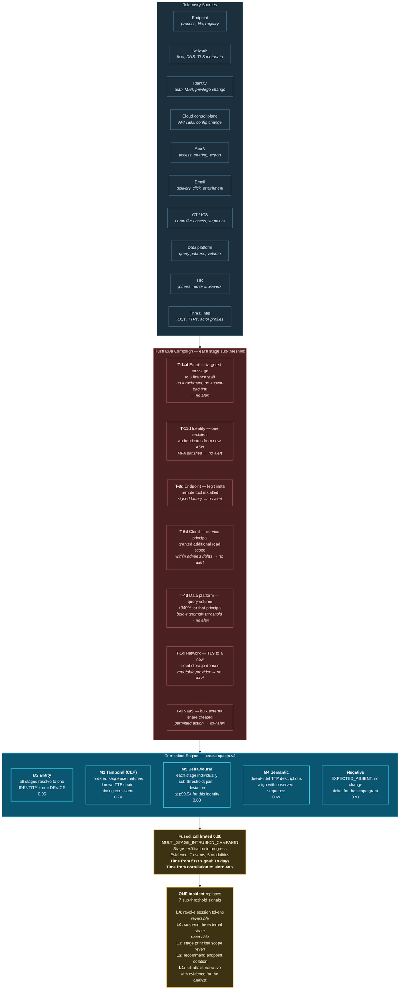

# 34. Cybersecurity Use Case

---


**Illustrative scenario.** Synthetic and constructed. All figures are reasoned estimates, not measurements.


## 34.1 Scenario Context

**"Vantis Group"** is a constructed multinational: 34,000 employees, hybrid cloud estate, 180 SaaS applications, an operational technology environment in three manufacturing sites, and a security operations centre processing approximately 2.1 million events per day into roughly 4,200 alerts, of which 180 receive human triage.

**The problem it cannot solve.** Sophisticated intrusion is cross-telemetry by design. An attacker who understands that endpoint, network, identity, cloud, and application telemetry are analysed by separate detectors will deliberately keep each individual signal below its detector's threshold. The campaign is invisible in every domain and obvious across all of them.

This is the purest expression of the thesis in [Chapter 5](../part-1/05-current-challenges.md): alert fatigue is a correlation failure, and adversaries exploit it deliberately.

## 34.2 Cross-Telemetry Correlation

**Figure 48.** *Cybersecurity cross-telemetry threat correlation workflow (illustrative). Seven campaign stages, each deliberately below its domain detector's threshold, spanning fourteen days and six telemetry sources. Five modalities contribute, including a negative relationship — the change ticket that should have accompanied the privilege grant and did not. The output is one incident with a complete narrative, replacing seven signals that individually generated no alert.*

## 34.3 Why Security Is the Framework's Most Natural Fit

Four properties make security an unusually good match:

**The adversary is optimizing against uncorrelated detection.** This is not an incidental benefit; it is the entire game. Every mature attack framework assumes siloed detection and is designed to stay beneath per-domain thresholds. Correlation directly attacks the adversary's core assumption.

**Actions are frequently reversible.** Revoking a session token, suspending a share, blocking an IP, or disabling an account are reversible in the strict sense — which is why security supports higher autonomy levels than most domains.

**Ground truth arrives, eventually.** Incident investigation produces definitive labels. Confidence calibration is tractable.

**The volume problem is acute and measurable.** The compression ratio from raw signals to triaged incidents is directly measurable and directly valuable, giving the framework an unambiguous success metric.


**The security-specific argument.** In most domains, correlation infrastructure competes with alternative investments. In security, the alternative — hiring analysts proportional to alert volume — does not scale and is not available in the labour market. Correlation is not an optimization; it is the only path to coverage.


## 34.4 Correlation Scopes

| Scope | Purpose | Modalities | Window | Autonomy | Note |
| --- | --- | --- | --- | --- | --- |
| `sec.campaign.v4` | Multi-stage intrusion detection | M1, M2, M4, M5, negative | 30 d | L4 (reversible actions) | Adversarial — continuous review |
| `sec.insider.v3` | Insider data movement | M2, M5, negative | 90 d | **L2 only** | Employment consequence; never automated |
| `sec.lateral.v3` | Lateral movement within estate | M1, M2 | 24 h | L4 | High confidence, fast window |
| `sec.supply_chain.v2` | Third-party and vendor compromise | M2, M4 | 60 d | L3 | Depends on external telemetry quality |
| `sec.ot_boundary.v2` | IT-to-OT boundary crossing | M1, M2 | 7 d | L3 | OT actions are **not** reversible — capped |
| `sec.platform_self.v1` | The pool monitoring itself | M2, M5 | 30 d | L2 | Must not be sole monitoring ([Chapter 23](../part-3/23-security-architecture.md)) |

**Table 69.** *Cybersecurity correlation scopes (illustrative). Two are deliberately capped: insider detection at L2 because the consequence is employment-related and irreversible, and OT boundary at L3 because an automated action against operational technology can cause physical harm.*

## 34.5 Adversarial Considerations

Security is the one domain where the correlation system itself is a target.

**Correlation evasion.** An adversary who knows correlation windows and scopes can space activity to fall outside them. Mitigation: window widths and scope definitions should be treated as sensitive, varied where feasible, and supplemented by wide-window batch correlation that is harder to evade by timing alone.

**Baseline poisoning.** An adversary with early, low-privilege access can shape M5 baselines over weeks so that later malicious activity appears normal. Mitigation: baseline change-rate limits, robust statistics resistant to gradual shift, and cross-checking individual baselines against cohort baselines — an entity whose baseline drifts while its cohort's does not is itself a signal.

**Correlation store as target.** The correlation store contains a map of the organization's detection capability. An adversary who reads it knows exactly what is and is not detected. It requires protection commensurate with the most sensitive security tooling, and access to it should be more restricted than access to raw telemetry.

**Alert-flooding as cover.** Generating high volumes of low-severity events to exhaust correlation capacity and trigger load shedding. Mitigation: the load-shedding hierarchy in [Chapter 11](../part-2/11-streaming-layer.md) sheds by scope priority, and security scopes should hold the highest priority so that they are shed last.

## 34.6 Illustrative Outcomes

| Measure | Plausible direction | Reasoning |
| --- | --- | --- |
| Alerts requiring human triage | Substantial reduction | Clustering and correlation replace independent signals |
| Detection of deliberately sub-threshold campaigns | New capability | Joint deviation detection across telemetry domains |
| Mean time to detect multi-stage intrusion | Substantial reduction | Continuous cross-telemetry evaluation |
| Mean time to investigate | Substantial reduction | Attack narrative and evidence pre-assembled |
| False positive rate | Reduction | Multi-modal reinforcement raises precision |
| Analyst coverage of alert volume | Improvement | Fewer, richer incidents within triage capacity |
| Detection of privilege changes without change control | New capability | Negative relationship across ITSM and cloud telemetry |

**Table 70.** *Illustrative outcome directions for cybersecurity. The final row illustrates a distinctive pattern: correlating a security event with the absence of its expected governance artifact is frequently more informative than the event itself.*

---


## Key Takeaways

1. **Sophisticated intrusion is cross-telemetry by design**, deliberately keeping each signal below its domain detector's threshold — making security the purest expression of the correlation thesis.
2. **Correlation directly attacks the adversary's core assumption** that detection is siloed, which is not an incidental benefit but the central one.
3. **Security supports higher autonomy than most domains** because token revocation, share suspension, and account disabling are genuinely reversible.
4. **Insider detection and OT boundary scopes are deliberately capped**, at L2 and L3 respectively, because employment consequences and physical-harm potential are irreversible.
5. **In security, correlation is not an optimization but the only path to coverage**, since hiring analysts proportional to alert volume neither scales nor is available in the labour market.
6. **The correlation store is itself a target** containing a map of detection capability, and warrants more restricted access than raw telemetry.
7. **Baseline poisoning is countered by cross-checking individual baselines against cohort baselines** — an entity drifting while its cohort does not is itself a signal.
8. **Security scopes must hold the highest load-shedding priority**, since alert flooding to exhaust correlation capacity is a viable attack.


---

**Next:** [35. Government Use Case →](35-government.md)
