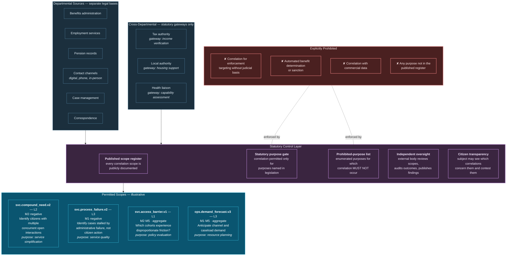

# 35. Government Use Case

---


**Illustrative scenario.** Synthetic and constructed. All figures are reasoned estimates, not measurements. This chapter is not legal or policy advice.


## 35.1 Scenario Context

**"Department of Public Services"** is a constructed national government department administering benefits, employment support, and pension services, interacting with tax, health, housing, and local authorities, and serving 11 million citizens through digital, telephone, and in-person channels.

**The problem it cannot solve — stated carefully.** Citizens experience government as a single entity and are administered by many. A person who has recently become unemployed, has a housing arrears notice, has missed two healthcare appointments, and has a pending benefit claim held for verification is, from the citizen's perspective, having one crisis. From the state's perspective they are four unconnected cases in four systems, each progressing at its own pace, none aware of the others.

The correlation opportunity is real. So is the correlation danger, and this chapter treats them with equal weight.

## 35.2 The Two Faces of Government Correlation


**A framing this chapter insists upon.**

The same technical capability supports two profoundly different applications:

**Service integration** — identifying that a citizen is experiencing compound difficulty and proactively simplifying their interaction with the state. This is the correlation working *for* the citizen.

**Population monitoring** — identifying and scoring citizens across administrative datasets for risk, eligibility challenge, or enforcement targeting. This is the correlation working *on* the citizen.

They are technically near-identical and ethically opposite. An architecture that enables the first enables the second, and the only durable distinction is governance that is externally enforced, publicly transparent, and politically accountable — not internal policy.

The author's position is that government deployments of correlation architecture require **statutory authorization, independent oversight, published scope registers, and enforceable prohibition of secondary use** as preconditions, not as subsequent additions.


## 35.3 Constrained Correlation Architecture

**Figure 49.** *Government inter-agency service correlation workflow (illustrative). The statutory control layer sits between sources and scopes, enforcing a published register, a statutory purpose gate, an enumerated prohibited-purpose list, independent oversight, and citizen transparency. No scope exceeds L3, and no scope makes eligibility determinations.*

## 35.4 The Most Valuable Scope Is a Negative One

`svc.process_failure.v2` deserves emphasis because it inverts the usual direction of government analytics.

Conventional administrative analytics examines citizen behaviour: who claims, who complies, who appeals. This scope examines **administrative behaviour**: which cases are stalled because a verification request was never sent, a document was received but not processed, a referral was made but not acknowledged, or a decision deadline passed without action.

These are negative relationships — expected administrative events that did not occur. They identify failures of the state rather than failures of the citizen, and they are, in the author's view, the single most defensible and most valuable application of correlation in government.

They also carry no meaningful privacy risk in the direction that matters: the subject of the finding is the administrative process, not the person.


**A recommendation for public sector adoption.** An organization introducing correlation architecture in government should begin with scopes that examine institutional performance rather than citizen behaviour. This establishes the capability, demonstrates value, builds public confidence, and — importantly — establishes the governance machinery before any scope that examines individuals is proposed.


## 35.5 Automated Decision-Making Constraints

The framework's position for government is more restrictive than for commercial contexts:

| Decision type | Maximum autonomy | Rationale |
| --- | --- | --- |
| Eligibility determination | **L0** — prohibited | Legal effect on the individual; requires human determination |
| Sanction or penalty | **L0** — prohibited | Punitive; requires human determination and appeal rights |
| Enforcement targeting | **L0** — prohibited absent judicial basis | Disproportionate risk of discriminatory targeting |
| Case prioritization for human review | L2 | Human decides; must not systematically deprioritize protected groups |
| Proactive service offer | L2 | Benefits the citizen; still requires human judgement on appropriateness |
| Administrative process correction | L3 | Fixes a state failure; low citizen risk |
| Resource and capacity planning | L3 | Aggregate; no individual effect |
| Aggregate policy evaluation | L1 | Published; no individual effect |

**Table 71.** *Autonomy constraints for government decision types. Three categories are prohibited outright rather than capped, reflecting that automated adverse determinations about citizens are, in the author's assessment, illegitimate regardless of accuracy.*

## 35.6 Equity Auditing as a First-Class Requirement

Any government correlation system must be able to answer: **does this system treat comparable people comparably?**

The framework's requirements for government deployment:

- Every scope's outputs are analysed for **disparate impact** across protected characteristics, using aggregate analysis that does not itself require individual-level protected-characteristic data where avoidable.
- **Disparate impact findings are published**, not merely reported internally.
- A scope demonstrating unexplained disparate impact is **suspended pending investigation**, not merely flagged.
- **Independent oversight has access** to the analysis and the underlying methodology.

This is more demanding than commercial practice and appropriately so: the state's obligation to treat citizens equally is qualitatively different from a company's obligation to its customers.

## 35.7 What Makes This Hard

**Legal basis and statutory gateways.** Cross-departmental data sharing in most jurisdictions requires specific statutory authority for a specific purpose. The purpose intersection rule will block most cross-departmental correlation, which is correct. Enabling legitimate correlation requires legislation, not engineering.

**Historical data quality in legacy administration.** Government administrative data is frequently decades old, migrated multiple times, with inconsistent identity practices. Entity resolution across such data is difficult and error-prone, and the consequence of over-merging two citizens is severe — one person's record affecting another's entitlement.

**Public legitimacy is not a communications problem.** Public concern about government data correlation is substantively well-founded given historical precedent. It is not addressed by better explanation; it is addressed by genuine, enforceable, externally-verified constraint.

**Scope creep is the predictable failure.** A system built for service integration will be asked to support enforcement. The published register, the statutory purpose gate, and the prohibited-purpose list exist specifically to make this transition visible and difficult rather than gradual and administrative.

---


## Key Takeaways

1. **Citizens experience government as one entity and are administered by many**, so compound difficulty is invisible to every individual system.
2. **The same capability supports service integration and population monitoring** — technically near-identical, ethically opposite — and only externally enforced governance durably distinguishes them.
3. **Statutory authorization, independent oversight, published scope registers, and enforceable secondary-use prohibition are preconditions**, not subsequent additions.
4. **The most defensible and valuable government scope examines administrative failure, not citizen behaviour**, identifying where the state failed to act rather than where the citizen did.
5. **Public sector adoption should begin with institutional-performance scopes**, establishing capability and governance machinery before any scope examining individuals is proposed.
6. **Three decision categories are prohibited outright** — eligibility determination, sanction, and enforcement targeting — because automated adverse determinations about citizens are illegitimate regardless of accuracy.
7. **Equity auditing is a first-class requirement** with published disparate-impact findings and automatic suspension of scopes showing unexplained disparity.
8. **Scope creep toward enforcement is the predictable failure**, and the control architecture exists specifically to make that transition visible and difficult.


---

**Next:** [36. Telecommunications Use Case →](36-telecommunications.md)
