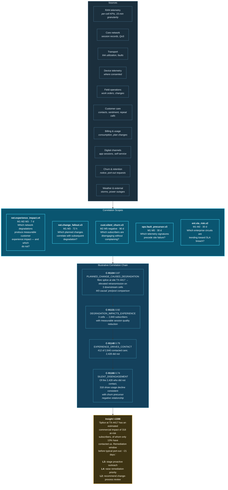

# 36. Telecommunications Use Case

---


**Illustrative scenario.** Synthetic and constructed. All figures are reasoned estimates, not measurements.


## 36.1 Scenario Context

**"Lyrath Communications"** is a constructed converged operator: 8.4 million mobile subscribers, 2.1 million fixed broadband lines, a nationwide radio access network of 14,000 sites, a core network, and an enterprise services division.

**The problem it cannot solve.** Telecommunications generates more operational data than almost any other industry and correlates less of it than almost any other industry, because the domains are deeply siloed by engineering discipline. Radio, transport, core, IT, and customer experience are analysed by different teams using different tools with different data models.

The consequence: a network engineer sees a cell exhibiting elevated retransmission rates within acceptable bounds. A customer care manager sees a rise in complaints from one postcode area. A churn analyst sees three enterprise accounts in a region reducing spend. A field operations manager sees a scheduled fibre splice completed successfully. Nobody sees that these are one event.

## 36.2 Network-to-Experience Correlation

**Figure 50.** *Telecommunications network and experience correlation workflow (illustrative). A four-link correlation chain traces a field operation through network degradation, customer experience impact, contact behaviour, and silent disengagement. The chain — not any single link — is what converts an engineering event into a quantified commercial consequence.*

## 36.3 The Silent Majority Problem

`cust.silent_churn.v3` addresses telecommunications' most expensive blind spot.

Operators respond to complaints. Complaint volume is the primary signal of customer dissatisfaction, and remediation is prioritized accordingly. But in the illustrative chain above, 2,428 of 2,840 affected subscribers — 85% — did not contact care. They experienced degradation, formed a judgement, and said nothing.

The complaint-driven model systematically under-prioritizes exactly the customers most likely to leave without warning, because willingness to complain correlates with engagement, and engagement correlates with retention. **The customers who complain are disproportionately the ones who will stay.**

Detecting the silent majority requires correlating network degradation with usage behaviour change and the *absence* of contact — a negative relationship. It is not available from any single source and is not visible in complaint-driven reporting by construction.

## 36.4 Distinguishing Impactful from Ignorable Degradation

`net.experience_impact.v4` addresses the inverse problem, and it is where operators most frequently misallocate effort.

Network operations centres monitor thousands of KPIs and generate large volumes of threshold alerts. Many degradations that breach engineering thresholds produce no measurable customer impact — a cell degrades at 03:00 with four active subscribers, or a metric deteriorates within a range where the application layer compensates transparently.

Correlating network events with actual session quality, usage behaviour, and contact patterns allows the operator to distinguish degradation that matters from degradation that merely breaches a threshold. This reprioritizes field effort toward impact rather than toward alarm — and it typically reduces network alert volume substantially while improving the experience outcome.


**This is the alert fatigue argument in a different domain.** The network operations centre's problem is structurally identical to the security operations centre's: thousands of independent threshold alerts, no correlation to consequence, and human triage capacity as the binding constraint. The remedy is the same.


## 36.5 Illustrative Outcomes

| Measure | Plausible direction | Reasoning |
| --- | --- | --- |
| Network alerts requiring field response | Substantial reduction | Impact correlation distinguishes consequential degradation |
| Silent disengagement identified | New capability | Negative relationship across network, usage, and contact |
| Change-caused degradation attributed | Improvement | Causal pre/post correlation at change granularity |
| Enterprise SLA breaches pre-empted | Improvement | Trend correlation across circuit and service layers |
| Proactive outreach precision | New capability | Targeted at affected, non-complaining subscribers |
| Field effort allocated to customer impact | Improvement | Prioritization by correlated consequence rather than KPI breach |
| Repeat-contact rate | Reduction | Root cause identified at first contact via correlation |

**Table 72.** *Illustrative outcome directions for telecommunications.*

## 36.6 What Makes This Hard

**Telemetry volume is extreme.** RAN telemetry at per-cell, per-KPI, sub-minute granularity across 14,000 sites exceeds the comfortable bounds of [Table 55](../part-3/26-scalability.md) by a wide margin. As in manufacturing, aggregation before ingestion is mandatory, and the aggregation must preserve the features correlation requires — which means the aggregation design is itself a correlation design decision.

**Subscriber-to-network attribution is non-trivial.** Determining which subscribers were served by which cell during which interval requires session-level correlation that is itself expensive. Approximations introduce error that must be represented in confidence rather than hidden.

**Privacy constraints on network data are strict.** Communications metadata is specially protected in most jurisdictions. Correlating location-derived data with usage and commercial behaviour engages telecommunications-specific privacy law in addition to general data protection. Purpose binding must reflect these constraints, and several commercially attractive correlations will be prohibited.

**Organizational silos are engineering cultures, not just data silos.** Radio, transport, core, and IT are distinct engineering disciplines with distinct vocabularies, tools, and professional identities. Cross-domain correlation requires a shared semantic layer that no single discipline owns — which is an organizational challenge at least as significant as the technical one, and one the framework's governance model ([Chapter 25](../part-3/25-governance.md)) addresses only partially.

---


## Key Takeaways

1. **Telecommunications generates more operational data than almost any industry and correlates less of it**, because domains are siloed by engineering discipline rather than merely by system.
2. **The four-link chain from field operation to silent disengagement is the scenario's central value** — it converts an engineering event into a quantified commercial consequence no single team could compute.
3. **The complaint-driven model systematically under-prioritizes the customers most likely to leave**, because willingness to complain correlates with engagement and engagement correlates with retention.
4. **Detecting silent disengagement requires a negative relationship** — degradation and usage change with an absence of contact — unavailable from any single source.
5. **Distinguishing impactful from ignorable degradation reprioritizes field effort toward consequence rather than alarm**, and is structurally the same problem as security alert fatigue.
6. **Telemetry aggregation design is a correlation design decision**, since aggregation must preserve exactly the features correlation requires.
7. **Communications metadata attracts sector-specific privacy protection** beyond general data protection, and several commercially attractive correlations will be prohibited.
8. **Engineering-discipline silos are an organizational challenge the framework addresses only partially**, and one that will determine adoption success more than the technology will.


---

**Next:** [36A. Insurance, Logistics, Energy and Aviation →](36a-additional-sectors.md)
