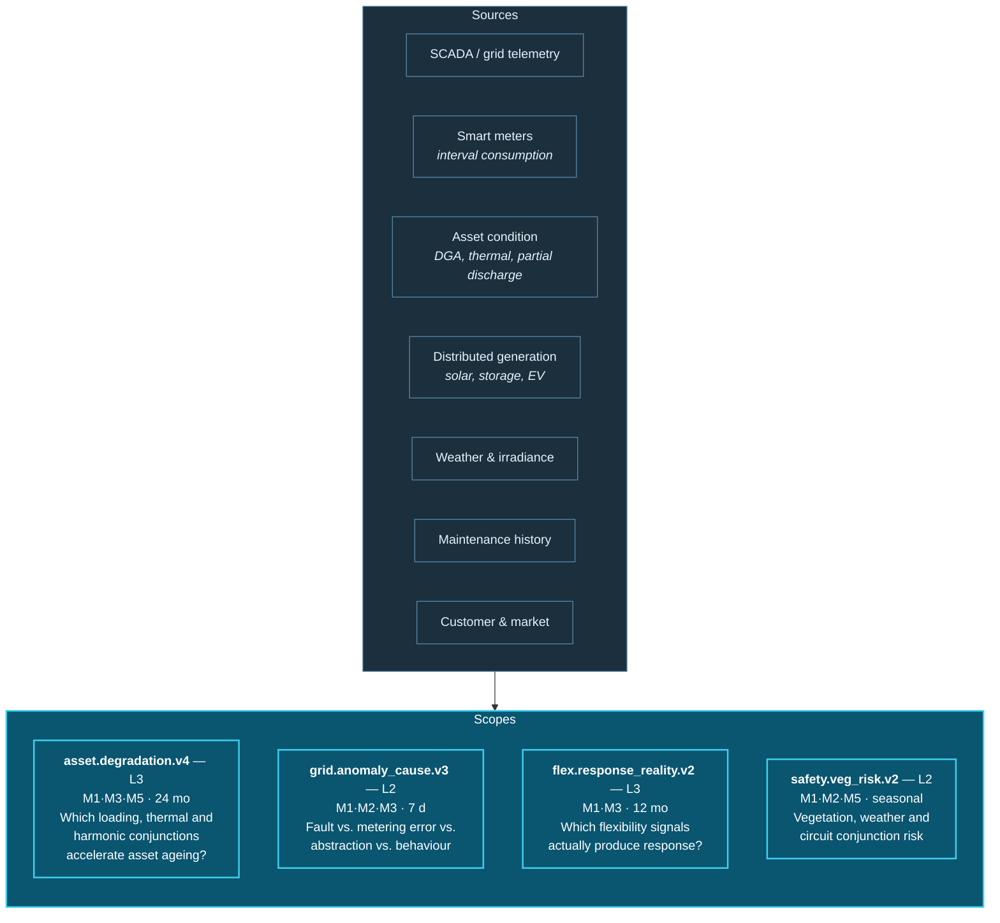

# 36A. Insurance, Logistics, Energy and Aviation

---


**Illustrative scenarios.** All four are synthetic and constructed. Figures are reasoned estimates, not measurements.


This chapter presents four additional sectors in condensed form, completing the ten-sector coverage. Each follows the same analytical structure: the cross-domain phenomenon that current architectures cannot see, the correlation pattern that would reveal it, and the specific constraint that makes it difficult.

---

## 36A.1 Insurance

### The Invisible Phenomenon

Claims fraud, particularly organized fraud, is a network phenomenon presented as a set of individual claims. A staged collision involves a driver, a passenger, a medical practitioner, a vehicle repairer, and a legal representative — each of whom appears in multiple claims across multiple insurers, in combinations that are individually unremarkable and collectively definitive.

Separately and more benignly, claims *experience* is multi-factorial in ways underwriting does not capture: a property's claims history correlates with weather exposure, local infrastructure age, maintenance behaviour, and occupancy pattern — signals that exist across policy, claims, external, and IoT data but are not related.

### Correlation Pattern

**Figure 51.** *Insurance correlation pattern (illustrative). Claim network detection is a graph community-detection problem over shared participants — the archetypal M2 application at depth.*

### The Specific Constraint


**Correlation in insurance risks unlawful discrimination.** A correlation between a protected characteristic proxy and claims experience may be statistically robust and legally prohibited as a pricing factor. Insurance is among the most heavily regulated domains for permissible inference, and the scope assessment in [Chapter 24](../part-3/24-privacy.md) — *what could this correlation reveal?* — must extend to *what does this correlation proxy for?*

Additionally, autonomy must be capped at **L2 for anything affecting a policyholder's price, terms, or claim outcome.** These are materially irreversible and typically require human determination with appeal rights.


---

## 36A.2 Logistics

### The Invisible Phenomenon

Supply chain disruption propagates through relationships that no single system models. A port congestion event affects specific vessels, carrying specific containers, containing specific SKUs, destined for specific distribution centres, feeding specific stores, supporting specific promotional campaigns — with a customs delay, a driver-hours constraint, and a warehouse capacity limit interacting along the way.

Each system tracks its own leg. The **compound delay** — and, critically, which downstream commitments it endangers — is computed by nobody until something fails.

### Correlation Pattern

| Scope | Purpose | Modalities | Window | Autonomy |
| --- | --- | --- | --- | --- |
| `sup.disruption_propagation.v3` | Trace a disruption to endangered downstream commitments | M1, M2 (k≤5), M3 | 30 d | L3 (staged re-routing) |
| `sup.eta_reality.v4` | Correlate promised vs. realized transit under condition combinations | M1, M3, M5 | 12 mo, batch | L2 |
| `sup.carrier_reliability.v2` | Which carrier–lane–condition combinations underperform | M2, M5 | 12 mo, batch | L2 |
| `sup.cold_chain.v2` | Temperature excursion correlated with handling events | M1, M2, negative | Per shipment | **L4** (reversible: divert, re-inspect) |

**Table 73.** *Logistics correlation scopes (illustrative). Cold chain reaches L4 because diverting a shipment for inspection is genuinely reversible and the consequence of not acting — spoiled pharmaceutical or food product reaching consumers — is severe.*

### The Specific Constraint

Logistics correlation crosses organizational boundaries constantly — carriers, ports, customs, 3PLs, and suppliers are separate entities with separate systems and no obligation to share. Data availability, not correlation capability, is the binding constraint. The framework's contribution here is to make the *value* of shared data measurable, which may support the commercial case for sharing agreements.

Deep graph traversal (k≤5) is required to trace propagation, which pushes against the depth limits in [Chapter 26](../part-3/26-scalability.md). This scope must run in the batch layer with careful pruning rather than as interactive traversal.

---

## 36A.3 Energy

### The Invisible Phenomenon

Grid reliability, asset health, and demand behaviour are analysed separately and are causally entangled. A transformer's degradation rate depends on loading history, ambient conditions, harmonic distortion from distributed generation, and maintenance history. A local demand anomaly may indicate an emerging fault, a metering error, unauthorized abstraction, or a genuine behavioural change — and distinguishing them requires correlating meter data, network telemetry, weather, and customer records.

### Correlation Pattern

**Figure 52.** *Energy correlation pattern (illustrative). Asset degradation correlation is a strong M3 candidate because the physical mechanisms are well understood and causal hypotheses are experimentally testable — as in manufacturing.*

### The Specific Constraint


**Safety-critical actions must not be automated on correlation.** Grid switching, protection setting changes, and asset de-energization have physical safety consequences and are governed by engineering authority frameworks. The framework's role in energy is to inform human engineering judgement, not to substitute for it. Autonomy above L3 is inappropriate for any action affecting grid state.

Smart meter data is also personal data in most jurisdictions, revealing occupancy, appliance use, and behaviour patterns. Purpose binding must be strict, and correlations combining meter data with customer records require careful special-category assessment.


---

## 36A.4 Aviation

### The Invisible Phenomenon

Aviation operations are a tightly coupled network in which small perturbations propagate non-linearly. An aircraft's delayed arrival affects its next rotation, the crew's duty limits, the connecting passengers, the gate allocation, the ground handling schedule, and — through crew and aircraft rotation — flights hours later and continents away.

Separately, predictive maintenance in aviation is exceptionally multi-factorial: component health correlates with flight cycles, route profiles, environmental exposure, operating technique, and maintenance history, across data held by the operator, the manufacturer, and the maintenance provider.

### Correlation Pattern

| Scope | Purpose | Modalities | Window | Autonomy | Note |
| --- | --- | --- | --- | --- | --- |
| `ops.disruption_propagation.v4` | Trace a delay to endangered downstream rotations, crew limits and connections | M1, M2 (k≤4), M3 | 72 h | L3 | Recovery actions staged for ops control |
| `maint.component_health.v5` | Multi-factor component degradation prediction | M1, M3, M5 | 24 mo, batch | L2 | Airworthiness decisions are human, always |
| `safety.precursor.v3` | Correlate operational events with recognized safety precursors | M1, M2, M4, M5 | 12 mo | **L1** | Safety reporting culture — never punitive |
| `cust.recovery_priority.v2` | Which disrupted passengers face worst compound outcomes | M2, negative | Per event | L3 | Rebooking is reversible |

**Table 74.** *Aviation correlation scopes (illustrative). Safety precursor correlation is capped at L1 — informational only — because aviation safety depends on a non-punitive reporting culture, and any perception that correlated data is used for enforcement would suppress the reporting the system depends on.*

### The Specific Constraint


**Aviation safety data has a special status.** Safety reporting systems function because reporters trust that data will be used for safety improvement rather than enforcement. Correlating safety reports with operational and personnel data — technically valuable — risks destroying that trust and therefore the data itself.

The framework's position for aviation: safety precursor correlation should be **de-identified at ingestion, restricted to aggregate analysis, governed by the safety function independently of operations management, and explicitly excluded from any individual performance or disciplinary purpose** — with the exclusion enforced computationally through purpose binding rather than asserted in policy.


Additionally, airworthiness determinations are subject to regulatory frameworks requiring qualified human judgement. Predictive maintenance correlation informs the engineer; it does not determine the outcome.

---

## 36A.5 Cross-Sector Pattern Synthesis

Ten sectors have now been examined. Five patterns recur across all of them:

| Recurring pattern | Description | Sectors where dominant |
| --- | --- | --- |
| **Sub-threshold conjunction** | Multiple individually-acceptable conditions that are jointly significant | Manufacturing, healthcare, cybersecurity, energy |
| **Cross-domain attribution** | An outcome misattributed because each function sees only its own data | Retail, telecommunications, banking, aviation |
| **Network / community detection** | Coordinated behaviour visible only as a graph structure | Banking, insurance, cybersecurity |
| **Negative relationship** | The expected event that did not occur | Healthcare, government, telecommunications, logistics |
| **Propagation tracing** | A perturbation's compound downstream consequences | Logistics, aviation, smart cities, energy |

**Table 75.** *Cross-sector correlation pattern synthesis. Every scenario in Part IV reduces to one or more of these five patterns, which suggests that a reference implementation supporting them well would serve most enterprise correlation requirements — a hypothesis worth testing and proposed as future work in [Chapter 40](../part-5/40-future-roadmap.md).*

Two constraints also recur universally:

**Autonomy is capped by irreversibility, not by confidence.** In every sector, the actions the organization most wants to automate are the ones least eligible for automation — credit decisions, clinical interventions, benefit determinations, airworthiness calls, grid switching. The framework's consistent answer is that these remain human, and the value is delivered by making the human's decision better-informed and faster rather than by removing the human.

**The correlation that is most valuable is frequently the one that is most sensitive.** Staffing to clinical outcomes, operator to defect, safety report to individual, citizen to service history. In every case the framework's answer is the same: the correlation should exist, its purpose must be bound computationally to a legitimate use, and the prohibited uses must be enforced by architecture rather than asserted in policy.

---


## Key Takeaways

1. **Insurance correlation risks unlawful discrimination**, requiring scope assessment to extend from *what could this reveal?* to *what does this proxy for?*, with autonomy capped at L2 for anything affecting price, terms, or claim outcome.
2. **Logistics is constrained by data availability across organizational boundaries**, not by correlation capability — and the framework's contribution may be making the value of sharing measurable enough to justify agreements.
3. **Energy asset degradation is a strong causal-correlation candidate** because physical mechanisms are understood and hypotheses are experimentally testable, but safety-critical grid actions must never exceed L3.
4. **Aviation safety data has a special status** dependent on non-punitive reporting culture, requiring de-identification, aggregate-only analysis, independent safety-function governance, and computationally enforced exclusion from performance purposes.
5. **Five correlation patterns recur across all ten sectors** — sub-threshold conjunction, cross-domain attribution, network detection, negative relationship, and propagation tracing — suggesting a reference implementation supporting these would serve most enterprise requirements.
6. **Autonomy is universally capped by irreversibility, not confidence.** The actions organizations most want to automate are consistently the least eligible, and the framework's value lies in better-informed human decisions rather than removed humans.
7. **The most valuable correlation is frequently the most sensitive**, and the consistent answer is that it should exist with its purpose bound computationally and prohibited uses enforced architecturally.


---

**Next:** [37. Comparison with Existing Technologies →](../part-5/37-comparison.md)
