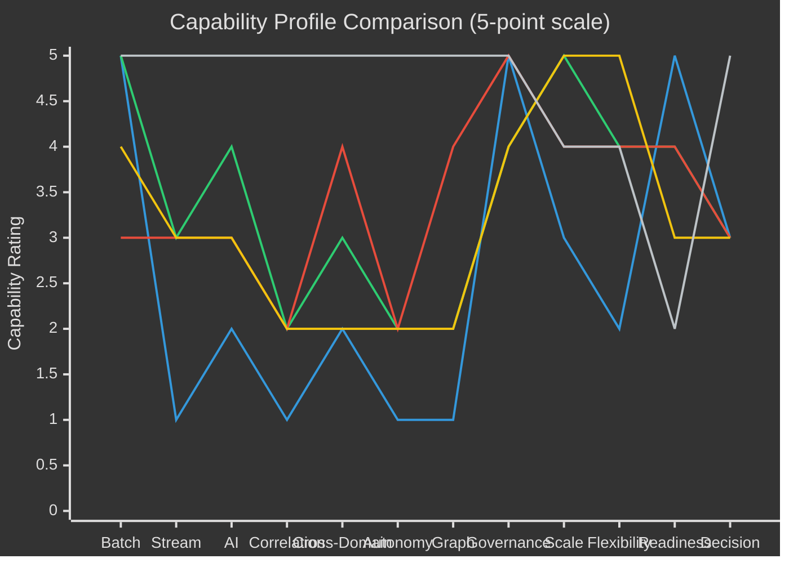

# 37. Comparison with Existing Technologies

---

## 37.1 Methodology and Its Limits

This chapter compares Data Swimming Pool against five incumbent paradigms across twelve capability dimensions.


**Three honest caveats about this comparison.**

**It compares architectural intent, not achievable outcome.** Any capability can be built into any architecture with sufficient custom engineering. The ratings reflect what each paradigm provides *natively*, by design, without substantial bespoke work.

**It is authored by the proposer of one of the paradigms.** The author has attempted to compensate by rating Data Swimming Pool lowest on enterprise readiness, operational simplicity, and cost — where it genuinely is worst — and by conceding throughout [Chapter 7](../part-1/07-why-another-architecture.md) that most organizations should extend an incumbent rather than adopt this framework. Readers should nonetheless apply appropriate scepticism.

**No empirical basis exists for the Data Swimming Pool column.** Every other column reflects observable deployed systems. This one reflects a design. That asymmetry is real and is why the Enterprise Readiness row exists.


**Rating scale:** ●●●●● native and comprehensive · ●●●●○ strong · ●●●○○ moderate · ●●○○○ limited · ●○○○○ minimal or absent.

## 37.2 Master Comparison Matrix

| Capability Dimension | Data Warehouse | Data Lake | Data Lakehouse | Data Fabric | Data Mesh | **Data Swimming Pool** |
| --- | :---: | :---: | :---: | :---: | :---: | :---: |
| **1. Batch Processing** | ●●●●● | ●●●●○ | ●●●●● | ●●●○○ | ●●●●○ | ●●●●● |
| **2. Streaming** | ●○○○○ | ●●○○○ | ●●●○○ | ●●●○○ | ●●●○○ | ●●●●● |
| **3. AI Integration** | ●●○○○ | ●●●○○ | ●●●●○ | ●●●○○ | ●●●○○ | ●●●●● |
| **4. Event Correlation** | ●○○○○ | ●○○○○ | ●●○○○ | ●●○○○ | ●●○○○ | **●●●●●** |
| **5. Cross-Domain Intelligence** | ●●○○○ | ●●○○○ | ●●●○○ | ●●●●○ | ●●○○○ | **●●●●●** |
| **6. Autonomous Insights** | ●○○○○ | ●○○○○ | ●●○○○ | ●●○○○ | ●●○○○ | **●●●●●** |
| **7. Knowledge Graph Support** | ●○○○○ | ●●○○○ | ●●○○○ | ●●●●○ | ●●○○○ | ●●●●● |
| **8. Governance** | ●●●●● | ●●○○○ | ●●●●○ | ●●●●● | ●●●●○ | ●●●●● |
| **9. Scalability** | ●●●○○ | ●●●●● | ●●●●● | ●●●●○ | ●●●●● | ●●●●○ |
| **10. Flexibility** | ●●○○○ | ●●●●● | ●●●●○ | ●●●●○ | ●●●●● | ●●●●○ |
| **11. Enterprise Readiness** | ●●●●● | ●●●●○ | ●●●●○ | ●●●●○ | ●●●○○ | **●●○○○** |
| **12. Decision Support** | ●●●○○ | ●●○○○ | ●●●○○ | ●●●○○ | ●●●○○ | ●●●●● |

**Table 76.** *Master architectural comparison matrix. The pattern is deliberate and instructive: Data Swimming Pool leads decisively on rows 4, 5, and 6 — the dimensions it was designed around — and trails materially on row 11, which is its most significant real-world limitation.*

## 37.3 Dimension-by-Dimension Analysis

**1. Batch Processing.** Warehouses and lakehouses are the reference standard. Data Swimming Pool inherits lakehouse batch capability directly, adding correlation-specific workload classes ([Chapter 12](../part-2/12-batch-layer.md)). No architectural advantage is claimed; the rating reflects inheritance.

**2. Streaming.** Warehouses are fundamentally batch. Lakes and lakehouses support streaming ingestion but not stateful streaming computation as a first-class concern. Fabric federates rather than streams. Mesh is agnostic. Data Swimming Pool makes stateful stream processing its primary execution model.

**3. AI Integration.** Lakehouses are strong, providing feature engineering and ML pipeline support. Data Swimming Pool's differentiation is not that it runs models — everything runs models — but that models consume *correlations as features* and generation is *grounded in a relationship substrate* ([Chapter 16](../part-2/16-ai-insight-engine.md)).

**4. Event Correlation.** The decisive dimension. No incumbent treats cross-domain correlation as a first-class architectural concern with persistence, scoring, governance, and lifecycle. Lakehouses support query-time joins. Streaming supports declared windowed joins. Fabric relates assets. None persists scored, expiring, governed relationships between instances.

**5. Cross-Domain Intelligence.** Data fabric is the strongest incumbent, and the distinction from it is precise: fabric provides cross-domain *access*, Data Swimming Pool provides cross-domain *inference*. Fabric can bring the data together; it does not tell you what the relationship between the data is.

**6. Autonomous Insights.** All incumbents are interrogative — they answer questions asked. Continuous evaluation of undeclared conditions is the framework's Principle 4, with the Autonomy Ladder providing the governance that makes acting on it defensible.

**7. Knowledge Graph Support.** Fabric is strong at asset-level graphs. Data Swimming Pool's living graph operates at instance level with derived, expiring, confidence-scored edges — different scale, different volatility, different purpose ([Table 34](../part-2/17-knowledge-graph-layer.md)).

**8. Governance.** Warehouses and fabric are excellent. Data Swimming Pool matches them and extends to a novel object — the correlation scope — and to a novel enforcement point — correlation formation. The rating is equal rather than superior because incumbent governance is genuinely mature and this framework's is theoretical.

**9. Scalability.** Lakes, lakehouses, and mesh scale essentially without limit on volume. Data Swimming Pool is rated one level lower **because correlation cost is super-linear in domain count** ([Chapter 26](../part-3/26-scalability.md)). This is an honest structural limitation, not a tuning gap.

**10. Flexibility.** Lakes and mesh are maximally flexible. Data Swimming Pool imposes a canonical event model and declared correlation scopes, which is deliberate constraint in exchange for tractability — but constraint nonetheless.

**11. Enterprise Readiness.** The framework's weakest dimension by a wide margin. No production deployment, no operational playbooks, no trained practitioner population, no vendor support, no reference implementation, no benchmarks. Two dots reflects a coherent design with mature underlying components, and nothing more.

**12. Decision Support.** Incumbents deliver data from which decisions are made. Data Swimming Pool delivers Insight Objects with evidence, confidence, recommended action, and governed autonomy — a categorically different output.

## 37.4 Radar Comparison

**Figure 53.** *Capability profile comparison. The Data Swimming Pool line is high and flat across capability dimensions and drops sharply at Readiness. The incumbent lines show the opposite shape — moderate capability with high readiness. This is the honest trade-off the framework presents: capability that does not yet exist in deployable form.*

## 37.5 Feature Matrix — Detailed

| Feature | DW | DL | DLH | DF | DM | **DSP** |
| --- | :-: | :-: | :-: | :-: | :-: | :-: |
| Schema-on-write | ✔ | ✘ | ✔ | ◐ | ◐ | ✔ (canonical event) |
| Schema-on-read | ✘ | ✔ | ✔ | ✔ | ✔ | ◐ (raw zone only) |
| ACID transactions | ✔ | ✘ | ✔ | ✘ | ◐ | ✔ (inherited) |
| Time travel | ◐ | ✘ | ✔ | ✘ | ◐ | ✔ (required for audit) |
| Native streaming compute | ✘ | ✘ | ◐ | ✘ | ◐ | ✔ |
| Event-time semantics | ✘ | ✘ | ◐ | ✘ | ◐ | ✔ (mandatory) |
| Exactly-once processing | ✘ | ✘ | ◐ | ✘ | ◐ | ✔ (required) |
| Entity resolution at ingestion | ✘ | ✘ | ✘ | ◐ | ✘ | ✔ |
| Persistent typed relationships | ✘ | ✘ | ✘ | ◐ asset-level | ✘ | ✔ instance-level |
| Confidence scoring on relationships | ✘ | ✘ | ✘ | ✘ | ✘ | ✔ calibrated |
| Relationship expiry | ✘ | ✘ | ✘ | ✘ | ✘ | ✔ |
| Continuous undeclared-condition evaluation | ✘ | ✘ | ✘ | ✘ | ✘ | ✔ |
| Complex event processing | ✘ | ✘ | ✘ | ✘ | ✘ | ✔ (as M1) |
| Correlation-grounded RAG | ✘ | ✘ | ✘ | ✘ | ✘ | ✔ |
| Instance-level knowledge graph | ✘ | ✘ | ✘ | ✘ | ✘ | ✔ |
| Record-level lineage | ✘ | ✘ | ◐ | ◐ | ◐ | ✔ |
| Inference-level lineage | ✘ | ✘ | ✘ | ✘ | ✘ | ✔ |
| Outcome feedback to calibration | ✘ | ✘ | ✘ | ✘ | ✘ | ✔ |
| Policy at correlation formation | ✘ | ✘ | ✘ | ✘ | ✘ | ✔ |
| Purpose binding with intersection | ✘ | ✘ | ✘ | ◐ | ◐ | ✔ |
| Graduated autonomy model | ✘ | ✘ | ✘ | ✘ | ✘ | ✔ |
| Federated domain ownership | ✘ | ✘ | ◐ | ◐ | ✔ | ✔ (adopted) |
| Data-as-product | ✘ | ✘ | ◐ | ◐ | ✔ | ✔ (extended to insights) |
| Production deployments | ✔✔✔ | ✔✔✔ | ✔✔ | ✔✔ | ✔ | **✘ none** |
| Vendor support | ✔✔✔ | ✔✔✔ | ✔✔✔ | ✔✔ | ✔ | **✘ none** |
| Trained practitioner population | ✔✔✔ | ✔✔✔ | ✔✔ | ✔ | ✔ | **✘ none** |

**Table 77.** *Detailed feature matrix. Legend: ✔ supported natively, ◐ partial, ✘ absent. The final three rows are the ones a decision-maker should weigh most heavily.*

## 37.6 Cost Comparison


**Structural, not quantitative.** Actual costs depend entirely on scale, cloud pricing, and implementation quality. This table compares cost *shape*.


| Cost component | DW | DL | DLH | DF | DM | **DSP** |
| --- | :-: | :-: | :-: | :-: | :-: | :-: |
| Storage | High | Low | Low | Low | Low | Low–Medium |
| Compute — batch | High | Medium | Medium | Medium | Medium | Medium |
| Compute — streaming | N/A | Low | Low | Low | Low | **High** |
| Correlation state | N/A | N/A | N/A | N/A | N/A | **High** |
| Graph infrastructure | N/A | N/A | N/A | Low | N/A | **Medium–High** |
| Metadata / lineage | Low | Low | Low | Medium | Medium | **High** (no sampling) |
| Integration engineering | High | Medium | Medium | Medium | High | Medium |
| **Ongoing governance labour** | Medium | Low | Medium | Medium | High | **High** |
| **Specialist skills premium** | Low | Low | Medium | Medium | Medium | **Very high** |
| Vendor licensing | High | Low | Medium | High | Low | Variable |
| **Correlation tax (avoided)** | Incurred | Incurred | Incurred | Partially | Incurred | **Reduced** |

**Table 78.** *Total cost of ownership considerations. Data Swimming Pool is more expensive on nearly every line except the last. The economic case rests entirely on whether the correlation tax avoided — an unmeasured cost carried in analytics labour budgets — exceeds the substantial costs added. **This is an open empirical question, and the author does not claim to know the answer.***

## 37.7 Selection Guidance

| If your primary need is… | Choose |
| --- | --- |
| Governed, consistent financial and regulatory reporting | **Data Warehouse** |
| Low-cost retention of high-variety data for future use | **Data Lake** |
| A single platform for BI and ML with transactional guarantees | **Data Lakehouse** |
| Unified access across distributed, heterogeneous sources without consolidation | **Data Fabric** |
| Scaling data ownership across many autonomous domains | **Data Mesh** |
| Continuous cross-domain relationship discovery driving governed action | **Data Swimming Pool** |
| Any of the above, and you are not already mature in quality and governance | **Fix that first** |

**Table 79.** *Selection guidance. The final row is the most important. Data Swimming Pool amplifies existing data maturity; it does not create it. An organization with unreliable data quality, poor entity resolution, and weak governance will build a correlation system that confidently relates wrong things to other wrong things.*

## 37.8 Complementarity, Not Replacement

The comparison format implies competition. In practice the relationships are largely complementary:

- **Data Swimming Pool requires a lakehouse.** It does not replace one.
- **Data Swimming Pool operates well within a data mesh**, as the platform-provided correlation capability.
- **Data Swimming Pool consumes a data fabric's catalog** as its metadata plane.
- **Data Swimming Pool sources from a warehouse** and can write curated correlations back into one.

The only paradigm it genuinely displaces is the practice of implementing cross-domain correlation independently in every consuming application — which is not a paradigm so much as an absence of one.

---


## Key Takeaways

1. **The comparison is authored by the framework's proposer**, compensated for by rating it lowest where it genuinely is worst, and readers should apply appropriate scepticism regardless.
2. **Data Swimming Pool leads decisively on event correlation, cross-domain intelligence, and autonomous insights** — the three dimensions it was designed around and where no incumbent treats the capability as first-class.
3. **Data fabric provides cross-domain access; Data Swimming Pool provides cross-domain inference.** This is the precise distinction between the two closest paradigms.
4. **Enterprise readiness is the framework's weakest dimension by a wide margin**, with no production deployment, vendor support, practitioner population, or benchmarks.
5. **Scalability is rated below incumbents honestly**, because correlation cost is super-linear in domain count — a structural limitation, not a tuning gap.
6. **The framework is more expensive on nearly every cost line**, and its economic case rests entirely on whether the avoided correlation tax exceeds the added cost — an open empirical question the author does not claim to have answered.
7. **Organizations not already mature in data quality and governance should fix that first**, because the framework amplifies maturity rather than creating it.
8. **The relationships are complementary, not competitive.** The only practice genuinely displaced is implementing correlation independently in every application.


---

**Next:** [38. Benefits →](38-benefits.md)
