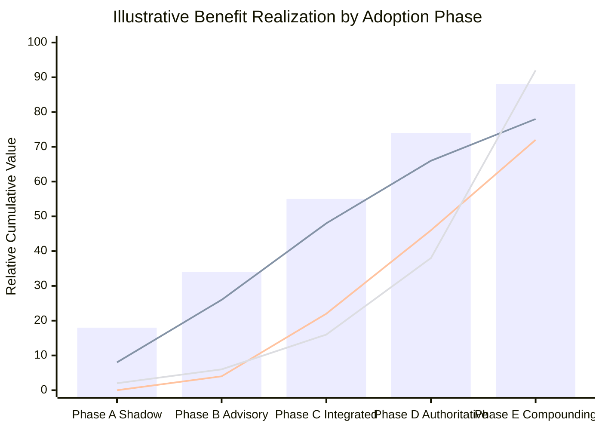

# 38. Benefits

---


**Claimed, not demonstrated.** Every benefit in this chapter is a **reasoned projection** from the framework's design properties. None has been measured in a deployed Data Swimming Pool, because none exists. Each benefit is stated with its mechanism and its falsification condition, so that readers can assess the reasoning rather than accept the claim.


## 38.1 Benefit Taxonomy

```mermaid
flowchart TB
    ROOT["<b>Benefits</b>"]
    ROOT --> B1["<b>Epistemic</b><br/>knowing things<br/>not previously knowable"]
    ROOT --> B2["<b>Temporal</b><br/>knowing them<br/>sooner"]
    ROOT --> B3["<b>Economic</b><br/>knowing them<br/>more cheaply"]
    ROOT --> B4["<b>Operational</b><br/>acting on them<br/>more effectively"]
    ROOT --> B5["<b>Institutional</b><br/>retaining and<br/>compounding knowledge"]

    B1 --> E1["Sub-threshold conjunctions detected"]
    B1 --> E2["Network structures revealed"]
    B1 --> E3["Negative relationships surfaced"]
    B1 --> E4["Correct attribution of outcomes"]

    B2 --> T1["Detection within actionability window"]
    B2 --> T2["Continuous rather than interrogative"]
    B2 --> T3["Investigation evidence pre-assembled"]

    B3 --> C1["Correlation tax eliminated"]
    B3 --> C2["Redundant computation avoided"]
    B3 --> C3["Alert triage capacity reclaimed"]

    B4 --> O1["Alert precision and volume improve together"]
    B4 --> O2["Modifiable factors identified"]
    B4 --> O3["Competing hypotheses retained"]
    B4 --> O4["Graduated, governed autonomy"]

    B5 --> I1["Relationships persist beyond individuals"]
    B5 --> I2["Confidence improves with outcomes"]
    B5 --> I3["Methodology improvable via re-correlation"]
    B5 --> I4["AI grounded in verified relationships"]

    classDef root fill:#0a5570,stroke:#3fd0f0,stroke-width:3px,color:#ffffff
    classDef cat fill:#0d4159,stroke:#22b3d6,stroke-width:2px,color:#eaf9ff
    classDef leaf fill:#183028,stroke:#4caf7d,color:#e6fff2
    class ROOT root
    class B1,B2,B3,B4,B5 cat
    class E1,E2,E3,E4,T1,T2,T3,C1,C2,C3,O1,O2,O3,O4,I1,I2,I3,I4 leaf
```

**Figure 54.** *Benefit taxonomy across five categories. The institutional category is the least immediately visible and, in the author's assessment, the most durable: an organization whose relational knowledge persists and compounds behaves differently over years than one whose knowledge evaporates with staff turnover.*

## 38.2 Benefits With Mechanisms and Falsification Conditions

| # | Benefit | Mechanism | How it would be falsified |
| --- | --- | --- | --- |
| **B1** | Detection of sub-threshold conjunctions | Multi-modal correlation over signals that individually breach no threshold | Controlled comparison shows no detection advantage over well-tuned single-signal detectors |
| **B2** | Revelation of network structures | M2 shared-attribute clustering and community detection at instance level | Detected communities prove to be artifacts of entity resolution rather than genuine coordination |
| **B3** | Surfacing of negative relationships | Declared expectations with timers, gated on source health | Absence detection produces more false positives than the events it catches justify |
| **B4** | Correct attribution of outcomes | Competing hypothesis evaluation with discriminating evidence | Attributions prove no more accurate than domain experts' judgements |
| **B5** | Detection within the actionability window | Continuous stateful evaluation rather than periodic query | Latency improvement does not translate to improved outcomes because organizations cannot act faster |
| **B6** | Investigation evidence pre-assembled | Lineage and evidence chains constructed at correlation time | Analysts do not trust pre-assembled evidence and reconstruct it anyway |
| **B7** | Correlation tax eliminated | Entity resolution and relationship discovery performed once, reused | Reuse rate is low because each consumer's requirements differ too much |
| **B8** | Alert precision and volume improve together | Clustering and multi-modal reinforcement replace independent thresholds | Compression is achieved but at unacceptable recall cost |
| **B9** | Modifiable factors identified | Cross-domain correlation includes operational and process factors | Identified factors are not actually modifiable in practice |
| **B10** | Competing hypotheses retained | Multiple scopes evaluate the same events; alternatives surfaced | Presenting alternatives degrades decision quality through choice paralysis |
| **B11** | Graduated, governed autonomy | Autonomy Ladder with reversibility gating and automatic demotion | Organizations either ignore the ladder or find L3+ unreachable in practice |
| **B12** | Institutional knowledge persistence | Correlations are durable, versioned platform assets | Persisted correlations become stale faster than they accumulate value |
| **B13** | Confidence improves with outcomes | Calibration against realized outcomes; auto-deprecation | Ground truth is too sparse or delayed for calibration to converge |
| **B14** | Methodology is improvable | W2 retrospective re-correlation under revised logic | Re-correlation cost is prohibitive, so methodology freezes in practice |
| **B15** | AI grounded in verified relationships | Correlation-grounded retrieval with citation validation | Grounding does not measurably reduce fabrication relative to document RAG |

**Table 80.** *Fifteen claimed benefits with mechanisms and falsification conditions. The author regards **B7 (correlation tax)** and **B15 (AI grounding)** as the two most likely to hold, and **B11 (graduated autonomy)** as the most likely to fail in practice — organizations tend either to over-automate or to leave everything at L2 indefinitely.*

## 38.3 Benefit Realization Over Time

**Figure 55.** *Illustrative benefit realization curve. Cost is incurred early; epistemic value appears in the advisory phase; economic value lags until correlations are integrated into production decisions; institutional value compounds and eventually dominates. **The crossover point is late**, which has a direct implication for how such a programme must be funded and governed.*


**The funding implication.** If Figure 55's shape is approximately correct, a Data Swimming Pool programme evaluated on twelve-month return will be cancelled before its principal value materializes. Organizations should either fund it on a multi-year horizon with interim epistemic milestones, or not begin.

This is a genuine argument against adoption for organizations that cannot sustain multi-year platform investment, and it should be treated as such rather than as a plea for patience.


## 38.4 Measuring Benefits

Claimed benefits are worthless without measurement. The framework proposes:

| Benefit category | Primary measure | Method | Baseline |
| --- | --- | --- | --- |
| Epistemic | Detections not achievable by incumbent detectors | Parallel run; count correlations with no single-signal equivalent | Existing detection suite |
| Temporal | Detection latency distribution | Timestamp from first constituent event to actionable output | Current time-to-detection |
| Economic — correlation tax | Analyst hours per cross-domain enquiry | Time study, before and after | Current investigation time |
| Economic — compute | Cost per acted-upon insight | Cost attribution per scope divided by actioned insights | Not currently measured |
| Operational | Alert compression ratio and precision | Alerts before / incidents after, with disposition tracking | Current alert volume and precision |
| Institutional | Correlation reuse rate | Distinct consumers per persisted correlation type | Zero (no persistence today) |
| AI grounding | Citation validation failure rate; human-rated factuality | Automated validation plus blind human rating | Document-RAG baseline |

**Table 81.** *Benefit measurement approaches. **Correlation reuse rate** is the single measure the author would prioritize: it directly tests whether correlation-as-infrastructure delivers the reuse that justifies its cost, and it has an unambiguous baseline of zero because nothing is persisted today.*

## 38.5 Benefits That Are Frequently Overclaimed

In the interest of calibration, three benefits the author deliberately does **not** claim:

**"Reduces data platform costs."** It does not. It adds a substantial cost layer. Any cost reduction comes from avoided analyst labour and avoided redundant integration work, which sit in different budgets and may not be recognized as savings.

**"Eliminates the need for domain expertise."** The opposite. Interpreting correlations, designing appropriate scopes, stratifying baselines, and assessing what a correlation could reveal all require deeper domain expertise than conventional analytics, not less.

**"Provides causal understanding."** It provides causal *hypotheses* with capped confidence ([Chapter 19](../part-2/19-event-relationships.md)). Any claim that the framework establishes causation is a misrepresentation of what observational correlation can deliver.

---


## Key Takeaways

1. **Every benefit is a reasoned projection, not a measurement**, and each is stated with its mechanism and falsification condition so the reasoning can be assessed rather than the claim accepted.
2. **Fifteen benefits span five categories** — epistemic, temporal, economic, operational, and institutional — of which the institutional category is least visible and most durable.
3. **The correlation tax and AI grounding benefits are the most likely to hold**; graduated autonomy is the most likely to fail, as organizations tend either to over-automate or to remain at L2 indefinitely.
4. **Value realization is back-loaded while cost is front-loaded.** A programme evaluated on twelve-month return will be cancelled before its principal value materializes.
5. **Organizations unable to sustain multi-year platform investment should not begin**, and this is a genuine argument against adoption rather than a plea for patience.
6. **Correlation reuse rate is the measure to prioritize**, since it directly tests the reuse premise and has an unambiguous baseline of zero.
7. **Three benefits are deliberately not claimed:** cost reduction, reduced need for domain expertise, and causal understanding. Claiming any of them would misrepresent what the framework delivers.


---

**Next:** [39. Challenges and Limitations →](39-challenges-and-limitations.md)
