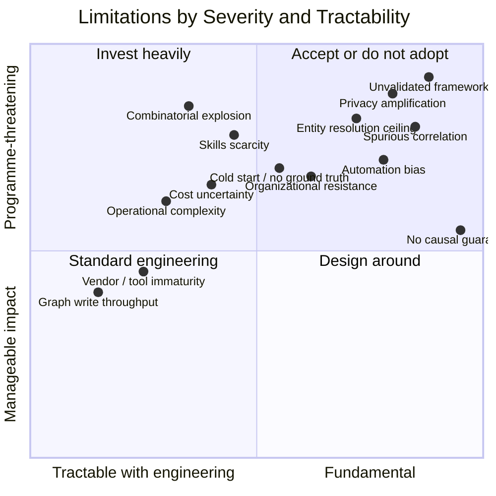

# 39. Challenges and Limitations

---


**The most important chapter in this document.** A proposal that cannot articulate its own weaknesses more precisely than its critics can has not been thought through. This chapter states the framework's limitations without mitigation-first framing — mitigations are noted where they exist, but the limitation is stated first and plainly.


## 39.1 Limitation Severity Map

**Figure 56.** *Limitations positioned by tractability and severity. The upper-right quadrant — fundamental and programme-threatening — contains **privacy amplification, unvalidated framework, spurious correlation, and entity resolution ceiling**. These cannot be engineered away. An organization must either accept them or decline to adopt.*

## 39.2 Fundamental Limitations

These are properties of the approach, not defects of a design.

### L1 — Correlation is not causation, and no amount of engineering changes this

The framework detects statistical and temporal relationships in observational data. Confounding, selection effects, and reverse causation are all indistinguishable from causal relationships without intervention. The framework caps causal confidence at 0.70 ([Chapter 19](../part-2/19-event-relationships.md)) and labels causal edges as hypotheses, but this is disclosure, not solution.

**Consequence:** every decision informed by a causal correlation carries an irreducible risk that the intervention will not produce the expected effect because the relationship was not causal.

### L2 — Combinatorial explosion is structural

Correlation cost grows super-linearly in domain count, entity cardinality, window width, and modality count simultaneously ([Chapter 26](../part-3/26-scalability.md)). Scope governance manages this by *refusing* work, which means the framework's tractability depends on organizational discipline that will erode under commercial pressure.

**Consequence:** the framework is only economically viable in organizations willing to say no to correlation requests, indefinitely.

### L3 — Correlation quality is bounded by entity resolution quality

Every correlation depends on knowing that entity X in system A is entity X in system B. Entity resolution is imperfect in every real enterprise. Errors compound: a false merge creates spurious correlations across two unrelated entities; a false split hides genuine ones.

**Consequence:** the framework's outputs inherit and *amplify* an existing weakness rather than compensating for it. Organizations with poor master data will build a system that confidently relates the wrong things.

### L4 — Privacy risk is amplified, not merely transferred

The framework manufactures inferences that were not present in any source system ([Chapter 24](../part-3/24-privacy.md)). Purpose binding, k-anonymity thresholds, and prohibited-inference registries reduce this risk substantially but cannot eliminate it, because the capability to infer is inherent to the architecture.

**Consequence:** an organization deploying this framework accepts responsibility for a class of harm — inferential harm — that its existing platforms could not have caused.

### L5 — The framework is entirely unvalidated

No production deployment. No benchmark. No independent review. No reference implementation. The design is internally coherent and built from mature components, and that is the strongest statement that can honestly be made.

**Consequence:** any organization adopting it is conducting the first experiment, at its own cost and risk.

## 39.3 Tractable but Serious Challenges

| # | Challenge | Description | Mitigation | Residual risk |
| --- | --- | --- | --- | --- |
| **C1** | Cold-start problem | Confidence calibration requires outcome feedback; outcomes are sparse and delayed at launch | Launch at L1 shadow mode; use priors; extend calibration window | Early confidence scores are unreliable and may be trusted anyway |
| **C2** | Spurious correlation at scale | Testing many hypotheses continuously produces false discoveries | Multiple-comparison correction; scope discipline; expiry; calibration | Base rate of spurious relationships remains non-zero and scales with scope count |
| **C3** | Skills scarcity | Requires streaming, graph, ML, governance, and domain expertise simultaneously | Phased build; platform team model; vendor partnership | Very few practitioners hold this combination; hiring is a real constraint |
| **C4** | Operational complexity | More moving parts than any incumbent architecture | Managed services; strong observability; runbooks | Failure modes are novel and initially unfamiliar to operators |
| **C5** | Cost uncertainty | Streaming state, graph writes, and unsampled lineage are all expensive | Cost per acted-upon insight; scope-level budgets; tiering | Costs may exceed avoided correlation tax; this is unmeasured |
| **C6** | Automation bias | Confident-looking Insight Objects induce over-reliance | Confidence display standards; disagreement tracking; periodic manual review | Human oversight degrades over time in every automated system studied |
| **C7** | Graph write throughput | Instance-level graph writes are the throughput bottleneck | Hot/cold tiering; batched writes; confidence-gated persistence | Constrains achievable correlation rate |
| **C8** | Alert absence-detection false positives | Negative correlations fire on source outages | Source-health gating; degradation-mode suppression | Gating itself can mask genuine absences |
| **C9** | Tooling immaturity | No integrated product exists; assembly required | Build on mature components with standard interfaces | Integration burden falls entirely on the adopter |
| **C10** | Organizational resistance | Cross-domain correlation exposes failures that cross ownership boundaries | Executive sponsorship; blameless framing; federated governance | Political resistance is the most common cause of platform failure and is not an engineering problem |
| **C11** | Scope creep | Each successful scope invites five more | Hard scope budget; explicit retirement; cost attribution | Discipline erodes; this is the mechanism by which L2 materializes |
| **C12** | Regulatory uncertainty | EU AI Act, evolving inference jurisprudence, sectoral rules | Conservative design; legal review; documented purpose binding | Rules may change in ways that invalidate deployed scopes |

**Table 82.** *Twelve tractable challenges with mitigations and residual risk. **C10 (organizational resistance)** deserves particular attention: it is the most common cause of data platform failure generally, and this framework is unusually exposed because its outputs frequently implicate more than one department.*

## 39.4 Failure Modes Specific to This Architecture

| Failure mode | Symptom | Root cause | Detection |
| --- | --- | --- | --- |
| **Correlation sprawl** | Hundreds of low-value scopes, rising cost, falling precision | Absent scope budget and retirement discipline | Cost per acted-upon insight rising; reuse rate falling |
| **Confidence inflation** | Everything scores high; discrimination lost | Calibration not performed against realized outcomes | Reliability curve diverges from diagonal |
| **Graph rot** | Traversals return stale, irrelevant relationships | Expiry not enforced; decay not applied | Median edge age rising; traversal precision falling |
| **Insight theatre** | Insights generated, none acted upon | Poor routing; no ownership; low trust | Action rate per insight near zero |
| **Shadow correlation** | Teams rebuild correlations outside the platform | Platform too slow, restrictive, or untrusted | Duplicate logic discovered in application code |
| **Purpose drift** | Correlations used beyond their declared purpose | Weak runtime enforcement of purpose binding | Access audit shows out-of-purpose consumption |
| **Autonomy ratchet** | Actions promoted to higher autonomy without evidence | Promotion criteria bypassed under pressure | Promotion audit; precision at time of promotion |
| **Silent degradation** | Detection quality declines without alarm | Upstream schema or semantic drift | Contract validation; correlation rate anomaly detection |

**Table 83.** *Architecture-specific failure modes. **Insight theatre** — generating insights nobody acts on — is the most likely outcome of a poorly governed deployment and is also the hardest to admit, because the platform appears to be working.*

## 39.5 When Not to Adopt


**Do not adopt this framework if any of the following is true.**

1. Your data quality and entity resolution are not already good. The framework amplifies both.
2. Your cross-domain questions are few, stable, and already answered adequately.
3. You cannot sustain a multi-year investment horizon.
4. You cannot staff streaming, graph, ML, and governance expertise simultaneously.
5. You are not prepared to refuse correlation requests indefinitely.
6. Your regulatory environment prohibits the inferences that would create value.
7. Your organizational culture punishes the surfacing of cross-departmental failures.
8. You need a supported product with a vendor to call. This is a design, not a product.

Any one of these is sufficient reason to extend an existing architecture instead.


## 39.6 What Would Change the Author's Assessment

Intellectual honesty requires stating what evidence would revise the position:

- **Against the framework:** a controlled comparison showing well-instrumented incumbent architectures achieve equivalent cross-domain detection at materially lower cost; or evidence that persisted correlations achieve reuse rates below approximately 2 consumers per correlation type; or demonstration that spurious-correlation rates remain unacceptable under realistic scope counts despite correction.
- **For the framework:** a reference implementation achieving the proposed SLOs at realistic scale; sustained calibration convergence in a domain with delayed ground truth; alert compression above 5:1 with recall preserved.

The author's honest expectation is that the framework's *concepts* — persisted scored correlations, correlation scopes as governance objects, the Autonomy Ladder, correlation-grounded RAG — will prove more durable than the framework as a whole. Being absorbed into existing platforms would be a satisfactory outcome.

---


## Key Takeaways

1. **Five limitations are fundamental and cannot be engineered away:** correlation is not causation, combinatorial explosion is structural, quality is bounded by entity resolution, privacy risk is amplified, and the framework is entirely unvalidated.
2. **Organizations with poor master data will build a system that confidently relates the wrong things.** The framework amplifies existing weaknesses rather than compensating for them.
3. **Deploying this framework means accepting responsibility for inferential harm** — a class of harm existing platforms could not have caused.
4. **Tractability depends on organizational discipline that erodes under commercial pressure**, which makes scope creep the mechanism by which combinatorial explosion actually materializes.
5. **Organizational resistance, not engineering difficulty, is the most likely cause of failure**, because correlation outputs routinely implicate more than one department.
6. **Insight theatre is the most probable failure of a poorly governed deployment** and the hardest to detect, because the platform appears to be working.
7. **Eight conditions each independently disqualify adoption**, and any organization meeting one should extend an existing architecture instead.
8. **The author expects the concepts to outlast the framework.** Absorption of persisted correlations, correlation scopes, the Autonomy Ladder, and correlation-grounded retrieval into existing platforms would be a satisfactory outcome.


---

**Next:** [40. Future Roadmap →](40-future-roadmap.md)
