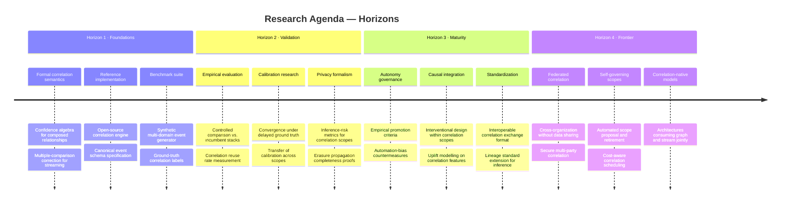
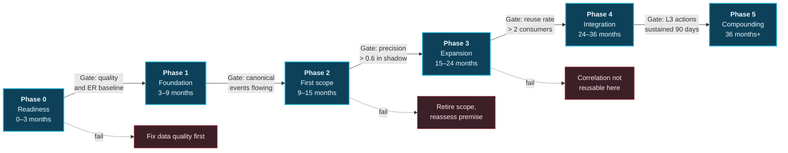

# 40. Future Roadmap

---

## 40.1 Two Roadmaps

This chapter presents two distinct roadmaps that should not be conflated:

- **The research roadmap** — open problems the author cannot solve alone and invites the community to address.
- **The adoption roadmap** — a phased path for an organization that has read [Chapter 39](39-challenges-and-limitations.md) and still wishes to proceed.

## 40.2 Research Roadmap

**Figure 57.** *Research agenda across four horizons. Horizon 1 items are prerequisites for anything else: **without a benchmark suite and a reference implementation, none of the framework's claims can be tested by anyone other than an organization willing to fund a full build.** That is the single largest barrier to the framework being taken seriously.*

### Priority open problems

| # | Problem | Why it matters | Discipline |
| --- | --- | --- | --- |
| **R1** | Confidence algebra for composed correlations | Chained relationships currently use a conservative product rule with no theoretical justification | Statistics, probabilistic reasoning |
| **R2** | Multiple-comparison correction for continuous, unbounded hypothesis spaces | Classical FDR control assumes a fixed hypothesis set; correlation scopes generate hypotheses continuously | Statistics |
| **R3** | Inference-risk quantification for a correlation scope | Governance currently relies on human judgement about what a scope could reveal | Privacy engineering, formal methods |
| **R4** | Calibration convergence under sparse, delayed ground truth | Healthcare, credit, and safety domains may never provide enough labels | Machine learning |
| **R5** | Automated scope cost-benefit scheduling | Scope admission is currently a manual governance decision | Systems, optimization |
| **R6** | Federated correlation without data movement | Cross-organization correlation has clear value and no acceptable mechanism | Cryptography, distributed systems |
| **R7** | Automation-bias countermeasures that survive routine use | Every known countermeasure degrades as operators habituate | Human factors |
| **R8** | Standard exchange format for scored, expiring relationships | No interoperable representation exists | Standards bodies |

**Table 84.** *Priority open problems. **R2 and R3 are the two the author considers most urgent**: without principled multiple-comparison control, spurious correlation undermines the framework's credibility; without inference-risk quantification, privacy governance remains subjective.*

## 40.3 Adoption Roadmap

**Figure 58.** *Phased adoption with explicit exit gates. **The exit paths are as important as the progression paths.** A programme without a defined way to conclude that the premise does not hold in its context will continue consuming resources long after that conclusion should have been drawn.*

| Phase | Duration | Objective | Key deliverables | Exit gate |
| --- | --- | --- | --- | --- |
| **0 — Readiness** | 0–3 mo | Determine whether to proceed at all | Data quality baseline; entity resolution assessment; correlation tax measurement; disqualifier review (§39.5) | No disqualifier present; ER accuracy above agreed threshold |
| **1 — Foundation** | 3–9 mo | Canonical events and metadata | Canonical event schema; 3–5 sources ingested with contracts; entity resolution service; metadata and lineage plane; governance body constituted | Canonical events flowing with lineage; contracts enforced |
| **2 — First scope** | 9–15 mo | One scope, shadow mode only | Single high-value cross-domain scope; correlation engine (M1 + M2); confidence scoring; Insight Object; L1 shadow operation; disposition tracking | Precision above 0.6 with expert adjudication over 90 days |
| **3 — Expansion** | 15–24 mo | Prove reuse | 3–5 scopes; knowledge graph hot tier; M3/M4 modalities; alert clustering; L2 advisory operation; correlation-grounded RAG | Reuse rate above 2 consumers per correlation type |
| **4 — Integration** | 24–36 mo | Production decision integration | Batch layer W1–W4; multi-region HA; calibration loop closed; first L3 actions with reversibility windows; full autonomy governance | L3 actions sustained 90 days without demotion |
| **5 — Compounding** | 36 mo+ | Institutional capability | Scope portfolio management; retrospective re-correlation cycles; cross-domain agent operation; L4 in narrow reversible domains | Ongoing; measured by cost per acted-upon insight trend |

**Table 85.** *Adoption phases with objectives, deliverables, and gates. Note that **Phase 2 delivers exactly one scope in shadow mode after fifteen months.** Any vendor or internal proposal promising materially faster time-to-value for a correlation platform should be treated with suspicion.*

## 40.4 Anti-Patterns in Adoption Sequencing

| Anti-pattern | Why it fails |
| --- | --- |
| Building the knowledge graph first | Without canonical events and entity resolution, the graph encodes existing inconsistency |
| Starting with AI/LLM layer | Grounding requires a correlation substrate that does not yet exist; result is document RAG with extra steps |
| Launching multiple scopes simultaneously | No capacity to adjudicate precision; failures cannot be attributed |
| Skipping shadow mode | Trust is destroyed by early false positives and is very difficult to rebuild |
| Deferring governance to Phase 3 | Scopes deployed without purpose binding cannot be retrofitted; erasure obligations accumulate |
| Treating it as a tooling procurement | No product exists; the work is architecture and governance, not purchase |
| Measuring only technical metrics | Latency and throughput are satisfied long before value is delivered |

**Table 86.** *Adoption anti-patterns. The first two are the most common, because they are the most visible and demonstrable to executives — and both produce impressive demonstrations that cannot scale into production value.*

## 40.5 Technology Evolution That Would Help

| Development | Effect on the framework |
| --- | --- |
| Streaming engines with native graph state | Removes the graph write bottleneck ([C7](39-challenges-and-limitations.md)) |
| Cheaper long-horizon streaming state | Widens economically viable correlation windows |
| Standardized inference lineage | Reduces bespoke metadata engineering |
| Practical secure multi-party computation at event scale | Enables federated correlation (R6) |
| Regulator-published guidance on inferred data | Reduces the largest source of legal uncertainty |
| Smaller models with strong structured-data reasoning | Reduces cost of the insight layer and improves grounding fidelity |
| Mature open-source entity resolution | Addresses the framework's most binding quality constraint |

**Table 87.** *External developments that would materially improve the framework's viability. Mature open-source entity resolution would have the largest single effect, because [L3](39-challenges-and-limitations.md) bounds everything downstream.*

## 40.6 An Invitation

This framework is published without patent, licence restriction, or commercial interest. The author invites:

- **Critique** — particularly arguments that the correlation tax is smaller than claimed, or that incumbent architectures already address it adequately.
- **Implementation** — any partial implementation, especially of the correlation engine and confidence calibration.
- **Absorption** — adoption of individual concepts into existing platforms, with or without attribution to this framework.
- **Empirical testing** — the falsification conditions in [Chapter 38](38-benefits.md) and [§39.6](39-challenges-and-limitations.md) are stated precisely so that they can be tested.

---


## Key Takeaways

1. **Two roadmaps must not be conflated:** a research agenda addressing problems the author cannot solve alone, and an adoption path for organizations that have read the limitations and still wish to proceed.
2. **A benchmark suite and reference implementation are prerequisites for everything else**, and their absence is the single largest barrier to the framework being taken seriously.
3. **Principled multiple-comparison control and inference-risk quantification are the two most urgent open problems**, one governing credibility and the other governing privacy legitimacy.
4. **Adoption exit gates matter as much as progression gates.** A programme with no defined way to conclude the premise does not hold will consume resources long past that point.
5. **Phase 2 delivers one scope in shadow mode after fifteen months.** Any proposal promising materially faster time-to-value for a correlation platform warrants suspicion.
6. **Building the graph first or starting with the AI layer are the most common sequencing failures**, precisely because both produce impressive demonstrations that cannot scale.
7. **Mature open-source entity resolution would improve the framework's viability more than any other external development**, because entity resolution quality bounds everything downstream.
8. **The framework is published without patent or commercial interest**, and absorption of its concepts into existing platforms is an explicitly welcome outcome.


---

**Next:** [41. Conclusion →](41-conclusion.md)
