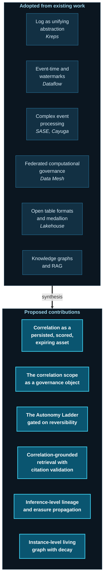

# 41. Conclusion

---

## 41.1 The Argument in Full

Six decades of enterprise data architecture have systematically removed constraints. Databases removed the constraint of navigational access. Warehouses removed the constraint of analysis competing with operations. Lakes removed the constraint of schema-before-storage. Lakehouses removed the trade-off between transactional reliability and open storage. Fabric removed the constraint of physical consolidation. Mesh removed the constraint of centralized ownership. Event streaming removed the constraint of batch periodicity.

Each generation solved a real problem. None addressed the one that this document is about.

**Across every generation, the relationship between two pieces of data has remained something a consumer computes at query time and then discards.** The join is written in a notebook. The correlation is established in an investigation. The connection is understood by an analyst. And then the notebook is archived, the investigation closes, the analyst leaves, and the relationship — which was the actual knowledge produced — is gone. The events remain. What they meant together does not.

The consequences are visible in every large organization and are usually attributed to other causes. Cross-domain questions that take weeks are attributed to data quality. Alert floods are attributed to tuning. Ungrounded AI is attributed to model limitations. Missed compound risks are attributed to insufficient monitoring. In each case the more precise diagnosis is the same: **the platform stores facts and not relationships, so every consumer reconstructs relationships independently, incompletely, and without persistence.**

The Data Swimming Pool proposes a single structural change with wide consequences: **treat the relationship between events as a first-class, persisted, scored, governed, and expiring platform asset.** Everything else in this document — the correlation engine, the confidence pipeline, the living knowledge graph, the Insight Object, the Autonomy Ladder, correlation scopes as governance objects, inference-level lineage — follows from taking that commitment seriously and asking what it requires.

## 41.2 What Is Genuinely New

**Figure 59.** *Separation of adopted foundations from proposed contributions. **The framework's originality lies in the right-hand box and in the composition, not in the underlying technologies**, all of which are established. A reader who concludes that the six proposed contributions are the durable part of this work, and the framework itself merely the vehicle that carried them, would not be misreading the author's own assessment.*

## 41.3 What This Document Does Not Establish

To close as it opened — with the claim properly bounded:

- It does not establish that the architecture works. Nothing has been built.
- It does not establish that the benefits exceed the costs. Neither has been measured.
- It does not establish that the correlation tax is as large as claimed. That figure is an estimate.
- It does not establish that most organizations should adopt this. [Chapter 39](39-challenges-and-limitations.md) argues that most should not.
- It does not establish causation from correlation, and no version of it ever will.

What it does offer is a coherent design, built from mature components, addressing a gap the author believes is real, stated precisely enough to be tested and, if wrong, refuted.

## 41.4 The Case for Restraint

A framework that manufactures inferences about people carries obligations that a framework which merely stores facts does not.

The Data Swimming Pool can determine that a customer is probably in financial distress before they disclose it, that a patient is deteriorating before clinical thresholds breach, that a household is under compound institutional pressure, that a subscriber is disengaging before they churn. Each of these capabilities can serve the subject or exploit them. **The architecture is indifferent; only governance is not.**

This is why the framework places policy enforcement at correlation formation rather than at consumption, why purpose binding intersects rather than unions, why prohibited-inference registries are architectural components rather than policy documents, why the Autonomy Ladder is gated on reversibility rather than accuracy, and why several chapters state prohibitions more forcefully than capabilities.


**The uncomfortable conclusion.** The organizations most capable of building this architecture — those with the data, the scale, and the engineering capacity — are frequently those whose commercial or institutional incentives are least aligned with using it restrainedly.

The author has no solution to this. Stating it plainly is the least that intellectual honesty requires, and it is a reason to hope the framework's governance concepts are adopted at least as widely as its capabilities.


## 41.5 Closing

Enterprise data platforms have become extraordinarily good at accumulation. An organization can today store every event it generates, at low cost, indefinitely, with transactional guarantees and full governance.

It still cannot readily say what those events mean in relation to one another.

That gap is the subject of this whitepaper. Whether the Data Swimming Pool is the right answer to it is genuinely uncertain and will not be settled by argument. What the author does hold with some confidence is that the question is the correct one, that the industry has been answering a different question well for sixty years, and that **the next meaningful advance in enterprise data architecture will come from treating relationships as infrastructure rather than as a query result.**

If this document contributes only that reframing, and every architectural proposal within it is superseded by better designs from people who build them, it will have done its work.

---

*Water in a lake is stored.*
*Water in a swimming pool is circulated, filtered, monitored, and used.*
*The difference is not the water. It is what the system does with it.*

---


## Key Takeaways

1. **Every generation of data architecture removed a real constraint, and none addressed relationship persistence.** The join is computed by the consumer and discarded, in every paradigm from the relational database to the data mesh.
2. **Symptoms usually attributed to data quality, alert tuning, or model limitations share one structural cause:** platforms store facts, not relationships, so every consumer reconstructs relationships independently and without persistence.
3. **The framework's single structural commitment** — relationships as persisted, scored, governed, expiring assets — generates every other component in the design.
4. **Six contributions are genuinely proposed;** the underlying technologies are all established, and the originality lies in the composition.
5. **The document establishes a coherent, testable design and nothing more.** It does not establish that the architecture works, that benefits exceed costs, or that most organizations should adopt it.
6. **The architecture is indifferent to whether its inferences serve or exploit their subjects; only governance is not** — which is why policy sits at correlation formation and autonomy is gated on reversibility.
7. **Those most capable of building this are often least incentivized to build it restrainedly**, a problem the author states plainly without claiming to solve.
8. **The reframing is the contribution.** If relationships come to be treated as infrastructure rather than as a query result, the specific designs proposed here are expendable.


---

**Next:** [42. References →](42-references.md)
